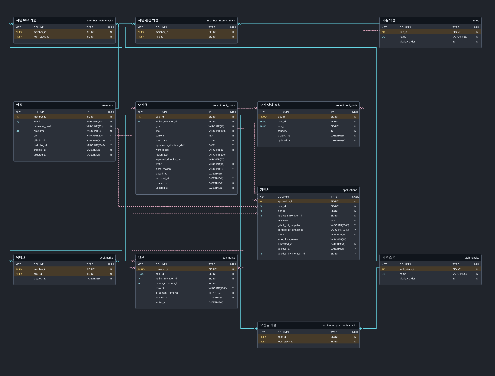

# DevPedia — 데이터베이스와 물리 ERD

> V1 보완본 · 공통 경계 정책: [09 확정 정책](09_확정정책_경계조건.md) · 구현 순서: [08 Slice 계획](08_구현_순서_완료조건.md)

- [1. 모델과 읽는 방법](#1-모델과-읽는-방법)
- [2. 컬럼 사전](#2-컬럼-사전)
- [3. 키와 관계](#3-키와-관계)
- [4. 최초 스키마](#4-최초-스키마)
- [5. 최초 기준 데이터](#5-최초-기준-데이터)
- [6. JPA 매핑](#6-jpa-매핑)
- [7. 스키마 확인](#7-스키마-확인)

## 1. 모델과 읽는 방법

MySQL 8.0.16 이상, InnoDB, utf8mb4. 총 **11개 테이블**이다. 프로필은 members에 포함하며 별도 계정 자격·공개 프로필 테이블을 만들지 않는다. PK는 signed BIGINT, Java Long이다. 단독 PK는 AUTO_INCREMENT, 연결 테이블은 복합 PK다.

[물리 ERD 원본 열기](03_물리_ERD.svg)

[논리 ERD](03_논리_ERD.svg) · [영역별 물리 ERD 탐색](ERD_탐색.html)



논리 ERD는 한국어 업무 속성을, 물리 ERD는 SQL 컬럼과 타입을 보여준다. 전체 도면에 11개 테이블을 한 번씩 배치하고 18개 FK 관계를 직접 연결한다. 실선은 식별 관계, 점선은 비식별 관계다. 선택 부모는 0..1이며 각 부모의 자식은 0..N이다. 복합 UNIQUE/FK와 CHECK는 아래 DDL을 기준으로 한다. 영역별 컬럼 상세도도 함께 제공한다.

## 2. 컬럼 사전

NN = NOT NULL, NULL = null 허용. 기본값 없는 컬럼은 애플리케이션이 값을 넣는다. 시각은 DATETIME(6)에 UTC로 저장한다. 업무 날짜는 서울 기준 DATE다. 

### `members`

| 컬럼              | SQL 타입        | NULL·기본값                | 의미                    |
| --------------- | ------------- | ----------------------- | --------------------- |
| `member_id`     | BIGINT        | NOT NULL AUTO_INCREMENT | 회원 ID                 |
| `email`         | VARCHAR(254)  | NOT NULL                | 로그인 이메일; trim·소문자, 유일 |
| `password_hash` | VARCHAR(255)  | NOT NULL                | BCrypt 비밀번호 해시        |
| `nickname`      | VARCHAR(30)   | NOT NULL                | 공개 닉네임; trim, 유일      |
| `bio`           | VARCHAR(500)  | NULL                    | 공개 소개                 |
| `github_url`    | VARCHAR(2048) | NULL                    | 공개 GitHub URL         |
| `portfolio_url` | VARCHAR(2048) | NULL                    | 공개 포트폴리오 URL          |
| `created_at`    | DATETIME(6)   | NOT NULL                | 생성 시각(UTC)            |
| `updated_at`    | DATETIME(6)   | NOT NULL                | 최근 변경 시각(UTC)         |

### `roles`

| 컬럼 | SQL 타입 | NULL·기본값 | 의미 |
|---|---|---|---|
| `role_id` | BIGINT | NOT NULL AUTO_INCREMENT | 기준 역할 ID |
| `name` | VARCHAR(50) | NOT NULL | 표시 이름 |
| `display_order` | INT | NOT NULL DEFAULT 0 | 목록 표시 순서 |

### `tech_stacks`

| 컬럼 | SQL 타입 | NULL·기본값 | 의미 |
|---|---|---|---|
| `tech_stack_id` | BIGINT | NOT NULL AUTO_INCREMENT | 기준 기술 ID |
| `name` | VARCHAR(50) | NOT NULL | 표시 이름 |
| `display_order` | INT | NOT NULL DEFAULT 0 | 목록 표시 순서 |

### `member_interest_roles`

| 컬럼 | SQL 타입 | NULL·기본값 | 의미 |
|---|---|---|---|
| `member_id` | BIGINT | NOT NULL | 회원 ID |
| `role_id` | BIGINT | NOT NULL | 기준 역할 ID |

### `member_tech_stacks`

| 컬럼 | SQL 타입 | NULL·기본값 | 의미 |
|---|---|---|---|
| `member_id` | BIGINT | NOT NULL | 회원 ID |
| `tech_stack_id` | BIGINT | NOT NULL | 기준 기술 ID |

### `recruitment_posts`

| 컬럼 | SQL 타입 | NULL·기본값 | 의미 |
|---|---|---|---|
| `post_id` | BIGINT | NOT NULL AUTO_INCREMENT | 모집글 ID |
| `author_member_id` | BIGINT | NOT NULL | 작성 회원 ID |
| `type` | VARCHAR(16) | NOT NULL | PROJECT / STUDY |
| `title` | VARCHAR(100) | NOT NULL | 모집 제목 |
| `content` | TEXT | NOT NULL | 본문 내용 |
| `start_date` | DATE | NOT NULL | 활동 시작일 |
| `application_deadline_date` | DATE | NULL | 지원 마감일(선택) |
| `work_mode` | VARCHAR(16) | NOT NULL | ONLINE / OFFLINE / HYBRID |
| `region_text` | VARCHAR(100) | NULL | 활동 지역 설명 |
| `expected_duration_text` | VARCHAR(50) | NULL | 예상 활동 기간 설명 |
| `status` | VARCHAR(16) | NOT NULL DEFAULT 'OPEN' | 해당 도메인의 상태값 |
| `close_reason` | VARCHAR(24) | NULL | OWNER / ALL_ROLES_FILLED |
| `closed_at` | DATETIME(6) | NULL | 직접 또는 정원 충족 마감 시각 |
| `removed_at` | DATETIME(6) | NULL | 공개 제거 시각 |
| `created_at` | DATETIME(6) | NOT NULL | 생성 시각(UTC) |
| `updated_at` | DATETIME(6) | NOT NULL | 최근 변경 시각(UTC) |

### `recruitment_slots`

| 컬럼 | SQL 타입 | NULL·기본값 | 의미 |
|---|---|---|---|
| `slot_id` | BIGINT | NOT NULL AUTO_INCREMENT | 해당 글의 모집 역할 ID |
| `post_id` | BIGINT | NOT NULL | 모집글 ID |
| `role_id` | BIGINT | NOT NULL | 기준 역할 ID |
| `capacity` | INT | NOT NULL | 역할별 모집 정원 1..20 |
| `created_at` | DATETIME(6) | NOT NULL | 생성 시각(UTC) |
| `updated_at` | DATETIME(6) | NOT NULL | 최근 변경 시각(UTC) |

### `recruitment_post_tech_stacks`

| 컬럼 | SQL 타입 | NULL·기본값 | 의미 |
|---|---|---|---|
| `post_id` | BIGINT | NOT NULL | 모집글 ID |
| `tech_stack_id` | BIGINT | NOT NULL | 기준 기술 ID |

### `applications`

| 컬럼 | SQL 타입 | NULL·기본값 | 의미 |
|---|---|---|---|
| `application_id` | BIGINT | NOT NULL AUTO_INCREMENT | 지원서 ID |
| `post_id` | BIGINT | NOT NULL | 모집글 ID |
| `slot_id` | BIGINT | NOT NULL | 해당 글의 모집 역할 ID |
| `applicant_member_id` | BIGINT | NOT NULL | 지원 회원 ID |
| `motivation` | TEXT | NOT NULL | 지원 동기 |
| `github_url_snapshot` | VARCHAR(2048) | NULL | 제출 당시 GitHub URL |
| `portfolio_url_snapshot` | VARCHAR(2048) | NULL | 제출 당시 포트폴리오 URL |
| `status` | VARCHAR(16) | NOT NULL DEFAULT 'UNDER_REVIEW' | 해당 도메인의 상태값 |
| `auto_close_reason` | VARCHAR(16) | NULL | ROLE_FILLED / POST_CLOSED / POST_REMOVED |
| `submitted_at` | DATETIME(6) | NOT NULL | 지원 제출 시각 |
| `decided_at` | DATETIME(6) | NULL | 검토 종료 시각 |
| `decided_by_member_id` | BIGINT | NULL | 승인·거절·철회 수행 회원 ID |

### `comments`

| 컬럼 | SQL 타입 | NULL·기본값 | 의미 |
|---|---|---|---|
| `comment_id` | BIGINT | NOT NULL AUTO_INCREMENT | 댓글 ID |
| `post_id` | BIGINT | NOT NULL | 모집글 ID |
| `author_member_id` | BIGINT | NOT NULL | 작성 회원 ID |
| `parent_comment_id` | BIGINT | NULL | 같은 글의 루트 댓글 ID; 루트면 null |
| `content` | VARCHAR(1000) | NULL | 본문 또는 댓글 내용 |
| `is_content_removed` | TINYINT(1) | NOT NULL DEFAULT 0 | 답글이 있는 루트의 내용 제거 여부 |
| `created_at` | DATETIME(6) | NOT NULL | 생성 시각(UTC) |
| `edited_at` | DATETIME(6) | NULL | 댓글 내용 수정 시각; 미수정이면 null |

### `bookmarks`

| 컬럼 | SQL 타입 | NULL·기본값 | 의미 |
|---|---|---|---|
| `member_id` | BIGINT | NOT NULL | 회원 ID |
| `post_id` | BIGINT | NOT NULL | 모집글 ID |
| `created_at` | DATETIME(6) | NOT NULL | 생성 시각(UTC) |

## 3. 키와 관계

회원의 관심 역할·기술, 모집글의 기술, 북마크는 연결 테이블의 복합 PK로 중복 연결을 막는다. 모집 역할은 UNIQUE(post_id,role_id)로 동일 글의 역할 중복을 막는다. 지원서는 복합 FK(slot_id,post_id)로 해당 역할이 그 글에 속하도록 한다. 댓글 부모도 복합 FK(parent_comment_id,post_id)로 같은 글 소속을 보장한다. 답글 깊이는 서비스에서 검사한다.

승인 수는 applications 중 APPROVED를 집계하고 별도 카운터 컬럼을 두지 않는다. 모집 역할 status는 응답 계산값이며 DB 컬럼이 아니다. 모든 FK는 기본 RESTRICT이고 글 제거는 공개 상태 변경이다. 연관 데이터의 삭제·표시 처리는 09의 공개 제거 정책을 적용한다.

## 4. 최초 스키마

아래 SQL은 빈 개발 DB의 테이블 생성 기준이다. 운영 변경·데이터 마이그레이션 절차는 포함하지 않는다. 테이블 블록은 devpedia_test를 선택한 뒤 동일하게 적용한다. 동일 내용을 sql/001_schema.sql과 sql/002_seed.sql로 제공한다. 후속 변경은 번호가 있는 별도 SQL로 기록한다.

```sql
CREATE DATABASE devpedia CHARACTER SET utf8mb4 COLLATE utf8mb4_0900_ai_ci;
CREATE DATABASE devpedia_test CHARACTER SET utf8mb4 COLLATE utf8mb4_0900_ai_ci;
USE devpedia;
CREATE TABLE members (
  member_id BIGINT NOT NULL AUTO_INCREMENT,
  email VARCHAR(254) COLLATE utf8mb4_0900_as_cs NOT NULL,
  password_hash VARCHAR(255) NOT NULL,
  nickname VARCHAR(30) COLLATE utf8mb4_0900_as_cs NOT NULL,
  bio VARCHAR(500) NULL,
  github_url VARCHAR(2048) NULL,
  portfolio_url VARCHAR(2048) NULL,
  created_at DATETIME(6) NOT NULL,
  updated_at DATETIME(6) NOT NULL,
  PRIMARY KEY (member_id),
  CONSTRAINT uq_member_email UNIQUE (email),
  CONSTRAINT uq_member_nickname UNIQUE (nickname)
) ENGINE=InnoDB DEFAULT CHARSET=utf8mb4 COLLATE=utf8mb4_0900_ai_ci;

CREATE TABLE roles (
  role_id BIGINT NOT NULL AUTO_INCREMENT,
  name VARCHAR(50) NOT NULL,
  display_order INT NOT NULL DEFAULT 0,
  PRIMARY KEY (role_id),
  CONSTRAINT uq_roles_name UNIQUE (name),
  CONSTRAINT ck_roles_order CHECK (display_order >= 0)
) ENGINE=InnoDB DEFAULT CHARSET=utf8mb4 COLLATE=utf8mb4_0900_ai_ci;

CREATE TABLE tech_stacks (
  tech_stack_id BIGINT NOT NULL AUTO_INCREMENT,
  name VARCHAR(50) NOT NULL,
  display_order INT NOT NULL DEFAULT 0,
  PRIMARY KEY (tech_stack_id),
  CONSTRAINT uq_tech_stacks_name UNIQUE (name),
  CONSTRAINT ck_tech_stacks_order CHECK (display_order >= 0)
) ENGINE=InnoDB DEFAULT CHARSET=utf8mb4 COLLATE=utf8mb4_0900_ai_ci;

CREATE TABLE member_interest_roles (
  member_id BIGINT NOT NULL,
  role_id BIGINT NOT NULL,
  PRIMARY KEY (member_id, role_id),
  CONSTRAINT fk_member_interest_roles_member FOREIGN KEY (member_id) REFERENCES members (member_id) ON DELETE RESTRICT ON UPDATE RESTRICT,
  CONSTRAINT fk_member_interest_roles_ref FOREIGN KEY (role_id) REFERENCES roles (role_id) ON DELETE RESTRICT ON UPDATE RESTRICT
) ENGINE=InnoDB DEFAULT CHARSET=utf8mb4 COLLATE=utf8mb4_0900_ai_ci;

CREATE TABLE member_tech_stacks (
  member_id BIGINT NOT NULL,
  tech_stack_id BIGINT NOT NULL,
  PRIMARY KEY (member_id, tech_stack_id),
  CONSTRAINT fk_member_tech_stacks_member FOREIGN KEY (member_id) REFERENCES members (member_id) ON DELETE RESTRICT ON UPDATE RESTRICT,
  CONSTRAINT fk_member_tech_stacks_ref FOREIGN KEY (tech_stack_id) REFERENCES tech_stacks (tech_stack_id) ON DELETE RESTRICT ON UPDATE RESTRICT
) ENGINE=InnoDB DEFAULT CHARSET=utf8mb4 COLLATE=utf8mb4_0900_ai_ci;

CREATE TABLE recruitment_posts (
  post_id BIGINT NOT NULL AUTO_INCREMENT,
  author_member_id BIGINT NOT NULL,
  type VARCHAR(16) NOT NULL,
  title VARCHAR(100) NOT NULL,
  content TEXT NOT NULL,
  start_date DATE NOT NULL,
  application_deadline_date DATE NULL,
  work_mode VARCHAR(16) NOT NULL,
  region_text VARCHAR(100) NULL,
  expected_duration_text VARCHAR(50) NULL,
  status VARCHAR(16) NOT NULL DEFAULT 'OPEN',
  close_reason VARCHAR(24) NULL,
  closed_at DATETIME(6) NULL,
  removed_at DATETIME(6) NULL,
  created_at DATETIME(6) NOT NULL,
  updated_at DATETIME(6) NOT NULL,
  PRIMARY KEY (post_id),
  CONSTRAINT fk_post_author FOREIGN KEY (author_member_id) REFERENCES members (member_id) ON DELETE RESTRICT ON UPDATE RESTRICT,
  CONSTRAINT ck_post_type CHECK (type IN ('PROJECT','STUDY')),
  CONSTRAINT ck_post_mode CHECK (work_mode IN ('ONLINE','OFFLINE','HYBRID')),
  CONSTRAINT ck_post_status CHECK (status IN ('OPEN','CLOSED','REMOVED')),
  CONSTRAINT ck_post_dates CHECK (application_deadline_date IS NULL OR application_deadline_date < start_date),
  CONSTRAINT ck_post_close CHECK ((status='OPEN' AND close_reason IS NULL AND closed_at IS NULL AND removed_at IS NULL) OR (status='CLOSED' AND close_reason IS NOT NULL AND closed_at IS NOT NULL AND removed_at IS NULL) OR (status='REMOVED' AND removed_at IS NOT NULL AND ((close_reason IS NULL AND closed_at IS NULL) OR (close_reason IS NOT NULL AND closed_at IS NOT NULL)))),
  CONSTRAINT ck_post_reason CHECK (close_reason IS NULL OR close_reason IN ('OWNER','ALL_ROLES_FILLED')),
  KEY ix_post_created (created_at DESC, post_id DESC),
  KEY ix_post_author (author_member_id, created_at DESC, post_id DESC),
  KEY ix_post_status_start (status, start_date, post_id),
  KEY ix_post_status_deadline (status, application_deadline_date, post_id)
) ENGINE=InnoDB DEFAULT CHARSET=utf8mb4 COLLATE=utf8mb4_0900_ai_ci;

CREATE TABLE recruitment_slots (
  slot_id BIGINT NOT NULL AUTO_INCREMENT,
  post_id BIGINT NOT NULL,
  role_id BIGINT NOT NULL,
  capacity INT NOT NULL,
  created_at DATETIME(6) NOT NULL,
  updated_at DATETIME(6) NOT NULL,
  PRIMARY KEY (slot_id),
  CONSTRAINT uq_slot_post_role UNIQUE (post_id, role_id),
  CONSTRAINT uq_slot_id_post UNIQUE (slot_id, post_id),
  CONSTRAINT fk_slot_post FOREIGN KEY (post_id) REFERENCES recruitment_posts (post_id) ON DELETE RESTRICT ON UPDATE RESTRICT,
  CONSTRAINT fk_slot_role FOREIGN KEY (role_id) REFERENCES roles (role_id) ON DELETE RESTRICT ON UPDATE RESTRICT,
  CONSTRAINT ck_slot_capacity CHECK (capacity BETWEEN 1 AND 20)
) ENGINE=InnoDB DEFAULT CHARSET=utf8mb4 COLLATE=utf8mb4_0900_ai_ci;

CREATE TABLE recruitment_post_tech_stacks (
  post_id BIGINT NOT NULL,
  tech_stack_id BIGINT NOT NULL,
  PRIMARY KEY (post_id, tech_stack_id),
  CONSTRAINT fk_posttech_post FOREIGN KEY (post_id) REFERENCES recruitment_posts (post_id) ON DELETE RESTRICT ON UPDATE RESTRICT,
  CONSTRAINT fk_posttech_tech FOREIGN KEY (tech_stack_id) REFERENCES tech_stacks (tech_stack_id) ON DELETE RESTRICT ON UPDATE RESTRICT
) ENGINE=InnoDB DEFAULT CHARSET=utf8mb4 COLLATE=utf8mb4_0900_ai_ci;

CREATE TABLE applications (
  application_id BIGINT NOT NULL AUTO_INCREMENT,
  post_id BIGINT NOT NULL,
  slot_id BIGINT NOT NULL,
  applicant_member_id BIGINT NOT NULL,
  motivation TEXT NOT NULL,
  github_url_snapshot VARCHAR(2048) NULL,
  portfolio_url_snapshot VARCHAR(2048) NULL,
  status VARCHAR(16) NOT NULL DEFAULT 'UNDER_REVIEW',
  auto_close_reason VARCHAR(16) NULL,
  submitted_at DATETIME(6) NOT NULL,
  decided_at DATETIME(6) NULL,
  decided_by_member_id BIGINT NULL,
  PRIMARY KEY (application_id),
  CONSTRAINT fk_app_post FOREIGN KEY (post_id) REFERENCES recruitment_posts (post_id) ON DELETE RESTRICT ON UPDATE RESTRICT,
  CONSTRAINT fk_app_slot_post FOREIGN KEY (slot_id, post_id) REFERENCES recruitment_slots (slot_id, post_id) ON DELETE RESTRICT ON UPDATE RESTRICT,
  CONSTRAINT fk_app_member FOREIGN KEY (applicant_member_id) REFERENCES members (member_id) ON DELETE RESTRICT ON UPDATE RESTRICT,
  CONSTRAINT fk_app_decider FOREIGN KEY (decided_by_member_id) REFERENCES members (member_id) ON DELETE RESTRICT ON UPDATE RESTRICT,
  CONSTRAINT ck_app_state CHECK ((status='UNDER_REVIEW' AND decided_at IS NULL AND decided_by_member_id IS NULL AND auto_close_reason IS NULL) OR (status IN ('APPROVED','REJECTED','WITHDRAWN') AND decided_at IS NOT NULL AND decided_by_member_id IS NOT NULL AND auto_close_reason IS NULL) OR (status='AUTO_CLOSED' AND decided_at IS NOT NULL AND decided_by_member_id IS NULL AND auto_close_reason IS NOT NULL AND auto_close_reason IN ('ROLE_FILLED','POST_CLOSED','POST_REMOVED'))),
  KEY ix_app_slot_status (slot_id, status, application_id),
  KEY ix_app_post_status (post_id, status, submitted_at DESC, application_id DESC),
  KEY ix_app_member_time (applicant_member_id, submitted_at DESC, application_id DESC)
) ENGINE=InnoDB DEFAULT CHARSET=utf8mb4 COLLATE=utf8mb4_0900_ai_ci;

CREATE TABLE comments (
  comment_id BIGINT NOT NULL AUTO_INCREMENT,
  post_id BIGINT NOT NULL,
  author_member_id BIGINT NOT NULL,
  parent_comment_id BIGINT NULL,
  content VARCHAR(1000) NULL,
  is_content_removed TINYINT(1) NOT NULL DEFAULT 0,
  created_at DATETIME(6) NOT NULL,
  edited_at DATETIME(6) NULL,
  PRIMARY KEY (comment_id),
  CONSTRAINT uq_comment_id_post UNIQUE (comment_id, post_id),
  CONSTRAINT fk_comment_post FOREIGN KEY (post_id) REFERENCES recruitment_posts (post_id) ON DELETE RESTRICT ON UPDATE RESTRICT,
  CONSTRAINT fk_comment_author FOREIGN KEY (author_member_id) REFERENCES members (member_id) ON DELETE RESTRICT ON UPDATE RESTRICT,
  CONSTRAINT fk_comment_parent_post FOREIGN KEY (parent_comment_id, post_id) REFERENCES comments (comment_id, post_id) ON DELETE RESTRICT ON UPDATE RESTRICT,
  CONSTRAINT ck_comment_content CHECK ((is_content_removed=0 AND content IS NOT NULL AND CHAR_LENGTH(TRIM(content)) BETWEEN 1 AND 1000) OR (is_content_removed=1 AND content IS NULL AND parent_comment_id IS NULL)),
  KEY ix_comment_page (post_id, created_at, comment_id)
) ENGINE=InnoDB DEFAULT CHARSET=utf8mb4 COLLATE=utf8mb4_0900_ai_ci;

CREATE TABLE bookmarks (
  member_id BIGINT NOT NULL,
  post_id BIGINT NOT NULL,
  created_at DATETIME(6) NOT NULL,
  PRIMARY KEY (member_id, post_id),
  CONSTRAINT fk_bookmark_member FOREIGN KEY (member_id) REFERENCES members (member_id) ON DELETE RESTRICT ON UPDATE RESTRICT,
  CONSTRAINT fk_bookmark_post FOREIGN KEY (post_id) REFERENCES recruitment_posts (post_id) ON DELETE RESTRICT ON UPDATE RESTRICT,
  KEY ix_bookmark_page (member_id, created_at DESC, post_id DESC)
) ENGINE=InnoDB DEFAULT CHARSET=utf8mb4 COLLATE=utf8mb4_0900_ai_ci;

```

## 5. 최초 기준 데이터

ID는 환경마다 동일하게 넣고 API 클라이언트는 조회 결과의 ID를 사용한다. 모집 역할은 보안 ROLE_USER와 관계없다.

```sql
INSERT INTO roles (role_id,name,display_order) VALUES
(1,'백엔드',10),(2,'프론트엔드',20),(3,'풀스택',30),
(4,'모바일',40),(5,'디자인',50),(6,'기획',60),(7,'데브옵스',70),(8,'스터디원',80);
INSERT INTO tech_stacks (tech_stack_id,name,display_order) VALUES
(1,'Java',10),(2,'Spring Boot',20),(3,'MySQL',30),(4,'JavaScript',40),
(5,'TypeScript',50),(6,'React',60),(7,'Python',70),(8,'Kotlin',80),
(9,'Docker',90),(10,'Redis',100),(11,'PostgreSQL',110),(12,'Git',120);
```

## 6. JPA 매핑

| 대상 | 매핑 |
|---|---|
| 단독 PK | Long, @Id, @GeneratedValue(IDENTITY) |
| 연결 테이블 | @Embeddable ID, @EmbeddedId, @MapsId |
| 부모 참조 | @ManyToOne(fetch=LAZY) |
| enum | @Enumerated(STRING), DB VARCHAR 길이 명시 |
| 날짜 | LocalDate |
| UTC 시각 | LocalDateTime 저장, 응답에서 UTC OffsetDateTime 변환 |
| 댓글 삭제 표시 | boolean ↔ TINYINT(1) |

지원서의 글·역할은 각각 JoinColumn으로 매핑하며 DB의 복합 FK로 소속 정합성을 보장한다. 댓글 부모도 같은 방식이다. 양방향 관계는 실제 탐색이 필요한 경우만 추가한다. 단순 @ManyToMany 대신 연결 엔티티를 사용한다. 모든 응답은 DTO로 반환한다.

## 7. 스키마 확인

11개 테이블 생성 후 JPA 매핑을 작성하고 ddl-auto=validate로 기동한다. SHOW CREATE TABLE로 FK·UNIQUE·CHECK 존재를 확인한다. validate만으로 모든 제약 검증을 대신하지 않는다. 회원 중복, 역할 중복, 부모·글 불일치, 북마크 중복은 MySQL 테스트로 확인한다.

### 공식 자료

- [MySQL CREATE TABLE](https://dev.mysql.com/doc/refman/8.0/en/create-table.html)

## 제약의 책임

DB: PK, FK, UNIQUE, 상태/기록 필드 CHECK, 역할 정원 범위. 서비스: 글당 활성 지원 제한, 정원 집계, 지원 이력, 댓글 깊이, 날짜, 소유권. 여러 행에 걸친 규칙은 09의 글 단위 잠금과 통합 테스트로 보장한다.
