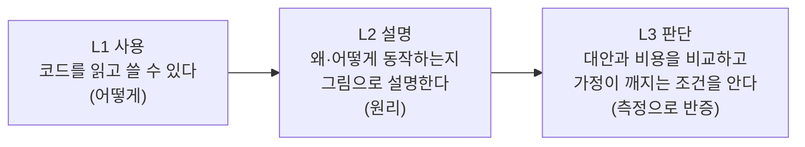
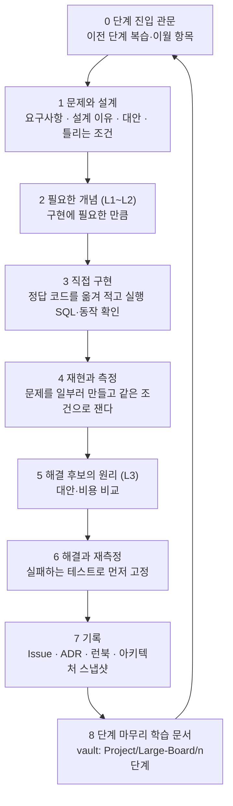
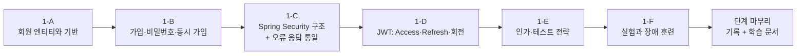

# 00. 목표와 학습 커리큘럼 — 1단계로 가기 전의 설계

> 상태: **제안**(사용자 확정 전). 이 문서는 [Wiki 로드맵](https://github.com/guseoh/large-scale-board/wiki/Roadmap)(0~11단계, **정본**)을 바꾸지 않는다. 그 위에 **"무엇을 어떤 깊이로, 어떤 순서로 배우고, 어떻게 증명하는가"**라는 학습 층을 얹는다. 로드맵과 충돌하면 Wiki가 이긴다.
>
> 0단계 결과는 [[0단계/README|0단계 문서]]에 있다. 프로젝트 방향의 원문은 Wiki의 [Home](https://github.com/guseoh/large-scale-board/wiki/Home)(프로젝트의 본질, 학습 깊이 기준)이다.

## 0. 이 문서의 결론

1. **목표는 "게시판을 만드는 것"이 아니라 "시스템이 어떻게 동작하고, 느려지고, 실패하는지를 스스로 설명하고 판단하는 것"이다.** 완성된 기능이 아니라 **설명할 수 있는 근거**(코드, 측정, ADR, 테스트)가 산출물이다.
2. **한 단계를 같은 루프로 돈다.** 문제 → 개념(필요한 만큼) → 직접 구현 → 재현·측정 → 해결·재측정 → 기록 → **단계 마무리 학습 문서**.
3. **개념마다 목표 깊이를 정한다.** 사용(L1) / 설명(L2) / 판단(L3). 모든 것을 L3까지 파지 않는다.
4. **1단계로 가기 전에 0단계 복습 관문**(12문항)을 통과한다. 통과하지 못한 문항은 해당 문서의 절로 돌아간다.
5. **1단계는 여섯 묶음(1-A~1-F)으로 쪼갠다.** 0단계의 A~E와 같은 크기의 묶음이고, 묶음마다 구현·실험·학습 문서가 있다.
6. 아래 **열린 결정 6개**만 정해 주면 바로 1-A를 시작할 수 있다(10절).

## 1. 목표

### 1.1 프로젝트 목표 (Wiki Home 기준)

> AI가 구현을 쉽게 대신할 수 있는 시대에도, 백엔드 개발자가 **시스템의 동작 원리와 문제 원인을 스스로 이해하고, 설계와 기술 선택을 판단**할 수 있는 근본 역량을 기른다.

이것을 **끝났을 때 답할 수 있어야 하는 질문**으로 바꾸면 곧 학습 목표다.

```text
이 시스템은 지금 어떻게 동작하는가?            → 요청 경로를 코드와 지표로 따라갈 수 있다
왜 이 구조로 설계했는가?                       → ADR로 대안과 비용을 설명할 수 있다
문제는 어느 계층에서, 왜 생기는가?              → 측정으로 계층을 분리하고 원인을 증명한다
해결 후보와 각각의 비용은 무엇인가?              → 비교 실험 결과로 말한다
장애가 나면 어디까지 번지는가?                  → 장애 훈련 결과와 런북이 있다
데이터의 유실·중복·지연 범위를 말할 수 있는가?   → 수치로 말한다
AI가 낸 구현·기술 선택이 우리 시스템에 맞는가?   → 가정이 깨지는 조건을 찾아 검토할 수 있다
```

### 1.2 역량 목표: 6가지와 "증거"

목표는 **증거로 확인되지 않으면 달성한 것이 아니다.** 역량마다 증거의 종류를 정한다.

| # | 역량 | 달성의 증거 | 주로 다루는 단계 |
| --- | --- | --- | --- |
| C1 | **요청 경로 추적**: HTTP → Tomcat 스레드 → 풀 → JDBC → MySQL를 지표로 따라가고 병목 계층을 가른다 | 부하 실험 기록에서 첫 병목을 지표 근거로 지목한다(0단계에서 시작) | 0, 2, 4, 5 |
| C2 | **DB 설계·튜닝**: 스키마·인덱스를 설계하고 실행 계획으로 검증한다 | 인덱스 ADR + `EXPLAIN ANALYZE` 전후 비교 | 2, 3, 8, 9 |
| C3 | **트랜잭션과 동시성**: 이상 현상을 재현하고 락·격리·재시도로 막는다 | **실패하는 테스트로 먼저 고정**한 뒤 고친 기록 | 1, 2, 4, 5, 6 |
| C4 | **캐시·메시징**: Redis·Kafka를 "문제가 있을 때" 도입하고 유실·중복 범위를 수치로 말한다 | 장애 훈련 런북, 일관성 허용 범위 문서 | 5, 6, 7, 8 |
| C5 | **장애 대응과 운영**: 탐지 → 영향 → 완화 → 복구 → 재발 방지를 훈련한다 | 단계별 런북 + 알림 규칙 + 포스트모템 | 모든 단계 |
| C6 | **설계 판단과 기록**: 대안·비용·되돌릴 조건을 남기고, 단순한 구조가 왜 복잡해졌는지 설명한다 | 아키텍처 진화 기록 + ADR (이유만으로 구조 변화를 설명 가능) | 모든 단계 |

> 0단계에서 이미 C1(기준선, 병목 계층), C5(MySQL 중단 훈련), C6(ADR 7건)의 **첫 증거**를 만들었다. 증거의 모양(이슈 구조, ADR 템플릿, 실험 기록)은 그대로 재사용한다.

### 1.3 비목표 (하지 않는 것)

- 배포하지 않는다. 모든 실행은 로컬 Docker Compose다(AWS는 대응 관계 표만).
- 기술을 많이 써 보는 것이 목적이 아니다. **병목이 없는 곳에 도입한 기술은 "과설계 비용 실험"의 대상**이다.
- 모든 개념을 끝까지 파지 않는다. 현재 문제를 설명하는 핵심 원리와 **판단에 필요한 내용**까지만 깊게 간다(2절).
- 테스트 커버리지 숫자 목표는 없다. 실험에서 찾은 문제를 **다시 재현하는 도구**로 테스트를 쓴다.

### 1.4 현실적인 목표: 취업 관점의 구간

Wiki 로드맵은 0~5단계를 **취업 핵심 구간**으로 본다(인증, 쿼리·인덱스 튜닝, 트랜잭션과 동시성, 캐시, Redis, 테스트, 모니터링). 6~10단계는 면접에서 깊이를 보여 주는 구간이고 11단계는 선택이다.

| 구간 | 단계 | 이 문서의 권장 |
| --- | --- | --- |
| **핵심** | 0~5 | 완성도 우선. 단계 마무리 학습을 건너뛰지 않는다 |
| **심화** | 6~10 | 핵심 구간이 끝난 뒤 취업 준비와 병행. 게이트(8절)를 통과할 때 진입 |
| **선택** | 11 | 10단계 회고에서 "분리할 이유"가 수치로 나올 때만 |

> 기간은 정하지 않는다(사용자가 "기간은 상관없다"고 정했다). 대신 **순서 게이트**(어느 증거가 있어야 다음으로 가는가)를 둔다. 목표 종료일을 두고 싶다면 10절의 결정 항목이다.

## 2. 학습 깊이 기준: L1 · L2 · L3

모든 개념을 같은 깊이로 파면 끝나지 않는다. 개념마다 **목표 깊이**를 미리 적는다.



| 깊이 | 확인 방법 | 예 (0단계) |
| --- | --- | --- |
| **L1 사용** | 보지 않고 쓸 수 있다 | `FilterRegistrationBean`으로 필터를 등록한다 |
| **L2 설명** | 백지에 그림을 그리며 설명한다 | MDC가 `ThreadLocal`이고 스레드 풀에서 `finally`로 지워야 하는 이유 |
| **L3 판단** | 대안·비용·실패 조건을 말하고 **측정으로 확인**했다 | `connection-timeout` 상한 = 스레드 수 ÷ 초당 요청 (리틀의 법칙 + 장애 훈련) |

**깊이를 올리는 시점**은 개념이 **실제 문제로 나타날 때**다. 예컨대 `@Transactional`은 1단계에서 L2(프록시·롤백), 2단계에서 격리 수준(L2), 4단계의 Lost Update·데드락에서 L3로 **세 번에 걸쳐** 깊어진다. 이것이 Wiki의 "문제가 생기는 단계에서 연결해 배운다"는 원칙이다.

## 3. 한 단계를 도는 학습 루프



| 국면 | 누가 | 산출물 |
| --- | --- | --- |
| 1 문제와 설계 | AI가 제공 | 요구사항, 정답 코드, 설계 이유, 대안과 비용, **이 설계가 틀리는 조건** |
| 2 개념 | AI가 짧게 브리핑 | 구현에 필요한 개념 한 장(10절 결정 ①) |
| 3 구현 | **사용자가 직접** | 코드를 옮겨 적어 실행, 실제 실행 SQL 확인 |
| 4 재현·측정 | AI가 스크립트, **사용자가 실행** | k6·SQL·장애 주입 결과 붙여넣기 |
| 5~6 해석·해결 | AI가 해석, **사용자가 재측정** | 예상과 다른 부분의 원인, 개선 코드, 전후 표 |
| 7 기록 | **사용자가 정리** | Issue(실험 4종 표시), ADR, 런북 |
| 8 마무리 학습 | AI가 문서 작성, 사용자가 검토 | **vault 문서**(0단계와 같은 형식, 9절) |

> **작업 방식(고정 규칙).** 0단계는 인프라 바닥이라 예외적으로 AI가 구현했다. **1단계부터 AI는 프로젝트 소스를 고치지 않는다.** 정답 코드를 보여 주고 사용자가 옮겨 구현한다. 커밋·푸시는 사용자의 지시 후에만 한다.

## 4. 0단계 복습 관문 (1단계로 가기 전)

1단계의 많은 부분이 0단계 위에서 바로 이어진다(필터 순서, 오류 응답, ID, 측정 방법). **보지 않고 답하고, 막히면 해당 절을 다시 읽는다.** 12문항 중 10문항 이상 L2로 설명하면 통과로 본다(기준은 제안이다).

| # | 질문 | 막히면 |
| --- | --- | --- |
| 1 | 요청이 Filter → DispatcherServlet → Interceptor → Controller를 지나는 순서와, 필터가 `@RestControllerAdvice`에 안 걸리는 이유 | [[0단계/01. A 코드 골격]] 1, 4.7절 |
| 2 | 컨트롤러 예외가 `ProblemDetail`이 되기까지의 `HandlerExceptionResolver` 순서와 `ResponseEntityExceptionHandler`를 상속하는 이유 | A 4.2~4.5절 |
| 3 | MDC가 `ThreadLocal`인데 왜 `finally`에서 지워야 하는가, 비동기에서는 어떻게 되는가 | A 5.5~5.7절 |
| 4 | ArchUnit 규칙을 "규칙으로 검증"하는 픽스처 테스트가 왜 필요한가 | A 3.4~3.5절 |
| 5 | Snowflake의 비트 구성, 같은 밀리초 순번 소진·시계 역행 시 동작 | [[0단계/02. B Snowflake ID]] 4~6절 |
| 6 | 왜 JS에서 ID가 깨지고(2^53), 해결은 무엇인가 | B 9절 |
| 7 | 히스토그램 p99는 어떻게 계산되고 왜 p99의 평균을 내면 안 되는가 | [[0단계/03. C 측정 환경]] 3.3절 |
| 8 | 열린 모델과 닫힌 모델의 차이, `dropped_iterations`의 의미 | C 4절 |
| 9 | 리틀의 법칙으로 풀 크기와 `connection-timeout`의 상한을 계산한다 | C 5.4절, [[0단계/05. E 운영과 장애 훈련]] 3절 |
| 10 | 직접 할당 ID에서 `save()`가 SELECT를 먼저 보내는 이유와 `Persistable` | [[0단계/04. D 데이터 생성과 적재]] 3.4절 |
| 11 | IDENTITY가 JDBC 배치를 끄는 이유 | D 3.4절 |
| 12 | 지표 포트를 분리한 이유(관측이 장애 때 먼저 죽은 과정) | E 3.2절 |

### 0단계에서 1단계로 이월되는 항목

0단계 문서에서 "후속 항목"으로 남긴 것 중 **1단계에서 바로 맞닥뜨리는 것**이다. 구현 순서에 끼워 넣는다.

| 이월 항목 | 1단계의 어느 묶음에서 |
| --- | --- |
| **시간대**: `hibernate.jdbc.time_zone=UTC`와 JVM 기본 시간대(KST)의 충돌, `Instant` vs `LocalDateTime` 결정 | 1-A (첫 엔티티) |
| **`Persistable` 엔티티 공통 상위 클래스** | 1-A |
| **ID는 DTO에서 문자열**(ADR-005)과 누락 방지 방법(ArchUnit 또는 테스트) | 1-A |
| **필터에서 난 예외**는 `GlobalExceptionHandler`를 거치지 않는다 → 보안 필터의 401/403을 같은 `ProblemDetail`로 | 1-C |
| 비동기 디스패치에서 `traceId`가 비는 한계 | 비동기 도입 전까지 보류 |
| 테스트용 `ddl-auto: create` → 직접 DDL 전환 시점 | 2단계(Wiki 기준)로 유지, 1단계는 `create` 허용 여부 결정 |

## 5. 개념 지도: 개념은 단계를 지나며 깊어진다

| 개념 | 1 | 2 | 3 | 4 | 5 | 6 | 7 | 8 | 9 |
| --- | --- | --- | --- | --- | --- | --- | --- | --- | --- |
| **트랜잭션·락** | 프록시·롤백 L2 | 격리 수준·MVCC L2 | 벌크 연산과 영속성 컨텍스트 | **Lost Update·락·데드락 L3** | 긴 트랜잭션 | 커밋 시점·Outbox | AFTER_COMMIT | 배치 트랜잭션 크기 | 샤드를 넘는 쓰기 |
| **인덱스·실행 계획** | email 인덱스 | **복합·커버링 L3** | `(article_id, path)` | UNIQUE | — | — | — | 파티션 프루닝 | 샤드 키 |
| **JPA** | 엔티티 기본·`Persistable` | N+1·DTO·OSIV | 자기 참조·cascade | 변경 감지·`@Version` | — | 이벤트 | — | JdbcTemplate 배치 | 라우팅 |
| **커넥션·스레드** | 로그인 폭주 | **풀 고갈 훈련 L3** | — | 락 대기 | 타임아웃 | — | — | — | — |
| **보안** | **Security·JWT L3** | 작성자 인가 | — | 다중 인스턴스 인증 | 토큰 차단 목록 | — | — | 메서드 인가 | — |
| **캐시·Redis** | — | — | — | — | **Redis L2~L3** | Sorted Set | **캐시·읽기 모델 L3** | HyperLogLog | — |
| **메시징·Kafka** | — | — | — | — | — | **Kafka·Outbox L3** | 이벤트로 읽기 모델 갱신 | 수집 버퍼 | — |
| **관측·장애 훈련** | 로그인 폭주 훈련 | 풀 고갈 훈련 | 경로 충돌 | 데드락·락 | Redis 중단 | Kafka 중단 | Stampede | 수집 폭주 | 복제 지연·승격 |

굵은 칸이 그 개념의 **L3 진입 지점**이다. 이 표가 "왜 이 순서인가"의 답이다. 개념이 필요해지기 **직전 단계**에 L1~L2를 깔고, 문제가 터지는 단계에서 L3로 올린다.

## 6. 단계별 커리큘럼 — 핵심 구간 (1~5단계)

Wiki의 단계별 상세([0~5단계](https://github.com/guseoh/large-scale-board/wiki/Steps-0-to-5))에 **학습 층**(개념 깊이, 선행 점검, 자가 점검 질문, 마무리 학습 산출물)을 더한다. 구현·실험 항목은 Wiki가 정본이다.

### 6.1 1단계 — 회원과 인증 (다음 진행)

**한 문장 목표.** "필터 체인 위에서 인증이 어떻게 동작하는지 설명하고, 로그인 폭주가 다른 API로 번지는 것을 수치로 보인다."

**상대 규모:** L (0단계 A~E와 비슷하거나 약간 작다)



#### 묶음별 설계

| 묶음 | 구현 | 개념(목표 깊이) | 증거·실험 |
| --- | --- | --- | --- |
| **1-A 회원 엔티티와 기반** | `Member` 매핑, **엔티티 공통 상위 클래스**(`Persistable`, 시간 타입), 회원 ID는 Snowflake, 응답 DTO의 ID 문자열화 | JPA 엔티티 기본 매핑(L2), `Persistable`(L3, 0단계 H-01 근거), 시간대·`Instant`(L2), `@Transactional` 경계(L1) | 시간대 문제를 **실패하는 테스트로 고정**한 뒤 해결 |
| **1-B 가입과 비밀번호** | 가입 API, 비밀번호 해싱, 이메일 중복 처리 | **BCrypt의 작업 계수와 비용**(L2), 선조회 vs UNIQUE 예외 처리(L3), 프록시·self-invocation·롤백 규칙(L2) | **동시 가입 중복 재현**(선조회 방식에서 중복 발생)→UNIQUE로 해결, `@Transactional` 트랙 실험 2개 |
| **1-C Security 구조** | `SecurityFilterChain`, 필터 순서, `SecurityContext`, 인증 실패·인가 실패 처리 | **필터 체인과 순서**(L2, 0단계 필터와 연결), 401 vs 403(L2) | 보안 필터 오류를 **`ProblemDetail` + `traceId`로 통일**(0단계 이월), 추적 필터가 보안 필터보다 앞인지 확인 |
| **1-D JWT** | 로그인, Access(15분)·Refresh(14일, 회전), 재발급, 로그아웃 | JWT 구조와 서명 HS256 vs RS256(L3), Refresh **회전과 탈취 재사용 탐지**(L3), 세션 vs JWT(L3) | 재사용 탐지 시 해당 회원 토큰 **전체 폐기**하는 테스트, Refresh는 MySQL에 해시로 저장(5단계에서 Redis 이전) |
| **1-E 인가와 테스트** | USER/ADMIN, `@PreAuthorize`, API·통합 테스트 | 인가 모델(L2), `MockMvc`·Spring Security Test·Testcontainers(L2) | 인증 필요한 API를 k6에서 토큰과 함께 호출 가능 |
| **1-F 실험과 장애 훈련** | 부하 실험 스크립트, datagen에 회원 테이블 추가 | **BCrypt 비용과 처리량·CPU**(L3), 인덱스 유무와 로그인 조회(L3), 리틀의 법칙 재적용(L3) | 아래 |

#### 1단계의 실험 4개 (Wiki 정본 + 가설 제안)

| 실험 | 종류 | 가설(제안) | 0단계와의 연결 |
| --- | --- | --- | --- |
| BCrypt 강도 10·12·14에서 로그인 TPS·CPU | 비교 실험 | 강도가 1 오를 때마다 해시 시간이 약 2배, 로그인 TPS는 반비례로 감소하고 CPU가 먼저 포화 | 같은 호스트 포화 한계([[0단계/03. C 측정 환경]] 7절). **호스트 CPU를 기록** |
| `email` 인덱스 유무(회원 100만 건) | 비교 실험 | 인덱스가 없으면 로그인 조회가 100만 행 스캔 | datagen에 `member` 생성기 추가 필요(결정적 생성, [[0단계/04. D 데이터 생성과 적재]] 2절) |
| 선조회 방식의 동시 가입 중복 | 의도적 안티패턴 | 둘 이상의 동시 요청이 모두 "없음"을 보고 모두 INSERT | 실패하는 테스트로 먼저 고정 |
| **로그인 폭주가 다른 API를 느리게 함** | 장애 훈련 | 로그인이 CPU를 쓰면(BCrypt) **DB와 무관한 API까지** 느려진다 | 0단계 MySQL 중단 훈련과 같은 번짐 구조([[0단계/05. E 운영과 장애 훈련]] 3절). 이번엔 **자원이 스레드가 아니라 CPU** |

> 마지막 실험이 1단계의 핵심이다. "번지는 구조"는 같고 **고갈되는 자원이 다르다**(MySQL 중단: Tomcat 스레드, 로그인 폭주: CPU와 스레드). 같은 구조를 다른 자원에서 다시 보면 L3로 올라간다.

#### 1단계 자가 점검 질문 (마무리 때 보지 않고 답한다)

1. `SecurityFilterChain`이 우리 `RequestTraceFilter`와 어떤 순서로 실행되고, 왜 추적 필터가 앞이어야 하는가?
2. 인증 실패(401)와 인가 실패(403)는 어떤 컴포넌트가 처리하고, 왜 `@RestControllerAdvice`가 못 잡는가?
3. 세션 대신 JWT를 쓰면 무엇을 얻고 무엇을 잃는가(로그아웃, 탈취 대응)?
4. Refresh 토큰을 회전시키고 재사용을 탐지하는 이유와 탐지 시 무엇을 폐기하는가?
5. BCrypt 작업 계수를 올리면 왜 안전해지고 어떤 비용이 생기는가? 로그인 폭주가 다른 API로 번지는 이유는?
6. 선조회 중복 검사가 동시 가입에서 깨지는 이유와 UNIQUE 제약의 한계(예외 변환)는?
7. `@Transactional`이 같은 클래스 내부 호출에서 안 먹는 이유(프록시)와 체크 예외 롤백 규칙은?
8. 엔티티 공통 클래스에서 `Persistable`을 구현하지 않으면 무슨 일이 생기는가? 시간대는 왜 문제가 되었는가?

#### 1단계 마무리 학습 문서 (vault, 제안 목차)

`Project/Large-Board/1단계/` — 0단계와 같은 형식(9절). 묶음 문서 5~6개 + README.

| 문서 | 담을 것 |
| --- | --- |
| 01. 엔티티와 기반 | 시간대, `Persistable` 기반 클래스, ID 문자열 DTO, 프록시·롤백 실험 |
| 02. 가입과 비밀번호 | BCrypt 동작 원리, 동시 가입 재현과 UNIQUE |
| 03. Spring Security 구조 | 필터 체인·순서, `SecurityContext`, 오류 응답 통일 |
| 04. JWT와 토큰 운영 | 구조·서명·회전·재사용 탐지, 세션과의 비교 |
| 05. 실험과 장애 훈련 | BCrypt 곡선, 인덱스 효과, 로그인 폭주 번짐 |

### 6.2 2단계 — 게시글 (가장 큰 단계)

**한 문장 목표.** "1,000만 건에서 목록이 느려지는 이유를 실행 계획으로 증명하고, 인덱스와 쿼리 구조로 p99를 목표 안에 넣는다."

**상대 규모:** XL. 한 번에 하지 말고 **2-A 스키마와 대량 데이터 → 2-B 목록 쿼리와 인덱스 → 2-C 페이지네이션 → 2-D 검색 → 2-E 풀 고갈 훈련**으로 나눈다.

| 개념 | 목표 깊이 | 선행 |
| --- | --- | --- |
| B+Tree·클러스터드 인덱스·보조 인덱스 | L3 | [[0단계/02. B Snowflake ID]] 3절 |
| `EXPLAIN ANALYZE` 읽기, 커버링 인덱스, 복합 인덱스 순서 | L3 | 0단계의 `performance_schema` 사용 |
| 격리 수준·MVCC 스냅샷 | L2 (트랜잭션 트랙) | 1단계의 프록시·롤백 |
| OFFSET 비용 vs 커서, 제한 COUNT | L3 | — |
| N+1, DTO 프로젝션, OSIV | L2 | 1단계 엔티티 |
| QueryDSL | L1~L2 | — |
| PK 전략 4종 비교 | L3 | 0단계 H-01·B 문서(이미 근거 일부 확보) |
| 풀 고갈과 쿼리 타임아웃 | L3 | [[0단계/05. E 운영과 장애 훈련]] (타임아웃 1초의 대가를 여기서 측정) |
| 가상 스레드 | L2 | [[../../Study/Performance/06. Tomcat HikariCP DB Queueing\|Tomcat HikariCP DB Queueing]] |

**0단계가 미리 남겨 준 것:** 기준선(풀 10개, 초당 약 3,000건에서 포화), `exp_load_article`, 결정적 생성기, 스냅샷. 2단계의 풀 고갈 훈련은 **0단계에서 "측정하지 않은 비용"**(1초 타임아웃이 트래픽 폭증에서 만드는 실패율)을 처음으로 잰다.

### 6.3 3단계 — 댓글

**한 문장 목표.** "계층 구조를 세 가지 모델로 저장하고 비용 표로 선택 기준을 말한다."

| 개념 | 목표 깊이 |
| --- | --- |
| 인접 리스트·경로 열거·Closure Table | L3 (모델별 읽기·쓰기·공간 비용 표) |
| 자기 참조 연관관계 매핑 vs ID 참조 | L2 |
| cascade 삭제의 쿼리 수, 벌크 DELETE와 영속성 컨텍스트 불일치 | L2 |
| `path` 콜레이션 `utf8mb4_bin`, UNIQUE 충돌·재시도 | L2 |
| JVM 힙·GC 로그(Wiki: 3단계) | L2 |

**상대 규모:** M. 실험이 데이터 모델 비교 위주라 규모는 작지만, 2단계에서 만든 인덱스 읽기 능력을 그대로 쓴다.

### 6.4 4단계 — 좋아요 (트랜잭션의 정점)

**한 문장 목표.** "동시성 문제를 재현하고, 네 가지 해법을 수치로 비교해 선택 기준을 ADR로 남긴다. 앱 2대에서 깨지는 가정을 확인한다."

| 개념 | 목표 깊이 |
| --- | --- |
| Lost Update, 변경 감지, flush 시점 | L3 |
| 원자적 UPDATE / 낙관적 락 / 비관적 락 / Redis 분산 락 | L3 (TPS·p99·락 대기·재시도 비교) |
| 갭 락·넥스트 키 락·데드락(`SHOW ENGINE INNODB STATUS`) | L3 |
| 트랜잭션 전파, **`REQUIRES_NEW`와 풀 교착** | L3 ([[0단계/03. C 측정 환경]] 6.2절의 `Tn × (Cm − 1) + 1`) |
| 멱등 API | L2 |
| Nginx와 앱 2대 | L2 ([[../../Study/Infra/Nginx/2. 요청은 어떻게 Spring Boot까지 가는가\|Nginx: 요청은 어떻게 Spring Boot까지 가는가]]) |
| **Snowflake 노드 ID 배정**(인스턴스 2대) | L3 ([[0단계/02. B Snowflake ID]] 7절의 "실패 지점") |

**상대 규모:** L. **0단계에서 미리 만든 "같은 노드 ID 두 개 = 중복 ID" 실패 지점이 4단계에서 현실이 된다.** 노드 ID 배정(환경 변수 vs 기동 시 선점)을 이 단계에서 결정한다.

### 6.5 5단계 — 조회수 (Redis 첫 도입)

**한 문장 목표.** "MySQL UPDATE로 병목을 일부러 만든 뒤 Redis로 옮기고, Redis가 죽었을 때 유실 범위를 수치로 말한다."

| 개념 | 목표 깊이 |
| --- | --- |
| Redis 단일 스레드, 자료구조, 영속화(RDB·AOF) | L2 |
| Write-back 기준(건수 vs 시간), 유실 허용 범위 | L3 |
| 행 락 경합(인기 글 하나에 쓰기 집중) | L3 (4단계 연결) |
| `SET NX` + TTL 분산 락, `@Scheduled`의 2대 중복 실행 | L2 |
| 타임아웃 없는 외부 호출이 스레드를 고갈시키는 현상 | L3 (**0단계의 장애 훈련과 같은 구조**, Toxiproxy로 재현) |
| Redis 대시보드 | L1 |

**상대 규모:** L. Refresh 토큰 저장소도 이 단계에서 Redis로 이전한다(1단계의 의도적 임시 구현).

## 7. 심화 구간 요약 (6~11단계)

핵심 구간이 끝난 뒤 게이트(8절)를 확인하고 진입한다. 상세는 Wiki([6~11단계](https://github.com/guseoh/large-scale-board/wiki/Steps-6-to-11))가 정본이다.

| 단계 | 한 문장 목표 | L3 진입 개념 | 진입 조건(제안) |
| --- | --- | --- | --- |
| 6 인기글 | Kafka를 내렸다 올려도 이벤트가 유실되지 않고 중복 전달에도 점수가 맞는다 | Transactional Outbox, 멱등 컨슈머, 컨슈머 lag | 5단계의 Redis 장애 런북 |
| 7 조회 최적화 | 캐시가 사라져도 서비스가 버티고 읽기 모델의 불일치 허용 범위를 말한다 | Cache Stampede, 읽기 모델, 논리·물리 만료 | 6단계 이벤트 흐름. **병목이 없는 곳에 캐시를 넣는 과설계 비용 실험** 포함 |
| 8 활동 분석 | 수집 처리량 한계와 통계 p99를 수치로 갖고 컬럼형 저장소 도입 여부를 ADR로 | 파티션 프루닝, 롤업, HyperLogLog | 2단계 실행 계획 능력 |
| 9 데이터 계층 | 샤드 키 근거와 한계, 리샤딩 절차를 ADR·런북으로 | 복제 지연, 샤딩, 부분 장애 격리 | 2·4단계의 인덱스·트랜잭션 능력 |
| 10 Game Day | 최초 구조에서 최종 구조까지 각 변화의 이유를 ADR만으로 설명 | 재시도 폭풍, 서킷 브레이커의 위치, 무중단 재기동 | 모든 단계의 런북 |
| 11 (선택) | 분리로 얻은 것과 잃은 것을 수치로 | 분산 트레이싱, Saga, 서비스 간 장애 전파 | 10단계 회고에서 분리 후보가 **수치로** 나올 때만 |

> 0단계에서 **의도적으로 미룬 것**(서킷 브레이커, Alertmanager)은 10단계 Game Day의 설계 결정으로 합류한다.

## 8. 단계 진입 게이트 (다음으로 가는 조건)

"시간"이 아니라 **증거**로 넘어간다. 한 단계의 게이트는 다음 네 가지가 모두 있어야 통과다.

| # | 게이트 | 확인 방법 |
| --- | --- | --- |
| G1 | **완료 조건 달성** | Wiki의 해당 단계 "완료 조건"을 수치나 테스트로 만족한다 |
| G2 | **기록 완료** | 실험 Issue(종류 표시), ADR(대안·비용·되돌릴 조건), 런북(장애 훈련이 있었다면), 아키텍처 스냅샷, PR |
| G3 | **마무리 학습 문서** | vault `n단계/` 문서가 있고 **자가 점검 질문에 보지 않고 답**한다 |
| G4 | **이월 항목 정리** | 이 단계의 후속 항목을 다음 단계 일정에 넣거나 폐기한다고 적었다 |

단계 안에서도 **묶음 게이트**를 둔다. 묶음 하나(예: 1-B)가 끝나면 그 묶음의 코드와 테스트가 통과하고 실험 기록이 있어야 다음 묶음으로 간다.

## 9. 학습 산출물과 문서 운영

### 9.1 vault 문서 구조

```text
Project/Large-Board/
├── README.md                    ← 폴더 지도
├── 00. 목표와 학습 커리큘럼.md     ← 이 문서
├── 0단계/                        ← 완료 (README + A~E + assets)
├── 1단계/                        ← 1단계 마무리 때
│   ├── README.md
│   ├── 01. ... .md
│   └── assets/
└── ...
```

### 9.2 묶음 문서의 형식 (0단계 형식을 그대로)

1. 위치와 목적(표), 2. 큰 그림(Mermaid), 3. **코드 읽기(왜 그렇게 했는가)**, 4. 프레임워크·DB가 실제로 어떻게 움직이는가, 5. **측정 결과와 해석**, 6. 결정과 대가(표), 7. 알려진 한계·후속, 8. **참고 자료**(한국 기업·개인 블로그 + 공식 문서, **자료의 부정확한 부분 메모**).

| 규칙 | 이유 |
| --- | --- |
| 외부 이미지는 **복사하지 않고 링크 + 출처**, 실제로 보고 고른다 | 저작권, 확인 가능성 |
| 적합한 이미지가 없으면 **직접 도식**(Mermaid/SVG) | 개념 이해가 우선 |
| 사실 주장의 근거는 **공식 문서 우선**, 블로그는 보조 | 오래되거나 틀린 글이 있다 |
| Mermaid는 `mermaid.parse`로 검증, 외부 링크는 상태 확인 | 0단계에서 쓴 검증 절차 |
| 공개 저장소이므로 **비밀번호·토큰은 문서에 쓰지 않는다** | `AGENTS.md` |

### 9.3 `concept-learning` 스킬 사용 기준

단계 마무리 때 **그 단계에서 실제로 만난 개념**을 두 종류로 나눈다.

| 구분 | 요청 | 결과 |
| --- | --- | --- |
| 깊이 이해할 주제(L3 목표) | "설명해줘" | 강의형 설명(코드·실행 흐름·공식 근거·한국 블로그·실제 이미지) → **vault 문서의 해당 절** |
| 복습할 주제(L1~L2) | "정리해줘" | 핵심 복습 정리 → 문서의 요약 표 |

0단계 때는 채팅에서 강의형으로 시작해 보니 **오래 보관하기 어렵다**는 이유로 문서로 바꿨다. 1단계부터는 처음부터 **vault 문서를 정본**으로 한다.

## 10. 열린 결정 6개 (1-A 시작 전)

| # | 결정 | 선택지 | **제안** |
| --- | --- | --- | --- |
| ① | **구현 전 개념 브리핑의 형태** | (a) 채팅의 짧은 브리핑(요구사항·정답 코드·이유·대안) / (b) vault에 "사전 노트"를 먼저 만든다 | **(a)**. 사전 노트는 분량이 늘어 속도가 느려진다. 정리는 마무리 문서에서 한 번에 |
| ② | **OAuth2 소셜 로그인**(선택 과제) 포함 | 포함 / 제외 | **1단계에서는 제외**. JWT 발급·회전·재사용 탐지가 먼저이고, 필요하면 5단계 이후 선택 과제로 |
| ③ | **비밀번호 해싱 비교 범위** | BCrypt 강도만 / Argon2도 비교 | **BCrypt 강도 10·12·14만**(Wiki 정본). Argon2는 설계 대안 비교(표)로만 |
| ④ | **JWT 서명 방식 기본값** | HS256 / RS256 | **HS256으로 구현**하고 RS256은 대안·비용 표와 짧은 실험으로 (앱 2대·서비스 분리 시 필요해지는 이유까지) |
| ⑤ | **목표 기간(핵심 구간 0~5단계)** | 정하지 않음 / 목표 종료일 설정 | 이미 "정하지 않음". 정하고 싶다면 **묶음 단위**(1-A, 1-B …)로 분배하고 게이트로 조정 |
| ⑥ | **1단계 `ddl-auto`** | `create` 유지 / 직접 DDL로 먼저 전환 | **`create` 유지**하되 회원 테이블 DDL은 **미리 손으로 써 보고 비교**(2단계 전환 연습). 2단계에서 직접 DDL로 공식 전환 |

> 위 제안대로면 **1-A(회원 엔티티와 기반)**부터 바로 시작한다. 이 결정들 중 확정된 것은 Wiki의 [Decisions](https://github.com/guseoh/large-scale-board/wiki/Decisions)에 기록하는 것이 좋다(이 문서는 제안 상태).

## 11. 위험과 대응

| 위험 | 신호 | 대응 |
| --- | --- | --- |
| **옮겨 적기만 하고 이해하지 못한다** | 자가 점검 질문에 답하지 못한다 | G3 게이트. 막힌 문항만 해당 문서·개념 학습으로 돌아간다. 구현을 *바꿔 보는* 실험(일부러 깨뜨리기)을 더한다 |
| **한 묶음이 너무 커진다** | 한 묶음이 며칠째 안 끝난다 | 묶음을 더 쪼갠다(2단계 예시). 6단계 이후는 게이트 통과 전에 시작하지 않는다 |
| **측정이 로컬 장비에 휘둘린다** | 같은 조건의 수치가 흔들린다 | 0단계 측정 규칙: 서버 히스토그램 주 지표, 호스트 CPU 기록, k6 `dropped_iterations` 확인 |
| **기술 과잉** | 병목 없이 Redis·Kafka를 넣는다 | "과설계 비용 실험" 종류로만 허용, ADR에 **도입하지 않은 경우**도 남긴다 |
| **개념을 너무 깊게 판다** | 현재 문제와 무관한 내부 구현에 시간을 쓴다 | 2절의 두 기준(현재 시스템 이해에 필요한가? 설계·운영 판단에 필요한가?)에 해당하지 않으면 **별도 심화 학습**으로 분리 |
| **문서가 코드와 어긋난다** | 문서의 설명과 실제 동작이 다르다 | 문서의 사실 주장은 **코드·테스트·측정으로 확인한 것만** 단정, 나머지는 "가설"로 표시(0단계 문서의 방식) |

## 12. 바로 다음 한 걸음

1. **0단계 복습 관문(4절)**을 한 번 훑는다. 막히는 문항이 있으면 알려 주면 그 부분만 짧게 보충한다.
2. **열린 결정(10절)**에 답한다(제안대로면 "제안대로 진행").
3. **1-A 시작**: 정답 코드(엔티티 공통 상위 클래스 + `Member`), 설계 이유, 대안, 틀리는 조건, 그리고 **시간대 문제를 실패하는 테스트로 먼저 고정**하는 순서를 제시한다. 구현은 직접 한다.

## 부록. 이 문서가 쓴 근거

| 근거 | 위치 |
| --- | --- |
| 프로젝트의 본질, 학습 깊이 기준, 진행 루프, 단계 마무리 | Wiki [Home](https://github.com/guseoh/large-scale-board/wiki/Home) |
| 0~11단계 로드맵과 취업 핵심 구간 | Wiki [Roadmap](https://github.com/guseoh/large-scale-board/wiki/Roadmap) |
| 단계별 구현·실험·장애 훈련·완료 조건 | Wiki [0~5단계](https://github.com/guseoh/large-scale-board/wiki/Steps-0-to-5), [6~11단계](https://github.com/guseoh/large-scale-board/wiki/Steps-6-to-11) |
| Spring·JPA 학습 배치, 트랜잭션 실험 트랙, 테스트 전략, 모든 단계 공통 작업 방식 | Wiki [Spring·JPA 학습 배치](https://github.com/guseoh/large-scale-board/wiki/Spring-JPA-Learning-Map), [트랜잭션 실험 트랙](https://github.com/guseoh/large-scale-board/wiki/Transaction-Experiments), [테스트 전략](https://github.com/guseoh/large-scale-board/wiki/Test-Strategy), [성능·장애·실험](https://github.com/guseoh/large-scale-board/wiki/Performance-and-Failure-Practice) |
| 0단계의 결과·측정·후속 항목 | [[0단계/README\|0단계 문서]] |
| 일반 개념 학습 노트 | [[../../Study/Performance/README\|Study/Performance]], [[../../Study/Spring Security/1. 인증과 인가\|Spring Security: 인증과 인가]], [[../../Study/JPA/1단계/1-1 JPA와 ORM의 등장 배경 및 전체 구조\|JPA와 ORM]], [[../../Study/Spring Boot/1. 객체지향 설계와 IoC·DI\|IoC·DI]] |

> **"단계별 규모(S/M/L/XL)"와 "12문항 중 10문항 통과", "BCrypt 강도 가설"은 이 문서의 제안이며 측정·합의된 값이 아니다.** 첫 묶음을 해 본 뒤 조정한다.
