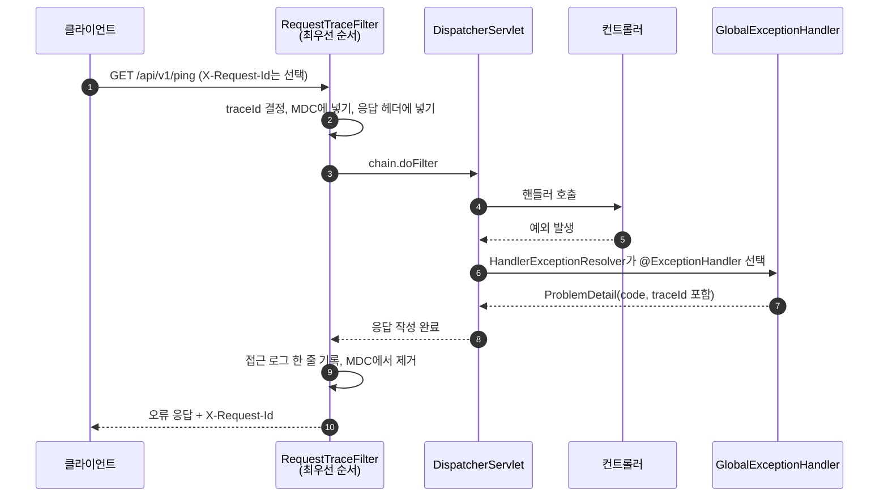
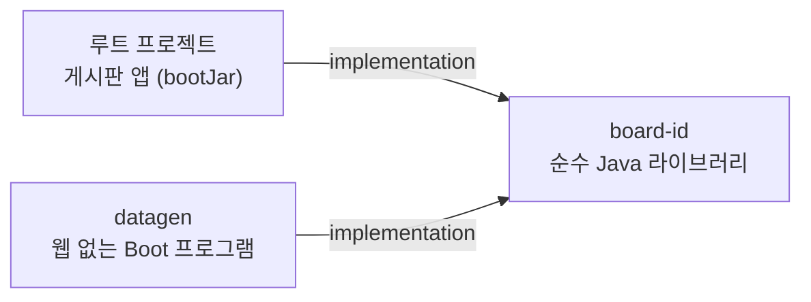
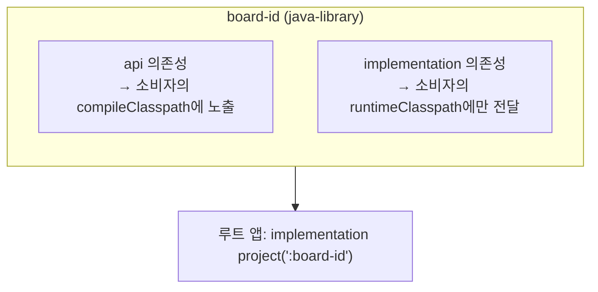
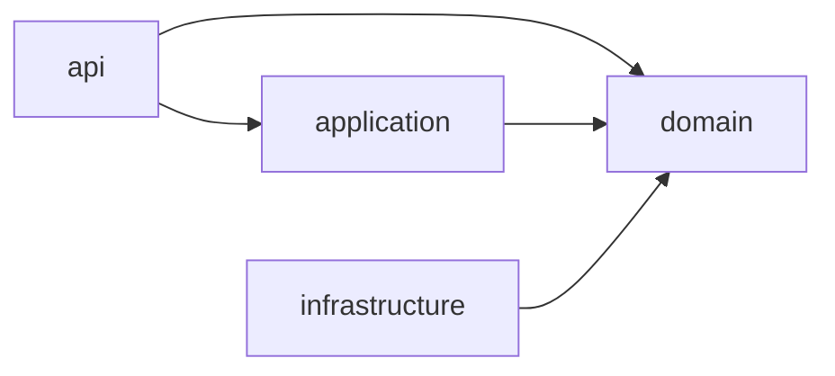
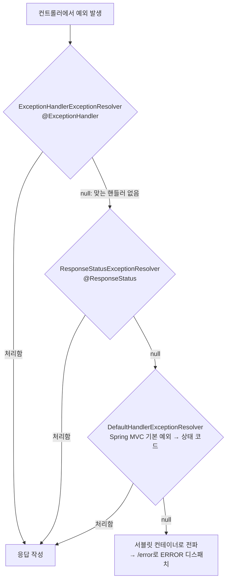
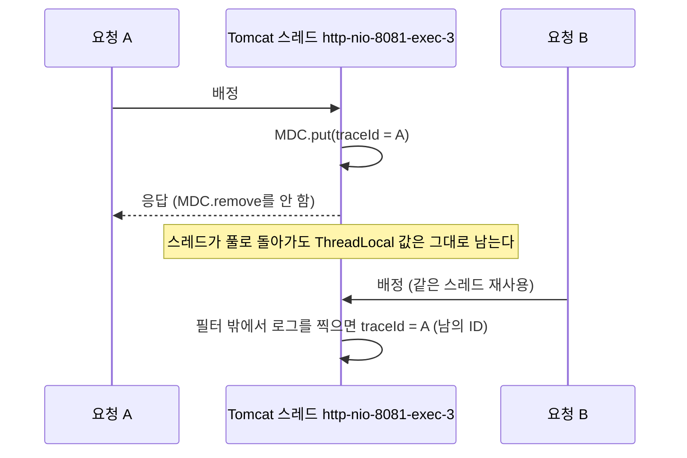
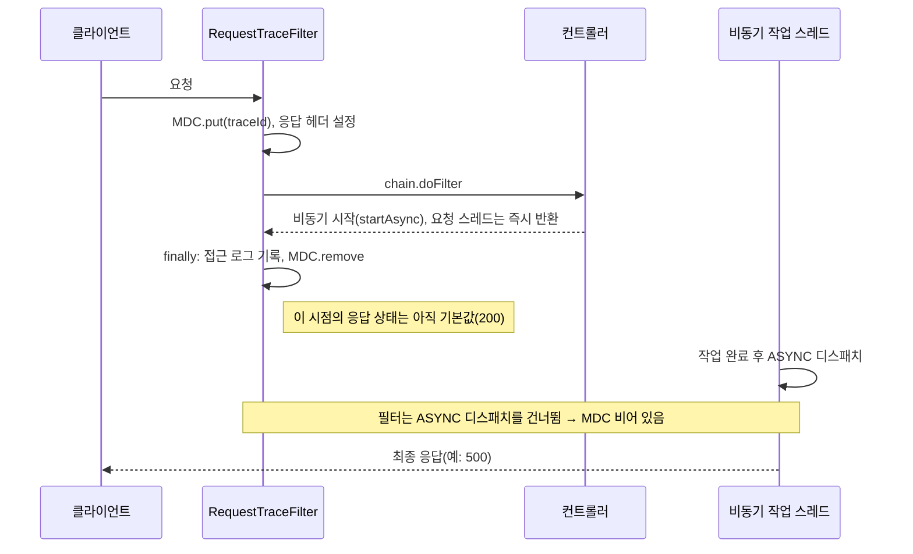

# 01. A 묶음 — 코드 골격: 멀티 프로젝트, 오류 응답, 요청 추적, 아키텍처 테스트

> 0단계 A 묶음에서 만든 "뼈대"를 코드 그대로 따라가며 **왜 그렇게 만들었는지**, **그 아래에서 프레임워크가 실제로 어떻게 움직이는지**를 설명한다.
> 전체 지도는 [[README]], 다음 묶음은 [[02. B Snowflake ID]]이다.

## 0. 이 묶음이 하는 일

0단계의 목표는 "숫자를 믿을 수 있는 기반"을 만드는 것이다. 그런데 측정을 하려면 먼저 **요청이 들어와서 응답이 나가는 길**이 정리되어 있어야 한다. 오류 응답 모양이 제각각이면 실패율을 셀 수 없고, 로그에 요청 식별자가 없으면 느린 요청 하나를 추적할 수 없고, 구조 규칙이 없으면 단계가 쌓일수록 코드가 엉킨다. A 묶음은 이 세 가지를 코드로 고정한다.

| 주제 | 핵심 코드 | 한 줄 목적 |
| --- | --- | --- |
| 멀티 프로젝트 | `settings.gradle`, `build.gradle`, `board-id/build.gradle`, `datagen/build.gradle` | 앱에 섞이면 안 되는 코드를 실행 파일 밖으로 분리한다 |
| 오류 응답 | `common/error/*` | 어떤 예외든 같은 모양(RFC 9457)으로 응답한다 |
| 요청 추적 | `common/logging/*` | 요청마다 `traceId`를 정해 모든 로그와 응답 헤더에 싣는다 |
| 아키텍처 규칙 | `architecture/ArchitectureRules`, `archfixture/*` | 패키지 의존 방향을 테스트로 강제하고, 규칙 자체도 검증한다 |

## 1. 큰 그림: 요청 하나가 지나가는 길

본문에 들어가기 전에 요청 하나가 서버 안에서 거치는 길을 먼저 그려 둔다. 이 문서의 나머지는 모두 이 그림의 한 칸을 확대한 것이다.



필터, `DispatcherServlet`, 인터셉터, AOP, 컨트롤러가 어떤 순서로 겹쳐 있는지는 아래 그림이 가장 잘 보여 준다.


*그림 1-1. 요청은 Tomcat(서블릿 컨테이너)의 **Filter**를 먼저 지나고, 그다음에야 Spring 영역의 `DispatcherServlet`으로 들어간다. 출처: [velog @yuhaeni, "Spring Boot Filter, Interceptor, AOP 차이점 정리"](https://velog.io/@yuhaeni/Springboot-Filter-Interceptor-AOP-%EC%B0%A8%EC%9D%B4%EC%A0%90-%EC%A0%95%EB%A6%AC)*

이 그림에서 두 가지를 기억하면 된다.

- **필터는 Spring MVC 밖에 있다.** 그래서 필터에서 난 예외는 `@RestControllerAdvice`가 받지 못한다. 1단계에서 Spring Security 필터가 들어오면 이 한계가 실제 문제가 된다(4.7절).
- **우리 추적 필터는 모든 필터보다 앞이어야 한다.** 뒤에 오는 모든 것(보안 필터, 인터셉터, 컨트롤러, 예외 핸들러)이 남기는 로그에 같은 `traceId`가 붙으려면 가장 바깥에서 값을 넣어야 한다(5.3절).

## 2. Gradle 멀티 프로젝트

### 2.1 왜 나누는가

0단계 설계에서 나눈 프로젝트는 둘이다. 앱 자체(루트 프로젝트)와 그 옆의 하위 프로젝트 두 개다.

```text
large-scale-board          ← 루트 = 게시판 앱 (bootJar로 실행되는 서버)
├── board-id               ← Snowflake ID. 순수 Java 라이브러리, 런타임 의존성 0개
└── datagen                ← 데이터 생성기. 웹 서버 없이 도는 Spring Boot 프로그램
```



나눈 이유는 **"실행 파일에 섞이면 안 되는 코드"를 분리**하기 위해서다.

- `datagen`은 100만~수천만 건의 데이터를 만들고 적재하는 도구다. 이 코드가 서버 jar 안에 들어가면 운영 서버가 데이터 생성 기능까지 품게 된다. 또한 `datagen`은 웹이 필요 없고, 앱은 웹이 필요하다. 클래스패스가 달라야 한다.
- `board-id`는 앱과 `datagen`이 **같은 ID 규칙**을 써야 해서 둘 사이에 놓인다. 어느 한쪽에 복사해 두면 규칙이 갈라진다. 그렇다고 앱 안에 두고 `datagen`이 앱에 의존하면, 데이터 생성기가 웹 서버 전체를 끌고 오게 된다.

> **"공통 모듈"의 함정.** 우아한형제들 기술 블로그의 「멀티모듈 설계 이야기 with Spring, Gradle」은 공통 코드를 `common` 모듈에 모았다가 겪은 문제를 "common의 저주"라고 부른다. 공통 모듈에 코드가 쌓이면서 (1) 한 곳을 고치면 시스템 전체가 흔들리는 스파게티가 되고, (2) 공통 모듈이 web, JPA, Redis 같은 starter를 모두 끌어와 **DB를 쓰지 않는 앱까지 DB 연결을 맺고**, (3) Thread Pool·Connection Pool·Timeout 같은 설정이 가장 민감한 앱 기준으로 한곳에 몰린다는 것이다.
>
> 
>
> *그림 2-1. 공통 모듈이 의존성을 한꺼번에 끌어오는 실패 사례. 출처: [우아한형제들 기술블로그, 권용근, 2019-07-01](https://techblog.woowahan.com/2637/)*

이 글이 제안하는 해법은 모듈을 계층으로 나누고 **의존 방향을 엄격히 제한**하는 것이다. 그중 "독립 모듈"은 시스템과 무관한 라이브러리 성격이고, 프로젝트 내부 의존을 두지 않는다.


*그림 2-2. 모든 계층이 "독립 모듈"에 의존할 수 있지만, 독립 모듈은 아무것에도 의존하지 않는다. 출처: 위와 같은 글*

우리 `board-id`가 정확히 이 "독립 모듈"이다. 런타임 의존성이 하나도 없고, Spring도 모른다. 반대로 앱 안의 `common`은 **별도 모듈이 아니라 패키지**로만 둔다(3절의 R4 규칙이 `common`이 도메인에 의존하지 못하게 막는다). 공유가 필요한 코드만 의존성 없는 모듈로 승격하는 방침이다.

### 2.2 `settings.gradle` — 프로젝트를 등록한다

```groovy
rootProject.name = 'large-scale-board'

// 루트 프로젝트 = 게시판 앱. 하위 프로젝트는 앱 실행 파일에 섞이면 안 되는 코드를 분리한다. (D0-01)
include 'board-id'  // Snowflake ID. 순수 Java 라이브러리, Spring 의존 없음
include 'datagen'   // 데이터 생성기. 웹 서버 없이 실행하는 Spring Boot 프로그램
```

Gradle 공식 문서(Multi-project builds)의 설명대로, 멀티 프로젝트 빌드는 **루트 프로젝트와 하위 프로젝트가 한 개의 `settings.gradle`에 정의**되는 구조다. `include`에 넘긴 이름은 프로젝트 경로가 되고, 기본적으로 같은 이름의 디렉터리에 대응한다. 프로젝트 사이 의존은 경로로 쓴다.

```groovy
dependencies {
    implementation project(':board-id')   // 콜론(:)은 루트부터의 경로를 뜻한다
}
```

공식 문서에 따르면 프로젝트 의존은 **빌드 순서와 클래스패스를 함께** 정한다. 필요한 프로젝트가 먼저 빌드되고, 그 컴파일 결과와 전이 의존성이 소비하는 쪽 클래스패스에 올라간다.

### 2.3 플러그인 버전은 한 곳에서만 정한다

루트 `build.gradle`:

```groovy
plugins {
	id 'java'
	id 'org.springframework.boot' version '4.1.0'
	id 'io.spring.dependency-management' version '1.1.7'
}
```

하위 프로젝트 `datagen/build.gradle`은 **버전 없이** 같은 플러그인을 쓴다.

```groovy
plugins {
	id 'java'
	id 'org.springframework.boot'                 // 버전 없음
	id 'io.spring.dependency-management'          // 버전 없음
}
```

루트 빌드 스크립트가 플러그인을 `plugins {}`로 선언하면 그 플러그인 클래스가 빌드 클래스패스에 올라가고, 하위 프로젝트는 같은 클래스로더를 공유하므로 버전을 다시 적지 않아도 된다. 이렇게 하면 Spring Boot를 올릴 때 **루트의 한 줄만 바꾸면** 모든 하위 프로젝트가 따라간다.

> **확인한 것과 못 한 것.** 이 동작은 실제 빌드(`datagen`이 정상 빌드·실행됨)로 확인했다. 다만 Gradle 공식 문서 `plugins.html`, `multi_project_builds.html`에서는 이 규칙을 직접 설명하는 문장을 찾지 못했다. 가장 가까운 문장은 *precompiled script plugin*에 대한 "version과 apply false는 지원되지 않고, 버전은 플러그인 빌드 파일이 정한다"는 설명이다. 이 문서에서는 "관찰된 동작"으로 다룬다. 기존 한국어 글에서는 `apply false`로 루트에서 선언만 해 두고 하위에서 적용하는 패턴이 자주 소개된다(예: [cbwstar 블로그, "build.gradle plugins와 apply plugin 차이"](https://cbwstar.tistory.com/entry/buildgradle-plugins-%EC%99%80-apply-plugin-%EC%B0%A8%EC%9D%B4)). Spring Boot 공식 문서도 Boot 플러그인을 적용하지 않고 의존성 관리만 쓰려면 `apply false`로 선언하라고 안내한다.

`subprojects { }`로 공통 설정을 루트에 몰아 넣는 방식도 있지만, Gradle 문서는 이를 "프로젝트 사이를 가로지르는 설정(cross-project configuration)"이라 부르며 **장기적으로 복잡도가 커진다**고 경고하고 *convention plugin*을 권한다(문서는 deprecated라고 하지는 않는다). 0단계 프로젝트는 둘뿐이라 각 `build.gradle`에 중복을 감수하고 단순하게 갔다. 모듈이 늘면 convention plugin(`buildSrc` 또는 `build-logic`)으로 옮기는 것이 다음 선택지다.

### 2.4 `board-id`는 Boot 플러그인을 적용하지 않는다

```groovy
plugins {
	id 'java-library'
	// 테스트 라이브러리(JUnit, AssertJ) 버전을 앱과 같은 Spring Boot BOM으로 맞추려고만 쓴다.
	id 'io.spring.dependency-management'
}

dependencyManagement {
	imports {
		mavenBom org.springframework.boot.gradle.plugin.SpringBootPlugin.BOM_COORDINATES
	}
}

dependencies {
	testImplementation 'org.junit.jupiter:junit-jupiter'
	testImplementation 'org.assertj:assertj-core'
	testRuntimeOnly 'org.junit.platform:junit-platform-launcher'
}
```

세 가지 선택을 풀어서 보자.

1. **`org.springframework.boot` 플러그인을 쓰지 않는다.** Spring Boot 공식 Gradle 플러그인 문서에 따르면, 이 플러그인은 `java` 플러그인과 함께 쓰일 때 `bootJar`(실행 가능한 uber jar), `bootRun`, `bootBuildImage` 같은 작업과 `developmentOnly` 같은 설정을 만들고, 일반 `jar`에는 `plain` 분류자를 붙인다. 라이브러리 모듈은 `main` 메서드가 없고 다른 프로젝트가 **일반 jar**를 가져다 써야 하므로, 이 플러그인이 만드는 것들이 필요 없다.
2. **BOM만 가져온다.** BOM(Bill of Materials)은 "이 라이브러리들은 이 버전으로 맞춘다"는 **버전 목록**이다. 의존성을 추가하지 않고 버전만 정하므로 Spring이 라이브러리에 섞이지 않는다. 그런데 테스트 라이브러리(JUnit, AssertJ)의 버전을 앱과 같게 맞추고 싶다. `SpringBootPlugin.BOM_COORDINATES`는 루트가 이미 올려 둔 Boot 플러그인 클래스에서 가져온 값이다(2.3절의 클래스패스 공유가 여기서도 쓰인다).
3. **`java-library`.** `java` 플러그인에는 없는 `api` 설정을 쓸 수 있게 한다. Gradle 문서의 설명처럼 `api`는 소비자의 **컴파일 클래스패스에 노출**되고, `implementation`은 노출되지 않고 런타임에만 전달된다. 문서는 "가능하면 `implementation`을 우선하라"고 권하며, 그 이유로 (a) 전이 의존성을 실수로 쓰지 않고, (b) 컴파일이 빠르고, (c) 내부 의존성이 바뀌어도 소비자가 다시 컴파일되지 않는 점을 든다. `board-id`는 런타임 의존성이 없어서 지금은 효과가 없지만, 의도를 표시하고 나중에 `api`가 필요해질 때를 대비한다.



> **대안: Gradle 네이티브 BOM.** Spring Boot 문서는 `implementation platform(SpringBootPlugin.BOM_COORDINATES)`도 안내하며, 이쪽이 "빌드가 더 빠를 가능성이 높고" 플러그인 방식은 "속성 기반 커스터마이징(`ext['slf4j.version']`)을 제공한다"고 비교한다. 우리는 앱 쪽에서 이미 플러그인 방식을 쓰고 있어 `board-id`도 같은 방식으로 맞췄다. 나중에 의존성 관리 플러그인을 걷어내고 싶다면 `platform()`으로 바꾸는 것이 문서가 권하는 방향이다.

### 2.5 함정 하나: `bootRun`은 모든 프로젝트에서 찾는다

Gradle에서 작업 이름만 쓰면 **루트와 모든 하위 프로젝트에서 같은 이름의 작업을 찾아 실행**한다.

```text
./gradlew bootRun        ← 루트의 bootRun + datagen의 bootRun을 둘 다 실행하려 든다
./gradlew :bootRun       ← 루트 앱만
./gradlew :datagen:bootRun   ← 데이터 생성기만
```

`datagen`도 `main`을 가진 Boot 프로그램이라 `bootRun`이 있다. 그래서 문서와 스크립트에서는 항상 프로젝트 경로(`:bootRun`, `:datagen:bootRun`)를 붙인다.

### 2.6 참고

| 구분 | 자료 | 읽을 부분 |
| --- | --- | --- |
| 한국 기업 | [우아한형제들, 멀티모듈 설계 이야기 with Spring, Gradle](https://techblog.woowahan.com/2637/) | common의 저주, 5계층 의존 규칙, `api`/`implementation` 배치 |
| 한국 개인 | [mangchhe, Gradle의 implementation과 api 차이](https://mangchhe.github.io/spring/2024/04/27/difference-between-implementation-api-in-gradle-dependency) | 재빌드 범위가 어떻게 달라지는가 |
| 한국 개인 | [velog @mu1616, java gradle 멀티모듈 프로젝트 구축하기](https://velog.io/@mu1616/java-gradle-멀티모듈-프로젝트-구축하기) | `bootJar`를 끄고 `jar`를 켜는 라이브러리 모듈 (글의 `compile`은 Gradle 7.0에서 제거되어 지금은 `implementation`/`api`로 읽어야 한다) |
| 공식 | [Gradle: Multi-project builds](https://docs.gradle.org/current/userguide/multi_project_builds.html), [Java Library plugin](https://docs.gradle.org/current/userguide/java_library_plugin.html), [Sharing build logic between subprojects](https://docs.gradle.org/current/userguide/sharing_build_logic_between_subprojects.html) | `include`, 프로젝트 의존, `api` vs `implementation`, convention plugin |
| 공식 | [Spring Boot Gradle Plugin: Managing Dependencies](https://docs.spring.io/spring-boot/gradle-plugin/managing-dependencies.html), [Reacting to other plugins](https://docs.spring.io/spring-boot/gradle-plugin/reacting.html) | BOM 가져오기, `apply false`, 플러그인이 만드는 작업 |

## 3. 패키지 구조와 ArchUnit 아키텍처 테스트

### 3.1 패키지 구조 — 의존 방향을 이름에 새긴다

```text
io.github.guseoh.board
├── common/                 ← 앱 공통 (error, logging, id 설정). 도메인을 모른다
├── system/api/             ← ping 같은 시스템 API (0단계의 유일한 "도메인")
└── <domain>/               ← 1단계부터 article, member … 가 생긴다
    ├── api/                  컨트롤러, 요청·응답 DTO
    ├── application/          유스케이스, @Transactional
    ├── domain/               엔티티, 리포지토리 인터페이스
    └── infrastructure/       리포지토리 구현, 외부 연동
```



화살표 방향으로만 의존할 수 있다. 눈여겨볼 점은 **`application`이 `infrastructure`를 모른다**는 것이다. 리포지토리 *인터페이스*는 `domain`에 두고 *구현*만 `infrastructure`에 둔다(의존성 역전). 이렇게 하면 유스케이스가 JPA 구현이 아니라 도메인이 정한 약속에만 의존해, 나중에 저장소를 바꾸거나 테스트에서 대체하기 쉽다.

우아한형제들의 멀티모듈 글도 같은 관점이다. 도메인 모듈 안을 Domain, Repository, Domain Service로 나누고, 상위 모듈이 하위 모듈을 조립한다.


*그림 3-1. 도메인 모듈의 구성. 출처: [우아한형제들 기술블로그](https://techblog.woowahan.com/2637/)*

관례는 사람이 기억해야 하지만, 규칙은 **빌드가 깨져야** 지켜진다. 그래서 ArchUnit으로 테스트한다.

### 3.2 ArchUnit은 무엇을 어떻게 검사하나

ArchUnit 공식 가이드(1.5.1)의 핵심은 세 줄이다.

1. **소스가 아니라 컴파일된 바이트코드를 분석한다.** `ClassFileImporter`가 클래스 파일을 읽어 `JavaClass` 객체(리플렉션과 닮은 모델)로 만든다. 필드 타입, 메서드 호출, 상속, 애너테이션, 제네릭 타입 인자까지 "의존"으로 추적한다.
2. **규칙은 평범한 JUnit 테스트**로 실행한다(`rule.check(classes)`). 스프링 컨텍스트를 띄우지 않아 빠르다.
3. 패키지는 **패턴**으로 지정한다.

| 패턴 | 의미 | 예 |
| --- | --- | --- |
| `..` | 점을 포함한 0개 이상의 패키지 조각 | `board.common..` = `board.common`과 그 하위 전부 |
| `*` | 점 없는 정확히 1개 조각 | `board.*.api..` = 도메인 한 단계 아래의 `api` |
| `(*)` | `*`와 같지만 **그룹으로 캡처**한다(슬라이스 식별자) | `board.(*)..` = 도메인별로 슬라이스를 나눈다 |
| `(**)` | `..`와 같지만 캡처한다 | `board.(**)` = 모든 하위 패키지를 각각 슬라이스로 |

패턴이 매칭하는 것은 **패키지 이름**이지 클래스 이름이 아니다(`..SomeService`는 클래스를 고르지 못한다).

### 3.3 규칙 R1~R6

`ArchitectureRules`는 규칙을 **기준 패키지를 인자로 받는 정적 메서드**로 만든다. 이유는 3.5절에서 나온다.

| 규칙 | 내용 | 사용한 ArchUnit 기능 |
| --- | --- | --- |
| R1 | 도메인 패키지는 서로 의존하지 않는다(`common`, `id`만 허용) | `slices().matching("base.(*)..").should().notDependOnEachOther()` |
| R2 | 계층 방향은 `api → application → domain`, `infrastructure → domain` | `layeredArchitecture()` |
| R3 | `domain`은 웹 기술(`org.springframework.web`, `jakarta.servlet`)에 의존하지 않는다 | `noClasses().that()...` |
| R4 | `common`은 어떤 도메인에도 의존하지 않는다 | `noClasses().that()...` |
| R5 | 패키지 사이에 순환 의존이 없다 | `slices().matching("base.(**)").should().beFreeOfCycles()` |
| R6 | `@RestController`는 `api`에만, `@Transactional`은 `application`에만 둔다 | 애너테이션 조건 + `CompositeArchRule` |

대표로 R1과 R2를 읽어 보자.

```java
public static ArchRule r1DomainsDoNotDependOnEachOther(String base) {
	return slices().matching(base + ".(*)..")
			.should().notDependOnEachOther()
			.ignoreDependency(
					DescribedPredicate.alwaysTrue(), resideInAnyPackage(sharedPackages(base)))
			.as("R1 도메인 패키지는 서로 의존하지 않는다 (common, id만 허용)")
			.allowEmptyShould(true);
}
```

- `"(*)"`가 `base` 바로 아래의 한 조각(`system`, `article`, `member` …)을 **슬라이스 이름으로 캡처**한다. 각 도메인이 하나의 조각이 된다.
- `ignoreDependency(모든 클래스, common·id 패키지)`: "어디서든 `common`과 `id`로 향하는 의존은 무시"한다. 그러면 도메인끼리의 의존만 남아 `notDependOnEachOther`가 검사한다.
- 처음에는 `common`과 `id`도 슬라이스로 잡혀 "article이 common에 의존한다"가 위반으로 나온다. 공유 패키지를 예외로 빼는 이유다.

```java
public static ArchRule r2LayerDependencyDirection(String base) {
	return layeredArchitecture()
			.consideringOnlyDependenciesInLayers()
			.withOptionalLayers(true)
			.layer(API).definedBy(base + ".*.api..")
			.layer(APPLICATION).definedBy(base + ".*.application..")
			.layer(DOMAIN).definedBy(base + ".*.domain..")
			.layer(INFRASTRUCTURE).definedBy(base + ".*.infrastructure..")
			.whereLayer(API).mayNotBeAccessedByAnyLayer()
			.whereLayer(APPLICATION).mayOnlyBeAccessedByLayers(API)
			.whereLayer(INFRASTRUCTURE).mayNotBeAccessedByAnyLayer()
			.whereLayer(DOMAIN).mayOnlyBeAccessedByLayers(API, APPLICATION, INFRASTRUCTURE)
			.as("R2 계층 의존 방향은 api → application → domain, infrastructure → domain");
}
```

규칙을 "누가 나를 접근할 수 있나"로 뒤집어 적은 것에 주목한다. `application`은 `api`에게만 접근을 허락하고, `infrastructure`는 아무에게도 접근당하지 않는다. 결과적으로 `application → infrastructure`, `domain → application` 같은 역방향이 모두 잡힌다. `withOptionalLayers(true)`는 "계층이 아직 없어도 괜찮다"는 뜻인데, 0단계에는 도메인 패키지가 `system` 하나뿐이라 필요하다.

R6의 `@Transactional` 규칙은 **클래스와 메서드 양쪽**, 그리고 **Spring과 Jakarta 두 애너테이션**을 모두 막는다. IDE 자동 완성이 `jakarta.transaction.Transactional`을 잘못 가져오기 쉽기 때문이다.

```java
ArchRule onClasses = noClasses().that(outsideApplication.as("application 밖의 클래스"))
		.should().beAnnotatedWith(springTx)
		.orShould().beAnnotatedWith(jakartaTx)
		.allowEmptyShould(true);
ArchRule onMethods = noMethods().that()
		.areDeclaredInClassesThat(outsideApplication.as("application 밖의 클래스"))
		.should().beAnnotatedWith(springTx)
		.orShould().beAnnotatedWith(jakartaTx)
		.allowEmptyShould(true);
return CompositeArchRule.of(onClasses).and(onMethods)
		.as("R6 @Transactional은 application 패키지에만 둔다");
```

앱 코드에 실제로 적용하는 쪽은 간단하다. 클래스 파일을 **한 번만** 읽고 모든 규칙이 공유한다(클래스 파일 읽기가 비싸다).

```java
@BeforeAll
static void importClasses() {
	classes = new ClassFileImporter()
			.withImportOption(ImportOption.Predefined.DO_NOT_INCLUDE_TESTS)
			.importPackages(BASE);
}
```

`DO_NOT_INCLUDE_TESTS`로 테스트 코드를 제외해야 테스트 픽스처가 규칙을 어지럽히지 않는다.

### 3.4 `allowEmptyShould(true)`와 그 위험

ArchUnit은 규칙의 "should" 쪽에 **검사 대상이 0개이면 기본적으로 실패**시킨다(`failOnEmptyShould`). 패키지 이름을 바꾸다가 규칙이 아무것도 못 고르는데 조용히 통과하는 사고를 막으려는 안전장치다.

그런데 0단계에는 `domain`, `application` 계층이 아직 없어서 R2, R3, R6 같은 규칙의 대상이 실제로 비어 있다. 그래서 규칙마다 `allowEmptyShould(true)`로 연다. 대가는 분명하다.

> **"아무것도 검사하지 않고 통과"하는 규칙이 생길 수 있다.** 패키지 패턴을 한 글자만 틀려도 규칙은 아무 클래스도 고르지 못하고, 우리는 그 사실을 알 방법이 없다.

이 위험을 막는 장치가 3.5절의 **픽스처 테스트**다.

### 3.5 규칙을 검증하는 규칙: 픽스처 테스트

"규칙이 통과했다"는 것만으로는 규칙이 제대로 일하는지 알 수 없다. 그래서 **규칙을 일부러 어긴 코드**를 만들어 두고, 규칙이 반드시 위반을 잡는지 확인한다.

```text
src/test/java/io/github/guseoh/archfixture/
├── r1/alpha/application/AlphaService.java   ← beta 도메인에 의존 (R1 위반)
├── r1/beta/domain/Beta.java
├── r1/common/SharedValue.java               ← 공유 패키지 의존은 허용해야 한다
├── r2/order/application/OrderService.java   ← infrastructure에 의존 (R2 위반)
├── r2/order/domain/Order.java               ← application에 의존 (R2 위반)
├── r3/order/domain/Order.java               ← HttpServletRequest 사용 (R3 위반)
├── r5/…                                      ← 패키지 순환 (R5 위반)
└── r6/…                                      ← 잘못 놓인 @RestController, @Transactional
```

```java
@Test
void R1은_다른_도메인에_대한_의존을_잡고_공유_패키지_의존은_허용한다() {
	String base = FIXTURE + ".r1";
	EvaluationResult result =
			evaluate(ArchitectureRules.r1DomainsDoNotDependOnEachOther(base), base);

	assertThat(result.hasViolation()).isTrue();
	assertThat(report(result))
			.contains("archfixture.r1.beta.domain.Beta")
			.doesNotContain("archfixture.r1.common.SharedValue")
			.doesNotContain("archfixture.r1.id.SharedId");
}
```

이 테스트는 **두 방향**을 모두 본다. (1) 위반은 반드시 잡고(`hasViolation`, `contains`), (2) 허용해야 할 것은 건드리지 않는다(`doesNotContain`). 규칙이 너무 느슨해도, 너무 엄격해도 실패한다. 그리고 규칙이 기준 패키지를 인자로 받기 때문에 **같은 규칙을 실제 코드(`board`)와 픽스처(`archfixture.rN`)에 모두 적용**할 수 있다. 이것이 규칙을 정적 메서드로 만든 이유다.

픽스처를 `io.github.guseoh.board` **밖**에 둔 것도 의도다. 앱의 컴포넌트 스캔 범위 안에 두면 `@SpringBootTest`가 픽스처의 `@RestController`까지 빈으로 등록해 버린다.

> **비교: 흔한 블로그 예제와의 차이.** 국내 블로그의 ArchUnit 글은 대체로 규칙을 선언하고 "통과했다"에서 끝난다. 예컨대 [velog @langoustine의 ArchUnit 적용기](https://velog.io/@langoustine/archunit-to-architecture-test)는 레이어드 규칙, 필드 주입 금지, 사이클 금지를 잘 소개하지만, 위반 코드를 넣어 규칙이 실제로 실패하는지 확인하는 단계는 없다. 규칙 테스트가 규칙을 믿을 수 있게 하는 마지막 고리라는 점이 이 프로젝트가 픽스처를 둔 이유다.

### 3.6 알려진 사각지대

- **R2는 계층에 속하지 않은 패키지를 보지 않는다.** `consideringOnlyDependenciesInLayers()`는 "정의한 계층 사이의 의존만" 본다. `common`이나 도메인 루트 직속 클래스 같은 **계층 밖 코드**가 `infrastructure`에 의존해도 R2는 잡지 못한다. 그 구멍을 R1, R4가 일부 메운다. ArchUnit 공식 가이드에는 이 옵션의 상세 설명이 없어, 위치별 동작은 코드로 직접 실험해야 확인된다.
- **계층 패턴이 `*.api..` 형태라 도메인 한 단계 아래만 계층으로 인식**한다. `board.system.api`는 잡히지만 `board.api`는 아니다.
- 이미 위반이 많은 레거시 코드에 규칙을 들일 때는 `FreezingArchRule.freeze(rule)`로 "기존 위반은 저장하고 새 위반만 막는" 방식이 있다. 이 프로젝트는 새 코드에서 시작하므로 쓰지 않았다.

### 3.7 참고

| 구분 | 자료 | 읽을 부분 |
| --- | --- | --- |
| 한국 개인 | [velog @langoustine, ArchUnit으로 아키텍처 테스트하기](https://velog.io/@langoustine/archunit-to-architecture-test) | 레이어드 규칙, 필드 주입 금지, 슬라이스 사이클 (규칙 자체를 검증하는 부분은 없다) |
| 한국 기업 | [우아한형제들, 멀티모듈 설계 이야기](https://techblog.woowahan.com/2637/) | "문서가 아니라 구조로 강제한다"는 문제의식과 의존 방향 표 |
| 공식 | [ArchUnit User Guide](https://www.archunit.org/userguide/html/000_Index.html) | 패키지 식별자 문법, Slices, Layered Architecture, `failOnEmptyShould`, `FreezingArchRule` |

## 4. 오류 응답: 예외가 응답이 되기까지

### 4.1 요구 사항

모든 오류 응답이 **같은 모양**이어야 한다. 그래야 (a) 클라이언트가 한 가지 방식으로 파싱하고, (b) 서버가 5xx 비율을 셀 수 있고, (c) 로그의 `traceId`와 응답을 연결할 수 있다. 모양은 RFC 9457(Problem Details for HTTP APIs)을 따른다.

### 4.2 예외는 어떻게 `@ExceptionHandler`에 도착하나

컨트롤러가 예외를 던지면 `DispatcherServlet`은 등록된 `HandlerExceptionResolver`들을 **차례로** 불러 "이 예외를 처리할 수 있나"를 묻는다. Spring 공식 문서(Exceptions)에 따르면 각 리졸버는 (1) 오류 뷰를 가진 `ModelAndView`, (2) 빈 `ModelAndView`(처리 완료), (3) `null`(처리 못 함, 다음 리졸버로)을 돌려준다. 끝까지 아무도 처리하지 못하면 예외는 서블릿 컨테이너로 전파된다.



MVC 기본 설정이 등록하는 순서는 위 그림과 같다(`@ExceptionHandler` 처리기가 맨 앞). 그래서 `@RestControllerAdvice`에 `@ExceptionHandler`를 두면 다른 리졸버보다 먼저 기회를 얻는다.

여기서 함정이 하나 있다. 어드바이스에 `@ExceptionHandler(Exception.class)`를 두면 **Spring MVC가 던지는 기본 예외**(예: 405 `HttpRequestMethodNotSupportedException`)까지 가로채 500으로 바꿔 버릴 수 있다. 이를 막는 방법이 `ResponseEntityExceptionHandler` 상속이다. 이 클래스는 Spring MVC 예외 약 20종에 대한 `@ExceptionHandler`를 이미 가지고 있고, 같은 어드바이스 안에서는 **예외 타입의 상속 거리가 가장 가까운 핸들러**가 선택되므로 `Exception.class`보다 구체적인 부모 클래스의 핸들러가 이긴다. (한 한국어 블로그는 "구체적인 핸들러를 먼저 선언하면 우선한다"고 설명하지만, 실제 기준은 **선언 순서가 아니라 예외 타입의 거리**다.)

### 4.3 ProblemDetail(RFC 9457)

RFC 9457은 오류 응답의 표준 필드를 정한다.

| 필드 | 의미 | 이 프로젝트에서 |
| --- | --- | --- |
| `type` | 문제 유형을 식별하는 URI. 없으면 `about:blank` | 아직 쓰지 않음(생략) |
| `title` | 짧은 요약 | HTTP 상태 문구(Spring이 채움) |
| `status` | HTTP 상태 코드(권고용) | 실제 응답 상태와 같은 값 |
| `detail` | 이 발생 건에 대한 설명 | 우리 고정 문구 |
| `instance` | 이 발생 건을 가리키는 URI | 요청 경로(Spring이 채움) |
| (확장) | 문제 유형이 더하는 필드. 모르는 확장은 무시해야 한다 | `code`, `traceId`, `errors` |

Spring은 이 표준을 `ProblemDetail` 클래스로 제공한다. Spring 문서에 따르면 Jackson이 `properties` Map을 **최상위 JSON 속성으로 펼치고**, 콘텐츠 타입은 `application/problem+json`이다. 실제 검증 실패 응답은 이런 모양이 된다.

```json
{
  "title": "Bad Request",
  "status": 400,
  "detail": "요청 값이 올바르지 않습니다.",
  "instance": "/test/validate",
  "code": "INVALID_INPUT",
  "traceId": "test-trace-0001",
  "errors": [
    { "field": "title", "reason": "must not be blank" }
  ]
}
```

*(`reason`은 Bean Validation의 기본 메시지라 로케일에 따라 달라진다. 테스트는 비어 있지 않음만 확인한다.)*

> **RFC 9457에서 주의할 점.** `detail`은 사람이 읽으라는 문구이고 **클라이언트가 파싱하지 말아야** 한다(RFC가 권고). 기계가 읽을 값은 확장 필드(`code`)로 준다. 우리가 `code`를 별도 필드로 두는 이유다. 또 `status`는 "권고용"이지만 생성자는 실제 응답 상태와 같은 값을 써야 한다.

> **문서 정오표 1건.** 설계 문서(Wiki)에는 `type` 필드를 포함한 예시가 있었으나, 실제 응답에서는 `type`이 `about:blank`일 때 **생략**된다. 설계 문서 쪽을 고쳐야 할 후속 항목으로 남겼다(7절).

### 4.4 `ErrorCode`와 `BusinessException`

도메인 오류는 `ErrorCode` 구현체에 상태·코드·기본 문구를 담아 `BusinessException`으로 던진다. 공통 코드는 `CommonErrorCode` enum이다.

```java
public enum CommonErrorCode implements ErrorCode {
	INVALID_INPUT(HttpStatus.BAD_REQUEST, "요청 값이 올바르지 않습니다."),
	UNAUTHORIZED(HttpStatus.UNAUTHORIZED, "인증이 필요합니다."),
	FORBIDDEN(HttpStatus.FORBIDDEN, "권한이 없습니다."),
	NOT_FOUND(HttpStatus.NOT_FOUND, "요청한 자원을 찾을 수 없습니다."),
	METHOD_NOT_ALLOWED(HttpStatus.METHOD_NOT_ALLOWED, "지원하지 않는 HTTP 메서드입니다."),
	CONFLICT(HttpStatus.CONFLICT, "요청이 현재 자원 상태와 충돌합니다."),
	TOO_MANY_REQUESTS(HttpStatus.TOO_MANY_REQUESTS, "요청이 너무 많습니다. 잠시 후 다시 시도해 주세요."),
	INTERNAL_ERROR(HttpStatus.INTERNAL_SERVER_ERROR, "서버 내부 오류가 발생했습니다."),
	DB_UNAVAILABLE(HttpStatus.SERVICE_UNAVAILABLE, "데이터베이스를 일시적으로 사용할 수 없습니다.");
	// ...
}
```

상태 코드 분류(4xx는 클라이언트 오류, 5xx는 서버 오류)가 곧 아래의 **로그 수준과 응답 노출 정책**을 가르는 기준이다. 4xx는 호출자가 고칠 수 있으므로 상세 문구를 주고 WARN으로, 5xx는 서버가 고쳐야 하므로 고정 문구만 주고 ERROR로 남긴다.

`BusinessException`은 일부러 **스택 트레이스를 채우지 않는다**.

```java
public BusinessException(ErrorCode errorCode, String detail, Throwable cause) {
	super(detail, cause, false, false);   // enableSuppression=false, writableStackTrace=false
	this.errorCode = errorCode;
}
```

`RuntimeException`의 네 인자 생성자에서 마지막 두 `false`는 (억제된 예외 기록, 스택 트레이스 기록)을 끈다. 규칙 위반(중복, 권한 부족 등)은 **예상한 흐름**이라 "어디서 던졌나"를 스택으로 볼 필요가 없고, 스택을 채우는 `fillInStackTrace()`는 호출 깊이에 비례하는 비용이 든다. 한 한국어 블로그([velog @dondonee](https://velog.io/@dondonee/Spring-REST-API-오류-응답하기))는 `fillInStackTrace`를 오버라이드하고 **예외 인스턴스를 static으로 캐싱**하는 방법을 소개하는데, 인스턴스를 공유하면 메시지·원인이 요청 사이에 섞이는 문제가 생기므로 우리는 **인스턴스는 매번 새로 만들고 스택만 생략**한다. 대가는, 스택이 없으니 5xx로 번질 가능성이 있는 예외는 `cause`를 감싸 원인을 남겨야 한다는 점이다.

### 4.5 `GlobalExceptionHandler` 읽기

```java
@RestControllerAdvice
public class GlobalExceptionHandler extends ResponseEntityExceptionHandler {
```

**(1) 우리 예외: 5xx는 내부 메시지를 숨긴다.**

```java
@ExceptionHandler(BusinessException.class)
public ResponseEntity<ProblemDetail> handleBusinessException(BusinessException ex) {
	ErrorCode errorCode = ex.getErrorCode();
	if (errorCode.status().is5xxServerError()) {
		log.error("[{}] {}", errorCode.code(), ex.getMessage(), ex);
		// 5xx에는 내부 메시지를 내보내지 않는다
		return toResponse(errorCode, errorCode.message());
	}
	log.warn("[{}] {}", errorCode.code(), ex.getMessage());
	return toResponse(errorCode, ex.getMessage());
}
```

4xx는 사용자가 고칠 수 있는 오류이므로 상세 메시지를 준다. 5xx는 SQL, 클래스 이름, 내부 상태가 새어 나갈 수 있으므로 **고정 문구**만 응답하고 원인은 로그에만 남긴다.

**(2) DB를 못 쓰는 상황은 500이 아니라 503이다.**

```java
@ExceptionHandler({DataAccessResourceFailureException.class,
		CannotCreateTransactionException.class})
public ResponseEntity<ProblemDetail> handleDatabaseUnavailable(Exception ex) {
	log.error("[{}] {}", CommonErrorCode.DB_UNAVAILABLE.code(), ex.getMessage(), ex);
	return toResponse(CommonErrorCode.DB_UNAVAILABLE, CommonErrorCode.DB_UNAVAILABLE.message());
}
```

이 한 쌍이 [[05. E 운영과 장애 훈련|장애 훈련]]에서 중요해진다. 앱의 버그(500)와 의존 구성 요소의 장애(503)를 **지표에서 구분**하려는 것이다. 두 예외가 필요한 이유는 접근 경로가 다르기 때문이다.

- `JdbcTemplate` 경로: HikariCP가 커넥션을 못 주면 `CannotGetJdbcConnectionException`이 나오고 그 부모가 `DataAccessResourceFailureException`이다.
- `@Transactional` 경로: 트랜잭션 매니저가 커넥션을 못 얻으면 `CannotCreateTransactionException`이다.

**(3) 나머지는 안전한 500.**

```java
@ExceptionHandler(Exception.class)
public ResponseEntity<ProblemDetail> handleUnexpected(Exception ex) {
	log.error("[{}] {}", CommonErrorCode.INTERNAL_ERROR.code(), ex.getMessage(), ex);
	return toResponse(CommonErrorCode.INTERNAL_ERROR, CommonErrorCode.INTERNAL_ERROR.message());
}
```

**(4) 모든 MVC 기본 예외가 지나가는 한 점: `handleExceptionInternal`.**

`ResponseEntityExceptionHandler`가 처리하는 약 20종의 예외는 모두 결국 `handleExceptionInternal`을 거쳐 응답이 만들어진다. 여기 한 곳만 가로채면 공통 필드를 모두 붙일 수 있다.

```java
@Override
protected ResponseEntity<Object> handleExceptionInternal(
		Exception ex, Object body, HttpHeaders headers,
		HttpStatusCode statusCode, WebRequest request) {
	ErrorCode errorCode = CommonErrorCode.fromStatus(statusCode);
	logFrameworkException(ex, statusCode, errorCode);

	ResponseEntity<Object> response =
			super.handleExceptionInternal(ex, body, headers, statusCode, request);
	if (response != null && response.getBody() instanceof ProblemDetail problemDetail) {
		// Spring 기본 문구("Invalid request content." 등) 대신 우리 문구로 통일한다.
		problemDetail.setDetail(errorCode.message());
		decorate(problemDetail, errorCode);
	}
	return response;
}

private void decorate(ProblemDetail problemDetail, ErrorCode errorCode) {
	problemDetail.setProperty("code", errorCode.code());
	problemDetail.setProperty("traceId", TraceContext.currentTraceId());
}
```

검증 실패(`@Valid @RequestBody`, 메서드 파라미터 제약)는 필드별 사유를 `errors`에 더한 뒤 같은 길로 보낸다.

```java
@Override
protected ResponseEntity<Object> handleMethodArgumentNotValid(
		MethodArgumentNotValidException ex, HttpHeaders headers,
		HttpStatusCode status, WebRequest request) {
	List<FieldErrorDetail> errors = new ArrayList<>();
	for (FieldError fieldError : ex.getBindingResult().getFieldErrors()) {
		errors.add(new FieldErrorDetail(fieldError.getField(), fieldError.getDefaultMessage()));
	}
	// ... 객체 수준 오류도 같은 방식
	ex.getBody().setProperty("errors", errors);
	return handleExceptionInternal(ex, ex.getBody(), headers, status, request);
}
```

**(5) 로그 수준 정책.** `logFrameworkException`은 404는 기록하지 않고(스캐너, 오타 요청이 로그를 채우지 않게), 4xx는 WARN(스택 없음), 5xx는 ERROR(스택 포함)로 남긴다. 5xx만 사람을 깨우는 신호여야 하기 때문이다.

### 4.6 테스트로 고정한 것

`GlobalExceptionHandlerTest`는 `@WebMvcTest`로 웹 계층만 띄우고, 예외를 일부러 던지는 테스트용 컨트롤러를 쓴다.

| 시나리오 | 기대 결과 |
| --- | --- |
| `@Valid` 본문 검증 실패 | 400, `INVALID_INPUT`, `errors[0].field/reason`, `traceId`, `instance` |
| `@Max(100)` 파라미터 위반 | 400, `errors[0].field = size` |
| 깨진 JSON 본문 / 타입 불일치 | 400 `INVALID_INPUT` |
| 없는 경로 / 지원하지 않는 메서드 | 404 `NOT_FOUND` / 405 `METHOD_NOT_ALLOWED` |
| `BusinessException` | 코드가 정한 상태·코드, 상세 메시지 그대로 |
| 예상하지 못한 예외 | 500, `INTERNAL_ERROR`, 내부 메시지(`SELECT secret ...`)가 응답에 **없음** |
| DB 커넥션 획득 실패 | 503 `DB_UNAVAILABLE`, `Connection is not available` 문구가 응답에 **없음**, 응답 헤더에 `X-Request-Id` |

### 4.7 한계

- **필터에서 난 예외는 이 핸들러가 못 받는다.** 필터는 `DispatcherServlet` 앞(1절 그림 1-1)에 있다. 1단계의 Spring Security 인증 실패(401)는 `AuthenticationEntryPoint`가 따로 같은 모양의 응답을 써야 한다. 코드 주석에도 적어 두었다.
- **비동기 요청**(`Callable`, `DeferredResult`)은 `ASYNC` 디스패치에서 처리되는 경로가 달라 `traceId`가 비어 있을 수 있다(5.7절).

### 4.8 참고

| 구분 | 자료 | 읽을 부분 |
| --- | --- | --- |
| 한국 개인 | [velog @dondonee, REST API 오류 응답하기](https://velog.io/@dondonee/Spring-REST-API-오류-응답하기) | `ErrorCode`/`BusinessException`/`@RestControllerAdvice` 구조, `fillInStackTrace` |
| 한국 개인 | [velog @choicore, 전역 예외 커스텀 (feat. RFC 7807)](https://velog.io/@choicore/Spring-에서-전역-예외-커스텀-feat.-RFC-7807) | `ResponseEntityExceptionHandler.handleExceptionInternal` 오버라이드 (글의 시그니처는 Spring 6 이전의 `HttpStatus`이고, 지금은 `HttpStatusCode`다) |
| 한국 개인 | [tistory minjoong, ProblemDetailsExceptionHandler](https://minjoong.tistory.com/3) | `spring.mvc.problemdetails.enabled`가 해 주는 일 |
| 한국 개인 | [tistory seungwon08, Spring Boot 예외 처리 전략](https://seungwon08.tistory.com/34) | `BusinessException` 계층과 `ErrorCode` (핸들러 선택 기준 설명은 위 4.2절 참고) |
| 공식 | [Spring: Exceptions](https://docs.spring.io/spring-framework/reference/web/webmvc/mvc-servlet/exceptionhandlers.html), [Error Responses](https://docs.spring.io/spring-framework/reference/web/webmvc/mvc-ann-rest-exceptions.html) | 리졸버 계약, `ProblemDetail`, `ResponseEntityExceptionHandler` |
| 표준 | [RFC 9457](https://www.rfc-editor.org/rfc/rfc9457.html) | 필드 정의, 확장 멤버, `about:blank` |

## 5. 요청 추적: 서블릿 필터, ThreadLocal, MDC

### 5.1 무엇을 해결하나

운영 중 로그 파일에는 수천 건의 요청이 **스레드가 섞여** 기록된다. "느리다고 신고된 그 요청"의 로그만 골라내려면 요청마다 식별자가 필요하고, 그 식별자가 **로그 한 줄 한 줄**에 자동으로 붙어야 한다. 그리고 사용자가 신고할 때 그 ID를 알려줄 수 있도록 **응답 헤더**에도 실어야 한다.

### 5.2 `RequestTraceFilter` 한 줄씩

```java
public class RequestTraceFilter extends OncePerRequestFilter {

	private static final Pattern VALID_TRACE_ID = Pattern.compile("^[A-Za-z0-9-]{8,64}$");

	@Override
	protected void doFilterInternal(
			HttpServletRequest request, HttpServletResponse response, FilterChain chain)
			throws ServletException, IOException {
		String traceId = resolveTraceId(request.getHeader(TraceContext.HEADER));
		MDC.put(TraceContext.MDC_KEY, traceId);
		// 본문을 쓰기 시작하면(커밋되면) 헤더를 바꿀 수 없으므로 체인을 타기 전에 넣는다.
		response.setHeader(TraceContext.HEADER, traceId);

		long startNanos = System.nanoTime();
		try {
			chain.doFilter(request, response);
		} finally {
			try {
				writeAccessLog(request, response, startNanos);
			} finally {
				MDC.remove(TraceContext.MDC_KEY);
			}
		}
	}
```

| 줄 | 왜 이렇게 했나 |
| --- | --- |
| `resolveTraceId(헤더)` | 상위(게이트웨이, 클라이언트)가 보낸 `X-Request-Id`를 **이어 쓰면** 여러 서비스에 걸친 요청이 한 ID로 묶인다. 단, 값이 로그에 그대로 찍히므로 형식을 제한한다. |
| `^[A-Za-z0-9-]{8,64}$` | 개행·제어 문자를 넣어 **가짜 로그 줄을 만드는 공격(log forging)**을 막는다. 너무 짧거나(충돌 위험) 너무 긴 값(로그 낭비)도 버린다. 형식이 맞지 않으면 새로 만든다. |
| `response.setHeader`를 체인 **전에** | 응답 본문을 쓰기 시작해 **커밋되면 헤더를 바꿀 수 없다**. 오류 응답에도 `X-Request-Id`가 실리려면 미리 넣어야 한다. |
| `try { chain.doFilter } finally { … }` | 컨트롤러가 예외를 던져도, 클라이언트가 연결을 끊어 `IOException`이 나도 **반드시** 정리 코드가 실행된다. |
| 바깥 `finally`의 `writeAccessLog` | 요청이 끝난 뒤 상태 코드와 소요 시간을 한 줄로 남긴다. |
| 안쪽 `finally`의 `MDC.remove` | 접근 로그 기록이 실패해도 **MDC는 반드시 지운다**. 중첩 `try/finally`의 이유다. |

```java
static String newTraceId() {
	ThreadLocalRandom random = ThreadLocalRandom.current();
	return HEX.toHexDigits(random.nextLong()) + HEX.toHexDigits(random.nextLong());
}
```

새 ID는 **128비트를 32자리 16진수**로 만든다. 이는 W3C Trace Context의 `trace-id`와 같은 길이라, 나중에 분산 트레이싱(Micrometer Tracing/OpenTelemetry)으로 바꿔도 형식이 유지된다. `UUID.randomUUID()` 대신 `ThreadLocalRandom`을 쓰는 이유는 추적 ID가 보안 값이 아니라서 `SecureRandom`이 필요 없고, 스레드별 난수 생성기라 요청이 몰려도 경합이 없기 때문이다.

접근 로그에는 의도적으로 **빼는 것**이 있다.

```java
accessLog.info("method={} path={} status={} durationMs={} clientIp={}",
		request.getMethod(), request.getRequestURI(), response.getStatus(), durationMs,
		request.getRemoteAddr());
```

쿼리 문자열은 남기지 않는다(검색어나 토큰이 로그에 남는다). `/actuator` 경로는 기록하지 않는다(Prometheus가 5초마다 긁어 로그가 지표 요청으로 가득 찬다). `clientIp`는 프록시가 없는 0~3단계 기준 값이고, 프록시를 두는 단계에서 `X-Forwarded-For` 신뢰 범위를 정한다.

### 5.3 등록: `@Component`를 붙이지 않는다

```java
@Bean
public FilterRegistrationBean<RequestTraceFilter> requestTraceFilter(LoggingProperties properties) {
	FilterRegistrationBean<RequestTraceFilter> registration =
			new FilterRegistrationBean<>(new RequestTraceFilter(properties.accessEnabled()));
	registration.setOrder(Ordered.HIGHEST_PRECEDENCE);
	registration.addUrlPatterns("/*");
	return registration;
}
```

Spring Boot는 컨텍스트에 있는 `Filter` 빈을 컨테이너에 **자동 등록**하고 기본 매핑은 `/*`다. 필터 클래스에 `@Component`를 붙이면 자동 등록되고, 여기에 순서를 정하려고 `FilterRegistrationBean`으로 다시 등록하면 **두 번 실행**된다. 그래서 필터는 일반 클래스로 두고 등록은 `FilterRegistrationBean` 한 곳에서만 한다. `HIGHEST_PRECEDENCE`는 1단계에서 들어올 Spring Security 필터 체인보다도 앞이어야 인증 실패 로그에도 `traceId`가 붙기 때문이다.

> 등록 결과는 두 단계로 확인했다. (1) `PingControllerTest`가 실제 `/api/v1/ping` 응답에 32자리 16진수 `X-Request-Id`가 실리는지 본다(필터가 실제로 등록됐다는 증거). (2) 프로브 테스트로 Tomcat에 등록된 필터 목록의 맨 앞이 이 필터인 것을 확인했다(확인 후 삭제한 임시 테스트).

### 5.4 `OncePerRequestFilter`가 보장하는 것

`OncePerRequestFilter`는 요청 **한 번의 디스패치당 한 번만** 실행됨을 보장한다. Spring Javadoc이 정한 기본값이 중요하다.

| 디스패치 종류 | 기본 동작 | 설정 |
| --- | --- | --- |
| `REQUEST` (최초 요청) | 실행 | — |
| `FORWARD`/`INCLUDE` | 같은 요청의 재진입이므로 건너뜀 | — |
| `ASYNC` (비동기 완료 후 재진입) | **건너뜀** | `shouldNotFilterAsyncDispatch()` 기본 `true` |
| `ERROR` (컨테이너의 `/error` 처리) | **건너뜀** | `shouldNotFilterErrorDispatch()` 기본 `true` |

> `OncePerRequestFilter`가 막는 것은 "같은 요청 안에서의 **디스패치 재진입**"이다. 클라이언트가 보내는 리다이렉트는 **새 HTTP 요청**이라 필터가 다시 실행된다. (한 블로그 글은 이 점을 잘못 설명한다.)

이 기본값이 5.7절의 한계로 이어진다.

### 5.5 ThreadLocal과 MDC: 왜 `finally`에서 지워야 하나

**ThreadLocal의 구조.** 값은 ThreadLocal 객체가 아니라 **스레드가 들고 있다**. 각 `Thread`는 자기만의 `ThreadLocalMap`을 가지고, 그 맵의 키는 ThreadLocal(약한 참조)이고 값은 실제 데이터(강한 참조)다. 그래서 스레드가 살아 있는 한 값도 살아 있다. Oracle Javadoc의 표현으로, 각 스레드는 "스레드가 살아 있고 ThreadLocal 인스턴스에 접근할 수 있는 동안" 자기 사본을 암묵적으로 참조한다.

**SLF4J `MDC`는 이 ThreadLocal 위에 만든 "스레드별 Map"**이다. Logback의 `LogbackMDCAdapter`가 `ThreadLocal`로 맵을 들고 있고, Logback 매뉴얼은 MDC가 "스레드 단위로 문맥 정보를 관리한다"고 설명한다. 그래서 로그 패턴의 `%X{traceId}`는 "지금 이 로그를 찍는 **스레드**의 MDC에서 `traceId`를 꺼내라"는 뜻이다.

```text
# application.yaml
logging.pattern.correlation: "[%X{traceId:-}] "
```

Spring Boot 기본 로그 패턴에는 "상관관계 ID" 자리가 있고(Micrometer Tracing이 켜져 있으면 `traceId`-`spanId`가 들어간다), 우리는 그 자리에 MDC의 `traceId`를 직접 넣었다. 필터 밖 스레드에서는 값이 없어 빈 괄호(`[]`)가 나온다.

**문제는 스레드 풀이다.** 톰캣은 요청마다 새 스레드를 만들지 않고 풀에서 꺼내 **재사용**한다.


*그림 5-1. 요청이 오면 스레드 풀에서 스레드를 하나 꺼내 준다(thread per request). 요청이 끝나면 스레드는 풀로 돌아가 **다음 요청**을 받는다. 출처: [카카오페이 기술블로그, "ELK 환경에서 좀 더 정교한 이슈 트래킹 Part2 - Thread Context 적극 활용하기", 2024-10-17](https://tech.kakaopay.com/post/podo-elk-threadcontext-part-2/)*

요청 처리가 끝났는데 `MDC.remove`를 하지 않으면 무슨 일이 생기는가.



*그림 5-2. `MDC.remove` 누락 시 스레드 재사용으로 이전 요청의 `traceId`가 다음 요청 로그에 붙는다.*

이것은 "메모리 누수"라기보다 **이전 값이 남아 엉뚱한 요청의 로그에 붙는** 문제다. 증상이 조용해서 더 위험하다. 로그를 검색하면 다른 사용자의 요청 기록이 섞여 나온다. 그래서 `put` 한 쪽은 반드시 `finally`에서 `remove`한다. Logback 매뉴얼도 "각 `put`은 `remove`와 짝을 이루게 하라, 가능하면 `finally` 블록에서"라고 권한다.

`RequestTraceFilterTest`가 이 규칙을 고정한다.

| 테스트 | 확인하는 것 |
| --- | --- |
| 형식에 맞는 헤더 | 그대로 쓰고 응답 헤더로 돌려준다 |
| 헤더 없음 | 32자리 16진수를 새로 만든다 |
| 위조된 헤더 (`"abc\nFAKE LOG LINE"`, 너무 짧음/김, 공백 포함) | 버리고 새로 만든다 |
| 요청 종료 | MDC가 비어 있다 |
| 체인에서 `IOException` | 예외가 나도 MDC가 비어 있다 |

### 5.6 자식 스레드와 비동기: MDC는 상속되지 않는다

Logback 매뉴얼은 **자식 스레드가 부모의 MDC를 자동으로 상속하지 않는다**고 분명히 적는다(같은 문서의 다른 문장은 "현재 스레드와 그 자식에게 영향을 준다"고 달리 읽혀 헷갈릴 수 있어, 실무에서는 상속에 기대지 않는다). `Executor`를 쓸 때는 사본이 전달되지 않으므로, 부모 스레드에서 `getCopyOfContextMap()`으로 복사해 작업 안에서 `setContextMap()`으로 복원하라고 안내한다.

Spring에서는 이 일을 `TaskDecorator`가 맡는다. 작업을 제출하는 스레드에서 MDC를 복사하고, 실행하는 스레드에서 **복원했다가 끝나면 비운다**.

```java
// 예시: 0단계 코드에는 없다. @Async 등 비동기를 도입하는 단계에서 필요하다.
public class MdcCopyTaskDecorator implements TaskDecorator {
	@Override
	public Runnable decorate(Runnable task) {
		Map<String, String> context = MDC.getCopyOfContextMap();   // 제출 스레드에서 복사
		return () -> {
			Map<String, String> previous = MDC.getCopyOfContextMap();
			try {
				if (context != null) MDC.setContextMap(context);   // 실행 스레드에서 복원
				task.run();
			} finally {
				if (previous != null) MDC.setContextMap(previous); else MDC.clear();   // 원상 복구
			}
		};
	}
}
```


*그림 5-3. 요청 스레드의 MDC(requestId, contextId)를 `@Async` 스레드로 **전파**한다. 출처: [카카오페이 기술블로그, "…Part3 - Multi Thread Context 적극 활용하기", 2024-10-29](https://tech.kakaopay.com/post/podo-elk-threadcontext-part-3/)*

실무 사례도 있다. 우아한형제들은 모든 SQL 주석에 "진입점"(컨트롤러, 이벤트 컨슈머, 배치 잡 이름)을 남기려고 MDC를 썼는데, `ThreadPoolTaskExecutor`에는 `TaskDecorator`로 복사하지만 **`TaskScheduler`는 `TaskDecorator`를 지원하지 않아** 래퍼 클래스(`DelegatingMDCTaskScheduler`)를 직접 만들어야 했다.


*그림 5-4. `MDCCopyTaskDecorator`와 `DelegatingMDCTaskScheduler`. 출처: [우아한형제들 기술블로그, 박지우, "로그 및 SQL 진입점 정보 추가 여정", 2023-09-15](https://techblog.woowahan.com/13429/)*

### 5.7 알려진 한계: 비동기 디스패치

`OncePerRequestFilter`의 `ASYNC` 기본값(5.4절) 때문에, 컨트롤러가 `Callable`/`DeferredResult`로 비동기 응답을 시작하면 다음 일이 일어난다.



*그림 5-5. 비동기 요청에서 접근 로그가 먼저 찍히고, 실제 응답 상태와 다를 수 있다.*

결과는 세 가지다. (1) 비동기 디스패치 이후의 로그에는 `traceId`가 비어 있다. (2) 접근 로그의 `status`가 실제 최종 응답과 다를 수 있다. (3) 응답 **헤더**의 `X-Request-Id`는 같은 응답 객체에 이미 설정했으므로 남아 있다. 0단계 엔드포인트(`/ping`, `/ping/db`)는 모두 동기라 영향이 없지만, 비동기를 도입하는 단계에서는 `shouldNotFilterAsyncDispatch()`를 `false`로 하고 로그를 요청 완료 시점으로 옮기거나 `TaskDecorator`로 전파해야 한다. 후속 항목으로 남겼다(7절).

### 5.8 참고

| 구분 | 자료 | 읽을 부분 |
| --- | --- | --- |
| 한국 기업 | [카카오페이, ELK … Part2 Thread Context 적극 활용하기](https://tech.kakaopay.com/post/podo-elk-threadcontext-part-2/) | thread-per-request와 MDC의 수명, `requestId`로 예외·로그 찾기 (예제 필터에는 요청 종료 시 정리 코드가 보이지 않으니 5.5절을 함께 읽자) |
| 한국 기업 | [카카오페이, ELK … Part3 Multi Thread Context 적극 활용하기](https://tech.kakaopay.com/post/podo-elk-threadcontext-part-3/) | `@Async`에서 `TaskDecorator`로 MDC 전파 |
| 한국 기업 | [우아한형제들, 로그 및 SQL 진입점 정보 추가 여정](https://techblog.woowahan.com/13429/) | `TaskScheduler` 래퍼, 배치에서 MDC 문제, `TaskDecorator` |
| 한국 기업 | [우아한형제들, DB분산처리를 위한 sharding](https://techblog.woowahan.com/2687/) | ThreadLocal로 샤딩 키를 싣고 AOP에서 set/clear하는 실전 예 (try/finally 없이 clear하면 예외 시 값이 남는다는 점에 주의) |
| 한국 개인 | [madplay, 자바 ThreadLocal: 사용법과 주의사항](https://madplay.github.io/post/java-threadlocal) | `Thread` → `ThreadLocalMap` → `Entry` 구조 (키만 약한 참조이고 **값은 강한 참조**라는 점은 글에 빠져 있다) |
| 한국 개인 | [velog @komment, 멀티쓰레드 환경에서 로그 수집 개선하기](https://velog.io/@komment/spring-log-collect-enhancement) | 최우선 필터에서 MDC 설정, `LogbackMDCAdapter`, `TaskDecorator` |
| 한국 개인 | [velog @phdljr, TIL Filter: return과 doFilter()](https://velog.io/@phdljr/TIL-FilterChain-return%EA%B3%BC-doFilter%EC%97%90-%EB%8C%80%ED%95%B4%EC%84%9C) | 필터 체인, `doFilter`를 호출하지 않으면 생기는 일 |
| 한국 개인 | [tistory devfunny, DispatcherServlet 요청 흐름](https://devfunny.tistory.com/896) | `doDispatch`의 순서(핸들러 탐색 → 어댑터 → preHandle → 호출 → postHandle → 결과 처리) |
| 공식 | [Spring `OncePerRequestFilter` Javadoc](https://docs.spring.io/spring-framework/docs/current/javadoc-api/org/springframework/web/filter/OncePerRequestFilter.html), [Logback MDC](https://logback.qos.ch/manual/mdc.html), [Java 21 `ThreadLocal`](https://docs.oracle.com/en/java/javase/21/docs/api/java.base/java/lang/ThreadLocal.html), [Spring Boot: Logging](https://docs.spring.io/spring-boot/reference/features/logging.html) | 디스패치별 기본값, MDC 상속과 복사, `ThreadLocal` 수명, 상관관계 ID |

## 6. 결정과 대가

| 결정 | 얻은 것 | 치른 대가 |
| --- | --- | --- |
| 하위 프로젝트로 `board-id`, `datagen` 분리 | 앱 실행 파일이 가볍다, ID 규칙이 한 곳이다 | `build.gradle`이 3개로 늘고 중복 설정이 생긴다. `:bootRun` 경로를 항상 써야 한다 |
| 플러그인 버전은 루트에서만 | 업그레이드가 한 줄이다 | 공식 문서에 명문화된 규칙이 아니라 관찰된 동작이다 |
| `board-id`에 Boot 플러그인 대신 BOM만 | Spring이 라이브러리에 섞이지 않는다 | 의존성 관리 플러그인이 하나 더 필요하다 |
| 규칙을 ArchUnit 테스트로 | 규칙을 어기면 빌드가 깨진다 | `allowEmptyShould(true)`로 "빈 규칙 통과"의 위험이 열렸다 → 픽스처 테스트로 보완 |
| 오류는 RFC 9457 + `code`/`traceId` | 클라이언트·지표·로그가 같은 모양을 본다 | `ResponseEntityExceptionHandler`의 한 점(`handleExceptionInternal`)에 의존한다 |
| 5xx는 고정 문구 | 내부 정보가 새지 않는다 | 클라이언트는 원인 힌트를 못 얻는다. 원인은 `traceId`로 서버 로그에서 찾는다 |
| 스택 없는 `BusinessException` | 예외 생성 비용을 줄인다 | 원인이 필요하면 `cause`로 감싸야 한다 |
| `@Component` 없이 `FilterRegistrationBean` | 중복 실행이 없다, 순서가 명확하다 | 등록 코드를 별도로 관리한다 |
| 필터에서 `try/finally`로 MDC 제거 | 스레드 재사용 오염이 없다 | 비동기 디스패치에서는 한계가 남는다(5.7절) |

## 7. 알려진 한계와 후속 항목

1. **비동기 디스패치의 `traceId`·접근 로그 상태 불일치**(5.7절). 비동기를 도입하는 단계에서 필터를 `ASYNC`도 처리하도록 바꾸거나 `TaskDecorator`로 전파한다. 지금은 코드 주석과 이 문서에만 기록되어 있다(ADR-003 보강 후보).
2. **Wiki 설계 문서의 `type` 필드 예시**를 실제 동작(`about:blank`이면 생략)에 맞게 고친다.
3. **R2의 사각지대**(3.6절): 계층 밖 코드의 의존은 R2가 보지 못한다. 도메인이 늘면 `consideringAllDependencies()`로의 전환 또는 보강 규칙을 검토한다.
4. 1단계의 **Spring Security 필터 오류**는 `GlobalExceptionHandler`를 거치지 않는다. `AuthenticationEntryPoint`/`AccessDeniedHandler`가 같은 `ProblemDetail`을 써야 한다.

## 8. 이 묶음의 검증 요약

```text
ArchitectureTest              7개  (실제 앱 코드에 R1~R6)
ArchitectureRulesFixtureTest  7개  (규칙이 위반 픽스처를 잡는지)
GlobalExceptionHandlerTest    9개  (오류 응답 형식)
RequestTraceFilterTest        5개  (추적 ID, 위조 방어, MDC 정리)
PingControllerTest            2개  (필터 실제 등록, DB 경유 ping)
```

다음 문서는 같은 뼈대 위에 올라가는 ID 생성기를 다룬다: [[02. B Snowflake ID]].
