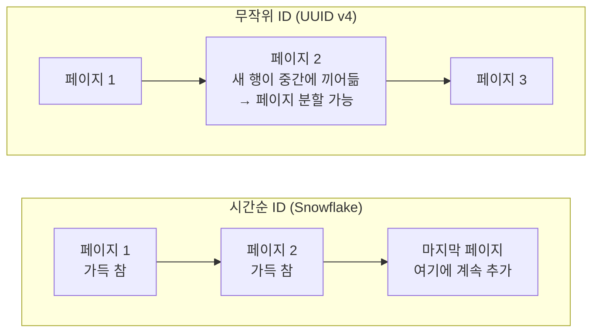
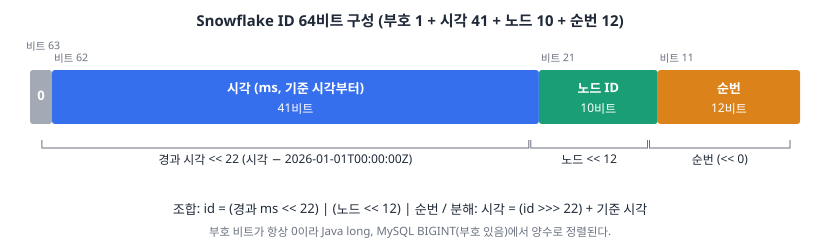
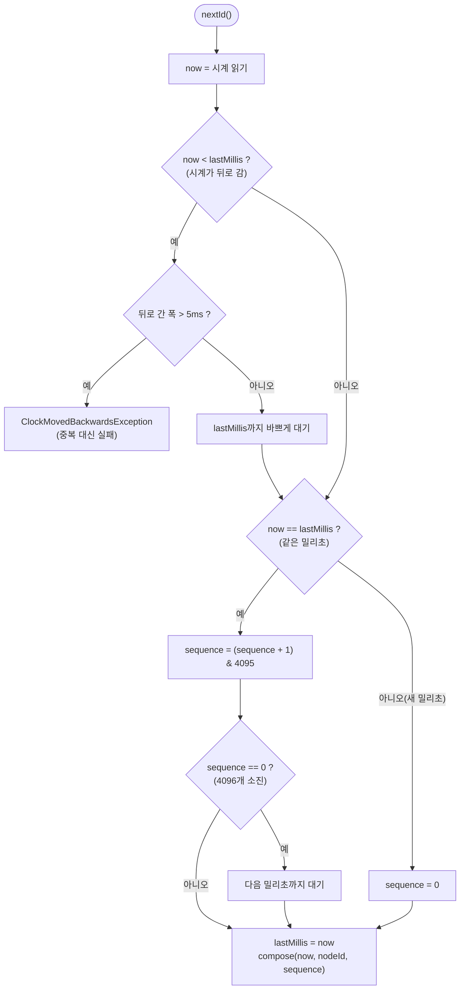

# 02. B 묶음 — Snowflake ID: 왜 이 구조이고, 코드는 무엇을 막는가

> 이전: [[01. A 코드 골격]] · 다음: [[03. C 측정 환경]]
>
> `board-id` 하위 프로젝트에 들어 있는 **ID 생성기**를 다룬다. 비트 구성, 시계가 거꾸로 갈 때의 처리, 동시성, 그리고 이 선택이 DB(InnoDB)와 JavaScript 클라이언트에 미치는 영향까지 코드 그대로 따라간다.

## 0. 한눈에 보기

| 항목 | 값 |
| --- | --- |
| 위치 | `board-id/src/main/java/io/github/guseoh/board/id/` (`Snowflake`, `SnowflakeIdGenerator`, `ClockMovedBackwardsException`) + 앱의 `common/id/` (설정과 빈) |
| 의존성 | **없음** (순수 Java, Spring 모름) |
| 구성 | 부호 1 + 시각 41(ms) + 노드 10 + 순번 12 = 64비트 |
| 기준 시각 | 2026-01-01T00:00:00Z (`EPOCH_MILLIS = 1_767_225_600_000L`) |
| 수명 | 41비트 ≈ **69.7년** → 2095-09-07까지 |
| 노드 수 | 1,024개 (0~1023). 앱은 0, 데이터 생성기(datagen)는 1023 |
| 처리 상한 | 노드 하나가 1ms에 4,096개 = 초당 약 409만 개 |
| 동시성 | `synchronized` (CAS 대안은 측정 후 판단) |
| 시계 역행 | 5ms 이내는 기다리고, 그보다 크면 예외 |
| 테스트 | `SnowflakeTest` 5개, `SnowflakeIdGeneratorTest` 7개, `SnowflakeConfigTest` 3개 |

## 1. 왜 ID 전략을 0단계에서 정하는가

ID는 나중에 바꾸기 가장 어려운 결정 중 하나다. PK는 InnoDB에서 **테이블 저장 구조 자체**를 정하고, 다른 테이블의 외래 키와 보조 인덱스 안에 복사되어 들어가며, 외부 API의 응답에 노출된다. 1단계에서 첫 엔티티를 만드는 순간 정해진다. 그래서 0단계에서 정하고 측정까지 한다.

이 프로젝트에서 ID는 세 가지 요구를 받는다.

1. **여러 앱 인스턴스가 중앙 조율 없이** 만들 수 있어야 한다(4단계에서 인스턴스를 2대로 늘린다).
2. **저장이 빨라야 한다.** 수천만 건 적재가 2~4단계의 핵심 실험이다.
3. **정렬이 가능해야 한다.** 최신순 목록, 커서 페이지네이션이 시각 순서의 ID에 기댄다.

## 2. 후보 비교

| 방식 | 원리 | 장점 | 이 프로젝트에서 탈락/채택한 이유 |
| --- | --- | --- | --- |
| `AUTO_INCREMENT` (IDENTITY) | DB가 INSERT 때 번호를 준다 | 단순, 작고 순서대로 증가 | **INSERT를 해야 ID를 안다** → Hibernate가 JDBC 배치를 끈다. H-01에서 INSERT가 행마다 1건씩 나갔다. 인스턴스/DB가 여러 개면 번호가 겹치거나 환경마다 다르다 |
| UUID v4 | 128비트 난수 | 어디서나 중복 없이 생성 | 16바이트(문자열이면 36바이트)로 크고, **순서가 없어서** 클러스터드 인덱스 곳곳에 끼어든다 |
| UUID v7 / ULID | 시각 + 난수 | 시간순 정렬 가능 | 128비트라 PK와 보조 인덱스가 커진다 |
| 채번 테이블/티켓 서버 | 중앙 서버가 번호를 발급 | 순서 보장 | 중앙 서버가 **단일 장애점**이고 발급이 병목이다 |
| **Snowflake 계열** | 시각 + 노드 + 순번을 64비트에 조합 | 8바이트, 시간순, 중앙 없음 | **노드 ID를 인스턴스마다 다르게 배정해야** 한다. 시계에 의존한다 |

> **현업 사례 한 줄.** LY Corporation(LINE Plus)의 「이커머스 플랫폼의 주문 DB 마이그레이션 경험기」는 MySQL `AUTO_INCREMENT`가 JPA의 batch insert와 맞지 않아(JPA가 영속성 컨텍스트에 넣기 위해 ID를 먼저 알아야 해서 객체마다 INSERT가 나간다), 채번 테이블 대신 **Snowflake와 유사한 자체 ID**를 채택했다고 적는다. 우리가 같은 결론에 도달한 이유가 H-01의 B' 결과(IDENTITY는 배치를 끈다)다([[04. D 데이터 생성과 적재]]).
>
> 우아한형제들의 「MySQL 환경의 스프링부트에 하이버네이트 배치 설정해 보기」도 같은 현상을 다룬다. `hibernate.jdbc.batch_size`만으로는 IDENTITY 엔티티의 INSERT가 묶이지 않는다.
>
> 
>
> *그림 2-1. Hibernate 공식 문서의 안내("IDENTITY 식별자 생성기를 쓰면 JDBC 수준의 INSERT 배치를 투명하게 끈다"). 출처: [우아한형제들 기술블로그, 권순규, 2020-09-23](https://techblog.woowahan.com/2695/)*

## 3. 키가 크면 왜 문제인가: InnoDB 클러스터드 인덱스

MySQL 공식 문서(8.4, InnoDB Index Types)가 말하는 것은 네 가지다.

1. 모든 InnoDB 테이블에는 **행 데이터를 저장하는 클러스터드 인덱스**가 있고, 보통 PK와 같다.
2. PK를 정의하면 InnoDB가 그것을 클러스터드 인덱스로 쓴다.
3. **보조 인덱스의 레코드마다 PK 컬럼이 함께 저장**되고, 보조 인덱스로 찾은 뒤 이 PK 값으로 클러스터드 인덱스를 다시 찾아간다.
4. 따라서 "PK가 길면 보조 인덱스가 더 많은 공간을 쓰므로 **짧은 PK가 유리**하다".

그림으로 보면 클러스터드 인덱스의 리프에는 행 전체가 들어 있고, 보조(논클러스터드) 인덱스의 리프에는 PK가 들어 있다.


*그림 3-1. 클러스터드 인덱스. 키 순서대로 페이지(PageId 10, 11, 12)에 행 전체가 놓인다. 출처: [velog @saewoohan, 클러스터링 인덱스](https://velog.io/@saewoohan/클러스터링-인덱스) (예시 테이블은 이해를 위한 일반 도식이다)*


*그림 3-2. 보조 인덱스. 리프에 `MobileNo`와 함께 **클러스터드 키(RollNo)**가 담겨, 그 값으로 다시 클러스터드 인덱스를 찾아간다. 출처: 위와 같은 글*

여기서 ID의 **크기**(8바이트 BIGINT vs 16~36바이트 UUID)가 모든 보조 인덱스의 크기에 곱해진다는 점이 나온다. 그리고 ID의 **순서**가 삽입 위치를 정한다.



시간순에 가까운 ID는 새 행이 **맨 끝 페이지에 붙는다**. 무작위 ID는 새 행이 B+트리 중간 어디에든 들어가고, 이미 찬 페이지에 끼어들면 페이지를 쪼개야 한다. 이것은 일반적인 설명이고, 0단계에서 UUID로 직접 측정하지는 않았다. 측정한 것은 **같은 Snowflake PK에서 적재 방식에 따른 차이**(H-01)이고, 보조 인덱스를 가진 1,000만 건 적재에서 PK 순서가 주는 영향은 2단계에서 잰다.

> 한국어 자료로 더 보려면 [velog @saewoohan, 클러스터링 인덱스](https://velog.io/@saewoohan/클러스터링-인덱스)(InnoDB가 PK 순서로 저장한다는 구조와 PK 변경 비용)를 읽자. 다만 이 글의 "세컨더리 인덱스가 5개면 크기가 5배" 같은 표현은 과장이다. 정확히는 **각 보조 인덱스 항목마다 PK 크기만큼이 더해진다**.

## 4. 비트 설계



*그림 4-1. 이 프로젝트의 비트 구성. 직접 그렸다.*

| 필드 | 비트 | 선택 이유 |
| --- | --- | --- |
| 부호 | 1 | 항상 0. Java `long`과 MySQL `BIGINT`(부호 있음)에서 양수로 다루려고 |
| 시각 | 41 | 기준 시각부터 경과한 **밀리초**. 2^41 ms ≈ 69.7년 |
| 노드 | 10 | 인스턴스 구분. 0~1023 |
| 순번 | 12 | 같은 밀리초 안의 일련번호. 0~4095 |

**기준 시각(epoch)을 2026-01-01로 잡은 이유.** Unix 시각(1970-01-01)을 그대로 쓰면 41비트가 2039년에 다 찬다. 기준을 2026년으로 당기면 같은 41비트로 **2095년까지** 쓰고, ID 숫자도 작아진다.

**노드를 10비트 하나로 둔 이유.** 한국어 자료에서 흔히 보는 Twitter 원본 구조는 "데이터센터 5 + 서버 5"로 쪼갠다.


*그림 4-2. 널리 알려진 구조(부호 1, 타임스탬프 41, 데이터센터 5, 서버 5, 일련번호 12). 출처: [velog @mmy789, 가상 면접 사례로 배우는 대규모 시스템 설계 기초 7장 정리](https://velog.io/@mmy789/System-Design-8)*

우리는 데이터센터가 하나뿐이라 둘을 합쳐 **노드 10비트**로 단순화했다. 총 비트가 같으므로 호환 가능한 구조이고, 노드 번호를 어떻게 나눌지는 운영 방식에 맡긴다.

**다른 설계도 있다.** LINE의 주문 DB는 호환성 때문에 표준 Snowflake를 쓰지 못하고 **날짜 8자리 + 인스턴스 번호 3자리 + 시퀀스 7자리의 18자리 숫자**로 구성했다.


*그림 4-3. 날짜 + 인스턴스 + 시퀀스 구조. 출처: [LY Corporation 기술 블로그, 서종현, "이커머스 플랫폼의 주문 DB 마이그레이션 경험기"](https://techblog.lycorp.co.jp/ko/experience-in-migrating-order-db-on-ecommerce-platform)*

두 방식의 차이는 "시각을 **밀리초 이진수**로 넣느냐, **날짜 문자열 자리**로 넣느냐"다. 앞은 짧고 빠르고 정렬이 정확하며, 뒤는 사람이 ID에서 날짜를 읽을 수 있고 기존 시스템과 맞추기 쉽다.

### 숫자로 따라가기

2026-11-14T00:00:00Z에 노드 0이 만든 순번 0의 ID를 직접 조합해 보자.

```text
경과 시간     = 2026-11-14 − 2026-01-01 = 317일 = 27,388,800,000 ms
경과 << 22    = 27,388,800,000 × 4,194,304 = 114,876,953,395,200,000
노드 << 12    = 0
순번          = 0
ID            = 114,876,953,395,200,000   (18자리)
이진수(앞쪽 36자리) = 0000 0011 0011 0000 0011 1111 1111 0110 0000 … (나머지 0)
```

같은 밀리초에 순번 1이면 `...200,001`, 순번 4095이면 `...204,095`다. 노드 1023이 순번 7을 만들면 `...,399,390,215`다(노드가 12비트 위에 얹혀 값이 크게 뛴다). 최댓값은 `2^63 − 1 = 9,223,372,036,854,775,807`이다.

## 5. 코드 읽기 — `Snowflake`: 조합과 분해만 한다

```java
public final class Snowflake {

	/** 기준 시각 2026-01-01T00:00:00Z. 41비트로 이 시각부터 약 69.7년을 쓸 수 있다. */
	public static final long EPOCH_MILLIS = 1_767_225_600_000L;

	public static final int TIMESTAMP_BITS = 41;
	public static final int NODE_ID_BITS = 10;
	public static final int SEQUENCE_BITS = 12;

	public static final long MAX_ELAPSED_MILLIS = (1L << TIMESTAMP_BITS) - 1;
	public static final int MAX_NODE_ID = (1 << NODE_ID_BITS) - 1;    // 1023
	public static final int MAX_SEQUENCE = (1 << SEQUENCE_BITS) - 1;  // 4095

	private static final int NODE_ID_SHIFT = SEQUENCE_BITS;                 // 12
	private static final int TIMESTAMP_SHIFT = SEQUENCE_BITS + NODE_ID_BITS; // 22
```

비트 수를 상수로 두고 나머지(최댓값, 시프트 양)를 모두 **계산**으로 얻는다. 비트 구성을 바꿀 때 숫자 하나만 고치면 나머지가 따라온다.

```java
public static long compose(long epochMillis, int nodeId, int sequence) {
	long elapsed = epochMillis - EPOCH_MILLIS;
	if (elapsed < 0 || elapsed > MAX_ELAPSED_MILLIS) {
		throw new IllegalArgumentException(
				"시각이 Snowflake 범위를 벗어났습니다: " + Instant.ofEpochMilli(epochMillis));
	}
	requireNodeId(nodeId);
	if (sequence < 0 || sequence > MAX_SEQUENCE) {
		throw new IllegalArgumentException(
				"순번은 0~" + MAX_SEQUENCE + "이어야 합니다: " + sequence);
	}
	return elapsed << TIMESTAMP_SHIFT | (long) nodeId << NODE_ID_SHIFT | sequence;
}
```

- **`elapsed << 22 | (long) nodeId << 12 | sequence`**: 자바에서 시프트 연산자는 `|`보다 우선순위가 높아 괄호 없이도 의도대로 묶인다. `nodeId`는 `int`라서 `(long)` 캐스트를 **시프트 전에** 한다(큰 노드 번호에서 `int` 오버플로를 막는 습관이다).
- **범위 검증을 조합 함수에서** 한다. 기준 시각 이전이면 `elapsed`가 음수가 되어 부호 비트가 켜진 음수 ID가 만들어진다. 데이터 생성기(datagen)에서 실제로 이 오류를 만났다. "과거 365일"을 만들려고 했는데 기준 시각(2026-01-01)보다 이전 날짜가 포함되어 ID로 표현할 수 없었다([[04. D 데이터 생성과 적재]]). 그래서 생성 기간을 300일로 줄이고 범위를 벗어나면 시작부터 오류를 내게 했다.

```java
/** ID를 만든 시각(Unix 기준 밀리초). */
public static long epochMillisOf(long id) {
	return (id >>> TIMESTAMP_SHIFT) + EPOCH_MILLIS;
}

public static int nodeIdOf(long id) {
	return (int) (id >>> NODE_ID_SHIFT) & MAX_NODE_ID;
}

public static int sequenceOf(long id) {
	return (int) id & MAX_SEQUENCE;
}
```

분해에는 `>>>`(부호 없는 오른쪽 시프트)를 쓴다. 부호 비트가 0이라 `>>`와 결과가 같지만 의도를 분명히 한다. 노드 ID는 마스크(`& 1023`)로 시각 비트를 잘라낸다.

### 왜 조합/분해를 생성기와 따로 두었나

```text
Snowflake            ← 상태 없음: compose / epochMillisOf / nodeIdOf / sequenceOf
SnowflakeIdGenerator ← 상태 있음: lastMillis, sequence. "지금 시각"으로 발급
```

데이터 생성기(datagen)는 **과거 시각 + 노드 1023 + 순번**으로 ID를 직접 조합해야 한다. "현재 시각"만 쓰는 생성기로는 과거 날짜의 게시글 ID를 만들 수 없다. 조합을 상태 없는 정적 함수로 분리했기에 앱과 데이터 생성기가 **같은 비트 규칙**을 공유한다.

## 6. 코드 읽기 — `SnowflakeIdGenerator`

```java
public synchronized long nextId() {
	long now = clock.getAsLong();

	if (now < lastMillis) {
		if (lastMillis - now > MAX_BACKWARD_MILLIS) {
			throw new ClockMovedBackwardsException(lastMillis, now);
		}
		now = waitUntil(lastMillis);
	}

	if (now == lastMillis) {
		sequence = (sequence + 1) & Snowflake.MAX_SEQUENCE;
		if (sequence == 0) {
			// 이 밀리초의 순번 4,096개를 다 썼다. 다음 밀리초가 될 때까지 기다린다.
			now = waitUntil(lastMillis + 1);
		}
	} else {
		sequence = 0;
	}

	lastMillis = now;
	return Snowflake.compose(now, nodeId, sequence);
}
```



세 갈래를 하나씩 보자.

**① 새 밀리초이면 순번을 0으로 되돌린다.** 모든 ID는 `(시각, 노드, 순번)` 튜플이 유일해야 하는데, 시각이 달라졌으니 순번을 처음부터 써도 안전하다.

**② 같은 밀리초이면 순번을 올린다.** `& MAX_SEQUENCE`로 4095 다음이 0이 되게 하고, 0으로 돌아왔다면 **이 밀리초의 4,096개를 다 쓴 것**이므로 다음 밀리초가 올 때까지 기다린다. 기다리지 않고 순번을 0으로 쓰면 같은 `(시각, 노드, 0)`이 두 번 나와 **중복**이다.

**③ 시계가 뒤로 가면 가장 위험하다.** `now < lastMillis`는 이미 쓴 시각으로 돌아갔다는 뜻이다(NTP 보정, 가상 머신 일시 정지 후 복귀 등). 그대로 진행하면 과거에 쓴 `(시각, 노드, 순번)`을 다시 만들 수 있다.

- **5ms 이내**: NTP 보정에서 흔한 크기라서 시계가 따라잡을 때까지 **기다린다**.
- **5ms 초과**: `ClockMovedBackwardsException`을 던진다.

```java
public class ClockMovedBackwardsException extends IllegalStateException { ... }
```

> **중복 ID보다 실패가 낫다.** 중복 PK는 INSERT 실패로 끝나지만, 다른 테이블이 같은 ID를 참조하면 **데이터가 조용히 섞인다**. 서비스는 "ID를 못 만들었다"는 장애로 보이는 편이 낫다.

### `waitUntil`: 바쁜 대기(spin)

```java
private long waitUntil(long targetMillis) {
	long now = clock.getAsLong();
	while (now < targetMillis) {
		Thread.onSpinWait();
		now = clock.getAsLong();
	}
	return now;
}
```

기다리는 시간은 **최대 몇 ms**다. `Thread.sleep(1)`로 스레드를 재우면 OS 스케줄링이 끼어 몇 ms 이상을 더 쓸 수 있다. 짧게는 돌면서 기다리는 쪽이 싸다. `Thread.onSpinWait()`는 CPU에 "나는 대기 루프 중"이라는 힌트를 준다(x86의 `PAUSE` 등). **대가**는 기다리는 동안 CPU 코어 하나를 쓴다는 점이다. 이 시계 역행·순번 소진은 드문 경로라서 받아들였다.

### 동시성: 왜 `synchronized`인가

두 값 `lastMillis`와 `sequence`를 **함께 읽고 함께 바꿔야** 한다. 한쪽만 바뀐 중간 상태를 다른 스레드가 보면 같은 ID가 나온다. 임계 구역이 몇 줄뿐이라 `synchronized`가 가장 단순하고 안전하다.

대안은 두 값을 `long` 하나로 묶어 `AtomicLong`의 **CAS(Compare-And-Swap)**로 갱신하는 것이다.

```java
// 설계 스케치 (구현하지 않음)
// state = (lastMillis << 12) | sequence 를 AtomicLong 하나로 들고,
// 읽은 값에서 다음 상태를 계산한 뒤 compareAndSet이 성공할 때까지 재시도한다.
```

| | `synchronized` | CAS (`AtomicLong`) |
| --- | --- | --- |
| 구현 난이도 | 쉽다 | 두 값을 한 `long`에 묶는 비트 연산 필요 |
| 경합이 적을 때 | 충분히 빠르다 | 약간 더 빠를 수 있다 |
| 경합이 많을 때 | 스레드가 락을 기다린다 | 재시도 루프가 CPU를 쓴다 |
| 시계 역행/순번 소진의 대기 | 락을 쥔 채 기다린다(다른 스레드도 막힘) | 재시도하며 기다린다 |

CAS는 하드웨어의 원자 명령 하나로 "기대한 값이면 바꾼다"를 수행한다(국내 블로그는 [tistory maruhxn, CAS - 동기화와 원자적 연산](https://mxruhxn.tistory.com/entry/Java-CAS-%EB%8F%99%EA%B8%B0%ED%99%94%EC%99%80-%EC%9B%90%EC%9E%90%EC%A0%81-%EC%97%B0%EC%82%B0)이 쉽게 설명하는데, CAS가 "두 명령 사이를 막는다"는 표현은 부정확하고 실제로는 CPU의 **단일 원자 명령**이다). **0단계에서는 발급 속도를 측정하지 않았다.** 스레드 수별 발급 속도를 재 보고 병목일 때만 바꾸는 것이 코드 주석에 적은 방침이다. 지금은 앱 처리량이 DB 왕복(약 0.9ms)에 묶여 ID 발급이 병목이 아니다.

## 7. 설정과 노드 ID: 이 방식의 실패 지점

```java
@Validated
@ConfigurationProperties("board.snowflake")
public record SnowflakeProperties(@DefaultValue("0") @Min(0) @Max(1023) int nodeId) {
}
```

```java
@Bean
public SnowflakeIdGenerator snowflakeIdGenerator(SnowflakeProperties properties) {
	return new SnowflakeIdGenerator(properties.nodeId());
}
```

- 값은 `board.snowflake.node-id`(환경 변수 `BOARD_NODE_ID`)에서 읽는다. 범위를 벗어나면 `@Min/@Max` 검증에서 **기동이 실패**한다. 잘못된 노드 번호로 서버가 뜨는 것보다 낫다.
- 생성기 **빈은 앱 전체에서 하나**다. 두 개를 만들어 같은 노드 번호를 주면 같은 밀리초에 같은 순번을 내서 **중복 ID**가 나온다.
- **같은 노드 번호로 인스턴스 둘을 띄우는 것이 이 방식의 근본적인 실패 지점**이다. 4단계에서 앱을 2대로 늘릴 때는 인스턴스마다 다른 값을 환경 변수로 줘야 한다. datagen은 1023을 쓰므로 앱에서는 1023을 피한다.

이 지점은 코드가 막아 주지 못한다(두 인스턴스는 서로를 모른다). 그래서 4단계에서 "노드 ID를 누가 배정하는가"(환경 변수, 기동 시 DB에서 선점, 컨테이너 번호 등)를 정해야 한다. LINE 사례는 기동 시 **MySQL 테이블 락으로 인스턴스 번호를 선점**하고 선점 시각을 기록한다고 소개한다.

## 8. 테스트로 고정한 것

**`SnowflakeTest` (상태 없는 조합/분해)**

| 테스트 | 의미 |
| --- | --- |
| 기준 시각은 2026-01-01 UTC | 상수가 의도와 같다 |
| 조합한 ID를 분해하면 넣은 값이 그대로 | 조합과 분해가 역함수다 |
| 모든 필드가 최댓값이어도 부호 비트는 0 | `Long.MAX_VALUE`를 넘지 않는다 |
| 지금 만든 ID는 JavaScript 안전 정수 범위를 넘는다 | 9절 |
| 범위를 벗어난 값은 거부 | 기준 시각 이전, 노드·순번 범위 |

**`SnowflakeIdGeneratorTest` (상태 있는 생성기)** — 시계를 `LongSupplier`로 **주입**받아 시간을 마음대로 조작한다.

| 테스트 | 의미 |
| --- | --- |
| 노드 ID 0~1023만 허용 | 경계값 |
| 같은 ms에서는 순번이 오르고 시각이 바뀌면 0 | ①② |
| 순번 4096개를 다 쓰면 다음 ms로 | ② 소진 |
| 시계가 5ms 이내로 뒤로 가면 따라잡을 때까지 기다림 | ③ 허용 범위 |
| 5ms보다 크게 뒤로 가면 예외 | ③ 초과 |
| 실제 시계로 발급한 ID는 단조 증가 | 정렬 |
| **스레드 32개가 10만 개씩 발급해도 중복 없음** | 동시성 |

시계를 주입하지 않으면 "시계가 뒤로 가는 상황"을 테스트에서 만들 수 없다. 생성기가 `LongSupplier`를 받는 이유다.

**`SnowflakeConfigTest`** — 설정이 없으면 노드 0으로 등록, 설정값이 ID에 들어감, 범위 밖이면 기동 실패.

## 9. 클라이언트에서의 함정: JavaScript는 2^53까지만 정확하다

JavaScript의 `Number`는 64비트 부동소수점이라 **정수를 정확히 표현할 수 있는 한계가 `2^53 − 1 = 9,007,199,254,740,991`**이다(`Number.MAX_SAFE_INTEGER`, [MDN](https://developer.mozilla.org/en-US/docs/Web/JavaScript/Reference/Global_Objects/Number/MAX_SAFE_INTEGER)). 우리 ID는 이를 **훨씬 넘는다**.

```text
위에서 조합한 ID   114,876,953,395,200,000
JS 안전 정수 한계     9,007,199,254,740,991
비율               약 12.75배
```

흥미로운 사실이 하나 있다. ID가 2^53을 넘는 시점은 `경과 ms × 2^22 > 2^53`, 즉 **경과 ms > 2^31 ms ≈ 24.9일**이다. 기준 시각(2026-01-01)에서 25일이 지난 **2026-01-26 이후의 모든 ID가 JS 안전 정수를 넘는다**. 그래서 JSON 숫자로 내려보내면 브라우저가 **조용히 마지막 자리를 반올림**해 다른 ID가 된다. `SnowflakeTest`의 "지금 만든 ID는 JavaScript 안전 정수 범위를 넘는다"가 이 사실을 고정한다.

**대응(ADR-005로 채택)**: API 응답 DTO의 ID 필드를 `String`으로 선언하고, 요청으로 받는 ID도 문자열로 받아 변환한다. 적용은 1단계 첫 응답 DTO부터다. 전역 Jackson 설정으로 **모든** `Long`을 문자열로 만드는 대안은 "좋아요 수" 같은 진짜 숫자까지 문자열이 되어 버려 채택하지 않았다. 대가는 DTO마다 변환 코드가 필요하고, 하나라도 `long`으로 두면 문제가 되살아난다는 점이다. 이를 ArchUnit이나 테스트로 막을지는 1단계에서 정한다.

## 10. 결정과 대가

| 결정 | 얻은 것 | 치른 대가 |
| --- | --- | --- |
| Snowflake 계열 64비트 | 8바이트, 시간순, 중앙 조율 없음, JPA 배치 가능 | 노드 ID 배정 책임이 운영으로 넘어온다 |
| 기준 시각 2026-01-01 | 2095년까지, 숫자가 작다 | 기준 시각 이전 데이터는 ID로 못 만든다 |
| 노드 10비트 | 단순하다 | 데이터센터/서버 구분은 운영 규칙으로 |
| 조합과 생성기 분리 | datagen이 과거 시각으로 조합 | 클래스가 둘이다 |
| `synchronized` | 단순, 안전 | 경합 시 대기. 측정 후 CAS 검토 |
| 시계 역행: 5ms 이내 대기, 초과 시 예외 | 중복을 막는다 | 큰 역행에서는 ID 발급이 실패한다 |
| ID는 DTO에서 문자열로 (ADR-005) | JS에서 정확하다 | DTO마다 변환이 필요하고, 누락을 막는 장치가 아직 없다 |

## 11. 후속 항목

1. **노드 ID 배정 방식**(4단계, 인스턴스 2대): 환경 변수 vs 기동 시 선점.
2. **ID 직렬화**(1단계): ADR-005대로 DTO에서 문자열로. 누락(`long`으로 둔 DTO)을 ArchUnit이나 테스트로 막을지 결정한다.
3. **엔티티 기반 클래스**(1단계): ID를 앱이 넣으므로 `Persistable`을 구현해 INSERT 전 SELECT를 막는다(H-01의 A′, [[04. D 데이터 생성과 적재]]).
4. 발급 속도 측정(필요 시): 스레드 수별 `synchronized` vs CAS.

## 12. 참고 자료

| 구분 | 자료 | 읽을 부분 |
| --- | --- | --- |
| 한국 기업 | [LY Corporation 기술 블로그, 이커머스 플랫폼의 주문 DB 마이그레이션 경험기](https://techblog.lycorp.co.jp/ko/experience-in-migrating-order-db-on-ecommerce-platform) | AUTO_INCREMENT와 JPA 배치의 충돌, 자체 ID 채번, 인스턴스 번호 선점 (본문의 "4byte" 표기 등 일부 오기가 있어 바이트는 직접 계산해 읽자) |
| 한국 기업 | [우아한형제들, MySQL 환경의 스프링부트에 하이버네이트 배치 설정해 보기](https://techblog.woowahan.com/2695/) | IDENTITY가 배치를 끄는 이유, `rewriteBatchedStatements` |
| 한국 기업 | [우아한형제들, JPA에서 아이디를 자동증가 값으로 사용 시 하이버네이트의 @NaturalId 사용해 보기](https://techblog.woowahan.com/17221/) | 자동증가 PK가 환경마다 달라질 때의 문제 |
| 한국 개인 | [velog @mmy789, 분산 시스템을 위한 유일 ID 생성기 설계](https://velog.io/@mmy789/System-Design-8) | 다중 마스터, UUID, 티켓 서버, Snowflake 비교 |
| 한국 개인 | [jihunparkme, 07. 유일 ID 생성기 설계](https://jihunparkme.gitbook.io/docs/book/system-design-interview/07) | 64비트 배치, 약 69년, NTP (시계 역행·노드 배정은 다루지 않는다) |
| 한국 개인 | [velog @saewoohan, 클러스터링 인덱스](https://velog.io/@saewoohan/클러스터링-인덱스) | 클러스터드 vs 논클러스터드 |
| 한국 개인 | [velog @penrose_15, IDENTITY 전략에서 JPA Bulk Insert를 하는 방법](https://velog.io/@penrose_15/MySQL에서-Bulk-Insert를-사용하기-위한-뻘짓-모음) | IDENTITY에서 `saveAll`이 묶이지 않아 `JdbcTemplate.batchUpdate`로 돌아간 과정 |
| 한국 개인 | [tistory maruhxn, CAS - 동기화와 원자적 연산](https://mxruhxn.tistory.com/entry/Java-CAS-%EB%8F%99%EA%B8%B0%ED%99%94%EC%99%80-%EC%9B%90%EC%9E%90%EC%A0%81-%EC%97%B0%EC%82%B0) | `compareAndSet` 재시도 루프 |
| 공식 | [MySQL 8.4: Clustered and Secondary Indexes](https://dev.mysql.com/doc/refman/8.4/en/innodb-index-types.html) | PK = 클러스터드, 보조 인덱스에 PK가 포함됨, 짧은 PK |
| 공식 | [Hibernate 6.6 User Guide: IDENTITY columns](https://docs.hibernate.org/orm/6.6/userguide/html_single/Hibernate_User_Guide.html) | IDENTITY 엔티티는 INSERT를 배치할 수 없다 |
| 공식 | [MDN: Number.MAX_SAFE_INTEGER](https://developer.mozilla.org/en-US/docs/Web/JavaScript/Reference/Global_Objects/Number/MAX_SAFE_INTEGER) | 2^53 − 1 |

> Twitter가 2010년 공개한 원본 Snowflake 설명(X 엔지니어링 블로그)은 접근이 막혀 이 문서에서 직접 인용하지 못했다. 구조 설명은 위의 한국어 정리 글을 근거로 했다.
