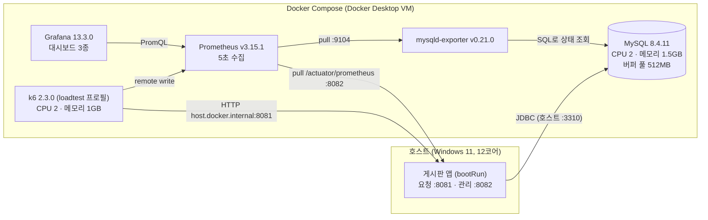
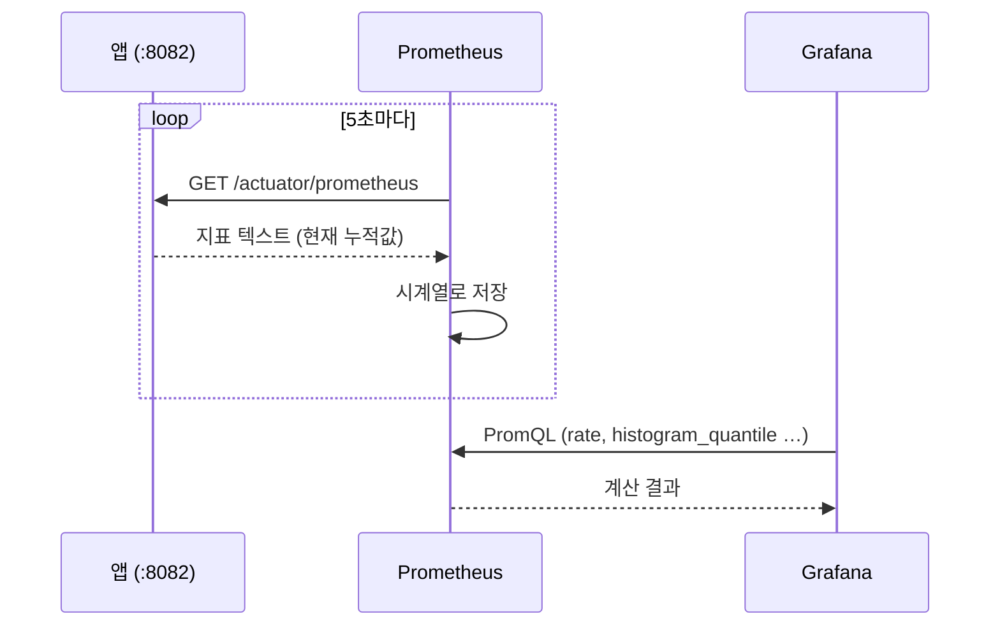
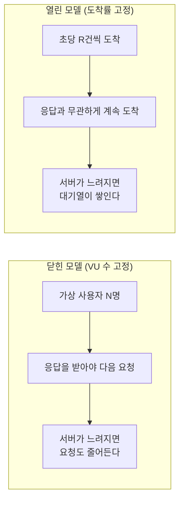
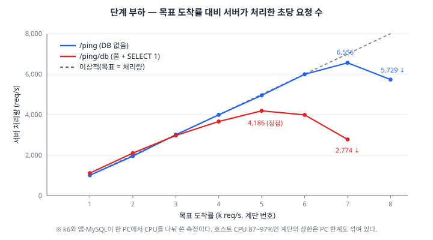
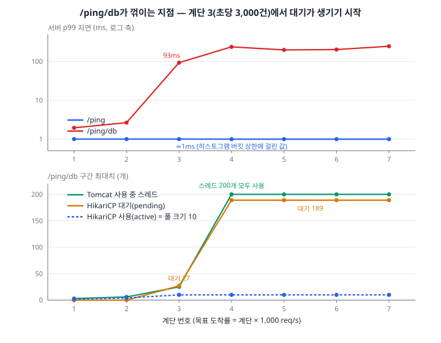

# 03. C 묶음 — 측정 환경: 환경을 코드로 고정하고, 기준선을 잰다

> 이전: [[02. B Snowflake ID]] · 다음: [[04. D 데이터 생성과 적재]]
>
> 이 묶음은 "숫자를 믿을 수 있게 만드는 장비"를 만든다. Docker Compose로 MySQL·Prometheus·Grafana·k6를 고정하고, 앱 지표를 어떻게 내보내고 읽는지, 부하를 어떤 모델로 거는지, 그리고 그 위에서 잰 **기준선**(DB 왕복 약 0.9ms, 풀 10개에서 포화)을 설명한다.
>
> 일반 개념은 [[../../../Study/Performance/01. 성능 엔지니어링과 기준선|성능 엔지니어링과 기준선]], [[../../../Study/Performance/06. Tomcat HikariCP DB Queueing|Tomcat HikariCP DB Queueing]], [[../../../Study/Performance/07. Latency Percentile과 Tail Latency|Latency Percentile과 Tail Latency]]에서 더 깊게 다룬다. 이 문서는 **이 프로젝트에서 실제로 한 일과 수치**에 집중한다.

## 0. 이 묶음이 하는 일

| 하는 일 | 파일 | 왜 |
| --- | --- | --- |
| 실험 환경 고정 | `compose.yaml`, `infra/mysql/conf.d/board.cnf` | 이미지 버전·자원·설정이 바뀌면 수치를 비교할 수 없다 |
| 지표 노출·수집 | `application.yaml`(management), `infra/prometheus/prometheus.yml` | 앱 안에서 무슨 일이 벌어지는지 숫자로 본다 |
| 시각화 | `infra/grafana/**` | 대시보드를 파일로 두어 지워도 다시 뜬다 |
| 부하 생성 | `loadtest/lib/config.js`, `loadtest/scenarios/ping.js` | 같은 조건을 반복 실행한다 |
| 기준선 측정 | `/api/v1/ping`, `/api/v1/ping/db` | 이후 모든 수치의 비교 기준 |

## 1. 전체 구성



**앱이 컨테이너가 아니라 호스트에 있는 이유**: 0~3단계에서는 앱을 IDE와 `bootRun`으로 빠르게 고치며 실험한다. 대신 MySQL(2코어)과 k6(2코어)에 CPU 제한을 걸어 **병목이 MySQL 쪽에서 먼저 나타나도록** 의도했다. 4단계에서 앱을 컨테이너로 옮기면 이 경로가 바뀌므로 다시 잰다.

## 2. `compose.yaml`: 환경을 코드로 고정한다

### 2.1 왜 고정하나

측정값이 바뀌는 이유는 "코드를 바꿔서"와 "환경이 바뀌어서" 두 가지다. 후자가 섞이면 **내가 바꾼 변수의 효과를 알 수 없다**. 그래서 이 프로젝트는 환경을 파일 하나로 못 박는다.

- 이미지 태그를 고정한다(`mysql:8.4.11`, `prom/prometheus:v3.15.1`, `grafana/grafana:13.3.0`, `grafana/k6:2.3.0`). `latest`는 쓰지 않는다.
- 자원(CPU, 메모리)을 제한한다.
- 설정 파일을 저장소에 둔다. **값을 바꾸면 실험 기록에 적는다**(설정 파일 주석에도 적어 두었다).

### 2.2 MySQL

```yaml
mysql:
  image: mysql:8.4.11
  command:
    - mysqld
    - --character-set-server=utf8mb4
    - --collation-server=utf8mb4_0900_ai_ci
    - --default-time-zone=+00:00
  deploy:
    resources:
      limits:
        cpus: "2"
        memory: 1536M
```

```ini
# infra/mysql/conf.d/board.cnf
[mysqld]
innodb_buffer_pool_size = 512M
slow_query_log = ON
long_query_time = 0.1
slow_query_log_file = /var/lib/mysql/slow-query.log
innodb_buffer_pool_dump_at_shutdown = OFF
innodb_buffer_pool_load_at_startup = OFF
innodb_flush_log_at_trx_commit = 1
```

| 설정 | 값 | 이유 |
| --- | --- | --- |
| `innodb_buffer_pool_size` | 512M | 나중의 데이터(수천만 건)가 버퍼 풀보다 **훨씬 커야** 디스크 읽기 병목이 드러난다. 풀이 데이터보다 크면 모든 것이 메모리에서 끝나 실험이 무의미해진다 |
| `long_query_time` | 0.1초 | 100ms 넘는 쿼리를 슬로우 쿼리로 기록한다(기본 10초는 너무 둔하다) |
| `innodb_buffer_pool_dump/load` | OFF | 재시작할 때마다 **버퍼 풀이 비어 있는 같은 상태**에서 시작하게 한다. 켜 두면 이전 실행의 캐시가 다음 측정을 빠르게 만든다 |
| `innodb_flush_log_at_trx_commit` | 1 | 기본값이지만 **실험 조건으로 기록**하려고 명시. 커밋마다 redo 로그를 디스크에 내려 내구성이 최대다 |
| CPU 2 / 메모리 1.5GB | | 운영의 작은 DB 인스턴스를 흉내 낸다 |

### 2.3 함정 1: Windows에서 마운트한 설정 파일이 무시된다

처음에는 `board.cnf`를 `/etc/mysql/conf.d`에 바로 마운트했다. 그런데 설정이 **전혀 적용되지 않았다**. 원인은 Windows 바인드 마운트의 파일 권한이 777로 보이는 것이고, MySQL은 이런 파일을 보안상 이유로 **무시**한다(`World-writable config file ... is ignored`). compose의 `configs` `mode`도 적용되지 않았다.

해결은 기동할 때마다 **컨테이너 안으로 복사하며 권한을 0644로 바꾼 뒤** 원래 엔트리포인트를 실행하는 것이다.

```yaml
entrypoint:
  - sh
  - -c
  - install -m 0644 /opt/board/conf.d/board.cnf /etc/mysql/conf.d/board.cnf && exec docker-entrypoint.sh "$$@"
  - --
volumes:
  - ./infra/mysql/conf.d:/opt/board/conf.d:ro
```

매번 복사하므로 `board.cnf`를 고친 뒤 **재시작만 하면 반영**된다. `$$@`는 compose가 `$`를 변수로 해석하지 않게 이스케이프한 것이다.

### 2.4 함정 2: CSV 폴더를 읽기 전용(`:ro`)으로 둘 수 없다

```yaml
volumes:
  # datagen이 만든 CSV를 LOAD DATA INFILE로 읽는 폴더(secure_file_priv).
  - ./data/csv:/var/lib/mysql-files
```

보안상 읽기 전용(`:ro`)으로 두고 싶지만, MySQL 엔트리포인트가 이 폴더의 **소유자를 바꾸려다 실패해 기동하지 못한다**. 그래서 읽기·쓰기로 마운트하고 서버가 읽을 수 있는 폴더를 `secure_file_priv`가 가리키는 이 폴더 하나로 제한한다([[04. D 데이터 생성과 적재]]).

### 2.5 나머지 서비스

```yaml
mysqld-exporter:
  image: prom/mysqld-exporter:v0.21.0
  command: [--mysqld.address=mysql:3306, --mysqld.username=exporter]
  environment:
    MYSQLD_EXPORTER_PASSWORD: ${EXPORTER_PASSWORD}   # 환경 변수로 주입한다 (로컬 기본값은 compose.yaml 참고)
```

비밀번호는 실행 인자가 아니라 **환경 변수**로 준다. 인자에 넣으면 `ps` 목록에 보인다. 접속 계정은 지표를 읽는 데 필요한 최소 권한(`PROCESS`, `REPLICATION CLIENT`, `SELECT`)과 **최대 연결 수 3**으로 만든다(`infra/mysql/init/01-exporter-user.sql`). exporter가 연결을 새더라도 앱의 연결 한도를 갉아먹지 않게 하려는 것이다.

```yaml
prometheus:
  command:
    - --config.file=/etc/prometheus/prometheus.yml
    - --storage.tsdb.path=/prometheus
    - --web.enable-remote-write-receiver      # k6가 결과를 밀어 넣는(remote write) 경로
```

```yaml
k6:
  profiles: ["loadtest"]          # docker compose up으로는 뜨지 않는다. 필요할 때만 실행
  environment:
    K6_OUT: experimental-prometheus-rw
    K6_PROMETHEUS_RW_SERVER_URL: http://prometheus:9090/api/v1/write
  deploy:
    resources:
      limits: { cpus: "2", memory: 1G }
```

같은 장비에서 부하 생성기가 MySQL의 CPU를 빼앗으면 결과가 흔들리므로 k6도 **자원 제한**을 건다(다만 이것이 7절의 측정 한계가 된다).

## 3. 관측 파이프라인: 앱 → Prometheus → Grafana

### 3.1 pull 모델

Prometheus는 앱이 지표를 **밀어 넣지 않고 서버가 주기적으로 긁어 간다(pull)**. 앱은 `/actuator/prometheus`에 현재 지표를 텍스트로 노출하고, Prometheus가 5초마다 HTTP로 가져간다.


*그림 3-1. Prometheus 아키텍처. 서버가 타깃(Jobs/exporters)을 **pull**하고, 로컬에 저장하고, 규칙을 평가해 알림을 만든다. 출처: [Prometheus 공식 문서, Overview](https://prometheus.io/docs/introduction/overview/)*

공식 문서는 두 가지를 말한다. (1) 수집은 "HTTP 위의 pull 모델"이고, 단명 작업만 푸시 게이트웨이를 쓴다. (2) 각 서버는 독립적이며 원격 저장소에 의존하지 않는다. 또한 "요청 단위 과금처럼 100% 정확도가 필요한 곳에는 맞지 않는다"고 한계를 적는다. 우리는 **추세와 비교**를 보려는 것이라 맞다.



국내 한국어 자료로 같은 구성을 처음부터 따라 해 보려면 [velog @yin, "Spring Boot Actuator, Prometheus로 메트릭 수집하기"](https://velog.io/@yin/Grafana-Basic-Spring-Boot-Actuator-Prometheus로-메트릭-수집하기)가 좋다. Prometheus가 `/actuator/prometheus`를 주기적으로 호출하는 **pull 방식**을 로그의 push 방식과 대비하고, `Status → Targets` 화면에서 `UP/DOWN`을 확인하는 단계까지 있다. 다만 이 글은 `http_server_requests_seconds`가 히스토그램이라고 설명하면서 **버킷을 켜는 설정**(3.3절)은 보여 주지 않는다.

### 3.2 앱 쪽 설정

```yaml
management:
  server:
    port: ${MANAGEMENT_PORT:8082}      # 요청 포트(8081)와 분리 (이유는 [[05. E 운영과 장애 훈련]] 문서에서)
  endpoints:
    web:
      exposure:
        include: [health, info, metrics, prometheus]
  metrics:
    tags:
      application: board               # 모든 지표에 붙는다. 대시보드/알림이 이 값으로 고른다
    distribution:
      percentiles-histogram:
        http.server.requests: true     # 응답 시간을 버킷별 개수로 내보낸다
server:
  tomcat:
    threads:
      max: 200
    mbeanregistry:
      enabled: true                    # tomcat_threads_busy_threads 같은 지표를 내려면 켜야 한다
```

| 설정 | 의미 |
| --- | --- |
| `application: board` | 같은 Prometheus에 앱이 여러 개여도 `{application="board"}`로 고른다 |
| `percentiles-histogram: true` | 3.3절의 히스토그램 버킷을 내보낸다 |
| `tomcat.mbeanregistry.enabled` | **기본은 꺼져 있다.** 꺼져 있으면 Tomcat 스레드 지표가 없어서 "스레드가 고갈됐는지"를 볼 수 없다 |

의존성은 두 줄이다(`build.gradle`).

```groovy
implementation 'org.springframework.boot:spring-boot-starter-actuator'
runtimeOnly    'io.micrometer:micrometer-registry-prometheus'
```

Micrometer는 지표를 만드는 **파사드**이고 `micrometer-registry-prometheus`가 그 지표를 Prometheus 텍스트 형식으로 바꿔 준다.

지표가 실제로 나오는지는 테스트로 고정했다.

```java
@SpringBootTest(properties = "management.server.port=")
@AutoConfigureMockMvc
@AutoConfigureMetrics
@Import(TestcontainersConfiguration.class)
class PrometheusEndpointTest {

	@Test
	void HikariCP_지표와_application_태그가_노출된다() throws Exception {
		mockMvc.perform(get("/actuator/prometheus"))
				.andExpect(status().isOk())
				.andExpect(content().string(containsString("hikaricp_connections_active")))
				.andExpect(content().string(containsString("hikaricp_connections_pending")))
				.andExpect(content().string(containsString("application=\"board\"")));
	}

	@Test
	void HTTP_요청_지표는_히스토그램_버킷으로_나온다() throws Exception {
		mockMvc.perform(get("/api/v1/ping")).andExpect(status().isOk());
		mockMvc.perform(get("/actuator/prometheus"))
				.andExpect(content().string(containsString("http_server_requests_seconds_bucket")));
	}
}
```

두 가지가 눈에 띈다.

- **`@AutoConfigureMetrics`**: Spring Boot는 테스트에서 지표 내보내기를 **기본으로 끈다**(외부로 지표를 보내지 않게). 이 애너테이션이 없으면 `/actuator/prometheus`가 404다.
- **`management.server.port=`(빈 값)**: 앱은 관리 포트(8082)를 따로 쓰지만 `MockMvc`는 본 컨텍스트에만 요청을 보낸다. 테스트에서는 관리 포트를 비워 **같은 포트**로 되돌린다. 두 통합 테스트가 같은 값을 주므로 스프링 컨텍스트와 MySQL 컨테이너를 **한 번만** 띄운다.

### 3.3 히스토그램: p99는 어떻게 계산되나

`http_server_requests_seconds`는 평균 하나가 아니라 **"몇 ms 이하인 요청이 누적 몇 개인가"의 버킷 목록**으로 나온다. 한 시점의 값 예시(숫자는 설명용이다)는 다음과 같다.

| 버킷 `le`(이하) | 누적 개수 |
| --- | --- |
| 0.001s (1ms) | 9,500 |
| 0.005s (5ms) | 9,890 |
| 0.010s (10ms) | 9,950 |
| `+Inf` | 10,000 |

p99는 "전체 10,000개 중 9,900번째 요청의 응답 시간"이다. 9,900번째는 5ms 버킷(누적 9,890)과 10ms 버킷(누적 9,950) 사이에 있다. `histogram_quantile`은 **버킷 안에서 값이 고르게 퍼져 있다고 가정하고 선형 보간**한다.

```text
p99 ≈ 5ms + (9,900 − 9,890) / (9,950 − 9,890) × (10ms − 5ms) = 5ms + 0.167 × 5ms ≈ 5.83ms
```

Prometheus 공식 문서(Histograms and summaries)에서 꼭 기억할 세 가지다.

1. **오차는 그 분위가 속한 버킷의 폭이 한계다.** 위 예에서 진짜 p99는 5ms와 10ms 사이라는 것만 보장된다.
2. **퍼센타일의 평균은 통계적으로 의미가 없다.** `avg(...{quantile="0.95"})`는 틀린 방법이라고 문서가 못 박는다. 인스턴스별 p99를 평균 내지 말고, **버킷을 먼저 합친 뒤** 계산한다.
3. 그래서 우리가 `percentiles-histogram`으로 버킷을 내보내는 것이다. 서버가 여러 대가 되어도 Prometheus가 합쳐서 정확히 계산할 수 있다.

```promql
# 앱 전체 p99 (인스턴스가 몇 개든 버킷을 먼저 합친다)
histogram_quantile(0.99,
  sum by (le) (rate(http_server_requests_seconds_bucket{application="board"}[1m])))
```

**대가**는 시계열 수 증가다. URI와 상태 조합마다 버킷이 수십 개씩 생긴다.

> **우리 데이터에서 실제로 본 한계.** `/ping`의 서버 p99가 모든 계단에서 정확히 **0.99ms 근처**로 나왔다(아래 5.1절). 실제로 응답이 끝까지 0.2ms였다는 뜻일 뿐, 가장 작은 버킷이 1ms라서 "1ms 이하"라는 것밖에 구분하지 못한 것이다. 더 정밀하게 보려면 `management.metrics.distribution.minimum-expected-value.http.server.requests`로 작은 버킷을 만들어야 한다.

### 3.4 Grafana: 대시보드도 코드다

```yaml
grafana:
  volumes:
    - ./infra/grafana/provisioning:/etc/grafana/provisioning:ro   # 데이터 소스, 대시보드 위치
    - ./infra/grafana/dashboards:/var/lib/grafana/dashboards:ro   # JSON 정의
```

데이터 소스와 대시보드를 **파일에서 읽는다(provisioning)**. 화면에서 클릭으로 만들면 볼륨을 지울 때 사라지지만, 파일이 있으면 **볼륨을 지워도 같은 대시보드가 다시 뜬다**. 대시보드 JSON은 코드와 함께 버전 관리된다.

| 대시보드 | 패널(핵심) |
| --- | --- |
| **application** | 초당 요청 수(URI별), 5xx 비율, 응답 시간 중앙값, **p99 응답 시간(URI별)**, **Tomcat 스레드**, **HikariCP 커넥션**, 커넥션 획득 시간, 커넥션 획득 타임아웃, JVM 힙, GC 정지 시간, CPU 사용률 |
| **mysql** | MySQL 상태, 현재 연결 수/`max_connections`, QPS, 버퍼 풀 크기·**적중률**, 디스크 읽기, 슬로우 쿼리(누적/증가량), 행 락 대기 |
| **k6** | 가상 사용자 수, 요청률, 응답 시간 중앙값, 실패율, **버린 반복(dropped iterations)**(`testid`로 실행을 고른다) |


*그림 3-2. 현업의 HikariCP 모니터링 패널. 부하 구간에서 **active 커넥션이 풀 최대치(50)까지 오르고** 왼쪽 위의 "Connection Timeout Count"가 쌓인다. 우리 대시보드의 "HikariCP 커넥션"·"커넥션 획득 타임아웃" 패널이 보려는 것이 이 모양이다. 출처: [카카오페이 기술블로그, 에덴, "배포 직후 발생하는 응답 지연을 해결하기 위한 여정 (feat. JVM 웜업)", 2026-02-25](https://tech.kakaopay.com/post/jvm-warm-up/)*

## 4. 부하 생성: k6와 "열린 모델"

### 4.1 닫힌 모델 vs 열린 모델

부하 도구의 가장 중요한 설계 선택은 **"서버가 느려지면 요청을 덜 보내는가"**다.



k6 공식 문서(Open and closed models)에 따르면 닫힌 모델에서는 이전 반복이 **끝나야** 다음 반복이 시작되므로 도착률이 반복 시간에 의존하고(`constant-vus` 등), 열린 모델에서는 도착이 완료와 **독립적**이다(`constant-arrival-rate`, `ramping-arrival-rate`). 문서는 닫힌 모델의 이 효과를 테스트 문헌의 **coordinated omission**과 연결한다.

닫힌 모델로 재면 서버가 느려지는 순간 도구가 **알아서 요청을 줄여** "생각보다 괜찮다"는 결과가 나온다. 사용자는 서버 상태와 무관하게 도착하는데도 말이다. 그래서 이 프로젝트는 **도착률 고정(열린 모델)**을 쓴다(D0-15).

### 4.2 `config.js`

```javascript
export function arrivalRateScenario() {
  const mode = __ENV.MODE || 'constant';
  // 응답이 느려지면 동시에 떠 있는 요청이 늘어난다.
  // VU가 모자라면 k6가 요청을 버리고(dropped_iterations) 경고한다.
  const preAllocatedVUs = envInt('PRE_VUS', 50);
  const maxVUs = envInt('MAX_VUS', 500);

  if (mode === 'constant') {
    return { executor: 'constant-arrival-rate', rate: envInt('RATE', 100), timeUnit: '1s',
             duration: __ENV.DURATION || '1m', preAllocatedVUs, maxVUs };
  }
  if (mode === 'step') {
    const start = envInt('START_RATE', 500);
    const step = envInt('STEP_RATE', 500);
    const steps = envInt('STEPS', 8);
    const stepDuration = __ENV.STEP_DURATION || '30s';
    const stages = [];
    for (let i = 0; i < steps; i++) {
      const target = start + step * i;
      stages.push({ target, duration: '5s' });         // 다음 계단으로 올라간다
      stages.push({ target, duration: stepDuration }); // 계단에 머문다
    }
    return { executor: 'ramping-arrival-rate', startRate: start, timeUnit: '1s',
             stages, preAllocatedVUs, maxVUs };
  }
  throw new Error(`MODE는 constant 또는 step이어야 합니다: ${mode}`);
}
```

| 개념 | 설명 |
| --- | --- |
| `constant-arrival-rate` | 정해진 도착률(`rate`/`timeUnit`)을 `duration` 동안 유지. **표준 측정**용 |
| `ramping-arrival-rate` | 단계별로 목표 도착률을 올림. **최대 처리량 찾기**(step 모드)용 |
| `preAllocatedVUs`/`maxVUs` | 도착률을 맞추려면 응답이 느릴수록 **동시에 떠 있는 요청**이 늘어 VU가 더 필요하다. 모자라면 k6가 요청을 **버린다** |
| `dropped_iterations` | 버려진 요청 수. 이 값이 0이 아니면 **측정 도구가 목표 부하를 못 냈다**는 신호다 |

앱이 아니라 **측정 도구의 한계에 걸린 측정을 걸러내는 가장 직접적인 지표가 `dropped_iterations`**다. 모든 실행에서 k6 CPU와 이 값을 함께 확인한다는 규칙을 7절에 둔다.

### 4.3 `ping.js`

```javascript
const TARGET = __ENV.TARGET || 'app'; // app | db
const PATH = TARGET === 'db' ? '/api/v1/ping/db' : '/api/v1/ping';

export const options = {
  scenarios: { ping: arrivalRateScenario() },
  thresholds: { http_req_failed: ['rate<0.01'] },       // 통과 기준: 실패율 1% 미만
  summaryTrendStats: ['avg', 'min', 'med', 'p(95)', 'p(99)', 'max'],   // p99를 요약에 포함
};

export default function () {
  const res = http.get(`${BASE_URL}${PATH}`, { tags: { name: PATH } });
  check(res, { 'status 200': (r) => r.status === 200 });
}
```

- `/api/v1/ping`: DB 없이 `UP`만 준다. **앱 자체**(필터, 직렬화, Tomcat)의 비용이다.
- `/api/v1/ping/db`: 커넥션 풀에서 커넥션을 받아 `SELECT 1`을 실행한다. **풀 + DB 왕복**의 비용이다.

두 엔드포인트의 차이가 곧 "DB 왕복 한 번의 비용"이다. 실행은 이렇게 한다.

```bash
docker compose --profile loadtest run --rm k6 run --tag testid=ping-100 -e RATE=100 -e DURATION=1m /scripts/scenarios/ping.js
docker compose --profile loadtest run --rm k6 run --tag testid=pingdb-step -e TARGET=db -e MODE=step /scripts/scenarios/ping.js
```

`--tag testid=...`가 모든 지표에 붙어 Grafana 대시보드에서 **실행별로 골라 볼 수 있다**.

## 5. 기준선 측정 결과

> 측정일 2026-11-11, 커밋 `5f75897`. 앱은 호스트에서 `bootRun`(Temurin 21.0.11), `maximum-pool-size=10`, `threads.max=200`, 접근 로그 끔. MySQL 8.4.11(CPU 2코어, 버퍼 풀 512MB). k6 2.3.0(CPU 2코어, 도착률 고정). **부하 전 호스트 CPU가 이미 50~64%**였다(다른 프로그램 포함).
>
> 이 측정은 E 묶음의 타임아웃 확정 **전**에 했다. 그때 HikariCP `connection-timeout`은 기본 30초였다. 처리량 상한은 타임아웃과 무관하지만, 포화 구간의 응답 시간·실패 양상은 지금 설정(1초)에서 달라진다.

### 5.1 계단식 측정: 최대 처리량 찾기

계단마다 5초 동안 올리고 30초 유지했다(1,000부터 1,000씩).



*그림 5-1. `/ping`(파랑)은 6,000건/초까지 목표를 따라가지만, `/ping/db`(빨강)는 **5,000건 구간의 4,186건**에서 정점을 찍고 꺾인다. 점선은 "목표 = 처리량"이다. 직접 그렸다(원자료: 계단별 Prometheus 요약).*

**`/ping` (DB 없음)**: 서버 처리 시간은 끝까지 평균 0.2ms로 변하지 않았다. Tomcat 사용 중 스레드는 최대 7개뿐이다. 그런데 7,000건에서 8,000건 구간으로 가면 처리량이 오히려 줄었다. 원인은 **k6의 CPU 한도(2코어=200%)**에 닿은 것이다(7,000건 구간에서 k6 CPU 197%, 버린 요청 초당 494건). **측정한 한계는 앱이 아니라 측정 장비의 한계다.**

**`/ping/db` (풀 + `SELECT 1`)**:

| 목표 | 서버 처리 | 서버 평균 | 서버 p99 | 풀 사용 / 대기 | Tomcat 사용 중 | 커넥션 획득 평균 | MySQL CPU |
| --- | --- | --- | --- | --- | --- | --- | --- |
| 1,000 | 1,110 | 1.0ms | 1.9ms | 2 / 0 | 3 | 0ms | 15% |
| 2,000 | 2,101 | 1.0ms | 2.6ms | 4 / 0 | 6 | 0ms | 24% |
| 3,000 | 2,968 | 6.7ms | **92.9ms** | **10 / 27** | 25 | 4.3ms | 42% |
| 4,000 | 3,660 | 39.7ms | 236.9ms | 10 / **189** | **200** | 37.1ms | 63% |
| 5,000 | **4,186** | 44.7ms | 198.2ms | 10 / 189 | 200 | 42.3ms | 69% |
| 6,000 | 3,986 | 45.8ms | 202.4ms | 10 / 189 | 200 | 43.3ms | 68% |
| 7,000 | 2,774 | 49.5ms | 246.4ms | 10 / 189 | 200 | 46.7ms | 44% |



*그림 5-2. 계단 3(초당 3,000건)에서 p99가 2.6ms에서 93ms로 **한 번에 뛰고**, 풀 대기와 Tomcat 사용 스레드가 급증한다. 계단 4부터 Tomcat 스레드 200개가 모두 찼다(위 `/ping` p99가 1ms 근처에서 평평한 것은 3.3절의 버킷 한계다). 직접 그렸다.*

읽는 순서는 이렇다.

1. **MySQL은 포화되지 않았다.** MySQL CPU는 코어 1개 기준(한도 200%)으로 최대 69%, 실행 중 스레드도 최대 7개다.
2. **풀이 먼저 찬다.** 3,000건 구간에서 풀 사용이 10(전부)이 되고 대기가 27이 생긴다. 이때부터 p99가 오른다.
3. **그다음 Tomcat 스레드가 찬다.** 4,000건에서 스레드 200개가 모두 차고, 그중 **189개가 커넥션을 기다린다**(200 − 사용 중 10 − 1).
4. 서버 평균이 1ms에서 45ms로 늘어난 **증가분은 거의 전부 커넥션을 얻으려고 기다린 시간**이다(획득 평균 37~47ms).
5. 6,000·7,000건 구간은 앱·k6·Docker VM이 호스트 CPU를 다 써서(85~97%) 믿기 어렵다. 최대 처리량은 5,000건 구간의 **4,186건**으로 잡는다.

### 5.2 표준 측정: 초당 2,000건, 워밍업 1분 + 3분 × 3회

두 API를 풀이 차기 **전**인 같은 도착률로 맞춰 "DB 왕복 한 번의 비용"을 비교했다. 각 3분 구간에서 시작 10초와 끝 5초를 뺀다.

| 지표 | `/ping` r1 / r2 / r3 | **중앙값** | `/ping/db` r1 / r2 / r3 | **중앙값** |
| --- | --- | --- | --- | --- |
| 서버 평균 | 0.19 / 0.16 / 0.21ms | **0.19ms** | 1.07 / 1.07 / 1.22ms | **1.07ms** |
| 서버 p99 | 1ms 이하 | 1ms 이하 | 3.08 / 2.95 / 4.97ms | **3.08ms** |
| k6 p99 | 13.1 / 24.7 / 39.4ms | 24.7ms | 20.1 / 7.0 / 37.4ms | 20.1ms |
| 풀 사용 최대 | 0 | | 4 / 4 / 4 (대기 0) | |

- **서버 평균은 3회 사이 편차가 ±10% 이내**이지만, **k6 p99는 같은 조건에서 7~39ms로 흔들렸다.** 클라이언트와 서버 사이에 Docker Desktop 네트워크와 k6 CPU가 끼어 있어서다. 그래서 **주 지표는 서버 히스토그램**으로 정했다(7절).
- 실패는 모두 `dial: i/o timeout`(TCP 연결 실패)이었다. 앱이 오류를 낸 것이 아니다.

**워밍업 1분을 빼는 이유.** JVM은 시작 직후 클래스를 지연 로딩하고 JIT 컴파일이 아직 안 된 코드를 인터프리터로 돌린다. 카카오페이 굿딜 팀의 사례([JVM 웜업](https://tech.kakaopay.com/post/jvm-warm-up/))는 배포 직후 **클래스 지연 로딩이 커넥션을 점유한 상태에서 일어나**, 평소 3ms 이내이던 connection usage가 최대 1~1.5초까지 늘고 획득이 최대 10초(평소 1ms 이내)까지 늘어 HikariCP 타임아웃이 반복된 일을 소개한다. 해결은 `ApplicationRunner` 기반 웜업과 `startupProbe`였다. 우리는 이를 **측정 규칙**으로 받아들여, 측정 전 1분의 워밍업을 결과에서 제외한다.

### 5.3 DB 왕복 한 번의 비용: 약 0.9ms

```text
서버 평균 차이 = 1.07ms (/ping/db) − 0.19ms (/ping) = 0.88ms     (k6 p50 차이: 1.94 − 1.15 = 0.79ms 와도 비슷)
```

`SELECT 1`은 MySQL 안에서 거의 시간이 들지 않는다. MySQL CPU로 계산하면 쿼리 하나에 약 0.11ms(코어 1개의 22% ÷ 2,000건/초)다. 나머지 대부분은 **경로 비용**이다. 앱은 호스트에 있고 MySQL은 Docker Desktop VM 안에 있어서 왕복마다 포트 포워딩(`localhost:3310`)을 거친다. 4단계에서 앱을 컨테이너로 옮기면 이 값이 바뀌므로 다시 잰다.

토스페이먼츠의 「Spring JDBC 성능 문제, 네트워크 분석으로 파악하기」는 이 **"DB 왕복 횟수가 성능을 결정한다"**는 감각을 다른 방식으로 확인한 사례다. `batchUpdate`로 5,000건을 넣는데 1분이 넘게 걸리는데 쿼리 로그에는 INSERT 말고는 보이지 않았고, **Wireshark로 TCP 패킷을 캡처해** INSERT 전에 같은 테이블에 대한 SELECT가 다량으로 나가는 것을 찾았다. 우리도 H-01에서 같은 종류의 숨은 왕복(`Persistable` 미구현 시 SELECT 추가, 트랜잭션마다 부수 SET 문장)을 `performance_schema`로 찾는다([[04. D 데이터 생성과 적재]]).

### 5.4 리틀의 법칙으로 풀의 상한을 계산한다

**동시에 쓰이는 커넥션 수 = 초당 요청 수 × 요청 하나가 커넥션을 쥐는 시간**.

```text
검증:        2,000건/초 × 약 1ms        = 평균 2개   (실측 최대 4개와 맞는다)
이론 상한:   풀 10개 ÷ 1ms             = 10,000건/초
실측 상한:   약 4,200건/초
실효 점유 시간 = 10 ÷ 4,200 ≈ 2.4ms    (이론의 1ms보다 늘어남)
```

1ms가 2.4ms로 늘어난 이유는 **호스트 CPU 포화(95~97%)**로 본다. k6, 앱, Docker VM이 같은 12코어를 나눠 쓰므로, 커넥션을 쥔 스레드가 CPU를 기다리고 반납된 커넥션을 받을 대기 스레드가 깨어나는 데도 시간이 걸린다. 운영처럼 장비를 나누면 줄어들 비용이다.

이후 단계 API의 상한 추정(요청 하나의 커넥션 점유에 따라):

| 요청 하나의 커넥션 점유 | 상한 (호스트 여유 시) | 상한 (호스트 포화 시, ×2.4) |
| --- | --- | --- |
| 쿼리 1개, 비용 무시 | 10,000건/초 | 4,200건/초 |
| 쿼리 3개, 비용 무시 | 3,300건/초 | 약 1,400건/초 |
| 쿼리 1개 + 실행 5ms | 1,600건/초 | 측정 필요 |

### 5.5 다음 병목 추정 (측정하지 않음)

- 요청 하나당 앱 CPU는 `/ping` 약 0.4ms, `/ping/db` 약 0.6ms였다. 풀을 늘리면 다음 병목은 **호스트 CPU**(측정 장비와 앱이 같은 장비)일 가능성이 가장 크다.
- MySQL은 `SELECT 1` 하나에 약 0.11ms라 2코어 한도에서 초당 약 18,000건이다.

## 6. 커넥션 풀을 이해하기: 이 숫자들이 말하는 것

### 6.1 `getConnection()`이 하는 일

HikariCP에서 스레드가 커넥션을 요청하면 다음 순서로 시도하고, 끝까지 못 얻으면 `connectionTimeout`까지 기다리다가 예외가 난다.


*그림 6-1. `getConnection()` 흐름. (1) 현재 스레드가 이전에 쓰던 커넥션 중 idle이 있나 → (2) 풀 전체에 idle이 있나 → (3) `handoffQueue`에서 기다리며 → (4) `connectionTimeout`이 지나면 실패. 출처: [우아한형제들 기술블로그, 이재훈, "HikariCP Dead lock에서 벗어나기 (이론편)", 2020-02-06](https://techblog.woowahan.com/2664/) (글이 Hibernate 5.4 기준이므로 내부 클래스 구성은 현재 버전과 다를 수 있다)*

우리의 계단 4(초당 4,000건)에서 189개 스레드가 "③ 대기" 칸에 있었던 것이다. 그리고 `connection-timeout`이 길수록 이 대기열이 **Tomcat 스레드를 오래 붙잡는다**(E 묶음의 핵심 주제, [[05. E 운영과 장애 훈련]]).

### 6.2 풀 크기: 작을수록 좋다, 단 데드락을 피하는 최소값은 있다

HikariCP 위키(About Pool Sizing)는 풀이 **작을수록 좋다**고 주장하고, PostgreSQL 프로젝트의 공식(`코어 수 × 2 + 유효 스핀들 수`)을 시작점으로 제시하며 "정답이 아니라 시작점이니 테스트하라"고 한다. 그리고 한 가지 **하한**을 따로 둔다.


*그림 6-2. 데드락을 피하는 **최소** 풀 크기. `Tn`=최대 스레드 수, `Cm`=스레드 하나가 **동시에** 쥐는 최대 커넥션 수. 최적값이 아니라 최소값이다. 출처: [우아한형제들 기술블로그, "HikariCP Dead lock에서 벗어나기 (실전편)"](https://techblog.woowahan.com/2663/) (HikariCP 위키 공식을 정리한 그림)*

왜 이런 공식이 필요한가. 우아한형제들의 메시지 플랫폼 장애는 **작업 하나가 커넥션 2개를 동시에 쥐는 구조**에서 일어났다. 트랜잭션을 열어 커넥션 1개를 쥔 채로, Hibernate가 `@GeneratedValue(AUTO)`의 채번(`hibernate_sequence` 테이블)을 위해 **별도의 커넥션을 하나 더** 요청한 것이다. 풀이 10개이고 스레드가 16개이면, 모든 스레드가 첫 번째 커넥션을 잡은 뒤 서로 두 번째를 기다리며 **아무도 진행하지 못한다**.


*그림 6-3. 스레드 1개, 풀 1개의 최소 재현. 바깥 트랜잭션이 커넥션을 쥔 채 안쪽에서 또 요청하면 `Connection Timeout`이 난다. 출처: 위와 같은 글*


*그림 6-4. `Tn × (Cm − 1) + 1`의 의미. 스레드 8개가 모두 첫 번째 커넥션을 쥐더라도 **여유 커넥션이 하나 남으면** 한 스레드는 두 번째를 얻어 작업을 끝내고 반납하므로 데드락이 풀린다. 출처: [우아한형제들 기술블로그, 이재훈, "HikariCP Dead lock에서 벗어나기 (실전편)", 2020-02-06](https://techblog.woowahan.com/2663/)*

현업에서 이 문제는 다른 얼굴로도 나타난다. 올리브영 클레임 스쿼드의 [SQS 기반 알림톡 처리에서 발생한 DB 커넥션 데드락 분석기](https://oliveyoung.tech/2025-12-30/alimtalk_improve_event_driven_architecture/)는 SQS 폴링의 병렬 처리와 **`REQUIRES_NEW`가 만드는 커넥션 중첩 점유**가 겹쳐 30초 HikariCP 타임아웃이 대량 발생한 사례로, 같은 공식을 적용해 `REQUIRES_NEW`를 제거(Cm=1)하고 한 번에 가져오는 메시지 수를 맞췄다.


*그림 6-5. `REQUIRES_NEW` 중첩의 풀 고갈 재현(풀 2개). Parent 둘이 커넥션을 모두 쥔 채 Child를 기다린다. 출처: 올리브영 테크블로그, 바로바로, 2025-12-30*

이 프로젝트의 0단계에서는 `@Transactional` 안에서 커넥션을 중첩해서 쓰지 않고(`Cm=1`), 풀 10개에 Tomcat 스레드 200개라는 **비대칭**이 병목의 모양을 정한다. 1~2단계에서 `REQUIRES_NEW`나 외부 호출을 트랜잭션 안에 넣게 되면 이 공식이 직접 필요해진다.

### 6.3 풀을 무작정 키우면 안 되는 이유


*그림 6-6. PostgreSQL `pgbench`의 클라이언트 수 대비 TPS. 수십 개 부근에서 곡선이 **평평해진다**. DB가 동시에 일할 수 있는 양에는 한계가 있어서, 그 이상은 대기만 늘린다. 출처: [HikariCP GitHub 위키](https://github.com/brettwooldridge/HikariCP/wiki/About-Pool-Sizing) 자료*

HikariCP 위키는 Oracle 성능 그룹의 사례(풀을 2,048에서 96으로 줄이자 응답 시간이 약 100ms에서 2ms로 줄었다)도 소개한다. **이 환경에서도 풀 10개가 첫 병목이지만, 풀을 키우면 다음 병목은 호스트 CPU**일 것이다(5.5절). 그래서 풀 크기 변경은 **실험 변수로 따로 둔다**(1단계 이후 "풀 크기만 바꾸는 비교 실험").

> **회사의 설정 가이드와 비교.** 우아한형제들의 「절대적 Rule을 지켜 – Config Checker 개발기」는 2020년 설정값으로 인한 다운타임이 4시간 32분이었고 원인 중 하나가 HikariCP 풀 부족이었다며, 사내 권장값으로 `connection-timeout` 3초, `maximum-pool-size` 50 이내(전체 서버 최대 기동 시 RDS 최대 커넥션의 약 50% 이내), `max-lifetime` 50초(DB `wait_timeout`보다 짧게)를 든다. 2021년 기준 사내 가이드라 일반 정답은 아니지만, **우리가 처음 설계안으로 잡은 "3초"가 업계 통념과 같다**는 점이 흥미롭다. 이 값이 실제로는 모자랐다는 것이 E 묶음의 발견이다.

## 7. 측정 도구에서 발견한 것: 앞으로의 측정 규칙

1. **주 지표는 서버 히스토그램이다.** k6 p99는 같은 조건에서 7~39ms로 흔들린다(Docker Desktop 네트워크와 k6 CPU가 끼어 있다). k6는 **실패율과 버린 요청 수**를 확인하는 데 쓴다.
2. **k6 한도는 초당 약 6,500건이다**(CPU 2코어). 이보다 높은 처리량을 재려면 k6 CPU를 올려야 하는데 그만큼 MySQL과 CPU를 다툰다. 2~5단계 API는 대부분 이 아래에서 꺾일 것이므로 유지한다. 모든 실행에서 k6 CPU와 `dropped_iterations`를 확인한다.
3. **1ms 미만은 구분되지 않는다.** (3.3절) HikariCP의 커넥션 사용 시간 지표(`hikaricp_connections_usage_seconds`)도 ms 정수로 기록돼 1ms 미만이 0으로 잘린다. 그래서 커넥션 점유 시간은 서버 평균으로 추정한다.
4. **배경 부하가 크다.** 부하 전 호스트 CPU가 50~64%였다. 측정할 때는 IDE 인덱싱, 브라우저 등을 줄이고, **호스트 CPU를 측정 조건에 기록**한다.
5. **TCP 연결 실패 0.03~0.14%가 바닥값이다.** Docker Desktop이 컨테이너에서 호스트로 연결을 넘기는 경로에서 생긴다. 실패율을 비교하는 실험에서는 이 값을 뺀다.
6. **Git Bash에서 k6를 실행할 때는 `MSYS_NO_PATHCONV=1`이 필요하다.** 없으면 `/scripts/...` 인자가 Windows 경로로 바뀌어 k6가 스크립트를 찾지 못한다. PowerShell에서는 문제없다.

## 8. 결정과 대가

| 결정 | 얻은 것 | 치른 대가 |
| --- | --- | --- |
| 환경을 compose 파일로 고정 | 수치를 비교할 수 있다 | 로컬 장비 한계가 곧 측정 한계다 |
| MySQL에 CPU 2코어·버퍼 풀 512MB | 병목이 DB 쪽에서 먼저 드러난다 | 운영 규모를 대표하지 않는다(상대 비교용) |
| 열린 모델(도착률 고정) | 과부하에서 대기열이 정직하게 쌓인다 | VU가 모자라면 요청을 버린다(`dropped_iterations` 확인) |
| 서버 히스토그램을 주 지표로 | 클라이언트·네트워크 잡음이 없다 | 1ms 미만이 구분되지 않는다. 시계열 수가 늘어난다 |
| Prometheus pull 5초 | 변화를 볼 만큼 촘촘하다 | 5초보다 짧은 스파이크는 놓친다 |
| Grafana를 provisioning으로 | 볼륨을 지워도 대시보드가 복원된다 | 화면에서 고친 것은 파일에 반영해야 한다 |

## 9. 후속 항목

- **풀 크기 변경 실험**: 풀 10 → 20/50에서 최대 처리량과 병목 이동 확인.
- **앱 컨테이너화**(4단계): DB 왕복 비용(0.9ms)과 프로메테우스 타깃 주소를 다시 잰다.
- **작은 버킷**: 1ms 미만을 구분해야 하는 실험에서 `minimum-expected-value`를 설정.
- k6가 7,000건 이상에서 먼저 포화하므로, 더 높은 부하가 필요하면 부하 생성기를 다른 장비로 옮긴다.

## 10. 참고 자료

| 구분 | 자료 | 읽을 부분 |
| --- | --- | --- |
| 한국 기업 | [우아한형제들, HikariCP Dead lock에서 벗어나기 (이론편)](https://techblog.woowahan.com/2664/) | `getConnection()` 흐름, 작업당 커넥션 2개일 때의 풀 고갈 (Spring Boot 2.x/Hibernate 5.4 기준) |
| 한국 기업 | [우아한형제들, HikariCP Dead lock에서 벗어나기 (실전편)](https://techblog.woowahan.com/2663/) | `Tn × (Cm − 1) + 1` 적용, 풀 크기와 Hibernate 채번 개선 (글의 "24"는 팀이 자체 확장한 식이다) |
| 한국 기업 | [우아한형제들, 절대적 Rule을 지켜 – Config Checker 개발기](https://techblog.woowahan.com/7242/) | 사내 HikariCP 권장값과 설정 사고 사례 |
| 한국 기업 | [카카오페이, 배포 직후 발생하는 응답 지연을 해결하기 위한 여정 (feat. JVM 웜업)](https://tech.kakaopay.com/post/jvm-warm-up/) | 워밍업을 측정에서 빼는 이유, 커넥션 사용·획득 지표 읽기 |
| 한국 기업 | [올리브영, SQS 기반 알림톡 처리에서 발생한 DB 커넥션 데드락 분석기](https://oliveyoung.tech/2025-12-30/alimtalk_improve_event_driven_architecture/) | `REQUIRES_NEW`의 커넥션 중첩 점유 (코드 스니펫은 Spring Cloud AWS 2.x 시절 API) |
| 한국 기업 | [토스페이먼츠, Spring JDBC 성능 문제, 네트워크 분석으로 파악하기](https://toss.tech/article/engineering-note-7) | Wireshark로 숨은 왕복 찾기 (드라이버 동작은 Oracle/MySQL 두 가지만 확인한 글이다) |
| 한국 개인 | [velog @yin, Spring Boot Actuator, Prometheus로 메트릭 수집하기](https://velog.io/@yin/Grafana-Basic-Spring-Boot-Actuator-Prometheus로-메트릭-수집하기) | Actuator → Prometheus → Grafana 구성, `Targets` 화면 |
| 공식 | [Prometheus: Overview](https://prometheus.io/docs/introduction/overview/), [Histograms and summaries](https://prometheus.io/docs/practices/histograms/) | pull 모델, `histogram_quantile`의 오차 한계와 "퍼센타일 평균 금지" |
| 공식 | [Grafana k6: Open and closed models](https://grafana.com/docs/k6/latest/using-k6/scenarios/concepts/open-vs-closed/) | 열린/닫힌 모델, 도착률 실행기 |
| 공식 | [HikariCP: About Pool Sizing](https://github.com/brettwooldridge/HikariCP/wiki/About-Pool-Sizing), [README(Configuration)](https://github.com/brettwooldridge/HikariCP) | 풀 크기 공식, `connectionTimeout` 30초/`maximumPoolSize` 10 기본값, `validationTimeout`은 `connectionTimeout`보다 작아야 함 |

다음 문서는 이 환경 위에서 데이터를 만들고 적재하는 방법을 비교한다: [[04. D 데이터 생성과 적재]].
