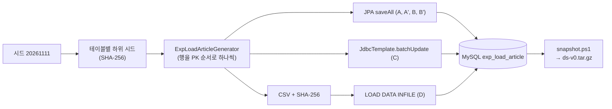
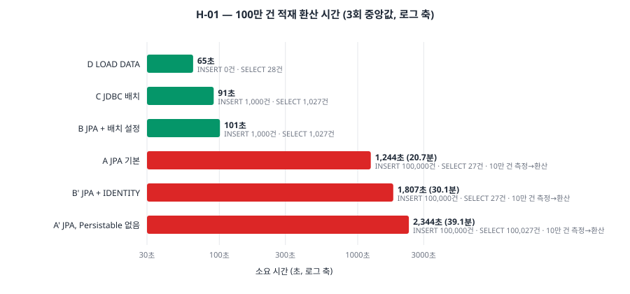
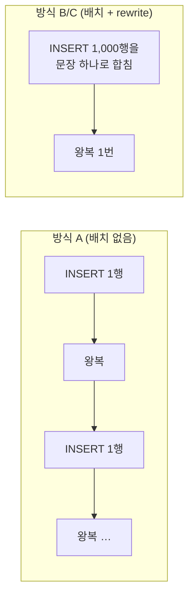

# 04. D 묶음 — 데이터 생성, 적재 방식 비교(H-01), 데이터셋 보관

> 이전: [[03. C 측정 환경]] · 다음: [[05. E 운영과 장애 훈련]]
>
> 2~4단계는 수천만 건을 넣어 놓고 시작한다. 이 묶음은 (1) **같은 데이터를 언제나 똑같이 만드는 생성기**, (2) 100만 건을 넣는 **여섯 가지 방식을 같은 조건에서 비교한 실험(H-01)**, (3) 만든 데이터를 **버전으로 보관하고 30초 안에 되돌리는 방법**을 다룬다.
>
> 일반 개념은 [[../../../Study/Performance/10. 대규모 데이터 Volume Cardinality Distribution Skew|대규모 데이터 Volume Cardinality Distribution Skew]], [[../../../Study/Performance/13. 재현 가능한 성능 실험과 안전한 격리|재현 가능한 성능 실험과 안전한 격리]]에서 더 깊게 다룬다.

## 0. 한눈에 보기

| 항목 | 값 |
| --- | --- |
| 생성기 | `datagen` 하위 프로젝트 (`core`, `table`, `csv`, `h01`) |
| 결정성 | 같은 시드 + 같은 행 수 → 같은 CSV (100만 건 CSV의 SHA-256이 4번 모두 `08b4ffb9…`로 같았다) |
| 실험 테이블 | `exp_load_article` (PK `BIGINT` Snowflake, 보조 인덱스 없음), 행당 평균 약 760바이트, 100만 건 CSV 759MB |
| 비교한 적재 방식 | A, A′, B, B′, C, D (6가지) |
| H-01 결과 | JPA 기본(A)이 약 20.7분 환산, JDBC 배치(C) 91초 → **약 13.7배**. `LOAD DATA`(D) 64.6초 |
| 데이터셋 | `ds-v0` = `exp_load_article` 100만 건, 시드 `20261111`. 보관본 201MB, 복원 약 29초 |

## 1. 왜 데이터를 "코드로" 만드는가

성능 실험의 데이터에는 세 가지 요구가 있다.

1. **크기가 현실적이어야 한다.** 데이터가 버퍼 풀(512MB)보다 훨씬 커야 디스크 읽기 병목이 드러난다.
2. **분포가 현실적이어야 한다.** 균등 분포에서는 "인기 게시판에 글이 몰리는" 문제가 안 보인다.
3. **다시 만들 수 있어야 한다.** 어제 쓴 데이터와 오늘 쓴 데이터가 다르면 "코드를 바꿔서 빨라진 것"인지 "데이터가 달라서"인지 알 수 없다.

그래서 데이터를 손으로 채우거나 운영 데이터를 복사하지 않고, **시드 하나로 결정되는 생성기**를 만든다.



## 2. 결정적 생성기

### 2.1 테이블마다 독립된 난수열: `Seeds`

```java
public static SplittableRandom forTable(long seed, String table) {
	return new SplittableRandom(subSeed(seed, table));
}

public static long subSeed(long seed, String table) {
	MessageDigest sha256 = MessageDigest.getInstance("SHA-256");
	byte[] digest = sha256.digest((seed + ":" + table).getBytes(StandardCharsets.UTF_8));
	return ByteBuffer.wrap(digest).getLong();
}
```

**왜 난수열을 테이블마다 따로 만드나.** 난수열 하나를 모든 테이블이 나눠 쓰면, 앞 테이블의 행 수가 바뀌는 순간 **뒤 테이블의 데이터가 전부 달라진다**(앞에서 뽑아 간 난수 개수가 달라지므로). "시드 + 테이블 이름"으로 하위 시드를 만들면 테이블을 추가하거나 다른 테이블의 규칙을 바꿔도 기존 테이블의 데이터는 그대로다.

**왜 SHA-256인가.** `String.hashCode()`는 32비트라 충돌이 쉽고, 구현이 JVM에 의존하지 않아야 **JVM이나 버전이 바뀌어도 같은 값**이 나온다. SHA-256 다이제스트의 앞 8바이트를 `long`으로 쓴다.

`SplittableRandom`은 `java.util.Random`과 달리 스레드 안전을 포기한 대신 빠르고, 시드가 같으면 같은 수열을 낸다. 생성기가 단일 스레드이므로 맞다.

### 2.2 "난수를 꺼내는 순서가 곧 데이터다"

```java
@Override
public ExpLoadArticleRow next() {
	produced++;
	// 아래 순서가 곧 데이터다. 바꾸지 않는다.
	long id = timeline.nextId(random);
	long boardId = boardSampler.sample(random);
	long writerId = random.nextLong(1, WRITERS + 1);
	String title = TextGenerator.words(random, 2, 8);
	String content = TextGenerator.words(random, 20, 150);
	LocalDateTime createdAt = LocalDateTime.ofEpochSecond(
			Math.floorDiv(timeline.lastMillis(), 1000L),
			(int) Math.floorMod(timeline.lastMillis(), 1000L) * 1_000_000,
			ZoneOffset.UTC);
	return new ExpLoadArticleRow(id, boardId, writerId, title, content, createdAt);
}
```

결정성을 깨는 흔한 실수 세 가지를 코드가 피한다.

1. **난수는 이 테이블 전용 `SplittableRandom` 하나에서만 얻는다.**
2. **현재 시각을 쓰지 않는다.** 생성 시각은 고정된 기준 시각(`baseTime`)에서 과거 `spanDays`일 안에서 만든다.
3. **한 행 안에서 난수를 꺼내는 순서를 바꾸지 않는다.** 바꾸면 같은 시드라도 다른 데이터가 된다(그래서 위 주석이 있다).

### 2.3 시각과 ID: 정렬 없이 증가하는 시각 만들기 (`SnowflakeTimeline`)

**문제.** 100만 건의 생성 시각을 과거 300일 안에서 무작위로 뽑으면서, **ID가 시간순으로 증가**해야 한다(PK 순서로 CSV를 쓰고 PK 순서로 넣어야 InnoDB 페이지 분할이 줄어든다). 가장 쉬운 방법은 N개를 무작위로 뽑아 **정렬**하는 것이다. 그러나 5,000만 건이면 시각만으로 400MB를 메모리에 올려야 한다.

**해법.** "다음 행까지의 **간격**"을 **지수 분포**로 뽑아 더해 가면, 메모리 없이 증가하는 시각이 나온다.

```java
public long nextId(SplittableRandom random) {
	// 지수 분포 간격: -평균 × ln(1 - u). u는 [0, 1)이므로 1 - u는 0이 되지 않는다.
	currentMillis += -meanGapMillis * Math.log(1 - random.nextDouble());
	long millis = Math.min((long) currentMillis, endMillis);

	if (millis <= lastMillis) {
		millis = lastMillis;
		sequence++;
		if (sequence > Snowflake.MAX_SEQUENCE) {
			millis++;
			sequence = 0;
		}
	} else {
		sequence = 0;
	}
	lastMillis = millis;
	lastId = Snowflake.compose(millis, DATAGEN_NODE_ID, sequence);
	return lastId;
}
```


- **왜 지수 분포인가.** 사건이 서로 독립적으로 무작위하게 일어나는 과정(포아송 과정)에서 **사건 사이의 간격은 지수 분포**를 따른다. 따라서 이 방식으로 만든 시각들은 기간 안에 "무작위로 흩어진" 시각과 통계적으로 같다. `−평균 × ln(1−u)`는 균등 난수를 지수 분포 난수로 바꾸는 표준 변환(역변환 표집)이다.
- **평균 간격**은 `기간 ÷ 행 수`다. 300일 동안 100만 건이면 평균 25.9초(약 25,920ms), 5,000만 건이면 약 518ms다. 같은 밀리초에 겹치는 일은 드물다(100만 건에서 간격이 1ms 미만일 확률은 약 0.004%). 겹치면 순번을 올리고, 4,096개를 넘으면 시각을 1ms 올린다.
- **노드 ID는 1023**(`DATAGEN_NODE_ID`)이다. 앱 인스턴스가 쓰지 않는 값이라, 생성기가 만든 ID와 앱이 만든 ID는 서로 겹치지 않는다([[02. B Snowflake ID]]).
- `compose`가 기준 시각 이전을 거부하므로 생성 기간이 Snowflake 기준 시각(2026-01-01) 앞으로 넘어가면 **시작 전에** 막는다. 설계는 "기준 시각에서 과거 365일"이었지만 이 때문에 기본을 **300일**로 줄였다(처음에는 365일로 만들다 ID 범위 오류로 실패했다).

> 포아송 과정과 지수 분포의 관계를 한국어 위키백과로 확인하려 했으나 해당 문서 주소가 404였다. 수학적 배경은 일반 통계 교재의 "포아송 과정의 도착 간격" 항목을 참고하자.

### 2.4 Zipf 분포: 인기 게시판에 글이 몰린다 (`ZipfSampler`)

현실의 게시판은 균등하지 않다. 소수의 인기 게시판에 글이 몰리고, 소수의 인기 글에 댓글과 조회가 몰린다. 균등 분포 데이터로는 **인기 글 쏠림, 핫스팟 행 락, 샤드 쏠림** 같은 문제가 드러나지 않는다.

Zipf 분포는 순위 `k`가 나올 확률이 `1/k^s`에 비례한다. 위키백과(지프의 법칙)가 말하듯 `s = 1`이 고전 형태이고, 확률질량함수는 `f(k; s, N) = 1 / (k^s · H(N,s))`(`H`는 일반화 조화수)다.


*그림 2-1. Zipf 확률질량함수(N=10, 양 축 로그). 직선으로 보이는 것이 멱법칙의 특징이고, `s`가 클수록 1위에 더 쏠린다. 출처: [Wikimedia Commons, Zipf distribution PMF](https://commons.wikimedia.org/wiki/File:Zipf_distribution_PMF.png), [위키백과 "지프의 법칙"](https://ko.wikipedia.org/wiki/%EC%A7%80%ED%94%84%EC%9D%98_%EB%B2%95%EC%B9%99)*

이 프로젝트의 게시판 100개, `s = 1`이면 다음과 같다(직접 계산).

| 게시판 순위 | 글이 그 게시판에 속할 확률 |
| --- | --- |
| 1위 | 19.3% |
| 2위 | 9.6% |
| 5위 | 3.9% |
| 10위 | 1.9% |
| 100위 | 0.19% |

상위 10개 게시판이 전체의 약 **56%**, 상위 20개가 약 **69%**를 가진다. 100만 건이면 1위 게시판에 약 19만 건, 100위에는 약 1,900건이다. 같은 100개 게시판이라도 **100배 차이**가 난다.

```java
public ZipfSampler(int n, double exponent) {
	this.cumulative = new double[n];
	double sum = 0;
	for (int k = 1; k <= n; k++) {
		sum += 1.0 / Math.pow(k, exponent);
		cumulative[k - 1] = sum;
	}
	for (int i = 0; i < n; i++) {
		cumulative[i] /= sum;
	}
	cumulative[n - 1] = 1.0; // 부동소수 오차로 마지막 값이 1보다 작아지는 것을 막는다
}

public int sample(SplittableRandom random) {
	double u = random.nextDouble();
	int index = Arrays.binarySearch(cumulative, u);
	int rank = index >= 0 ? index : -index - 1;
	return rank + 1;
}
```

**구현의 핵심은 "누적 분포 + 이진 탐색"이다.** 확률을 순위 순서로 누적해 `[0, 1]` 구간을 나누고, 0~1 난수가 어느 칸에 들어가는지 이진 탐색(`O(log n)`)으로 찾는다. 1위 칸이 구간의 19.3%를 차지하니 난수가 그 칸에 들어갈 확률이 19.3%다. **한계**는 배열 크기다. 순위가 1,000만 개이면 배열이 80MB라서 그때는 다른 방법(거절 표집)을 검토한다. `ZipfSamplerTest`가 확률의 합이 1인지, `s=1`에서 1위:2위가 2:1인지, 표본 빈도가 이론 확률과 맞는지 확인한다.

### 2.5 CSV와 SHA-256: 결정성을 검증하는 도구

```java
public static Result write(Iterator<ExpLoadArticleRow> rows, OutputStream out) {
	MessageDigest sha256 = sha256();
	CountingOutputStream counting =
			new CountingOutputStream(new DigestOutputStream(out, sha256));
	// ... 행마다 id,board_id,writer_id,title,content,created_at\n 쓰기
	return new Result(count, HexFormat.of().formatHex(sha256.digest()), counting.count);
}
```

CSV를 쓰면서 **쓴 바이트의 SHA-256을 함께 계산**한다. 같은 시드로 100만 건 CSV를 4번 만들었더니 해시가 모두 같았다. 해시가 같다는 것은 "행 하나하나가 비트 단위로 같다"는 가장 강한 증거다. CSV를 중간 산출물로 남기면 DB를 지워도 생성 없이 다시 적재할 수 있다. 형식은 `LOAD DATA INFILE` 기본값에 맞춰 UTF-8, 쉼표 구분, LF, 머리글 없음, 따옴표 없음으로 고정했고, 값에 쉼표·따옴표·줄바꿈이 없다는 것은 `TextGenerator`가 보장한다.

### 2.6 함정: 같은 행이 JPA로 넣으면 9시간 앞서 들어간다

세 경로(CSV, JDBC, JPA)로 넣은 **같은 행을 직접 비교**했더니 JPA로 넣은 행만 `created_at`이 9시간 달랐다. 원인은 설정 두 개의 조합이다.

```text
spring.jpa.properties.hibernate.jdbc.time_zone = UTC     ← 설정
JVM 기본 시간대 = Asia/Seoul (KST)                         ← 개발 PC
```

`LocalDateTime`에는 시간대가 없다. `hibernate.jdbc.time_zone=UTC`를 주면 Hibernate는 `LocalDateTime`을 **"JVM 기본 시간대의 시각"으로 간주하고 UTC로 바꿔** DB에 쓴다. 생성기가 만든 값은 이미 UTC 값인데 KST로 해석해서 9시간을 뺀다(예: UTC 값 14:00 → "KST 14:00"으로 보고 UTC로 변환 → 05:00이 저장된다). CSV와 JDBC는 이 변환을 거치지 않으므로 값이 어긋난다.

해결은 `DatagenApplication.main`에서 JVM 기본 시간대를 UTC로 고정하는 것이다.

```java
public static void main(String[] args) {
	TimeZone.setDefault(TimeZone.getTimeZone("UTC"));
	System.exit(SpringApplication.exit(SpringApplication.run(DatagenApplication.class, args)));
}
```

**앱에도 같은 설정(`hibernate.jdbc.time_zone: UTC`)이 있으므로 1단계의 첫 엔티티에서 같은 문제가 생긴다.** JVM 시간대를 UTC로 고정할지, 시각 타입을 `Instant`로 쓸지는 1단계에서 정한다.

한국어 자료로는 [tistory Railly, "Springboot JPA Timezone 설명"](https://railly-linker.tistory.com/entry/Springboot-JPA-Timezone-%EC%84%A4%EB%AA%85-%EB%8D%B0%EC%9D%B4%ED%84%B0%EB%B2%A0%EC%9D%B4%EC%8A%A4%EC%99%80-Springboot-%EA%B0%84%EC%9D%98-%ED%83%80%EC%9E%84%EC%A1%B4-%EC%B2%98%EB%A6%AC-%EB%B0%A9%EC%8B%9D)이 JDBC URL의 `serverTimezone`과 `TimeZone.setDefault`의 역할을 소개한다(글의 "JPA가 DATETIME을 DB 시간대에 맞춰 **자동으로** 변환한다"는 표현은 과장이고 실제 동작은 드라이버 설정에 따른다). Hibernate 6.2 이후 `default_storage` 변화를 다룬 [tistory 희랍인 조르바, "Spring 3.1 이상 Hibernate 사용시 발생할 수 있는 이슈"](https://zorba91.tistory.com/m/363)도 같은 계열의 문제(UTC 기준 값이 KST로 취급되어 저장)를 소스 수준에서 따라가 보여 준다(Hibernate 6.2 기준 글이라 현재 버전에 그대로 적용하면 안 된다). 영어권 원문은 Hibernate 팀의 [How to store timestamps in UTC using the new hibernate.jdbc.time_zone configuration property](https://in.relation.to/2016/09/12/jdbc-time-zone-configuration-property/)다.

## 3. H-01: 100만 건을 어떻게 넣을 것인가

### 3.1 질문, 가설, 통제

| | 내용 |
| --- | --- |
| 문제 | 2~4단계에서 수천만 건을 적재해야 한다. 어떤 방식으로 넣어야 하고, JPA로 대량 INSERT를 할 때 무엇을 설정해야 하는가 |
| 가설 | 배치 설정 없이 JPA로 100만 건을 넣으면 JDBC 배치보다 **10배 이상** 느리다 |
| 바꾸는 변수 | **적재 방식 하나** |
| 고정한 것 | 같은 시드와 같은 행, **묶음 크기 1,000**, 묶음마다 트랜잭션 하나(커밋), 시작 전 `TRUNCATE`, 테이블 구조 |
| 중단 조건 | 한 번이 30분을 넘으면 멈추고 10만 건 결과로 환산 |
| 환경 | MySQL 8.4.11(CPU 2코어, 버퍼 풀 512MB, 바이너리 로그 켜짐, `sync_binlog=1`, `innodb_flush_log_at_trx_commit=1`). datagen은 호스트 JVM(Temurin 21) |

**묶음 크기를 1,000으로 두고 묶음마다 커밋하는 이유.** 100만 건을 한 트랜잭션에 넣으면 방식 A·B는 영속성 컨텍스트에 엔티티 100만 개가 쌓여 **메모리와 변경 감지 비용이 결과를 덮는다**. 커밋하면 영속성 컨텍스트가 비워지므로 "묶음마다 flush와 clear"와 같은 효과다. **`TRUNCATE`로 시작**하는 이유는 이미 있는 행 때문에 B-트리 모양이 달라지지 않게 하려는 것이다.

### 3.2 여섯 가지 방식

| 방식 | 내용 | 핵심 코드 |
| --- | --- | --- |
| **A** | JPA `saveAll`, 배치 설정 없음, 엔티티가 `Persistable` 구현 | `persistableRepository.saveAll(...)` |
| **A′** | A에서 `Persistable` **미구현**(ID를 직접 넣음) | `assignedIdRepository.saveAll(...)` |
| **B** | A + `hibernate.jdbc.batch_size=1000` + `rewriteBatchedStatements=true` | A와 같은 코드, `batch` 프로필 |
| **B′** | B에서 ID 전략만 `IDENTITY`(AUTO_INCREMENT 테이블) | `identityRepository.saveAll(...)` |
| **C** | `JdbcTemplate.batchUpdate` + `rewriteBatchedStatements=true` | 아래 |
| **D** | CSV 생성 후 `LOAD DATA INFILE` | 아래 |

```java
private void insertChunk(LoadMethod method, List<ExpLoadArticleRow> chunk) {
	transactionTemplate.executeWithoutResult(status -> {
		switch (method) {
			case A, B -> persistableRepository.saveAll(
					chunk.stream().map(ExpLoadArticleEntity::from).toList());
			case A2 -> assignedIdRepository.saveAll(
					chunk.stream().map(ExpLoadArticleAssignedIdEntity::from).toList());
			case B2 -> identityRepository.saveAll(
					chunk.stream().map(ExpLoadArticleIdentityEntity::from).toList());
			case C -> jdbcTemplate.batchUpdate(INSERT_SQL, chunk, chunk.size(), (ps, row) -> {
				ps.setLong(1, row.id());
				// ... 나머지 파라미터
			});
			case D -> throw new IllegalStateException("D는 묶음 적재를 쓰지 않는다");
		}
	});
}
```

```text
# batch 프로필 (application-batch.yaml): B, B', C에서만 켠다
spring.datasource.url = ...&rewriteBatchedStatements=true
spring.jpa.properties.hibernate.jdbc.batch_size = 1000
spring.jpa.properties.hibernate.order_inserts = true
```

**실수를 막는 장치(`verifyProfile`).** `batch` 프로필을 빠뜨리고 B를 돌리면 사실상 A를 잰 셈이 되는데 **결과만 봐서는 알 수 없다**. 그래서 `H01Loader`가 실행 전에 방식과 설정이 맞는지 확인하고, 맞지 않으면 실행을 **거부**한다.

```java
if (method.requiresBatchProfile()) {
	if (!rewrite || (method != LoadMethod.C && batchSize <= 0)) {
		throw new IllegalStateException(method + "는 batch 프로필로 실행해야 합니다 ...");
	}
} else if (rewrite || batchSize > 0) {
	throw new IllegalStateException(method + "는 batch 프로필 없이 실행해야 합니다 ...");
}
```

### 3.3 결과

각 3회 측정의 중앙값이다. A, A′, B′는 100만 건에 40분 이상 걸릴 것으로 예상되어 **처음부터 10만 건으로 측정해 환산**했다.



*그림 3-1. 방식별 100만 건 환산 시간. 초록(배치/적재 전용)은 약 1~2분, 빨강(행마다 왕복)은 20~39분이다. 막대 옆에 나간 INSERT/SELECT 문장 수를 함께 적었다. 직접 그렸다(원자료 `data/h01/results.csv`).*

| 방식 | 측정 행 수 | 소요(3회) | **중앙값** | 초당 행 수 | 100만 건 환산 | INSERT 문장 | SELECT 문장 | MySQL CPU 평균 |
| --- | --- | --- | --- | --- | --- | --- | --- | --- |
| **D** LOAD DATA | 100만 | 70.3 / 64.6 / 50.6초 | **64.6초** | 15,470 | 64.6초 | 0 (LOAD 1) | 28 | 42% |
| **C** JDBC 배치 | 100만 | 91.1 / 105.7 / 82.3초 | **91.1초** | 10,979 | 91.1초 | 1,000 | 1,027 | 40% |
| **B** JPA 배치 | 100만 | 102.9 / 101.0 / 99.3초 | **101.0초** | 9,901 | 101.0초 | 1,000 | 1,027 | 28% |
| **A** JPA, 배치 없음 | 10만 | 124.4 / 126.5 / 120.5초 | **124.4초** | 804 | 약 1,244초(20.7분) | 100,000 | 27 | 34% |
| **B′** IDENTITY | 10만 | 180.7 / 180.9 / 179.2초 | **180.7초** | 553 | 약 1,807초(30.1분) | 100,000 | 27 | 31% |
| **A′** Persistable 없음 | 10만 | 230.4 / 234.4 / 256.6초 | **234.4초** | 427 | 약 2,344초(39.1분) | 100,000 | **100,027** | 25% |

- MySQL CPU는 코어 1개 기준(한도 200%)이다. **어느 방식도 MySQL CPU를 다 쓰지 않았다.**
- D의 CSV 생성은 별도로 약 21초 걸렸다(위 시간에 포함하지 않음).
- SELECT 27~28건은 datagen 기동과 `COUNT(*)` 확인이다.

**가설은 맞았다.** A(약 1,244초) ÷ C(91.1초) = **약 13.7배**. 그리고 배치 설정 하나로 JPA(B)가 C의 10% 이내까지 따라온다.

### 3.4 왜 이런 숫자가 나왔나

**① 행당 비용은 DB 왕복 횟수다.** A는 행 하나에 약 1.24ms인데, 기준선 측정의 DB 왕복 한 번(약 0.9ms, [[03. C 측정 환경]] 5.3절)에 Hibernate의 엔티티 처리 비용을 더한 값과 맞는다. 행마다 INSERT를 한 번씩 보내니 100만 건이면 100만 번 왕복한다.



B와 C는 `rewriteBatchedStatements=true` 덕분에 INSERT 1,000건을 **`INSERT ... VALUES (...),(...),...` 문장 하나**로 묶어, 100만 건을 왕복 1,000번으로 끝낸다. MySQL Connector/J 문서에 따르면 이 옵션은 기본 `false`이고, `executeBatch()`가 불릴 때 드라이버가 INSERT를 다중 값 문장으로 다시 쓴다(단, `getGeneratedKeys()`는 배치 전체가 INSERT일 때만 동작하는 등 제약이 있다). 우아한형제들의 [MySQL 환경의 스프링부트에 하이버네이트 배치 설정해 보기](https://techblog.woowahan.com/2695/)도 같은 결론이다. `hibernate.jdbc.batch_size`만으로는 MySQL에서 INSERT가 묶이지 않고, **드라이버 옵션 `rewriteBatchedStatements=true`가 있어야** 한 문장으로 전송된다. 그리고 Hibernate 로그에는 배치 여부와 관계없이 엔티티마다 한 줄씩 찍히므로 **드라이버 로그(`profileSQL`)로 실제 전송 쿼리를 확인**해야 한다고 알려 준다. (이 글은 Hibernate 5.4 기준이다.)

**② `Persistable`이 없으면 INSERT마다 SELECT가 나간다(A와 A′의 차이).**

Spring Data JPA의 `save()`는 새 엔티티인지 판단해 갈린다.

```text
isNew ? em.persist(entity) : em.merge(entity)
```

Spring Data 문서(Persisting Entities)에 따르면 기본 판단은 이렇다. 버전 속성이 없으면 **ID가 null일 때 새 엔티티**다. 그런데 우리는 **ID를 애플리케이션이 미리 넣는다**(Snowflake). ID가 null이 아니니 "기존 엔티티"로 보고 `merge`를 호출하고, `merge`는 그 ID의 행이 이미 있는지 확인하려고 **INSERT 전에 SELECT를 한 번** 보낸다. 그래서 A′는 SELECT가 정확히 10만 건 더 나갔고 속도가 절반이 됐다(왕복이 두 번).

해결은 `Persistable`을 구현해 `isNew()`를 직접 알려 주는 것이다(A, B).

```java
@Entity
public class ExpLoadArticleEntity implements Persistable<Long> {
	@Id private Long id;

	@Transient
	private boolean isNew = true;

	@Override public Long getId() { return id; }
	@Override public boolean isNew() { return isNew; }

	/** 저장했거나 DB에서 읽은 뒤에는 새 엔티티가 아니다. */
	@PostPersist
	@PostLoad
	void markNotNew() { this.isNew = false; }
}
```

`@Transient` 플래그는 DB에 저장되지 않는 메모리 상태이고, `@PostPersist`/`@PostLoad` 콜백이 저장 후와 조회 후에 `false`로 바꾼다. Spring Data 공식 문서가 수동 ID 엔티티에 권하는 바로 그 패턴이다. 한국어 자료는 [velog @michaelp3, "Spring Data JPA Insert 할 때 Select 가 호출되는 이유"](https://velog.io/@michaelp3/Spring-Data-JPA-Insert-할-때-Select-가-호출되는-이유)(`SimpleJpaRepository.save()`의 분기와 SELECT 로그)와 [velog @anlee, "Spring Data JPA isNew()로 새로운 엔티티를 구분하는 방식"](https://velog.io/@anlee/Spring-Data-JPAisNew로-새로운-엔티티를-구분하는-방식-완전-정리)(`Persistable`, `@Version`, ID 기준 판단 규칙표)가 잘 정리한다. **1단계의 엔티티 공통 상위 클래스가 이 방식을 따른다.**

**③ IDENTITY는 배치를 끈다(B′).** 배치 설정을 켜 놓았는데도 INSERT가 **행마다 1건씩**(10만 건 → 10만 문장) 나갔다. Hibernate 공식 문서(6.6)의 안내는 분명하다. IDENTITY 생성기를 쓰는 엔티티의 INSERT는 **배치할 수 없다**. INSERT를 실행해야 ID를 알 수 있으므로, Hibernate가 영속화하는 순간 바로 INSERT를 보내야 하기 때문이다. Snowflake처럼 **애플리케이션이 ID를 만드는 방식의 장점**이 여기서 드러난다([[02. B Snowflake ID]]).

국내 사례로는 [velog @penrose_15, "IDENTITY 전략에서 JPA Bulk Insert를 하는 방법"](https://velog.io/@penrose_15/MySQL에서-Bulk-Insert를-사용하기-위한-뻘짓-모음)이 `batch_size`를 켜고 TABLE 전략까지 시도하다가 결국 `JdbcTemplate.batchUpdate`로 해결한 과정을 보여 준다.

**④ JPA 배치(B)와 JDBC 배치(C)의 차이는 약 10%다.** 나가는 문장 수는 같다(INSERT 1,000). 차이는 **클라이언트 쪽 비용**(엔티티 생성, 영속성 컨텍스트 처리)이다. MySQL CPU도 B가 더 낮아(28% 대 40%) 병목이 앱 쪽임을 보여 준다.

**⑤ `LOAD DATA`는 C보다 1.4배 빠른 데 그쳤다.** CSV 생성(21초)까지 넣으면 C와 비슷하다. 또 3회 편차가 크다(50~70초). 원인 후보는 다음과 같고 **검증하지 않았다**.

- CSV를 Windows 폴더에서 Docker Desktop 파일 공유로 읽는 경로가 느리다.
- 100만 건을 트랜잭션 하나로 넣어서 바이너리 로그와 redo 로그를 한꺼번에 많이 쓴다.
- MySQL CPU 2코어 제한.

### 3.5 `LOAD DATA INFILE`의 조건과 위험

```java
jdbcTemplate.execute("LOAD DATA INFILE '" + inContainer + "' INTO TABLE exp_load_article "
		+ "CHARACTER SET utf8mb4 FIELDS TERMINATED BY ',' LINES TERMINATED BY '\\n' "
		+ "(id, board_id, writer_id, title, content, created_at)");
```

MySQL 8.4 공식 문서에서 중요한 것은 **`LOCAL`의 유무**다.

| | `LOCAL` 없음 (우리) | `LOCAL` 있음 |
| --- | --- | --- |
| 파일을 읽는 곳 | **서버**가 자기 디스크에서 | 클라이언트가 읽어 네트워크로 전송 |
| 필요한 권한 | 접속 계정의 **`FILE` 권한** (서버 전체 권한) | `FILE` 불필요 |
| 파일 위치 제약 | `secure_file_priv` 폴더 안 | 클라이언트가 접근 가능한 곳 |

`FILE`은 데이터베이스 단위가 아니라 **서버 전체**에 대한 권한이다. 서버가 읽고 쓸 수 있는 파일을 `secure_file_priv` 폴더(`/var/lib/mysql-files`)로 제한해 위험을 낮추지만, 로컬 실험 환경에서만 앱 계정에 준다(`02-board-file-privilege.sql`). 운영이라면 적재 전용 계정을 따로 만든다. 또 엔티티 규칙(검증, 이벤트)을 **전혀 거치지 않는다**.

### 3.6 예상과 다른 점: 배치 프로필에서도 트랜잭션마다 부수 왕복이 있다

B와 C에서 SELECT가 1,000건 더 나갔다. 5,000건(트랜잭션 5개)으로 재현해 `performance_schema`의 문장 통계(digest)를 보니 다음이 함께 나가고 있었다.

| 문장 | 횟수 | 보내는 쪽 |
| --- | --- | --- |
| `SET autocommit = ?` | 20 | 트랜잭션 시작·끝 (Spring) |
| `SELECT @@session.transaction_read_only` | 17 | MySQL 드라이버 |
| `SET character_set_results = ?` | 10 | MySQL 드라이버 |
| `INSERT ...` | 5 | 데이터 |
| `COMMIT` | 5 | |

묶음 적재에서는 무시할 만하지만 **요청 하나가 행 하나를 쓰는 API에서는 이 부수 왕복이 각각 약 0.9ms씩 더해진다.** 드라이버 옵션(`useLocalSessionState`, `useLocalTransactionState`)으로 줄일 수 있는지는 1단계 이후의 실험 후보다(Connector/J 문서: 둘 다 기본 `false`이며, 드라이버가 서버에 묻지 않고 자신이 추적한 자동 커밋·격리 수준·트랜잭션 상태를 쓰게 한다).


*그림 3-2. "쿼리 로그에는 보이지 않는 왕복"의 다른 사례. `batchUpdate` → `setValues` → … → `setNull`에서 드라이버가 DB에 파라미터 메타데이터를 묻는 바람에 1분 이상 걸렸다. 출처: [토스페이먼츠, 강민주, "Spring JDBC 성능 문제, 네트워크 분석으로 파악하기", 2024-01-17](https://toss.tech/article/engineering-note-7) (Oracle 드라이버 기준이며, 글도 다른 DB에서는 다를 수 있다고 적는다)*

### 3.7 비용과 결론

| 방식 | 비용 |
| --- | --- |
| `Persistable` 구현 | 엔티티마다 새 엔티티 플래그와 콜백이 필요하다. 공통 상위 클래스로 한 번만 만든다 |
| `rewriteBatchedStatements=true` | INSERT가 합쳐지므로 SQL 로그와 문장 통계에서 개별 행이 보이지 않는다. 합친 문장이 `max_allowed_packet`(기본 64MB)을 넘으면 드라이버가 나눠 보낸다 |
| `LOAD DATA INFILE` | 서버 전체 권한 `FILE`이 필요하고, 파일이 `secure_file_priv` 폴더 안에 있어야 한다. 엔티티 규칙을 거치지 않는다 |

**결론.**

- **대량 적재(datagen)**는 `LOAD DATA`를 기본으로 쓴다. CSV가 중간 산출물로 남아 재적재와 결정성 검증에도 쓰인다. 수천만 건 규모에서 C와의 차이가 커지는지는 2단계(게시글 1,000만 건)에서 다시 본다.
- **애플리케이션 코드에서 여러 건을 저장할 때**는 JPA라면 `batch_size`와 `rewriteBatchedStatements`를 켜고, `Persistable`을 구현하고, IDENTITY를 쓰지 않는다. 그러면 JDBC 직접 사용과 10% 차이다.
- **IDENTITY 전략은 쓰지 않는다.** Snowflake를 앱에서 할당하는 결정(D0-12)을 유지한다.

## 4. 데이터셋 보관과 복원 (`snapshot.ps1` / `restore.ps1`)

수천만 건을 만드는 데는 시간이 든다. 만든 데이터를 **버전으로 보관**하고, 실험이 끝나면 **원래 상태로 되돌려** 같은 조건에서 다시 시작해야 한다.


**왜 `mysqldump`가 아니라 볼륨을 통째로 압축하나.** 덤프는 복원할 때 모든 행을 다시 INSERT하고 인덱스를 다시 만든다. 수천만 건이면 수십 분~수 시간이다. 볼륨 압축본은 **파일을 풀기만** 하면 된다. 대가는 **같은 MySQL 버전에서만 복원된다**는 점이라, 이미지 태그를 매니페스트에 적는다.

**왜 MySQL을 멈추고 복사하나.** 돌고 있는 MySQL의 데이터 파일을 복사하면 버퍼 풀에만 있고 디스크에 아직 안 쓴 변경이 빠져 복원본이 깨질 수 있다. 정상 종료하면 InnoDB가 변경을 모두 디스크에 내린다.

**바이너리 로그가 데이터보다 커진다.** MySQL 8.4 공식 문서는 "MySQL 8.4에서 바이너리 로깅은 `--log-bin`을 지정하지 않아도 **기본으로 켜져 있다**"고 적는다. 적재한 행이 모두 로그에도 남으므로 H-01을 몇 번 돌렸더니 **로그가 7.8GB 쌓여 볼륨이 8.8GB**(데이터는 0.8GB)가 됐다. 그래서 보관 스크립트가 보관 전에 `FLUSH BINARY LOGS; PURGE BINARY LOGS BEFORE NOW();`로 정리한다(지금 쓰는 로그 파일은 지울 수 없으므로 새 파일로 넘긴 뒤 지운다). 정리 후 볼륨은 1.1GB, 보관본은 201MB다.

| 항목 | 값 |
| --- | --- |
| `ds-v0` | `exp_load_article` 100만 건, 시드 `20261111` |
| 볼륨 크기 | 1.1GB (바이너리 로그 정리 후) |
| 보관본 | `data/snapshots/ds-v0.tar.gz` 201MB, 보관 64.6초(MySQL 정지~기동) |
| 복원 | 28.4초 / 29.9초 (2회), 두 번 모두 행 수 일치 |

> 보관본(`data/snapshots`)과 CSV(`data/csv`)는 용량이 커서 저장소에 넣지 않는다(`.gitignore`).

## 5. 결정과 대가

| 결정 | 얻은 것 | 치른 대가 |
| --- | --- | --- |
| 테이블별 하위 시드(SHA-256) | 다른 테이블이 바뀌어도 데이터가 그대로 | 난수를 꺼내는 순서를 바꾸지 못한다(바꾸면 데이터가 달라진다) |
| 정렬 없이 지수 간격으로 시각 생성 | 메모리를 거의 안 쓰고 PK 순서로 쓸 수 있다 | 시각 분포가 "무작위로 흩어진" 것과 통계적으로만 같다 |
| Zipf(누적+이진 탐색) | 쏠림이 드러난다 | 순위가 1,000만이면 배열이 80MB |
| CSV를 중간 산출물로 | 해시로 결정성 검증, 재적재 | 디스크를 쓴다(100만 건 759MB) |
| 대량 적재는 `LOAD DATA` | 가장 빠르다 | `FILE` 권한, 엔티티 규칙 무시 |
| 수동 ID + `Persistable` | INSERT 전 SELECT가 없다 | 엔티티 공통 클래스가 필요하다 |
| 볼륨 압축 보관 | 복원이 30초 | 같은 MySQL 버전에서만 복원된다 |

## 6. 후속 실험

- **D 개선 확인**: CSV를 컨테이너 안으로 복사해 읽기, 바이너리 로그 끄기(`disable_log_bin`). **한 번에 하나씩**.
- B′가 A보다 느린 원인(생성 키 반환과 AUTO_INCREMENT 락).
- 드라이버 부수 왕복 줄이기(`useLocalSessionState`, `useLocalTransactionState`): 1단계 단건 쓰기 API에서 효과를 잰다.
- 2단계: 보조 인덱스가 있는 1,000만 건 적재.

## 7. 참고 자료

| 구분 | 자료 | 읽을 부분 |
| --- | --- | --- |
| 한국 기업 | [우아한형제들, MySQL 환경의 스프링부트에 하이버네이트 배치 설정해 보기](https://techblog.woowahan.com/2695/) | `batch_size`와 `rewriteBatchedStatements`, 드라이버 로그로 확인하기 (Hibernate 5.4 기준) |
| 한국 기업 | [LY Corporation 기술 블로그, 이커머스 플랫폼의 주문 DB 마이그레이션 경험기](https://techblog.lycorp.co.jp/ko/experience-in-migrating-order-db-on-ecommerce-platform) | AUTO_INCREMENT와 JPA 배치의 충돌 |
| 한국 기업 | [토스페이먼츠, Spring JDBC 성능 문제, 네트워크 분석으로 파악하기](https://toss.tech/article/engineering-note-7) | 쿼리 로그에 안 보이는 왕복을 패킷 캡처로 찾기 |
| 한국 개인 | [velog @michaelp3, Spring Data JPA Insert 할 때 Select 가 호출되는 이유](https://velog.io/@michaelp3/Spring-Data-JPA-Insert-할-때-Select-가-호출되는-이유) | `merge` 분기와 `Persistable` |
| 한국 개인 | [velog @anlee, Spring Data JPA isNew()로 새로운 엔티티를 구분하는 방식](https://velog.io/@anlee/Spring-Data-JPAisNew로-새로운-엔티티를-구분하는-방식-완전-정리) | `isNew()` 판단 규칙표 |
| 한국 개인 | [velog @penrose_15, IDENTITY 전략에서 JPA Bulk Insert를 하는 방법](https://velog.io/@penrose_15/MySQL에서-Bulk-Insert를-사용하기-위한-뻘짓-모음) | IDENTITY와 `saveAll`의 한계, `batchUpdate` |
| 한국 개인 | [MyLifeForCoding, Increase insert performance with batch insert](https://mangchhe.github.io/jpa/2022/03/01/MysqlBatchInsert) | SEQUENCE와 IDENTITY의 배치 차이(수치는 환경 미기재) |
| 한국 개인 | [tistory Railly, Springboot JPA Timezone 설명](https://railly-linker.tistory.com/entry/Springboot-JPA-Timezone-%EC%84%A4%EB%AA%85-%EB%8D%B0%EC%9D%B4%ED%84%B0%EB%B2%A0%EC%9D%B4%EC%8A%A4%EC%99%80-Springboot-%EA%B0%84%EC%9D%98-%ED%83%80%EC%9E%84%EC%A1%B4-%EC%B2%98%EB%A6%AC-%EB%B0%A9%EC%8B%9D) | `serverTimezone`, `TimeZone.setDefault` |
| 한국 개인 | [tistory 희랍인 조르바, Spring 3.1 이상 Hibernate 사용시 이슈](https://zorba91.tistory.com/m/363) | 6.2 이후 `default_storage`와 드라이버의 시간 포맷 (6.2 기준) |
| 한국어 위키 | [지프의 법칙](https://ko.wikipedia.org/wiki/%EC%A7%80%ED%94%84%EC%9D%98_%EB%B2%95%EC%B9%99) | Zipf 분포의 정의 |
| 공식 | [Spring Data JPA: Persisting Entities](https://docs.spring.io/spring-data/jpa/reference/jpa/entity-persistence.html) | `isNew` 판단 순서, `Persistable` 예제 |
| 공식 | [MySQL 8.4: LOAD DATA](https://dev.mysql.com/doc/refman/8.4/en/load-data.html), [바이너리 로그 옵션](https://dev.mysql.com/doc/refman/8.4/en/replication-options-binary-log.html) | `LOCAL` 유무, `FILE` 권한·`secure_file_priv`, 기본으로 켜진 바이너리 로그 |
| 공식 | [MySQL Connector/J: Performance Extensions](https://dev.mysql.com/doc/connector-j/en/connector-j-connp-props-performance-extensions.html) | `rewriteBatchedStatements`, `useLocalSessionState`, `useLocalTransactionState` |
| 공식 | [Hibernate ORM 6.6 User Guide](https://docs.hibernate.org/orm/6.6/userguide/html_single/Hibernate_User_Guide.html) | IDENTITY 사용 시 INSERT 배치 불가 |
| 공식 | [Hibernate 팀, hibernate.jdbc.time_zone](https://in.relation.to/2016/09/12/jdbc-time-zone-configuration-property/) | JDBC가 Calendar 없이 JVM 기본 시간대를 쓰는 문제와 해결 (2016년 글) |

> 이 묶음의 Hibernate 공식 문서 링크는 Batching 절(13장)까지는 읽지 못해, `batch_size`/`order_inserts`의 정의는 우아한형제들 글과 설정 이름 목록으로만 확인했다.

다음 문서는 운영 기초(알림, 장애 훈련, 타임아웃, CI)를 다룬다: [[05. E 운영과 장애 훈련]].
