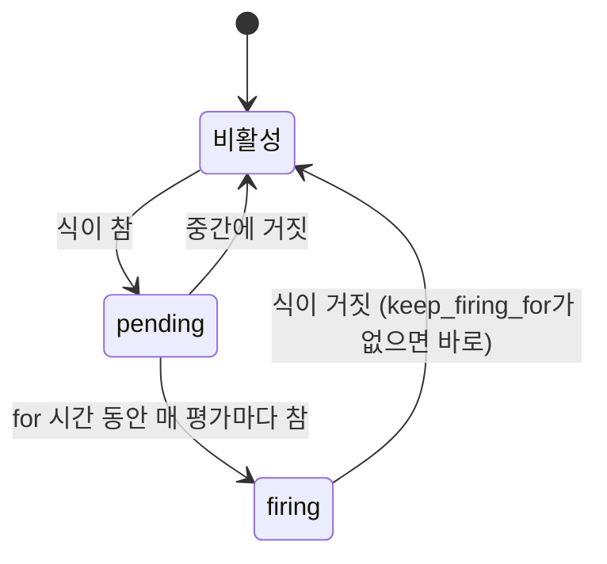
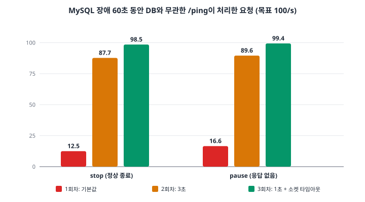
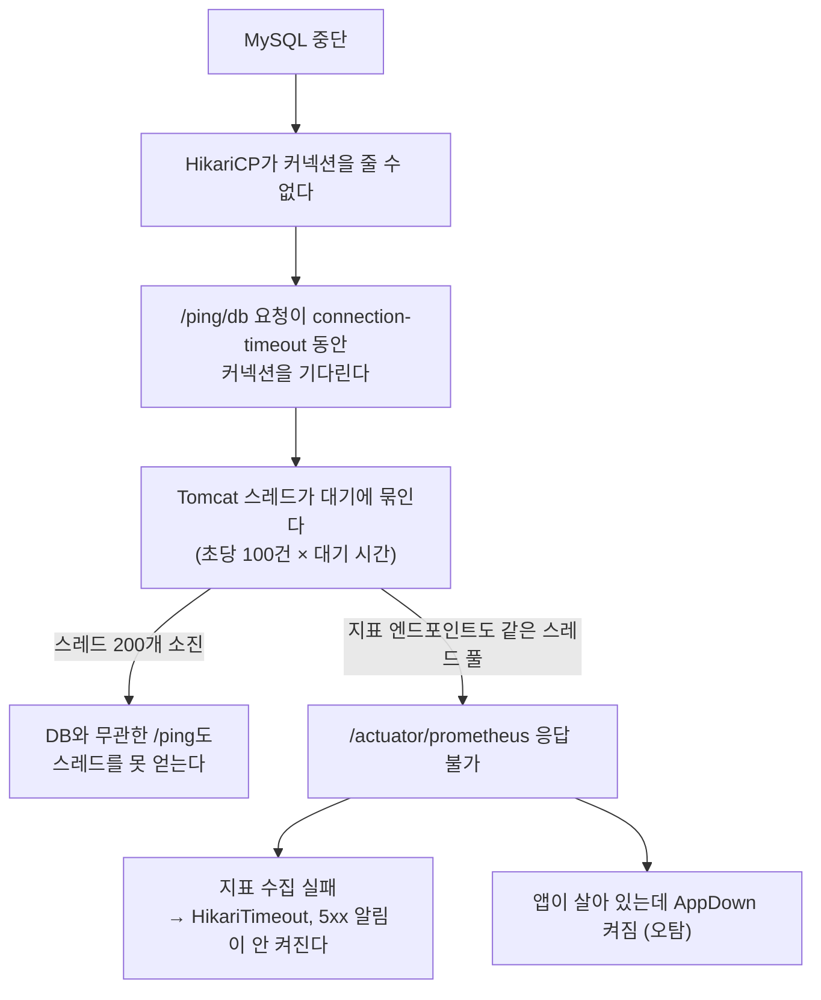
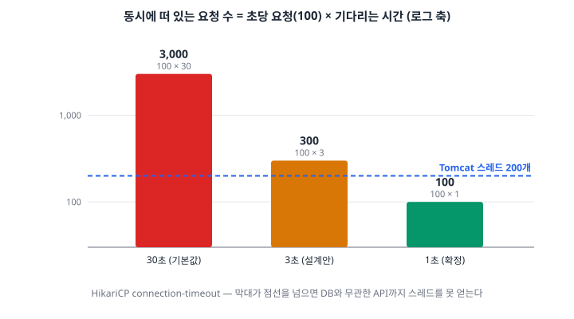
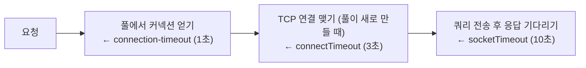
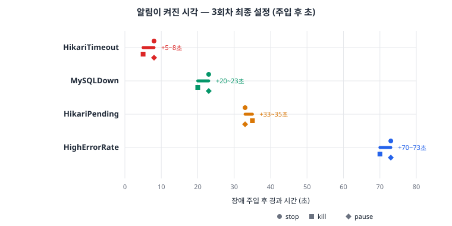
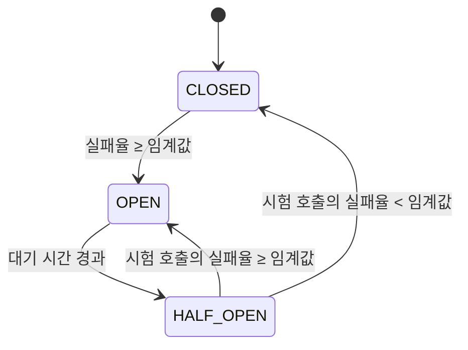

# 05. E 묶음 — 운영 기초: 알림, MySQL 중단 장애 훈련, 타임아웃, CI

> 이전: [[04. D 데이터 생성과 적재]] · 처음으로: [[README]]
>
> 이 묶음은 "장애가 났을 때 무슨 일이 벌어지고, 그것을 몇 초 만에 무엇으로 알 수 있는가"를 **일부러 장애를 일으켜 측정**한 기록이다. 가설이 절반 틀렸고, 그 덕분에 타임아웃 값과 지표 포트 구조가 바뀌었다.
>
> 일반 개념은 [[../../../Study/Performance/06. Tomcat HikariCP DB Queueing|Tomcat HikariCP DB Queueing]], [[../../../Study/Performance/03. Observability와 계층별 병목 분리|Observability와 계층별 병목 분리]], [[../../../Study/Performance/12. 성능 문제 분석 플레이북|성능 문제 분석 플레이북]]에서 더 깊게 다룬다.

## 0. 한눈에 보기

| 항목 | 내용 |
| --- | --- |
| 알림 규칙 | 5개 (`MySQLDown`, `AppDown`, `HikariPending`, `HikariTimeout`, `HighErrorRate`) |
| 장애 훈련 | MySQL을 `stop`/`kill`/`pause`로 멈추고, 설정을 바꿔 가며 **3회차**(회차마다 세 방식) |
| 확정한 설정 | `connection-timeout=1s`, `validation-timeout=750ms`, `connectTimeout=3s`, `socketTimeout=10s`, 관리 포트 8082 |
| 가장 큰 발견 | **지표 엔드포인트가 요청과 같은 Tomcat 스레드 풀을 써서, 장애 때 관측이 먼저 죽었다** |
| 규칙 | 커넥션 대기 시간의 상한은 "Tomcat 스레드 수 ÷ 그 API의 초당 요청 수"보다 작아야 한다 |
| CI | GitHub Actions: 푸시마다 전체 테스트(Testcontainers), 읽기 권한만, 같은 브랜치 중복 실행 취소 |

## 1. 알림 규칙

### 1.1 왜 Alertmanager 없이 규칙만 두었나

`infra/prometheus/rules/board-alerts.yml`은 Prometheus가 **규칙을 평가해 상태를 만드는 데까지만** 쓴다. Alertmanager와 알림 채널(Slack 등)은 두지 않고 Prometheus의 Alerts 화면(`http://localhost:9090/alerts`)에서 확인한다. 배우려는 것은 **"어떤 조건을 알림으로 만들 것인가"**지 알림 배달이 아니기 때문이다.

### 1.2 알림의 상태: pending과 firing

Prometheus 공식 문서(Alerting rules)에 따르면, 식이 하나라도 결과 벡터를 내면 해당 라벨 집합이 **활성(active)** 이 되고, `for`가 있으면 그 시간 동안 **계속** 참이어야 `firing`이 된다. 그 전까지는 `pending`이다.



`for`를 생략하면 첫 평가에서 바로 `firing`이다. **`for`가 짧으면 순간 튐에도 켜지고, 길면 탐지가 늦다.** 이 균형을 장애 훈련에서 탐지 시간을 재며 조정한다. 한국어 자료로 같은 상태 흐름(조건 충족 → `PENDING` → `FIRING` → `RESOLVED`)을 화면으로 따라가려면 [tistory 구르미, "알람 파이프라인 구축하기"](https://gurumee92.tistory.com/255)가 좋다. 다만 그 글은 본문 설명(4xx)과 최종 규칙(4xx+5xx 합산)이 달라 보이는 부분이 있고, `alertmanager.yml`이 `description`을 쓰는데 규칙에는 `summary`만 있어 Slack 문구가 비어 나올 수 있으니 규칙과 템플릿의 필드 이름을 맞춰 읽어야 한다.

### 1.3 다섯 개의 규칙

```yaml
groups:
  - name: board
    rules:
      - alert: MySQLDown
        expr: mysql_up == 0                         # exporter가 MySQL에 접속하지 못하면 0
        for: 15s
        labels: { severity: critical }
        annotations:
          runbook: "https://github.com/guseoh/large-scale-board/wiki/Runbook-MySQL-Down"

      - alert: AppDown
        expr: up{job="board-app"} == 0              # Prometheus가 앱 지표를 수집하지 못하면 0
        for: 15s
        labels: { severity: critical }

      - alert: HikariPending
        expr: max(hikaricp_connections_pending{application="board"}) > 0   # 커넥션을 기다리는 스레드가 있다
        for: 30s
        labels: { severity: warning }

      - alert: HikariTimeout
        expr: sum(increase(hikaricp_connections_timeout_total{application="board"}[1m])) >= 1
        labels: { severity: critical }              # 요청이 실패(503 DB_UNAVAILABLE)하고 있다

      - alert: HighErrorRate
        expr: |
          sum(rate(http_server_requests_seconds_count{application="board", status=~"5.."}[1m]))
            / sum(rate(http_server_requests_seconds_count{application="board"}[1m])) > 0.05
        for: 1m
        labels: { severity: critical }
```

| 알림 | 무엇의 신호인가 | `for` | 설계 의도 |
| --- | --- | --- | --- |
| `MySQLDown` | **원인**: DB에 접속할 수 없다 | 15초 | 직접적이고 빠른 원인 확인 |
| `AppDown` | 앱이 지표를 내지 못한다 | 15초 | 앱 중지나 응답 없음 |
| `HikariPending` | **증상**: 풀이 모자라거나 DB가 느리거나 응답이 없다 | 30초 | 원인을 모르는 단계의 경고 |
| `HikariTimeout` | **영향**: 요청이 실제로 실패하고 있다 | 없음 | 하나라도 생기면 곧바로(1분 창에서 1건 이상) |
| `HighErrorRate` | **영향**: 5xx 비율 5% 초과 | 1분 | 사용자가 겪는 결과 |

이 구성은 **원인(`MySQLDown`)·증상(`HikariPending`)·영향(`HikariTimeout`, `HighErrorRate`)** 세 층을 다 갖춘다. 어느 하나가 눈을 감아도 다른 층이 알려 주도록 하려는 것이다(그리고 실제로 이것이 중요해졌다. 3절).

`HighErrorRate`의 식은 요청이 없으면 `0/0`이라 평가되지 않는다(NaN은 조건을 만족하지 않는다). 규칙의 `runbook` 어노테이션이 Wiki의 런북([[#9. 런북]])을 가리킨다.

## 2. 장애 훈련의 설계

### 2.1 가설(설계 13절의 예측)

1. `/ping`(DB 없음)은 영향을 받지 않는다.
2. `/ping/db`는 HikariCP 기본 `connection-timeout`(30초) 동안 기다린 뒤 실패한다. 그동안 Tomcat 스레드가 쌓여 200개에 닿으면 **`/ping`까지 느려진다**.
3. 대시보드에서는 `mysql_up` 0 → HikariCP 대기 증가 → 사용 중 스레드 증가 → p99 급증 → 5xx 증가 순으로 보인다.

### 2.2 도구와 절차


*한 번의 훈련은 총 240초이고, 각 API에 초당 100건을 계속 보낸다.*

- **부하**: k6 도착률 고정. `/api/v1/ping`과 `/api/v1/ping/db`에 **각각** 초당 100건(`drill-mysql.js`). 장애를 일부러 일으키므로 통과 기준(thresholds)을 두지 않는다.
- **주입**: `scripts/drill-mysql.ps1`이 부하를 시작하고 정해진 시각에 `docker compose stop|kill|pause mysql`을 실행한 뒤 복구하고, 주입·복구 시각을 `data/drill/<testid>.json`에 남긴다. 탐지 시간과 영향은 Prometheus에서 **이 시각을 기준**으로 계산한다.
- **앱 사전 확인**: 앱이 떠 있지 않으면 훈련이 아니라 "연결 거부"를 재게 되므로 스크립트가 먼저 `/api/v1/ping`을 호출해 확인한다.
- **요청 타임아웃**: k6의 요청 타임아웃을 60초로 늘려, 요청이 30초씩 매달리는 상황을 그대로 본다. 이때 동시에 떠 있는 요청이 초당 100건 × 30초 = 3,000개까지 늘 수 있어 VU 상한(600)을 두었고, 상한에 닿아 k6가 버린 요청도 **"클라이언트가 보내지 못한 요청"이라는 장애 증상**으로 기록한다.

### 2.3 세 가지 주입 방식은 다르게 실패한다

| 주입 | 명령 | MySQL 쪽에서 일어나는 일 | 앱에게 보이는 증상 |
| --- | --- | --- | --- |
| `stop` | `docker compose stop` | 정상 종료. 포트가 닫힌다 | 새 연결이 **즉시 거부된다** |
| `kill` | `docker compose kill` | 강제 종료(SIGKILL). 진행 중이던 쿼리가 끊긴다. 재기동 시 InnoDB 크래시 복구 | 연결 거부 + 끊긴 연결 |
| `pause` | `docker compose pause` | 프로세스 정지(cgroup freezer). **연결은 살아 있는데 응답이 오지 않는다** | 타임아웃이 없으면 **영원히 매달린다** |

`pause`는 가장 악질적이다. 서버가 죽은 것이 아니라 **말이 없을 뿐**이라, TCP 연결은 유지되고 소켓 읽기가 끝없이 기다린다. 이것이 `socketTimeout`이 필요한 이유다(4.3절).

### 2.4 회차별 조건

| 회차 | HikariCP `connection-timeout` | JDBC `connectTimeout` / `socketTimeout` | 관리 포트 |
| --- | --- | --- | --- |
| 1 기본 | 30초 (기본값) | 없음 | 요청 포트와 같음 (8081) |
| 2 | 3초 (**설계안**) | 없음 | **분리 (8082)** |
| 3 최종 | **1초** | 3초 / 10초 | 분리 (8082) |

> 2회차에 관리 포트 분리와 타임아웃 변경을 함께 넣었다. 관리 포트 분리는 요청 경로가 아니라 **지표 수집 경로만** 바꾸므로 요청 처리 결과의 비교를 흐리지 않는다고 판단했다.

## 3. 1회차(기본 설정): 가설의 앞부분은 틀렸다

MySQL을 멈추자 **DB와 무관한 `/ping`이 87%를 처리하지 못했다**(`stop` 기준 초당 12.5건, 목표 100건).



*그림 3-1. MySQL 장애 60초 동안 **DB를 쓰지 않는** `/ping`이 처리한 요청(목표 100/s). 회차(타임아웃 설정)가 `/ping`의 운명을 갈랐다. 직접 그렸다(원자료: 훈련 요약).*

### 3.1 왜 `/ping`까지 번졌나: 리틀의 법칙

리틀의 법칙: **시스템 안에 동시에 있는 요청 수 = 초당 도착 수 × 요청 하나가 머무는 시간**.



초당 `/ping/db`가 100건이고 **대기 시간이 `connection-timeout`**이면 동시에 대기 중인 요청 수는 다음과 같다.



*그림 3-2. 대기 시간별 동시 요청 수(로그 축). 30초면 3,000개, 3초(설계안)도 300개로 **스레드 200개를 넘는다**. 1초일 때만 100개로 여유가 있다. 직접 그렸다.*

| `connection-timeout` | 계산 | 결과 |
| --- | --- | --- |
| 30초 | 100 × 30 = **3,000** ≫ 200 | 스레드 전부 고갈 |
| 3초 | 100 × 3 = **300** > 200 | 여전히 고갈(`/ping` 12% 손실) |
| 1초 | 100 × 1 = **100** < 200 | 여유. 실측 Tomcat 사용 중 최대 104개 |

> **규칙.** 커넥션 대기 시간의 상한은 "Tomcat 스레드 수 ÷ 그 API의 초당 요청 수"보다 **작아야** 한다. 설계안의 3초는 초당 100건에서 이미 부족했다.

이 현상은 업계에서 흔한 **장애 전파**의 한 형태다. 우아한형제들의 메시지 플랫폼 장애에서는 풀이 고갈되자 `Connection Timeout`이 다수 발생하고, DB INSERT가 대부분 실패(롤백)하며 간헐적으로만 성공하는 사이 메시지 큐 지연(lag)이 늘었다.


*그림 3-3. 한 구성 요소(커넥션 풀)의 고갈이 앞단(메시지 큐 소비)으로 번지는 과정. 출처: [우아한형제들 기술블로그, 이재훈, "HikariCP Dead lock에서 벗어나기 (이론편)", 2020-02-06](https://techblog.woowahan.com/2664/)*

### 3.2 가장 큰 발견: 관측 사각지대

지표 엔드포인트(`/actuator/prometheus`)가 **요청과 같은 Tomcat 스레드 풀**을 쓰고 있었다. 스레드가 고갈되자 **지표 수집이 실패**했고, 그 결과는 다음과 같다.

- 정작 원인을 가리키는 알림이 **켜지지 않았다**. `HikariPending`과 `HighErrorRate`는 세 번 모두, `HikariTimeout`은 `stop`·`kill`에서 켜지지 않았다(`pause`에서만 +62초에 켜졌다).
- 앱은 살아 있는데 **`AppDown`이 켜졌다**(오탐). 사람이 보면 "앱이 죽었다"고 오판해 앱을 재시작할 것이다. 그러면 **원인(MySQL)은 그대로**다.

**해결은 관리 포트 분리(8082)**다. Tomcat은 포트가 다르면 별도의 서버(스레드 풀)를 쓰므로, 요청 스레드가 고갈돼도 지표 수집은 계속된다.

```yaml
management:
  server:
    port: ${MANAGEMENT_PORT:8082}
```

> **원칙.** "관측은 장애 때 가장 필요한 순간에 가장 먼저 죽으면 안 된다." 지표 수집 경로는 서비스 경로와 **자원을 공유하지 않아야** 한다.

## 4. 설정 확정

```yaml
spring:
  datasource:
    url: jdbc:mysql://...&connectTimeout=3000&socketTimeout=10000
    hikari:
      maximum-pool-size: 10
      connection-timeout: 1000
      validation-timeout: 750
server:
  tomcat:
    threads:
      max: 200
```

### 4.1 `connection-timeout = 1초`

HikariCP README에서 `connectionTimeout`은 기본 30,000ms이고 **최소값 250ms**다. 풀에 유휴 커넥션이 없고 최대 크기에 닿으면 `getConnection()`은 이 시간까지 **블록**된 뒤 `SQLException`을 던진다([[03. C 측정 환경]] 6.1절의 `handoffQueue` 대기와 같다).

우아한형제들의 2021년 사내 가이드는 이 값을 3초로 권했다([[03. C 측정 환경]] 6.3절). **그 3초가 우리 환경에서는 모자랐다.** 초당 100건의 DB API가 있을 때 300 > 200이기 때문이다. 권장값은 **그 서비스의 처리량과 스레드 수로 계산**해야 한다는 교훈이다.

### 4.2 `validation-timeout = 750ms`

HikariCP는 `validationTimeout`이 `connectionTimeout`**보다 작아야** 한다고 명시한다(기본 5초). 우리 `connection-timeout`을 1초로 줄였으므로 이 값도 줄였다. 빌려줄 커넥션이 살아 있는지 확인하는 시간이 전체 대기 한도보다 길면 의미가 없다.

### 4.3 JDBC `connectTimeout=3000`, `socketTimeout=10000`

Connector/J 문서에 따르면 두 값의 **기본은 0(무제한)**이다.

- `connectTimeout`: 소켓 **연결**을 맺는 데 걸 수 있는 시간. 연결 자체가 안 될 때 빨리 포기한다.
- `socketTimeout`: 소켓 **읽기/쓰기** 대기 시간. 서버가 응답 없이 멈춘 `pause` 상황에서 **이미 쿼리를 보낸 커넥션**이 영원히 기다리지 않게 한다.

`pause`에서는 이미 쿼리를 보낸 커넥션 10개가 MySQL이 재개될 때까지(60초) 매달렸다. `socketTimeout=10000`을 넣자 **정확히 10초**에 끊겼다(서버 최대 10,023ms). `connection-timeout`은 풀에서 커넥션을 **얻는** 대기이고, `socketTimeout`은 얻은 커넥션으로 쿼리를 **보낸 뒤** 응답을 기다리는 시간이라 **서로 다른 구간을 지킨다.**



## 5. 탐지: 얼마나 빨리 알았나



*그림 5-1. 3회차 최종 설정에서 알림이 켜진 시각(주입 기준 초). 한 행의 세 도형이 `stop`(●), `kill`(■), `pause`(◆)다. 직접 그렸다.*

| 알림 | 1 기본 (stop / kill / pause) | 3 최종 (stop / kill / pause) |
| --- | --- | --- |
| `MySQLDown` | +19 / +20 / +22초 | +23 / +20 / +23초 |
| `HikariTimeout` | **안 켜짐 / 안 켜짐** / +62초 | **+8 / +5 / +8초** |
| `HikariPending` | **안 켜짐 (세 번 모두)** | +33 / +35 / +33초 |
| `HighErrorRate` | **안 켜짐 (세 번 모두)** | +73 / +70 / +73초 |
| `AppDown` | **+24 / +25 / +27초 (오탐)** | 안 켜짐 |

**탐지 시간을 정하는 것**은 대부분 각 규칙의 유지 시간(`for`)과 계산 창이다.

| 알림 | 대략 지연이 만들어지는 곳 |
| --- | --- |
| `HikariTimeout` (+5~8초) | 1초 뒤 첫 타임아웃 발생 + 수집 주기 5초 + 평가 주기 5초. `for` 없음 |
| `MySQLDown` (+20~23초) | exporter가 접속 실패를 보고 `mysql_up=0`이 되는 시간 + `for` 15초 |
| `HikariPending` (+33~35초) | 대기 스레드가 생기기까지 몇 초 + `for` 30초 |
| `HighErrorRate` (+70~73초) | 5xx 비율이 `[1m]` 창에서 5%를 넘기까지 + `for` 1분 |

**순서의 의미.** 3회차 기준으로 `HikariTimeout`(5~8초) → `MySQLDown`(20~23초) → `HikariPending`(33~35초) → `HighErrorRate`(70~73초) 순이다. **1차 탐지 신호는 `HikariTimeout`, 원인 확인은 `MySQLDown`**이다. 가설 3의 "`mysql_up`이 가장 먼저"와 다르다. `mysql_up` 지표가 0이 되는 것은 몇 초 안이지만 **알림은 `for` 15초를 채워야** 켜지고, `HikariTimeout`은 `for`가 없어 앱이 DB를 쓰려다 **처음 실패하는 순간**에 바로 켜지기 때문이다.

> `HikariTimeout`과 `HighErrorRate`는 1분 창으로 계산하므로 **복구 후에도 약 1분 동안 켜져 있다**(HikariTimeout 62~68초, HighErrorRate 48~58초). 사람이 "복구했는데 아직 알림이 켜져 있다"고 놀라지 않도록 런북에 적었다.

## 6. 회복

| 항목 | 1 기본 | 3 최종 |
| --- | --- | --- |
| MySQL이 다시 연결을 받기까지(복구 명령 후) | stop 3.7초, kill 4.9초, pause 0.8초 | stop 5.1초, kill 2.1초, pause 0.4초 |
| `/ping/db`가 초당 95건 이상 처리(복구 명령 후) | 13~15초 | 16~17초 |
| 알림이 꺼지기까지(복구 명령 후) | `MySQLDown` 1~9초 | `MySQLDown` 2~8초, `HikariTimeout` 62~68초, `HighErrorRate` 48~58초 |

- 정상화 시간은 15초 창으로 계산한 처리율이라 **실제보다 최대 15초 늦게** 나온다. 회차 사이 비교에만 쓴다.
- `kill` 뒤에는 InnoDB가 크래시 복구를 하고, 이 환경에서는 복구 명령 후 2~5초에 다시 연결을 받았다(크래시 복구 시간 포함). 데이터와 redo 로그가 커지면 길어질 수 있다.

## 7. 해석

1. **가설의 앞부분은 틀렸고 뒷부분은 맞았다.** `/ping`은 영향을 받았다. 원인은 예측대로 Tomcat 스레드 고갈이다.
2. **리틀의 법칙으로 정확히 설명된다.** 1초(100 < 200)만 여유가 있다.
3. **관측 사각지대가 가장 큰 발견이다.** 관리 포트 분리로 지표가 끊기지 않았고 `HikariTimeout`이 5~8초에 켜졌다.
4. **`pause`는 소켓 타임아웃이 없으면 끝나지 않는다.** `socketTimeout=10000`이 정확히 10초에 끊었다.
5. **대시보드 순서 예측은 부분적으로 맞았다.** 3회차 기준 `HikariTimeout`이 `MySQLDown`보다 앞섰다.

## 8. 서킷 브레이커는 왜 미뤘나

타임아웃을 줄이는 것은 **"기다리는 시간을 짧게"** 하는 것이고, 서킷 브레이커는 **"DB가 죽은 것이 확실하면 아예 기다리지 않는"** 방식이다. 상태 관리와 임계값 조정 비용이 커서 6단계 이후로 미뤘다.

Resilience4j의 서킷 브레이커는 세 상태를 가진다.




*그림 8-1. 서킷브레이커 상태 전이(Resilience4j 문서의 그림). 실패율이 임계값을 넘으면 `OPEN`(호출 차단), 대기 시간이 지나면 `HALF_OPEN`(시험 호출), 시험이 성공하면 `CLOSED`로 돌아온다. 출처: [우아한형제들 기술블로그, 이제현, "개발자 의식의 흐름대로 적용해보는 서킷브레이커", 2024-01-11](https://techblog.woowahan.com/15694/)*

올리브영은 같은 장애 전파 문제를 이렇게 풀었다. 재고 통합 조회 API에서 Redis 장애 시 **타임아웃 × 재시도만큼 대기 시간이 쌓이는** 문제를, `OPEN`일 때 Redis를 건너뛰고 **Oracle로 바로 failover**해 해결했다.


*그림 8-2·8-3. 서킷브레이커 미적용(위)과 적용(아래). 상태가 `Opened`면 Redis를 거치지 않고 곧바로 DB로 간다. 출처: [올리브영 테크블로그, 펭귄대장, "Circuitbreaker를 사용한 장애 전파 방지", 2023-08-31](https://oliveyoung.tech/2023-08-31/circuitbreaker-inventory-squad/)*

알아 둘 점 세 가지다(두 글의 설명에서 가져온 것이고, 아직 직접 구현하지 않았다).

- 기본값은 `failureRateThreshold` 50%, `slidingWindowSize` 100, `waitDurationInOpenState` 60초 등이다. 올리브영은 `failure-rate-threshold 10`, `slow-call-duration-threshold 500ms`, `minimum-number-of-calls 50`처럼 서비스에 맞게 훨씬 공격적으로 조정했다.
- **`Retry`의 실패도 서킷의 실패로 함께 집계**된다. 재시도가 있으면 실패율 임계값을 그만큼 감안해야 한다.
- fallback은 **서킷 상태와 무관하게** 메서드가 실패할 때 실행된다. fallback 실행 여부만으로는 서킷이 열렸는지 알 수 없다.

DB 서킷 브레이커의 대가는 "정상 상태에서도 관리할 상태와 임계값"이 생긴다는 것이고, 되돌릴 조건은 서킷 브레이커를 도입하면 커넥션 대기 시간을 다시 늘릴 수 있다는 점이다([[#10. 결정과 대가]]).

## 9. 런북

알림 규칙의 `runbook` 어노테이션이 가리키는 Wiki 페이지 [런북: MySQL 중단](https://github.com/guseoh/large-scale-board/wiki/Runbook-MySQL-Down)의 요지다.

| 단계 | 내용 |
| --- | --- |
| 증상 | `HikariTimeout`(5~8초), 503 `DB_UNAVAILABLE`(약 1초 뒤 응답), `MySQLDown`(20~23초), `HikariPending`(33~35초), `HighErrorRate`(70~73초) |
| 확인 | Grafana `MySQL` 대시보드의 MySQL 상태, `애플리케이션` 대시보드의 HikariCP·Tomcat 패널. `docker compose ps mysql`로 `Exited`/`Paused`/`Up` 구분 |
| 조치 | `Exited` → `start`, `Paused` → `unpause`, `Up`인데 무응답 → 로그 확인 후 `restart`. **앱은 재시작하지 않는다**(HikariCP가 새 커넥션을 스스로 다시 만든다) |
| 번짐 확인 | Tomcat 사용 중 스레드가 200에 닿았는가. 기준: 대기 요청 수 = 초당 요청 × `connection-timeout` |
| 복구 확인 | `mysql_up=1`, `/ping/db` 200, 풀 대기 0, 1분 창 알림은 약 1분 더 켜져 있음 |

런북은 우아한형제들이 소개한 장애 대응 흐름과 닮았다. 「우아~한 장애대응」은 **탐지 → 공지 → 전파·복구 → 원인 분석 → 재발 방지**로 정리하고, **복구는 원인 파악보다 서비스 정상화를 우선**하며, 롤백 검토 시 장애 이전 24시간의 변경 내역을 확인하라고 한다. 우리 런북의 "앱을 재시작하지 않는다" 항목이 이 원칙(원인이 아닌 곳을 건드리지 않는다)의 작은 사례다.

## 10. 결정과 대가

| 결정 | 얻은 것 | 치른 대가 |
| --- | --- | --- |
| `connection-timeout` 1초 | 장애가 DB와 무관한 API로 번지지 않는다 | **트래픽이 잠깐 몰려 풀이 모자란 순간에도 1초 만에 503**을 준다. 기다리면 성공했을 요청까지 실패한다(2단계 풀 고갈 훈련에서 잰다) |
| `socketTimeout` 10초 | `pause`에서 요청이 무한히 매달리지 않는다 | 10초보다 오래 걸리는 **정상 쿼리도 끊긴다**. 느린 쿼리 실험에서는 값을 늘리고 기록한다. 쿼리별 타임아웃(JPA query timeout)이 더 정밀한 대안이다 |
| 관리 포트 분리(8082) | 스레드 고갈 중에도 관측이 산다 | 포트가 하나 늘고, 테스트에서 같은 포트로 되돌리는 설정이 필요하다. 4단계 컨테이너화 때 둘 다 열어야 한다 |
| 알림 5개를 원인·증상·영향 3층으로 | 한 층이 눈을 감아도 다른 층이 알린다 | `for`/창 값에 따라 탐지가 늦거나 오탐이 난다. 훈련으로 조정해야 한다 |
| Alertmanager 미도입 | 조건 설계에 집중 | 알림이 사람에게 배달되지 않는다 |
| 서킷 브레이커 보류 | 상태·임계값 관리 비용을 미룬다 | DB가 죽어도 매 요청이 1초씩은 기다린다 |

DB API 처리량이 초당 약 200건(= 스레드 200 ÷ 1초)에 가까워지면 다시 번질 수 있다. **처리량이 늘면 이 계산을 다시 한다.**

## 11. CI: GitHub Actions

`.github/workflows/ci.yml`는 **푸시마다 전체 테스트**를 돈다. 부하·장애 훈련은 넣지 않고(CI는 시간이 짧고 환경이 달라 수치가 의미 없다), 배포도 하지 않는다(D0-19).

```yaml
on:
  push:
    branches: [main, "phase/**"]
  pull_request:
    branches: [main]

concurrency:
  group: ci-${{ github.ref }}
  cancel-in-progress: true

permissions:
  contents: read

jobs:
  test:
    runs-on: ubuntu-latest
    timeout-minutes: 30
    steps:
      - uses: actions/checkout@v7
      - uses: actions/setup-java@v6
        with: { distribution: temurin, java-version: "21" }
      - uses: gradle/actions/setup-gradle@v6
      - name: Test
        run: ./gradlew test --console=plain
      - name: Upload test reports
        if: failure()
        uses: actions/upload-artifact@v7
        with:
          name: test-reports
          path: |
            build/reports/tests/
            */build/reports/tests/
          retention-days: 7
```

| 설정 | 의미와 이유 |
| --- | --- |
| `concurrency.group` + `cancel-in-progress: true` | 같은 브랜치에 새 커밋이 올라오면 **이전 실행은 의미가 없으므로 취소**한다. GitHub 문서에 따르면 기본 동작은 같은 그룹에서 **대기 중인** 실행만 취소하고 진행 중인 것은 취소하지 않는다. 진행 중인 것까지 취소하려면 `cancel-in-progress: true`를 명시해야 한다. 그룹 이름에 `github.ref`를 넣어 **브랜치별로** 나눈다 |
| `permissions: contents: read` | `GITHUB_TOKEN`의 권한을 **읽기만**으로 줄인다. 문서에 따르면 권한을 하나라도 지정하면 **지정하지 않은 나머지는 모두 `none`**이다. 토큰이 새도 저장소를 바꿀 수 없다(최소 권한 원칙) |
| `timeout-minutes: 30` | 테스트가 매달려도 무한히 돌지 않는다 |
| `setup-gradle` | Gradle 배포판과 의존성을 캐시한다. 두 번째 실행부터 의존성 내려받기가 빠진다 |
| Testcontainers | 통합 테스트(`@SpringBootTest`)가 필요한 MySQL을 **GitHub 실행 환경(Ubuntu)의 Docker**로 직접 띄운다. 별도 서비스 컨테이너 설정이 필요 없다 |
| `if: failure()` 리포트 업로드 | 실패했을 때만 어떤 테스트가 왜 실패했는지 볼 수 있게 리포트를 올린다(7일 보관) |

`on.push.branches`에 `phase/**`를 넣은 이유는 단계별 작업 브랜치(`phase/0-foundation` 등)에서도 푸시마다 테스트가 돌게 하려는 것이다.

## 12. 후속 항목

- **서킷 브레이커**(Resilience4j): 6단계 이후. 대가와 함께 검토.
- **요청 폭증 때 `connection-timeout` 1초가 만드는 실패율**: 2단계 커넥션 풀 고갈 훈련.
- k6가 장애 중 요청 500~750건을 보내지 못했다(VU 생성 지연으로 추정). **클라이언트 쪽 원인 확인**.
- **알림 유지 시간 조정**: `MySQLDown` 15초를 더 짧게 할지, 오탐과 함께 본다.
- 필터에서 난 예외와 비동기 요청의 `traceId`([[01. A 코드 골격]] 5.7절).

## 13. 참고 자료

| 구분 | 자료 | 읽을 부분 |
| --- | --- | --- |
| 한국 기업 | [우아한형제들, 우아~한 장애대응](https://techblog.woowahan.com/4886/) | 탐지→공지→복구→분석→재발 방지, 복구 우선순위, 장애보고서 항목 |
| 한국 기업 | [우아한형제들, 개발자 의식의 흐름대로 적용해보는 서킷브레이커](https://techblog.woowahan.com/15694/) | Resilience4j 상태, 설정값, fallback 동작의 함정 |
| 한국 기업 | [올리브영, Circuitbreaker를 사용한 장애 전파 방지](https://oliveyoung.tech/2023-08-31/circuitbreaker-inventory-squad/) | Redis 장애 시 RDB failover, Retry와 CB의 상호작용 (글 안에서 Retry와 CB의 적용 순서 설명이 서로 맞지 않는 부분이 있다) |
| 한국 기업 | [우아한형제들, HikariCP Dead lock에서 벗어나기 (이론편)](https://techblog.woowahan.com/2664/) | 풀 고갈이 앞단으로 번지는 과정 |
| 한국 기업 | [우아한형제들, 빌링 시스템 장애, 이러지 말란 Maria~](https://techblog.woowahan.com/2517/) | 새 연결 생성 시 호스트명 조회가 DB `connect_timeout`을 넘긴 장애 (타임아웃이 서로 맞물리는 사례, 2017년 드라이버 기준) |
| 한국 기업 | [카카오페이, 배포 직후 응답 지연 (JVM 웜업)](https://tech.kakaopay.com/post/jvm-warm-up/) | HikariCP 타임아웃이 반복되던 원인과 지표 읽기 |
| 한국 개인 | [tistory 구르미, 알람 파이프라인 구축하기](https://gurumee92.tistory.com/255) | PENDING→FIRING→RESOLVED, recording rule, Alertmanager (규칙·템플릿 필드 불일치에 주의) |
| 공식 | [Prometheus: Alerting rules](https://prometheus.io/docs/prometheus/latest/configuration/alerting_rules/) | `for`, `keep_firing_for`, 템플릿 변수, `ALERTS` 시계열 |
| 공식 | [HikariCP README](https://github.com/brettwooldridge/HikariCP), [MySQL Connector/J 네트워킹 속성](https://dev.mysql.com/doc/connector-j/en/connector-j-connp-props-networking.html) | `connectionTimeout`/`validationTimeout`, `connectTimeout`/`socketTimeout`(기본 0) |
| 공식 | [GitHub Docs: Control the concurrency of workflows and jobs](https://docs.github.com/en/actions/using-jobs/using-concurrency), [Use GITHUB_TOKEN for authentication](https://docs.github.com/en/actions/security-for-github-actions/security-guides/automatic-token-authentication) | `cancel-in-progress`, `permissions` 기본 동작 |

처음으로 돌아가기: [[README]]
