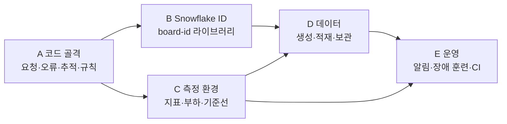
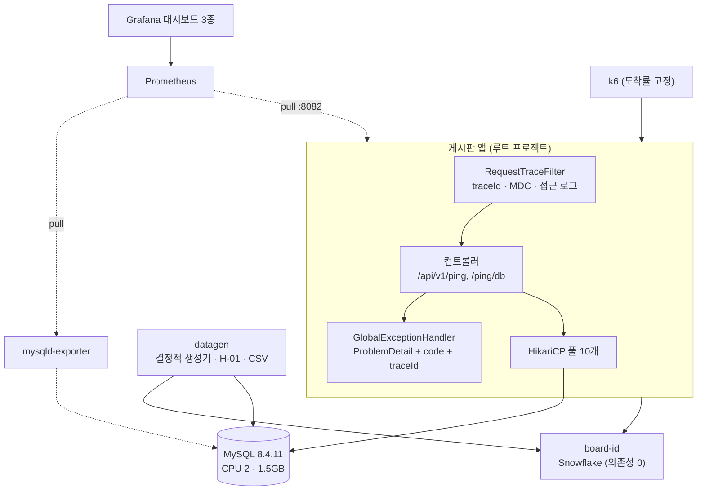

# Large-Board 0단계 — 기반과 측정 환경

> **한 줄 요약.** 대용량 게시판을 단계별로 키우기 전에, **숫자를 믿을 수 있는 바닥**(코드 골격, ID, 측정 환경, 데이터, 운영 기초)을 만들고 그 위에서 첫 측정과 첫 장애 훈련을 했다.
>
> 이 폴더는 0단계의 다섯 묶음(A~E)을 **실제 코드를 따라가며** 설명한다. 각 문서는 (1) 무엇을 만들었는지, (2) **왜 그렇게 했는지**, (3) 그 아래에서 프레임워크·DB가 어떻게 움직이는지, (4) 측정 결과와 해석, (5) 한국어 자료 모음 순서로 읽힌다.

## 1. 프로젝트와 0단계

| 항목 | 내용 |
| --- | --- |
| 저장소 | [guseoh/large-scale-board](https://github.com/guseoh/large-scale-board) (코드), [Wiki](https://github.com/guseoh/large-scale-board/wiki) (설계 문서와 ADR) |
| 기술 | Java 21, Spring Boot 4.1.0, Gradle 9.5.1, MySQL 8.4.11(Docker), Prometheus·Grafana·k6 |
| 0단계 범위 | 비즈니스 테이블 없이, 이후 모든 구현과 실험이 올라설 **바닥** |
| 작업 방식 | 0단계는 인프라 바닥이라 코드를 직접 작성·측정했고, 1단계부터는 정답 코드를 보고 직접 구현한다 |
| 결과물 | PR 한 개로 묶어 병합, Issue 2건(실험 기록), ADR 7건 |

## 2. 문서 지도

| 문서 | 다루는 것 | 핵심 질문 |
| --- | --- | --- |
| [[01. A 코드 골격]] | 멀티 프로젝트, 패키지·ArchUnit, 오류 응답(RFC 9457), 요청 추적(필터·MDC) | 요청과 예외가 어떤 길로 지나가고, 어떻게 규칙으로 강제하는가 |
| [[02. B Snowflake ID]] | 64비트 ID 구조, 시계 역행, 동시성, InnoDB·JS 영향 | 왜 DB가 번호를 주지 않게 했고, 무엇을 조심해야 하는가 |
| [[03. C 측정 환경]] | compose, Prometheus·Grafana, k6 열린 모델, 기준선, 풀 크기 | 숫자를 어떻게 믿을 수 있게 만들고, 첫 병목은 무엇인가 |
| [[04. D 데이터 생성과 적재]] | 결정적 생성기, Zipf, H-01 적재 방식 비교, 데이터셋 보관 | 100만 건을 어떻게 넣어야 하고, 같은 데이터를 어떻게 다시 만드는가 |
| [[05. E 운영과 장애 훈련]] | 알림 규칙, MySQL 중단 훈련, 타임아웃, CI | 장애가 나면 무슨 일이 벌어지고 몇 초 만에 알 수 있는가 |

**읽는 순서.** 처음이면 A → B → C → D → E 순서가 가장 자연스럽다. 특정 주제만 궁금하다면 다음처럼 골라 읽자.

| 알고 싶은 것 | 바로 읽을 곳 |
| --- | --- |
| 예외가 응답이 되는 과정 | [[01. A 코드 골격]] 4절 |
| `ThreadLocal`/MDC가 왜 `finally`에서 지워야 하는가 | [[01. A 코드 골격]] 5절 |
| Snowflake의 비트 구성과 시계 역행 처리 | [[02. B Snowflake ID]] 4~6절 |
| p99가 어떻게 계산되고 왜 평균을 내면 안 되는가 | [[03. C 측정 환경]] 3.3절 |
| 풀 크기와 리틀의 법칙 | [[03. C 측정 환경]] 5.4절, 6절, [[05. E 운영과 장애 훈련]] 3절 |
| JPA 대량 적재가 왜 느린가 | [[04. D 데이터 생성과 적재]] 3절 |
| 관측이 장애 때 먼저 죽은 이유 | [[05. E 운영과 장애 훈련]] 3.2절 |

## 3. 0단계가 만든 구조 한눈에 보기

## 4. 꼭 기억할 수치

| 주제 | 값 | 어디서 |
| --- | --- | --- |
| DB 왕복 한 번의 비용 | 약 **0.9ms** (서버 평균 `/ping/db` 1.07ms − `/ping` 0.19ms) | [[03. C 측정 환경]] 5.3절 |
| `/ping/db` 최대 처리량 | 약 **4,200건/초**. 첫 병목은 **HikariCP 풀 10개**, 초당 약 3,000건에서 포화 | [[03. C 측정 환경]] 5.1절 |
| H-01: JPA 기본 vs JDBC 배치 | 약 1,244초 vs 91.1초 = **13.7배**. `LOAD DATA` 64.6초 | [[04. D 데이터 생성과 적재]] 3.3절 |
| `Persistable` 미구현 | INSERT마다 SELECT가 추가되어 속도가 **절반** | [[04. D 데이터 생성과 적재]] 3.4절 |
| IDENTITY 전략 | 배치 INSERT가 **꺼진다** | [[04. D 데이터 생성과 적재]] 3.4절 |
| 기본 설정에서 MySQL 중단 | DB와 무관한 `/ping`이 **87% 처리 못 함**(초당 12.5건) | [[05. E 운영과 장애 훈련]] 3절 |
| 확정 설정 | `connection-timeout` 1초, `socketTimeout` 10초, 관리 포트 8082 | [[05. E 운영과 장애 훈련]] 4절 |
| 첫 탐지 신호 | `HikariTimeout`이 주입 후 **5~8초** | [[05. E 운영과 장애 훈련]] 5절 |
| Snowflake 수명 | 41비트 ≈ 69.7년 (2095-09까지), ID는 JS 안전 정수를 넘는다 | [[02. B Snowflake ID]] 4절, 9절 |
| 데이터셋 복원 | `ds-v0`(100만 건) **약 29초** | [[04. D 데이터 생성과 적재]] 4절 |

## 5. 설계 결정(ADR)

각 결정의 배경, 검토한 대안, 새로 생긴 비용과 되돌릴 조건은 Wiki에 있다.

| ADR | 주제 | 이 폴더에서 설명한 곳 |
| --- | --- | --- |
| [ADR-001](https://github.com/guseoh/large-scale-board/wiki/ADR-001-Package-and-Gradle) | 패키지와 Gradle 구조 | [[01. A 코드 골격]] 2~3절 |
| [ADR-002](https://github.com/guseoh/large-scale-board/wiki/ADR-002-Error-Response) | 오류 응답 | [[01. A 코드 골격]] 4절 |
| [ADR-003](https://github.com/guseoh/large-scale-board/wiki/ADR-003-Request-Trace-Id) | 요청 추적 ID | [[01. A 코드 골격]] 5절 |
| [ADR-004](https://github.com/guseoh/large-scale-board/wiki/ADR-004-Snowflake-Id) | Snowflake ID | [[02. B Snowflake ID]] |
| [ADR-005](https://github.com/guseoh/large-scale-board/wiki/ADR-005-Id-As-String) | API 응답의 ID는 문자열 | [[02. B Snowflake ID]] 9절 |
| [ADR-006](https://github.com/guseoh/large-scale-board/wiki/ADR-006-Dataset-Load-and-Snapshot) | 데이터셋 적재와 보관 | [[04. D 데이터 생성과 적재]] 3~4절 |
| [ADR-007](https://github.com/guseoh/large-scale-board/wiki/ADR-007-DB-Timeouts-and-Management-Port) | DB 타임아웃과 관리 포트 분리 | [[05. E 운영과 장애 훈련]] 3~4절 |

## 6. 용어 사전

| 용어 | 한 줄 설명 |
| --- | --- |
| **MDC** | SLF4J의 "스레드별 Map". 로그 패턴 `%X{traceId}`가 현재 스레드의 값을 꺼낸다. 스레드 풀에서는 `finally`에서 지워야 한다 |
| **ProblemDetail** | RFC 9457이 정한 오류 응답 형식(`type`, `title`, `status`, `detail`, `instance` + 확장 필드) |
| **Snowflake** | 시각 + 노드 + 순번을 64비트에 조합해 중앙 조율 없이 시간순 ID를 만드는 방식 |
| **클러스터드 인덱스** | InnoDB에서 PK 순서로 행 데이터를 저장하는 구조. 보조 인덱스에는 PK가 함께 저장된다 |
| **HikariCP** | JDBC 커넥션 풀. `maximumPoolSize`, `connectionTimeout`이 병목과 장애 전파를 정한다 |
| **리틀의 법칙** | 시스템 안의 동시 요청 수 = 초당 도착 수 × 머무는 시간 |
| **열린 모델 / 닫힌 모델** | 서버 상태와 무관하게 요청이 도착하는가(열린) / 응답을 받아야 다음 요청을 보내는가(닫힌) |
| **히스토그램 분위수** | 버킷의 누적 개수에서 선형 보간으로 계산. 오차는 버킷 폭이 한계이고 분위수의 평균은 금지 |
| **Persistable** | Spring Data JPA에게 "새 엔티티인가"를 직접 알려 INSERT 전 SELECT(`merge`)를 막는 인터페이스 |
| **LOAD DATA INFILE** | 서버가 자기 디스크의 CSV를 읽어 한 번에 적재하는 MySQL 문장. `FILE` 권한과 `secure_file_priv`가 필요 |
| **pending / firing** | Prometheus 알림의 상태. `for` 시간 동안 조건이 계속 참이어야 firing이 된다 |

## 7. 측정에 대한 정직한 전제

- 모든 측정은 **로컬 장비 한 대**(앱, k6, Docker VM이 같은 12코어를 나눠 쓴다)에서 했다. 부하 전에도 호스트 CPU가 50~64%였다. 절대 수치가 아니라 **같은 조건에서의 상대 비교**로 읽어야 한다.
- k6 p99는 같은 조건에서 7~39ms로 흔들려서, **주 지표는 서버 히스토그램**이다.
- H-01의 세 방식(A, A′, B′)은 시간이 너무 오래 걸려 **10만 건으로 재고 100만 건으로 환산**했다.
- `LOAD DATA`가 JDBC 배치보다 1.4배만 빠른 이유(파일 공유 경로, 로그 쓰기 등)는 **가설만 세우고 검증하지 않았다**.
- 장애 훈련은 **한 번에 한 가지 장애**(MySQL 중단)만 했고, 자동 테스트가 아니라 스크립트로 재실행한다.

## 8. 0단계의 후속 항목 모음

| 항목 | 어디서 |
| --- | --- |
| 비동기 디스패치에서 `traceId`가 비고 접근 로그 상태가 다를 수 있다 | [[01. A 코드 골격]] 5.7절 |
| Wiki 설계 문서의 `type` 필드 예시를 실제 응답에 맞게 고치기 | [[01. A 코드 골격]] 4.3절 |
| 노드 ID 배정 방식(4단계), ID 문자열 누락 방지(1단계) | [[02. B Snowflake ID]] 11절 |
| 풀 크기 변경 실험, 작은 히스토그램 버킷 | [[03. C 측정 환경]] 9절 |
| `LOAD DATA` 개선 확인, B′가 A보다 느린 이유, 드라이버 부수 왕복 줄이기 | [[04. D 데이터 생성과 적재]] 6절 |
| 서킷 브레이커, 요청 폭증 때 1초 타임아웃의 실패율 | [[05. E 운영과 장애 훈련]] 12절 |
| **시간대 문제**: `hibernate.jdbc.time_zone=UTC`와 JVM 기본 시간대의 충돌이 1단계 첫 엔티티에서 재현된다 | [[04. D 데이터 생성과 적재]] 2.6절 |

## 9. 이미지와 자료 출처

- **직접 그린 도식·차트**는 [`assets/`](assets/)에 두었다(SVG). 계단 부하(`step-*.svg`), H-01 적재 비교(`h01-load-methods.svg`), 장애 훈련(`drill-*.svg`, `littles-law.svg`), Snowflake 비트 구성(`snowflake-bits.svg`)이다. 원자료는 저장소의 `data/h01/results.csv`와 Prometheus 요약값이다.
- **다른 곳의 이미지**는 이 저장소에 복사하지 않고 **원문 주소로 링크**하며, 그림마다 출처 글을 적었다. 원문 사이트가 주소를 바꾸면 그림이 사라질 수 있다.
- **Mermaid 도식**은 Obsidian에서 바로 렌더링된다.
- 한국어 기술 블로그(우아한형제들, 카카오페이, 올리브영, 토스페이먼츠, LY Corporation)와 개인 블로그 글은 **개념을 이해하는 보조 자료**로 쓰고, 글마다 **오래되었거나 부정확한 부분**을 확인한 것은 해당 문서의 표에 적었다. 사실 주장의 근거는 가능한 한 공식 문서(Spring, Hibernate, MySQL, Prometheus, HikariCP, Gradle, ArchUnit 등)를 따랐다.

### 이 폴더에서 인용한 한국어 자료

| 구분 | 자료 | 쓰인 문서 |
| --- | --- | --- |
| 한국 기업 | 우아한형제들 — 멀티모듈 설계 이야기 / MDC·SQL 진입점 / DB 분산처리 sharding / HikariCP Dead lock(이론·실전) / Config Checker / 하이버네이트 배치 / @NaturalId / 서킷브레이커 / 우아~한 장애대응 / 빌링 시스템 장애 | A, B, C, D, E |
| 한국 기업 | 카카오페이 — ELK ThreadContext(Part2·3) / JVM 웜업 | A, C, E |
| 한국 기업 | 올리브영 — SQS 커넥션 데드락 / Circuitbreaker 장애 전파 방지 | C, E |
| 한국 기업 | 토스페이먼츠 — Spring JDBC 성능, 네트워크 분석 | C, D |
| 한국 기업 | LY Corporation — 주문 DB 마이그레이션(자체 ID 채번) | B, D |
| 한국 개인 | velog·tistory·GitHub Pages — Filter/Interceptor/AOP, DispatcherServlet 흐름, ThreadLocal, ArchUnit, Gradle 멀티모듈, ProblemDetail, Snowflake·클러스터링 인덱스·CAS, JPA 타임존·`isNew`·IDENTITY 배치, Prometheus·Grafana, 알람 파이프라인 | A~E |

## 10. 관련 문서

- 이 vault의 성능 학습 노트: [[../../../Study/Performance/README|Study/Performance]] — 일반 개념(관측성, 풀, 퍼센타일, 부하 모델, 재현 가능한 실험)은 이 노트들이 더 깊게 다룬다.
- 비슷한 형식의 프로젝트 기록: [[../../pawCycle/Performance/README|PawCycle Performance Engineering 기록]]
