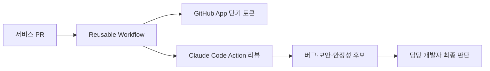

# Claude Code Action: 조직 전반의 코드 품질을 지키는 AI 코드 리뷰 플랫폼화

> [!abstract] 한 줄 정리
> AI 코드 리뷰도 개인 프롬프트가 아니라 인증·실행 환경·공통 규칙을 표준화해야 조직 수준의 품질 도구가 됩니다.

> techblog.lycorp.co.jp

## 핵심 내용

Claude Code Action을 GitHub Actions에 통합해 여러 팀이 같은 방식으로 AI 1차 코드 리뷰를 사용할 수 있도록 플랫폼화한 사례입니다. PAT 대신 GitHub App의 단기 토큰을 사용하고, 공통 runner와 reusable workflow를 제공해 각 서비스가 쉽게 적용하도록 했습니다.

리뷰는 버그·보안·안정성 같은 영역의 1차 탐지에 집중시키고, 서비스별 사람이 최종 판단하는 구조를 유지합니다.

공통 AI 코드 리뷰를 각 팀에서 개별 스크립트로 운영하면 액세스 토큰 관리, Workflow 버전, 실행 비용과 품질 기준이 팀마다 달라진다. 원문은 GitHub App의 단기 토큰, 공통 Runner와 재사용 가능한 Workflow를 사용해 보안·배포·운영 경계를 플랫폼이 담당하도록 했다. 그 위에서 서비스별 리뷰 규칙은 필요에 따라 다르게 적용하고, AI는 1차 위험 탐지에 집중시킨다.

*자체 재구성. 토큰 발급·공통 실행과 최종 승인 책임을 구분했다.*

AI 리뷰가 누락되거나 실패했을 때 CI 전체를 차단할지, 경고로 남길지 역시 보안·개발 생산성의 트레이드오프이므로 조직의 위험 기준에 맞게 결정해야 한다.

## 왜 읽을까

AI 리뷰를 '리뷰어 대체'가 아니라 반복 가능한 품질 게이트로 설계하는 방법을 보여줍니다. 권한과 운영 방식까지 포함한 사례라는 점이 좋습니다.

**프로젝트에 적용**

**PawCycle·DevPedia 공통** — AI 리뷰를 사용한다면 PR마다 임의로 요청하기보다 공통 검증 기준, 최소 권한, 테스트 결과와 함께 읽는 순서를 고정해 인간 리뷰를 보조하는 단계로 둘 수 있습니다.

---

**원문:** [Claude Code Action: 조직 전반의 코드 품질을 지키는 AI 코드 리뷰 플랫폼화](https://techblog.lycorp.co.jp/ko/building-ai-code-review-platform-with-claude-code-action)
