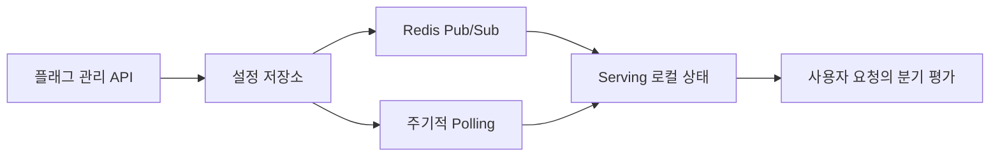

# 피처 플래그 개발기: 실시간 데이터 동기화를 향한 여정

> [!abstract] 한 줄 정리
> 안전한 기능 배포는 deploy와 release를 분리하고, 실시간 동기화가 실패해도 상태를 회복할 수 있는 fallback을 갖추는 데서 시작합니다.

> tech.kakaopay.com

## 핵심 내용

피처 플래그의 관리 영역과 실제 요청을 처리하는 serving 영역을 나누고, 변경 사항을 빠르게 반영하기 위해 Redis Pub/Sub 기반 동기화를 사용합니다. 실시간 이벤트를 놓칠 가능성에 대비해 polling을 보조 경로로 두는 식으로 복구 가능성도 설계합니다.

피처 플래그는 관리 화면에서 값을 바꾸는 기능과 각 요청에서 플래그를 읽는 기능의 신뢰성 요구가 다르다. 관리 서비스가 일시적으로 불안정해도 사용자 요청은 계속 처리되어야 하므로 Serving 계층이 로컬 상태를 보유하고 변경 이벤트를 수신하도록 분리한다. 하지만 Redis Pub/Sub은 구독자가 잠시 끊긴 동안의 메시지를 영속 보관하는 구조가 아니므로 놓친 변경을 주기적 Polling으로 다시 확인해야 한다.

*자체 재구성. 실시간 변경 알림과 누락 복구 경로를 함께 표시했다.*

플래그 삭제·기본값·계층별 우선순위도 별도 계약이다. Pub/Sub 성공을 곧 모든 서버의 즉시 동기화가 보장됐다고 해석하지 않아야 한다.

## 왜 읽을까

기능 on/off 스위치 하나가 실제로는 상태 동기화, 일관성, 운영 권한, 장애 복구가 필요한 분산 시스템 문제라는 점을 잘 보여줍니다.

**프로젝트에 적용**

**PawCycle·FutMatch 공통** — 위험한 신규 기능을 배포할 때 코드 배포와 사용자 노출을 분리하고, 문제 발생 시 재배포 없이 끌 수 있는 작은 feature flag를 실험해볼 수 있습니다.

---

**원문:** [피처 플래그 개발기: 실시간 데이터 동기화를 향한 여정](https://tech.kakaopay.com/post/feature-flag/)
