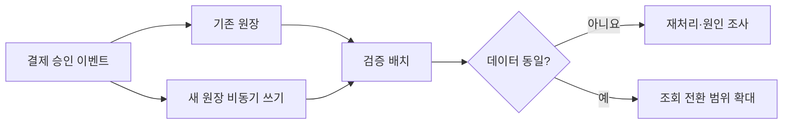

# 레거시 결제 원장을 확장 가능한 시스템으로

> [!abstract] 한 줄 정리
> 핵심 원장 마이그레이션은 새 DB에 쓰는 것보다 기존·신규 시스템의 결과가 실제로 같은지 지속적으로 검증하고 즉시 되돌릴 수 있게 만드는 일이 더 중요합니다.

> toss.tech

## 핵심 내용

결제 원장의 강한 도메인 결합과 구조적 제약을 줄이기 위해 Oracle/MyBatis 중심 구조에서 별도 MySQL/JPA 시스템으로 책임을 이동합니다. 승인 이력을 INSERT 중심으로 남기고 Kafka 이벤트를 활용하며, 초기 이행 과정에서는 비동기 dual-write와 검증 배치를 이용했습니다.

비동기 경로에 과부하가 생기면 일부 쓰기를 포기하고 검증 배치로 복구하는 선택, 5분 단위 read-only 검증, DB 부하 문제가 생겼을 때 빠르게 조회 경로를 되돌린 사례까지 다룹니다.

결제 원장 현대화는 저장소를 Oracle/MyBatis에서 MySQL/JPA로 교체하는 일 이상의 의미가 있다. 승인·취소·정산을 한 덩어리로 묶은 도메인 책임을 해체하면서 결제 기록은 수정 가능한 현재 상태만 저장하기보다 INSERT 중심의 이력으로 남겨 추적성을 높였다. 이행 기간에는 기존 경로와 새 경로가 동시에 운영되므로 정합성을 검증하는 배치와 빠른 조회 롤백을 별도 설계해야 한다.

*자체 재구성. 이행 중 비동기 경로의 부분 실패와 배치 보정이 별도 책임임을 보여 준다.*

비동기 Dual Write에서 과부하 시 일부 쓰기를 포기하는 선택은 **검증·복구 경로가 마련되어 있을 때에만** 고려할 수 있다. 조회 전환 후 DB 부하가 악화되면 새로운 저장소를 계속 고집하지 않고 되돌린 운영 판단도 중요하다.

## 왜 읽을까

데이터 마이그레이션의 핵심이 '한 번 복사'가 아니라 장기간의 정합성 증명과 rollback 가능성이라는 점을 잘 보여줍니다.

**프로젝트에 적용**

**FutMatch** — 신청·승인·취소 같은 상태 이력을 설계할 때 현재 상태만 덮어쓰기보다 중요한 변경을 추적 가능하게 남기고, 구조 변경 시 old/new 결과를 비교하는 검증 방식을 적용할 수 있습니다.

---

**원문:** [레거시 결제 원장을 확장 가능한 시스템으로](https://toss.tech/article/payments-legacy-5)
