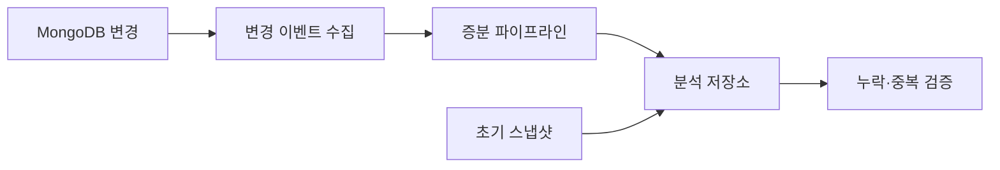

# 매번 다 퍼올 필요 없잖아? 당근의 MongoDB CDC 구축기

> [!abstract] 한 줄 정리
> 분석을 위해 운영 DB 전체를 반복 복사하는 대신 변경분만 전달하면 원본 서비스 부하를 줄이면서 데이터 파이프라인을 지속적으로 갱신할 수 있습니다.

> medium.com

## 핵심 내용

MongoDB 데이터를 분석 환경으로 옮길 때 반복적인 full dump가 운영 DB에 주는 부하와 데이터 갱신 지연을 줄이기 위해 CDC 파이프라인을 구축합니다. 변경 이벤트만 추출해 downstream으로 전달하면서 transaction workload와 analytics workload를 분리하는 방향입니다.

MongoDB 전체 컬렉션을 매번 분석 환경으로 복사하면 데이터 양에 비례해 소스 DB와 네트워크가 반복적으로 부하를 받는다. CDC는 마지막으로 반영한 변경 이후의 이벤트만 전달해 비용을 낮출 수 있지만 초기 스냅샷과 변경 스트림 사이를 맞추는 작업, 재처리 순서와 삭제 이벤트 반영까지 운영 계약으로 정의해야 한다.

*자체 재구성. 원문의 증분 동기화 목적에 초기 적재·검증 경계를 표시한 학습용 흐름이다.*

풀 덤프에서 변경 스트림으로 옮겼더라도 소비자가 늦게 반영하는 경우를 대비해 처리 지연, 재시도, Offset·Resume Token 같은 복구 상태를 검증해야 한다.

## 왜 읽을까

CDC를 유행하는 데이터 기술이 아니라 '운영 DB를 분석 요청으로부터 어떻게 보호할 것인가'라는 문제에서 출발해 이해하기 좋습니다.

**프로젝트에 적용**

**DevPedia·PawCycle 공통** — 나중에 통계·분석 요구가 커져 운영 MySQL 조회가 부담이 될 때만 CDC나 별도 분석 저장소를 후보로 올리고, 현재는 단순 쿼리/배치로 충분한지 먼저 측정하는 기준으로 활용할 수 있습니다.

---

**원문:** [매번 다 퍼올 필요 없잖아? 당근의 MongoDB CDC 구축기](https://medium.com/daangn/%EB%A7%A4%EB%B2%88-%EB%8B%A4-%ED%8D%BC%EC%98%AC-%ED%95%84%EC%9A%94-%EC%97%86%EC%9E%96%EC%95%84-%EB%8B%B9%EA%B7%BC%EC%9D%98-mongodb-cdc-%EA%B5%AC%EC%B6%95%EA%B8%B0-302ae8a0dc23)
