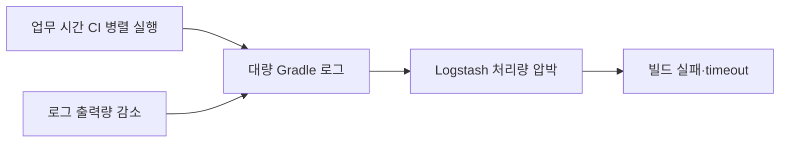

# CI 빌드 오류의 원인 분석에서 해결까지의 여정

> [!abstract] 한 줄 정리
> CI timeout을 늘려 임시로 숨기는 것보다 실패 시간대와 로그·리소스를 연결해 병목의 원인을 계측해야 재발을 막을 수 있습니다.

> techblog.lycorp.co.jp

## 핵심 내용

약 10일에 걸쳐 CI build failure의 원인을 추적합니다. 실패의 약 80%가 업무 시간대에 집중된 것을 확인하고 timeout을 단순히 두 배로 늘려보지만 문제가 해결되지 않습니다. 조사 결과 많은 build log가 Logstash 처리량을 압박하고 있었고, 인프라를 크게 증설하는 대신 Gradle 로그 양을 줄이는 선택으로 원인을 완화합니다.

CI timeout을 두 배로 늘려도 해결되지 않았다는 결과는 빌드 자체가 느리다는 첫 가설을 재검토하게 만든다. 업무 시간에 실패가 집중되었다면 코드 변경의 품질 문제뿐 아니라 동시 실행 수, 로그 파이프라인 처리량, 공유 인프라의 병목을 의심해야 한다. 실제 원인은 대량 빌드 로그가 Logstash를 압박하는 경로였고, 문제를 만든 **로그 생성량**을 줄이는 선택으로 접근했다.

*자체 재구성. 원문에서 확인한 CI와 로그 처리 계층의 의존을 요약했다.*

수집 시스템을 증설하면 당장의 처리는 빨라질 수 있지만, 불필요하게 발생시키는 로그의 비용을 제거하지 못한다. CI 원인 분석 시 빌드 시간뿐 아니라 runner의 CPU/메모리, 출력량, 수집 지연을 함께 보아야 한다.

## 왜 읽을까

'시간 초과 → timeout 증가' 같은 증상 처리가 왜 근본 해결이 아닌지, 데이터를 모아 가설을 좁히는 장애 분석 흐름이 좋습니다.

**프로젝트에 적용**

**PawCycle** — GitHub Actions가 느려지거나 실패하면 곧바로 timeout/retry를 늘리지 말고 실패 시각, runner CPU/memory, Gradle log, 테스트 단계별 시간을 기록해 병목을 찾는 운영 절차를 만들 수 있습니다.

---

**원문:** [CI 빌드 오류의 원인 분석에서 해결까지의 여정](https://techblog.lycorp.co.jp/ko/analysis-and-resolution-of-the-ci-build-error)
