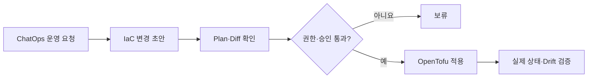

# 코드형 인프라(IaC)로 자동화에서 AI까지: OpenTofu와 ChatOps 도입기

> [!abstract] 한 줄 정리
> 인프라 자동화의 핵심은 CLI 명령을 줄이는 것이 아니라 변경 내용을 코드와 리뷰 가능한 상태로 만들고 그 위에 ChatOps나 AI를 안전하게 얹는 것입니다.

> techblog.lycorp.co.jp

## 핵심 내용

인프라 리소스를 OpenTofu/Terragrunt 기반 IaC로 관리하고 반복적인 운영 작업을 자동화한 뒤 ChatOps까지 확장하는 과정을 소개합니다. 사람의 수작업 변경을 줄이고 선언된 상태와 실제 상태를 비교할 수 있게 만든 뒤 자연어 인터페이스를 연결합니다.

IaC의 장점은 콘솔 작업을 코드로 바꿨다는 데서 끝나지 않는다. 선언한 리소스 구성과 실제 클라우드 상태가 다르면 누가 어떤 변경을 승인했는지 추적하고 되돌릴 수 있어야 한다. OpenTofu와 Terragrunt로 모듈·환경별 설정을 관리하더라도 자연어 ChatOps가 곧바로 `apply`를 실행하면 오히려 변경 통제권을 잃을 수 있다.

*자체 재구성. 자연어 입력은 변경 제안과 검증을 단축하되 실제 인프라 수정은 승인 게이트를 통과하도록 구성한 학습용 흐름이다.*

State 파일에는 민감한 정보가 포함될 수 있으므로 접근 제어·잠금·백업도 IaC 운영의 별도 보안 경계로 관리해야 한다.

## 왜 읽을까

AI 운영 자동화보다 먼저 인프라 상태가 코드로 표현되어야 하는 이유를 이해하기 좋습니다.

**프로젝트에 적용**

**PawCycle** — EC2·보안 그룹·DNS·모니터링 같은 인프라가 늘어날 때 수동 콘솔 변경이 반복되는 지점부터 Terraform/OpenTofu 후보로 옮기고 PR 리뷰를 거치게 할 수 있습니다.

---

**원문:** [코드형 인프라(IaC)로 자동화에서 AI까지: OpenTofu와 ChatOps 도입기](https://techblog.lycorp.co.jp/ko/techverse2026-86)
