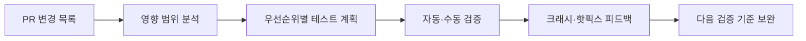

# 누군가는 토스를 테스트하는 동안, 우리는 테스트하는 법을 만듭니다.

> [!abstract] 한 줄 정리
> 테스트 도구의 수보다 품질 결과를 누가 어떤 기준으로 책임질지가 더 중요합니다.

> toss.tech

## 핵심 내용

매주 평균 300~400건의 코드 변경을 검증하기 위해 스모크 테스트, 회귀 테스트, PR 영향 범위 분석, 크래시·핫픽스 추적을 하나의 품질 체계로 발전시킨 사례입니다. 자체 플랫폼과 PRCheck, 문서 기반 테스트 케이스 생성 등을 연결했습니다. 테스트 케이스 생성 도구를 제공해도 사용자가 기대만큼 쓰지 않자 사용자가 원하는 것이 새 도구가 아니라 품질을 끝까지 책임지는 구조라는 점을 깨닫고 전략을 바꿨습니다.

테스트 케이스 생성 기능 하나를 만들었다고 품질 문제가 해결되지는 않는다. 주당 수백 PR의 변경 범위를 사람이 전부 추적하기 어렵다면 **무엇을 우선 검증할지**, 실패했을 때 누가 판단하고 릴리스를 중단할지를 서비스 흐름으로 정의해야 한다. 스모크와 회귀, 실제 크래시·핫픽스 이력을 함께 보는 것은 특정 테스트가 통과했다는 신호보다 제품의 전체 리스크를 평가하기 위한 장치다.

*자체 재구성. 검증 책임과 운영 피드백을 하나의 품질 루프로 연결했다.*

도구 도입률이 낮았던 것은 사용자 교육만의 문제가 아니라, 도구 사용 이후 품질 책임이 기존과 동일하게 사람에게 남아 있다는 제품 설계상의 신호였다.

## 왜 읽을까

테스트 자동화를 도구 개발이 아니라 품질 기준, 배포 판단, 조직 책임의 문제로 확장해서 볼 수 있습니다. 맞지 않는 방향의 도구를 빠르게 폐기한 사례도 인상적입니다.

---

**원문:** [누군가는 토스를 테스트하는 동안, 우리는 테스트하는 법을 만듭니다.](https://toss.tech/article/50893)
