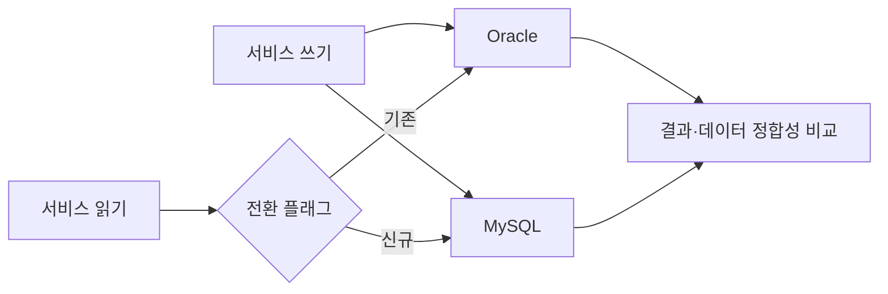

# 스마트스토어센터 Oracle에서 MySQL로의 무중단 전환기

> [!abstract] 한 줄 정리
> DB 전환은 데이터 복사 작업이 아니라 ORM·SQL·식별자·성능·롤백까지 함께 검증하는 애플리케이션 변경입니다.

> d2.naver.com

## 핵심 내용

10년 이상 운영한 서비스를 Oracle에서 MySQL로 중단과 데이터 손실 없이 옮기기 위해 양방향 이중 쓰기와 롤백 가능한 구조를 적용했습니다. JPA와 MyBatis가 함께 있는 환경에서 쿼리, 식별자 생성, DB 함수, 페이징 문법 차이를 처리하고 약 3개월 동안 기능과 데이터 정합성을 검증했습니다. MySQL로 읽기 전환 후에도 Oracle 이중 쓰기를 유지해 즉시 롤백 가능하게 했고 동일 조회를 두 DB에서 실행해 결과와 성능을 비교했습니다.

Oracle과 MySQL은 SQL 문법만 다른 저장소가 아니다. 시퀀스·식별자 발급, NULL과 문자열 처리, 트랜잭션·락 동작, 인덱스·페이징 전략이 달라 같은 API 코드라도 결과와 실행 계획이 바뀔 수 있다. 원문은 JPA와 MyBatis가 섞인 환경에서 SQL·DB 함수·키 생성 경계를 확인하고, **MySQL 읽기로 전환한 뒤에도 Oracle로 계속 쓰는 경로**를 잠시 유지해 긴급 롤백 가능성을 확보했다.

*자체 재구성. 실제 구현의 세부 전송 순서를 단정하지 않고 이행 기간의 쓰기·읽기·검증 경계를 표시한다.*

약 3개월의 비교 기간은 데이터가 일치하는지뿐 아니라 성능 저하, 롤백 후 재동기화와 운영 담당자의 전환 절차를 확인하는 기간이었다.

## 왜 읽을까

DB 이전을 애플리케이션 코드, ORM, 커넥션, 성능, 롤백까지 포함한 전환 문제로 다루는 점이 좋습니다.

---

**원문:** [스마트스토어센터 Oracle에서 MySQL로의 무중단 전환기](https://d2.naver.com/helloworld/6512234)
