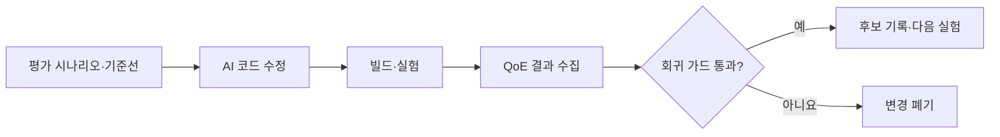

# AI 에이전트가 코드를 실험하고 개선하는 법

> [!abstract] 한 줄 정리
> AI 에이전트에게 성능 개선을 맡기려면 코드 생성보다 먼저 점수판, 회귀 가드, 실험 루프를 설계해야 합니다.

> d2.naver.com

## 핵심 내용

라이브 스트리밍 알고리즘 개선에 `코드 수정 → 빌드 → 실험 → 결과 판정`을 반복하는 자율 루프를 구축했습니다. 회귀 방지와 통계적 검증을 포함해 7개 시나리오에서 QoE를 개선하고 전체 지표를 17% 향상시켰다고 설명합니다. 약 5시간의 사람 작업과 60시간의 AI 실험을 결합했으며, 점수판을 먼저 정의하고 회귀가 생기면 변경을 버리도록 했습니다.

AI가 성능 개선 코드를 반복해서 만들 수 있어도 **무엇을 개선했다고 판단할 것인지**가 자동으로 정해지지는 않는다. 라이브 스트리밍처럼 QoE의 여러 차원을 평가하는 환경에서는 시나리오마다 지표를 측정하고 한 지표의 개선이 다른 지표를 크게 악화시키면 해당 실험을 폐기하도록 규칙을 둬야 한다.

*자체 재구성. 원문 실험의 자율 반복과 회귀 차단을 구분했다.*

원문의 **7개 시나리오·전체 지표 17% 개선**은 설정된 평가와 측정 환경의 결과다. 사람 약 5시간, AI 약 60시간의 작업 기록을 단순히 12배 빨라졌다는 효율 수치로 바꾸지 않아야 한다.

## 왜 읽을까

AI가 오래 일하는 것보다 무엇을 좋은 결과로 볼지 측정 기준을 먼저 고정하는 것이 중요하다는 사례입니다.

---

**원문:** [AI 에이전트가 코드를 실험하고 개선하는 법](https://d2.naver.com/helloworld/8061804)
