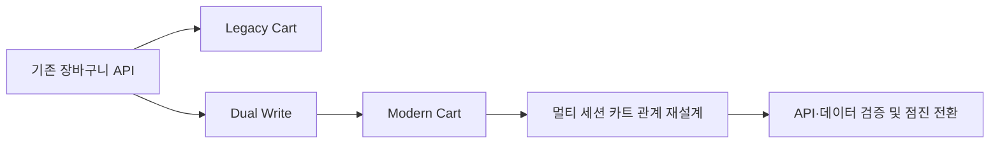

# 카트 개발 연대기

> [!abstract] 한 줄 정리
> 리팩터링은 코드 정리가 아니라 데이터 구조, API 호환성, 동시성, 배포 전략이 함께 얽힌 점진적 시스템 변화입니다.

> helloworld.kurly.com

## 핵심 내용

Legacy Cart → Stack Cart → Modern Cart → Multi Cart로 구조가 바뀌며 데이터 마이그레이션, Dual Write, 데드락, API 호환성 문제를 연속적으로 겪은 기록입니다. 신규·기존 테이블에 이중 쓰기를 적용했지만 기존 데드락이 더 심해졌고 앱 API 규격까지 바뀌어 단순 롤백하기 어려운 상태가 됐습니다. 결국 한 계정의 여러 세션을 하나의 카트로 강제 합치는 구조가 경합을 만든다는 점을 찾아 카트끼리 데이터를 공유하는 방향으로 설계를 바꿉니다.

Legacy Cart에서 Modern Cart로의 이행은 코드를 더 깔끔하게 바꾼다는 목표보다 **기존 세션과 데이터의 의미를 유지하면서 저장 모델을 교체한다**는 과제에 가깝다. 기존·신규에 동시에 쓰면 검증 기간을 확보할 수 있지만 서로 다른 락 순서와 트랜잭션이 합쳐지면서 오히려 데드락이 늘 수 있다. 앱 API가 이미 새 구조로 변경되었다면 DB만 이전 상태로 되돌린다고 완전한 롤백이 되는 것도 아니다.

*자체 재구성. 실제 전환에서 데이터, 세션, API 호환을 함께 검증해야 한다는 점을 강조한다.*

`한 계정 = 한 카트`라는 가정이 사용자의 복수 세션·카트 수명주기와 맞지 않는다면 단순 락 최적화로는 충돌을 해결하기 어렵다. 상태의 소유 경계를 바꾸는 것이 핵심 설계 변경이다.

## 왜 읽을까

완성된 아키텍처가 아니라 실패하고 다시 바뀌는 설계 과정을 볼 수 있습니다. 락을 추가하기 전에 경합을 만드는 모델 자체를 의심하게 합니다.

---

**원문:** [카트 개발 연대기](https://helloworld.kurly.com/blog/my-cart-development-history/)
