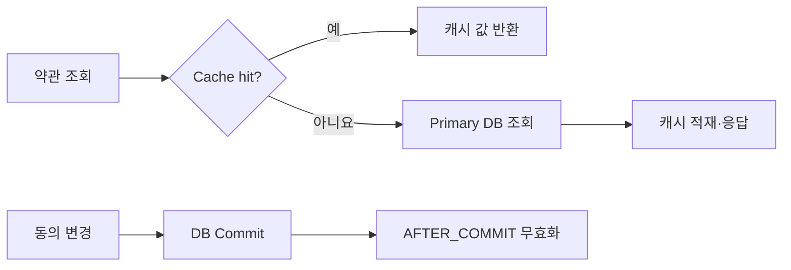

# 캐시를 적용하기 까지의 험난한 길 (TPS 1만 안정적으로 서비스하기)

> [!abstract] 한 줄 정리
> 캐시는 성능 개선의 공짜 해법이 아니라 데이터 일관성과 맞바꾸는 설계 선택입니다.

> toss.tech

## 핵심 내용

평균 TPS 1만, 최대 2만까지 올라간 약관 서버에서 DB 조회 부하를 줄이기 위해 캐시를 적용한 사례입니다. 약관 동의 여부는 변경 직후부터 정확한 값이 보여야 하는 데이터라 Replica DB 읽기 분산을 포기하고 Strong Consistency를 유지할 캐시 전략을 고민합니다. 조회가 많고 변경이 적은 특성을 고려해 Look-aside를 적용하며 데이터 변경 후 캐시 무효화 시점을 트랜잭션과 함께 설계합니다.

동의 정보처럼 사용자가 철회한 직후 잘못된 긍정 응답이 나오면 문제가 되는 데이터에서는 Replica 읽기 지연도 설계 제약이다. Look-aside는 조회 비용을 줄이기 쉽지만 갱신·트랜잭션 커밋과 캐시 무효화의 순서를 잘못 정하면 구 데이터가 다시 채워질 수 있다. 원문은 JPA 변경 이벤트와 `@TransactionalEventListener(phase = AFTER_COMMIT)`로 커밋 완료 뒤 캐시를 무효화하는 경로를 보여 준다.

```kotlin
// 원문에서 사용한 커밋 후 이벤트 처리 계약의 핵심
@TransactionalEventListener(phase = TransactionPhase.AFTER_COMMIT)
fun onUpdated(event: StrongConsistencyCacheEvictEvent) {
    // 약관 동의 상태와 연결된 캐시 무효화
}
```



*자체 재구성. 조회 경로와 수정 후 캐시 무효화 시점을 구분한다.*

커밋 직후 무효화 실행 전의 짧은 경합이나 이벤트 전달 실패까지 자동으로 해결되는 것은 아니므로 실제 서비스에서 요구하는 일관성 수준과 장애 처리 정책을 함께 확인해야 한다.

## 왜 읽을까

Redis를 쓰면 빨라진다는 이야기가 아니라 캐시를 넣는 순간 새롭게 생기는 정합성 문제를 중심으로 다룹니다.

---

**원문:** [캐시를 적용하기 까지의 험난한 길 (TPS 1만 안정적으로 서비스하기)](https://toss.tech/article/34481)
