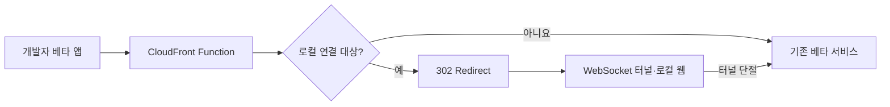

# 배포 없이 앱과 로컬 웹을 잇다

> [!abstract] 한 줄 정리
> 개발 생산성 자동화도 현재 요청 흐름과 보안 경계를 이해하고 실패 시 안전하게 기존 경로로 돌아갈 수 있게 설계해야 합니다.

> techblog.woowahan.com

## 핵심 내용

웹뷰 화면의 작은 변경에도 리뷰, 테스트, CI 빌드, 베타 배포, 캐시 무효화를 거쳐야 하는 긴 피드백 루프를 개선한 사례입니다. CloudFront Function, 302 Redirect, WebSocket 터널을 조합해 특정 개발자의 베타앱 요청만 로컬 서버로 보내는 ITDA를 만들었습니다. CloudFront rewrite, 앱 내부 호스트 라우팅, redirect를 비교하고 보안 요구사항·앱 수정 비용·책임 위치를 고려해 redirect를 선택했으며 연결이 끊어지면 원래 베타 환경으로 복귀하는 fallback도 설계했습니다.

로컬 웹을 베타 앱 안에서 곧바로 미리 보기 어렵다는 문제는 프런트엔드 개발 속도뿐 아니라 반복적인 앱 빌드와 배포 의존성을 만든다. 원문은 앱 라우팅을 크게 수정하거나 CloudFront 설정 전체를 바꾸지 않고, 특정 개발자의 요청만 302 Redirect와 WebSocket 터널로 로컬 개발 서버에 연결하는 방식을 선택했다. 이 방식에서는 공개 서비스 트래픽과 개발자 테스트 트래픽을 확실히 구분하는 것이 중요하다.

*자체 재구성. 원문의 개발자별 라우팅과 연결 실패 시 복구 경계를 나타낸다.*

## 왜 읽을까

개발 편의 기능도 시스템 설계 문제라는 점이 좋습니다. 새로운 도구보다 현재 시스템에서 통제 가능한 지점을 먼저 찾는 과정이 핵심입니다.

---

**원문:** [배포 없이 앱과 로컬 웹을 잇다](https://techblog.woowahan.com/26729/)
