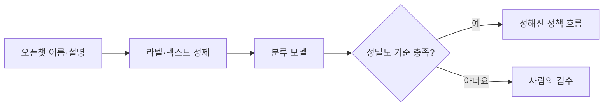

# 오픈챗 이름 및 설명 글로 유해성 판단하는 모델 개발하기

> [!abstract] 한 줄 정리
> 운영 가능한 AI 모델은 정확도뿐 아니라 데이터 품질, 비용, 임곗값, 사람 검수 경계까지 함께 설계해야 합니다.

> techblog.lycorp.co.jp

## 핵심 내용

LINE 오픈챗 이름과 설명으로 운영 정책 위반 여부를 자동 판단하는 모델을 개선합니다. 모델 선택보다 먼저 같은 텍스트에 서로 다른 징계 결과가 붙은 라벨 노이즈를 정리했고 서빙 비용, 속도, 라이선스, 모더레이션 적합성을 기준으로 약 2B 모델과 LoRA를 선택했습니다. 운영에서는 최고 확률 클래스를 그대로 자동 처리하지 않고 높은 정밀도를 만족하는 임곗값을 두고 확신이 낮은 데이터는 사람이 검수하도록 남겼습니다.

운영 정책 위반을 예측하는 모델은 전체 정확도보다 **자동 조치가 잘못된 사용자에게 적용되는 비율**을 특히 조심해야 한다. 원문에서는 같은 문구에 서로 다른 제재 라벨이 붙는 사례부터 정리하고, 운영 가능한 작은 모델·LoRA·라이선스·서빙 비용을 함께 검토했다. 모델의 최고 점수 클래스만 보고 제재를 확정하지 않고 신뢰도가 높은 결과만 자동화하는 것도 이 때문이다.

*자체 재구성. 원문의 임곗값 기반 사람 검수 경계를 요약한다.*

임곗값을 높이면 일반적으로 자동 처리 범위가 좁아질 수 있으므로, Precision뿐 아니라 자동 처리 비율과 누락 사례도 별도로 측정해야 한다.

## 왜 읽을까

모델 성능과 실제 자동화 가능성이 같은 개념이 아니라는 점을 잘 보여줍니다. 데이터 품질부터 인간 개입 경계까지 하나의 시스템으로 봅니다.

---

**원문:** [오픈챗 이름 및 설명 글로 유해성 판단하는 모델 개발하기](https://techblog.lycorp.co.jp/ko/developing-harmfulness-detection-model-for-open-chat-metadata)
