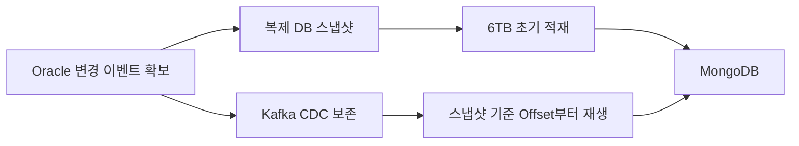

# Oracle에서 MongoDB로의 CDC Pipeline 구축

> [!abstract] 한 줄 정리
> 무중단 대용량 이관에서는 기존 데이터 초기 적재와 이관 중 새로 생기는 변경분을 별개의 문제로 나눠 다시 한 지점에서 합쳐야 합니다.

> tech.kakaopay.com

## 핵심 내용

Oracle 데이터를 MongoDB로 실시간 동기화하면서 6TB·130억 건의 기존 데이터도 함께 옮긴 프로젝트입니다. Kafka·Debezium·Kafka Connect로 변경 이벤트를 먼저 보존하고 별도 Oracle 복제 DB에서 초기 데이터를 추출해 MongoDB에 적재했습니다. Source Connector를 먼저 만들어야 복제 DB 생성 사이의 변경을 놓치지 않고, 초기 적재 후 Consumer offset도 복제 DB 생성 시점에 맞춰야 합니다. 6TB 초기 적재에 9일, 그동안 누적된 CDC lag 해소에 추가 12시간이 걸렸습니다.

초기 적재와 CDC를 결합할 때 가장 위험한 구간은 **스냅샷 생성 시점과 변경 스트림을 재개하는 시점 사이의 빈틈**이다. 먼저 Source Connector로 변경 이벤트를 수집한 뒤 일관된 복제 DB에서 기존 데이터를 읽고, 그 시점과 맞는 Offset에서 CDC를 적용해야 누락·중복 위험을 통제할 수 있다. 6TB·130억 건의 초기 적재 동안에도 원본 서비스는 계속 쓰기를 수행하므로 변경 스트림을 별도로 보존해야 한다.

*자체 재구성. 원문에서 강조한 변경 보존과 초기 적재 경계를 요약했다.*

**9일 초기 적재 + 추가 12시간 CDC Lag 해소**는 원문의 실제 처리 사례이며 이 시간 동안의 데이터 일관성을 단순히 처리 속도만으로 판단하면 안 된다.

## 왜 읽을까

CDC 개념보다 서비스를 계속 운영하면서 기존 데이터와 새 변경분을 어떻게 안전하게 합칠지 볼 수 있습니다.

---

**원문:** [Oracle에서 MongoDB로의 CDC Pipeline 구축](https://tech.kakaopay.com/post/kakaopaysec-mongodb-cdc/)
