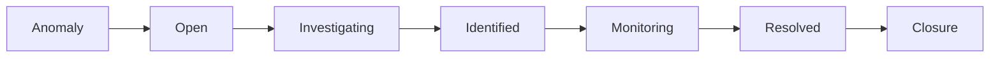

# 장애 대응의 성패를 가르는 First Action: 우아한형제들의 장애 관리 라이프사이클

> [!abstract] 한 줄 정리
> 장애에서는 원인을 빨리 맞히는 것보다 고객 영향을 줄이는 안전한 첫 조치를 얼마나 빨리 실행할 수 있는지가 중요합니다.

> techblog.woowahan.com

## 핵심 내용

2025년 내부 장애 70여 건을 분석해 장애 인지 직후 어떤 첫 조치를 했는지가 고객 영향 시간에 크게 작용한다는 점을 정리합니다. 핫픽스로 시작한 장애가 롤백으로 시작한 장애보다 평균적으로 거의 두 배 가까이 오래 지속되는 경향을 확인했고 `Anomaly → Open → Investigating → Identified → Monitoring → Resolved → Closure`로 라이프사이클을 표준화했습니다. MTTD·MTTR 외에 MTTFA(첫 완화 조치까지), MTTEA(실제 효과가 나타나기까지)도 구분합니다.

장애를 발견한 뒤 어떤 완화 동작을 먼저 선택하는지가 고객 영향 시간을 좌우한다. 원문에서 핫픽스로 시작한 장애의 평균 지속 시간이 롤백으로 시작한 장애보다 거의 두 배에 가까웠다는 관측은, 원인 규명과 코드 수정을 기다리는 동안 영향이 계속될 수 있음을 보여 준다. 다만 이 비교는 조사한 내부 장애들의 경향으로, 모든 핫픽스가 롤백보다 나쁘다는 인과 관계까지 증명하지는 않는다.

| 지표 | 측정 대상 |
| --- | --- |
| MTTD | 장애 발생부터 인지까지 |
| MTTFA | 인지 후 첫 완화 조치까지 |
| MTTEA | 첫 조치의 효과가 나타날 때까지 |
| MTTR | 복구까지의 전체 시간 |

*자체 재구성. 원문의 사고 관리 상태와 첫 대응 지표를 구분한다.*

## 왜 읽을까

Observability를 대시보드가 아니라 실제 고객 영향 시간을 줄이는 운영 프로세스로 연결합니다. 장애 대응을 개인 숙련도가 아니라 반복 가능한 시스템으로 보는 점이 좋습니다.

---

**원문:** [장애 대응의 성패를 가르는 First Action: 우아한형제들의 장애 관리 라이프사이클](https://techblog.woowahan.com/25189/)
