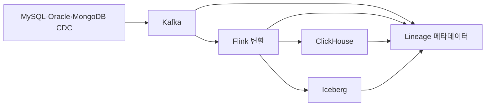

# 토스증권의 수천 개 실시간 데이터 파이프라인 운영방법 #1: Visualize Lineage

> [!abstract] 한 줄 정리
> 시스템이 많아질수록 코드보다 데이터가 어디에서 와서 어디로 가는지를 이해하는 비용이 커지므로 관계 자체를 메타데이터로 관리할 가치가 생깁니다.

> toss.tech

## 핵심 내용

MySQL·Oracle·MongoDB CDC, Kafka, Flink, ClickHouse, Iceberg 등으로 구성된 실시간 데이터 파이프라인이 수천 개까지 늘며 latency, 무중단 운영, 유실·중복, 리소스 격리와 모니터링이 복잡해진 문제를 다룹니다. `이 데이터는 어디서 와서 어디로 가는가`를 사람이 매번 찾는 비용을 줄이기 위해 관계를 DAG 형태 Data Lineage로 모델링하고 MongoDB 메타데이터와 Graph Search를 이용해 시각화합니다.

CDC, Kafka, Flink, 분석 저장소가 여러 팀에 걸쳐 연결되면 특정 대시보드 값이 어디서 만들어졌는지 추적하는 것 자체가 장애 대응의 상당 부분을 차지하게 된다. Data Lineage를 DAG로 보존하면 이벤트가 만들어진 Source와 최종 소비처, 중간 Transform을 따라가며 누락이나 지연 구간을 좁힐 수 있다.

*자체 재구성. 실제 파이프라인별 관계는 메타데이터로 관리하며 그림은 핵심 계층만 나타낸다.*

그래프가 최신 상태인지, 장애 중 이벤트가 누락돼도 의존성이 유지되는지 검증해야 한다. 보기 좋은 시각화보다 근거가 되는 메타데이터의 수집 완전성이 먼저다.

## 왜 읽을까

시스템이 늘면 관계 이해가 새로운 운영 비용이 된다는 점과 정적 문서가 아니라 실제 메타데이터에서 관계를 생성하는 접근이 좋습니다.

---

**원문:** [토스증권의 수천 개 실시간 데이터 파이프라인 운영방법 #1: Visualize Lineage](https://toss.tech/article/toss-securities-visualize-lineage)
