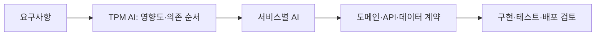

# OMS에서 Claude AI를 활용하여 변화된 업무 방식

> [!abstract] 한 줄 정리
> AI 코딩의 핵심은 모델 자체보다 팀이 공유하는 컨텍스트와 역할 경계를 설계하는 데 있습니다. 컬리 OMS팀은 지식과 행동을 분리한 AI Context와 역할별 세션을 통해 4명이 12개 MSA를 운영하는 방식을 재설계했습니다.

> 컬리 기술 블로그 · 2025-12-24

## 핵심 내용

PM 1명과 엔지니어 3명이 12개 MSA를 운영하면서 서비스 영향도 파악, 코드 레벨 정책 누락, MSA별 이해도 편차, 하루 7~8건의 배포 요청 같은 운영 부담이 커졌습니다. TPM AI는 전체 아키텍처와 배포 순서를 보고, 각 MSA AI는 코드 레벨 설계·구현을 담당하도록 역할을 분리했습니다. PO·TPM·Backend·Frontend·Infra마다 컨텍스트 로딩 범위도 다르게 설정했습니다.

`.claude/ai-context`에는 도메인·API·데이터 모델 같은 지식을, `skills/`에는 개발·배포 절차 같은 행동을 분리했습니다. API/Kafka 스펙은 JSON DSL로 구조화해 자연어 대비 적은 토큰으로 서비스 간 호출 관계를 표현했습니다. 글의 예시에서는 자연어 설명 약 200 tokens를 JSON DSL 약 70 tokens로 줄였고, 레이어드 구조에서 500줄을 읽어야 하던 주문 취소 흐름을 역할이 분리된 구조에서는 50줄 수준으로 좁힐 수 있다고 설명합니다.

MSA 자체보다 내부 역할 분리가 더 중요하다고 정정합니다. AI가 이해하기 쉬운 구조를 만들기 위해 아키텍처를 억지로 바꾸는 것이 아니라, 기존 구조에서 책임·경계·입출력 정보를 명확히 하는 것이 핵심입니다.

AI에 전체 MSA 코드를 한 번에 넣는 대신 조직의 업무 역할에 맞춰 **어떤 질문에 어떤 근거가 필요한가**를 달리한다. TPM AI는 서비스 간 호출·배포 순서와 영향도를 판단하고, 개별 MSA AI는 해당 저장소의 도메인·입출력 계약을 살펴 구현·검증한다. 이 계층화가 없다면 모든 세션에 전체 코드를 반복 로딩하면서 오히려 컨텍스트가 오염될 수 있다.

*자체 재구성. 도메인 근거(ai-context)와 작업 절차(skills)를 분리한 구조적 의도를 표현했다.*

## 왜 읽을까

AI 도구를 개인 생산성 도구에서 팀 개발 프로세스로 확장할 때 무엇을 문서화하고, 어떤 지식을 언제 로드하며, 어떤 작업은 Skill로 분리해야 하는지 구체적인 기준을 얻을 수 있습니다. 특히 AI에게 구현을 맡기더라도 컨텍스트의 품질과 범위를 사람이 통제해야 한다는 점이 잘 드러납니다.

**프로젝트에 적용 — 공통**

- [ ] DevPedia·PawCycle·FutMatch의 프로젝트 규칙에서 `프로젝트 지식`과 `구현 절차`를 별도 문서로 분리해봅니다.
- [ ] API 계약·이벤트·도메인 경계를 AI가 읽기 쉬운 구조화된 포맷으로 유지할 가치가 있는지 검토합니다.
- [ ] Codex에게 전체 저장소를 매번 읽히기보다 현재 작업에 필요한 도메인·파일·검증 명령만 선택적으로 전달합니다.
- [ ] AI가 만든 코드의 최종 설계 판단과 리뷰 책임은 사람이 유지합니다.

---

**원문:** [OMS에서 Claude AI를 활용하여 변화된 업무 방식](https://helloworld.kurly.com/blog/oms-claude-ai-workflow/)
