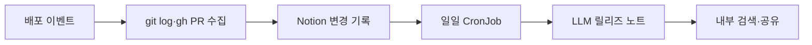

# 누구나 찾아볼 수 있는 중고거래 서버 LLM 릴리즈 노트 도입기

> [!abstract] 한 줄 정리
> 릴리즈 노트 자동화의 핵심을 LLM 요약이 아니라 먼저 재사용 가능한 배포 데이터 자산을 만드는 데 둔 사례다. 구조화된 사실은 코드와 기존 도구가 모으고, LLM은 사람이 읽기 좋은 설명으로 변환하는 역할에 집중한다.

> 당근 기술 블로그 · 2026-05-14

## 핵심 내용

운영·기획 조직이 기능 배포 시점을 확인하려면 개발자에게 물어보고 Git log와 PR을 다시 찾아야 해, 기술적 배포 맥락이 개발팀 안에 갇혀 있었다. 배포 시점에 Rails rake task가 `git log`에서 PR 목록을 얻고 `gh` CLI로 PR 설명을 수집해 Notion에 upsert한다. raw diff 대신 이미 의미가 정리된 PR 설명을 데이터 원천으로 사용한다.

매일 UTC 01:00(KST 10:00) CronJob이 GitHub를 다시 조회하지 않고 Notion의 PR 데이터를 읽어 내부 Prompt Studio에 전달하고, 생성한 릴리즈 노트를 별도 DB에 저장한다. LLM이 매번 코드 전체를 다시 해석하게 하지 않고, GitHub Actions·Notion·Rails·사내 GenAI 플랫폼처럼 이미 운영 중인 도구를 조합해 별도 인프라를 최소화했다.

같은 구조화 데이터에서 주간 주요 변경, 지역별 변경 요약, 여러 프로젝트의 통합 릴리즈 노트 등으로 확장할 수 있게 했다.

릴리즈 노트의 중요한 입력은 코드 전체를 LLM이 자유롭게 해석한 내용보다 **검토를 거친 PR 설명과 실제 배포 시점의 연결**이다. 배포 순간에 PR 정보를 수집해 저장하면 하루 뒤 요약 작업에서 GitHub를 매번 재탐색하지 않고도 배포 맥락을 재사용할 수 있다. 그러나 PR의 문장이 항상 사용자 영향까지 충분히 설명하는 것은 아니므로 릴리즈 노트의 주체와 공개 수준에 맞춘 검토가 필요하다.

*자체 재구성. PR 맥락을 재사용하는 작업 흐름이다.*

## 왜 읽을까

AI 자동화를 붙일 때 자주 빠지는 함정은 원본 데이터를 정리하지 않은 채 LLM에게 모든 해석을 맡기는 것이다. 이 글은 **사실 수집과 지식 구조화가 먼저이고 생성형 AI는 마지막 표현 계층**이라는 순서를 잘 보여준다.

PR·배포 기록을 사람에게만 읽히는 문서가 아니라 이후 검색·회고·AI 활용에도 재사용 가능한 데이터로 만든다는 점도 좋다.

**프로젝트에 적용 — 공통**

- [ ] PR에 구현 내용뿐 아니라 변경 이유와 사용자 영향이 남도록 최소 템플릿을 유지한다.
- [ ] 배포 시점·PR·커밋을 구조화된 기록으로 남겨 나중에 장애와 기능 변경을 연결할 수 있게 한다.
- [ ] LLM은 사실을 새로 추론하게 하기보다 이미 검증된 변경 기록을 요약·분류하는 역할부터 맡긴다.

---

**원문:** [누구나 찾아볼 수 있는 중고거래 서버 LLM 릴리즈 노트 도입기](https://medium.com/daangn/%EB%88%84%EA%B5%AC%EB%82%98-%EC%B0%BE%EC%95%84%EB%B3%BC-%EC%88%98-%EC%9E%88%EB%8A%94-%EC%A4%91%EA%B3%A0%EA%B1%B0%EB%9E%98-%EC%84%9C%EB%B2%84-llm-%EB%A6%B4%EB%A6%AC%EC%A6%88-%EB%85%B8%ED%8A%B8-%EB%8F%84%EC%9E%85%EA%B8%B0-93afe203d766)
