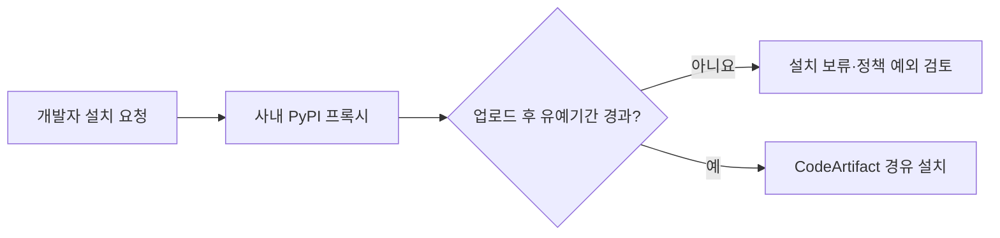

# 당근이 파이썬 공급망 공격에 대응하는 방법

> [!abstract] 한 줄 정리
> 공급망 공격은 악성 패키지를 찾아내는 문제만이 아니라, 새 패키지가 조직 안으로 들어오는 속도와 경로를 통제하는 문제다. 의존성 다운로드 앞에 얇은 프록시와 중앙 정책을 두어 공격 노출 시간을 줄이는 설계를 볼 수 있다.

> 당근 기술 블로그 · 2026-05-06

## 핵심 내용

LiteLLM PyPI 공급망 공격에서는 공식 배포 경로가 탈취돼 악성 버전 1.82.7과 1.82.8이 배포됐고, 환경 변수·SSH 키·클라우드 자격 증명 등이 유출될 수 있었다. AWS CodeArtifact 앞에 사내 PyPI 프록시를 두고, 방금 업로드된 패키지는 일정 시간 동안 조직 내부에서 바로 설치되지 못하게 하는 cooldown 정책을 적용했다.

클라이언트 호환성을 위해 PEP 503 응답을 유지하고, PEP 691 메타데이터에서 업로드 시각을 확인해 최근 파일을 필터링한다. 정책 값과 예외는 Central Dogma에서 중앙 관리한다. 새 악성 패키지가 공개 직후 내부 환경으로 바로 유입되는 경로를 차단했고, 이후 PyTorch Lightning 관련 공급망 공격도 동일한 정책으로 자동 방어할 수 있었다.

최신 버전을 즉시 써야 하는 경우 개발 속도가 늦어질 수 있으므로, 무조건 차단보다 중앙 정책과 명시적인 예외 관리가 중요하다.

의존성 잠금 파일이 있다고 해서 공식 패키지 레지스트리에 올라온 신규 버전이 모두 안전한 것은 아니다. 공급망 공격은 정상 패키지 이름·서명처럼 보이는 배포 경로 자체를 악용할 수 있으므로, 내부 설치 시점에 검증 시간을 확보하는 접근이다. `cooldown`은 취약점을 탐지하는 엔진이 아니라 **공격 확산을 늦추는 지연 방어층**이라는 점을 구분해야 한다.

*자체 재구성. 공개 패키지를 사내에 전달하기 전의 정책 확인 경계를 나타낸다.*

## 왜 읽을까

SBOM이나 취약점 스캐너만으로는 이미 정상 계정을 탈취해 배포된 악성 패키지를 즉시 구분하기 어렵다. 이 글은 보안을 탐지 기능 하나가 아니라 **의존성이 들어오는 경로 자체의 신뢰 경계**로 보는 관점을 준다.

특히 CI/CD와 개발 환경에서 외부 패키지 저장소를 직접 바라보게 두는 것과, 조직이 통제할 수 있는 단일 진입점을 두는 것의 차이를 생각해보기 좋다.

**프로젝트에 적용 — 공통**

- [ ] CI와 로컬 환경이 외부 패키지 저장소를 직접 참조하는 지점을 확인한다.
- [ ] 의존성 업데이트를 자동화할 때 신규 버전 공개 직후 바로 반영해야 하는지 기준을 정한다.
- [ ] 보안 정책과 예외를 코드 곳곳에 흩뿌리지 않고 중앙 설정으로 관리할 수 있는지 검토한다.

---

**원문:** [당근이 파이썬 공급망 공격에 대응하는 방법](https://medium.com/daangn/%EB%8B%B9%EA%B7%BC%EC%9D%B4-%ED%8C%8C%EC%9D%B4%EC%8D%AC-%EA%B3%B5%EA%B8%89%EB%A7%9D-%EA%B3%B5%EA%B2%A9%EC%97%90-%EB%8C%80%EC%9D%91%ED%95%98%EB%8A%94-%EB%B0%A9%EB%B2%95-e0b4f483b574)
