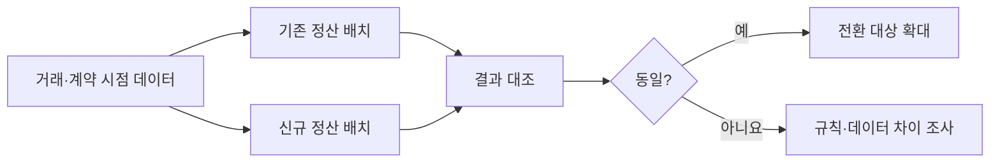

# 레거시 정산 개편기: 신규 시스템 투입 여정부터 대규모 배치 운영 노하우까지

> [!abstract] 한 줄 정리
> 20년 레거시를 안전하게 바꾸는 핵심은 새 코드를 만드는 것보다, 비즈니스 규칙을 분리하고 기존 결과와 계속 비교하며 작은 단위로 전환·복구할 수 있게 만드는 데 있습니다.

> Toss Tech · 2025-12-11

## 핵심 내용

JOIN·SUBQUERY·중첩 DECODE/CASE WHEN이 뒤엉킨 거대한 공통 쿼리에 정산 규칙이 숨겨져 있어 작은 변경도 영향 범위와 테스트 비용이 컸습니다. 도메인과 세부 기능을 분할해 비즈니스 규칙을 객체 코드로 드러내고, 거래 단위 결과와 당시 계약 조건 스냅샷을 저장해 추적·재현 가능성을 높였습니다.

실패 거래만 다시 처리할 수 있도록 거래별 상태를 독립적으로 저장하고, 핵심 조회와 복잡한 어드민 조회의 책임도 분리했습니다. 건별 I/O를 캐시·Bulk 조회·JDBC Batch Insert로 줄이고, Multi-threaded Step에서는 모듈러 연산으로 스레드별 처리 범위를 나눠 중복·누락 위험을 피했습니다.

레거시와 신규 시스템이 동시에 정산 결과를 만든 뒤 결과가 일치할 때만 신규 결과를 투입하는 배치 카나리를 구축했고, 가맹점·결제수단·개별 결제 건까지 전환 단위를 세분화했습니다.

정산 개편의 난점은 SQL 성능 자체보다 기존 쿼리에 묻혀 있던 계약 시점의 규칙을 **재현 가능한 데이터와 코드**로 옮기는 것이다. 거래 시점의 조건을 스냅샷으로 저장해야 나중에 계약 조건이 바뀌어도 당시 정산 근거를 재구성할 수 있다. 신규 배치의 결과를 단숨에 정본으로 쓰지 않고, 같은 거래를 양쪽에서 처리해 결과를 비교한 후 전환한 것이 데이터 무결성 측면에서 중요하다.

*자체 재구성. 정산 결과 검증을 통한 단계적 교체 흐름이다.*

## 왜 읽을까

레거시 리팩터링, Spring Batch, 데이터 모델링, 테스트, 카나리 전환이 따로 놀지 않고 **하나의 안전한 시스템 전환 전략**으로 연결됩니다. 특히 기존 시스템을 일정 기간 정답지로 유지하면서 새 시스템을 증명하는 방식이 좋습니다.

**프로젝트에 적용 — PawCycle**

- [ ] 성능 개선이나 신규 기술 도입 시 기존 경로와 신규 경로의 결과를 병행 비교할 수 있는 지점을 먼저 찾습니다.
- [ ] 대량 배치나 정산성 기능은 실패 건만 재처리할 수 있도록 상태 단위를 작게 설계합니다.
- [ ] 한 번에 전체 전환하지 않고 사용자·기능·도메인 단위의 카나리 기준을 정의합니다.

---

**원문:** [레거시 정산 개편기: 신규 시스템 투입 여정부터 대규모 배치 운영 노하우까지](https://toss.tech/article/payments-legacy-6)
