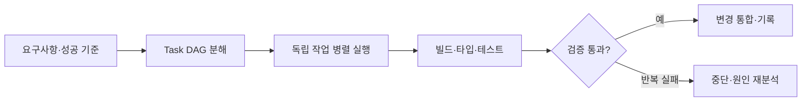

# AI 에이전트 15개를 동시에 굴리는 법 — AI 병렬 오케스트레이션 실전 운용기

> [!abstract] 한 줄 정리
> 여러 AI 에이전트를 병렬로 쓰는 것보다 중요한 것은 외부 기억, 의존성을 표현한 Task DAG, 자동 검증과 중단 조건을 함께 설계하는 것이다. 빠른 생성이 아니라 반복 가능한 오케스트레이션 구조가 생산성과 품질을 함께 만든다.

> 컬리 기술 블로그 · 2026-04-03

## 핵심 내용

AI 세션은 휘발적이라 과거 의사결정과 트러블슈팅을 잊고 같은 탐색과 실수를 반복한다. 병렬 에이전트를 많이 띄우는 것만으로는 이 문제가 해결되지 않는다. Obsidian을 로컬 지식 저장소로 두고 QMD 임베딩, recall Skill, Obsidian MCP를 조합해 과거 세션·아키텍처 결정·비즈니스 규칙을 로컬에서 검색한다.

중규모 이상 작업은 구현 전 30분~2시간 동안 요구사항·제약·성공 기준을 확정한 뒤, 선후관계가 있는 작업을 Task DAG로 나눠 병렬 실행한다. 디버깅에는 탐색 중 발견한 이슈를 독립 세션으로 분기하는 Branch Hunt를 사용한다. Ralph Loop가 Build·Type Check·Test를 자동 실행하고 수정 2회마다 검증한다. 실패 시 재시도하되 3회 연속 실패하면 작업을 중단하고 보고하도록 안전장치를 둔다.

글의 실제 정산 배치+E2E 사례에서는 기존 약 5일 작업을 DAG 구성 2분과 병렬 실행 20분으로 끝냈다. 저자는 전체 업무에서도 배포 주기가 절반으로 줄고 테스트 수행량은 2~3배 늘었다고 설명한다.

병렬 세션의 개수가 생산성을 결정하는 것이 아니라 **서로 독립적으로 검증하고 병합할 수 있는 작업**의 개수가 상한을 정한다. 설계가 확정되지 않은 상태에서 여러 에이전트를 동시에 실행하면 같은 파일과 계약을 서로 다르게 가정해 충돌이 늘어난다. DAG에서 선행 Task가 검증을 마친 뒤 후속 Task를 진행하고, 실패가 반복되면 무조건 재시도하지 않고 사람이 원인을 재분석하도록 정지시키는 구조가 필요하다.

*자체 재구성. 원문에 소개된 병렬 실행과 검증/중단 조건을 분리했다.*

## 왜 읽을까

AI 활용을 프롬프트 팁이 아니라 `기억 → 분해 → 위임 → 검증 → 실패 중단`의 시스템으로 다룬다. 특히 생산성 수치보다, 에이전트가 틀릴 것을 전제로 자동 테스트와 중단 조건을 넣는 방식이 실무적인 판단 기준을 준다.

**프로젝트에 적용 — DevPedia**

- [ ] ADR·트러블슈팅·도메인 규칙을 AI가 다시 검색할 수 있는 지속적인 외부 기억으로 관리한다.
- [ ] 큰 구현은 Codex에 한 번에 던지기보다 의존 관계가 있는 Task DAG로 먼저 분리한다.
- [ ] Build·Test·Lint 같은 완료 조건을 자동화하고 일정 횟수 연속 실패 시 구현을 멈추고 원인을 보고하도록 규칙화한다.

---

**원문:** [AI 에이전트 15개를 동시에 굴리는 법 — AI 병렬 오케스트레이션 실전 운용기](https://helloworld.kurly.com/blog/ai-orchestration-2/)
