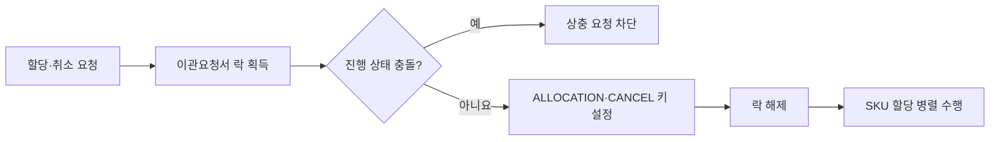

# WMS 재고 이관을 위한 분산 락 사용기

> [!abstract] 한 줄 정리
> 동시성 문제에 분산 락을 추가하는 것만으로는 충분하지 않다. 어떤 비즈니스 불변식을 보호할지와 락의 범위를 잘못 잡으면 정합성은 지켜도 필요한 병렬성을 잃기 때문에, 락 키와 상태를 업무 단위에 맞춰 설계해야 한다.

> 우아한형제들 기술블로그 · 2024-05-28

## 핵심 내용

재고 할당과 이관 요청 취소가 동시에 실행되면 할당 작업과 상태 변경의 트랜잭션이 분리돼 있어, 요청 상태는 `취소`인데 실제 재고는 할당된 모순 상태가 생겼다. 처음에는 할당과 취소가 같은 이관요청서 단위 분산 락 키를 사용하도록 했다. 그러나 N개 SKU를 병렬 할당하면 첫 요청 외에는 락 획득에 실패하는 새로운 문제가 발생했다.

`waitTime`을 두어 순차 처리하면 정합성은 확보하지만 SKU가 많을수록 처리 시간이 늘어 병렬 처리의 장점을 잃었다. 최종적으로 짧은 분산 락 구간에서 `ALLOCATION`·`CANCEL` 상태 키만 확인·갱신하고, 비용이 큰 실제 재고 할당은 락 밖에서 병렬 처리했다. 서로 다른 상태의 요청만 차단해 정합성과 병렬성을 함께 확보했다.

처음 문제가 발생한 이유는 할당 상태를 변경하는 구간에만 락이 있고, 취소 요청은 같은 보호 범위에 참여하지 않았기 때문이다. 이관요청서 전체를 잠가 버리면 SKU마다 병렬로 처리해야 할 재고 할당까지 직렬화된다. 최종안은 락 안에서 상태 키의 전이만 빠르게 결정하고 실제 재고 작업은 병렬로 진행하는 구조여서, 정합성 경계와 작업 실행 경계가 다르다.

| 대안 | 정합성 | 병렬성 |
| --- | --- | --- |
| 할당 상태 변경만 보호 | 할당/취소 경합 남음 | 높음 |
| 이관요청서 전체 락 | 보호 가능 | SKU 병렬 처리 불리 |
| 짧은 상태 키 락 + 할당 분리 | 상충 동작 선제 차단 | 병렬 처리 유지 |

*자체 재구성. 원문 해결 단계의 정합성 판단과 실행 분리를 요약한 학습용 그림이다.*

## 왜 읽을까

`분산 락 = 동시성 문제 해결`이라는 단순한 공식이 왜 위험한지 잘 보여준다. 락을 너무 크게 잡으면 처리량이 무너지고, 너무 작게 잡으면 비즈니스 상태 전이를 보호하지 못한다.

특히 DB 트랜잭션을 짧게 유지하면서도 여러 요청 사이의 논리적 상태를 지켜야 하는 Commerce 도메인에서 락의 범위를 결정하는 사고 과정을 배우기 좋다.

**프로젝트에 적용 — PawCycle**

- [ ] 주문·재고 처리에서 먼저 지켜야 할 불변식과 허용 가능한 상태 전이를 문장으로 정의한다.
- [ ] 동일 SKU 주문, 취소, 재고 차감이 동시에 들어오는 테스트를 만들고 모순 상태가 생기는지 확인한다.
- [ ] 문제가 재현된 뒤 DB 원자적 업데이트·낙관적 락·분산 락을 비교하고, 락을 선택한다면 키의 범위와 병렬성 손실을 함께 측정한다.

---

**원문:** [WMS 재고 이관을 위한 분산 락 사용기](https://techblog.woowahan.com/17416/)
