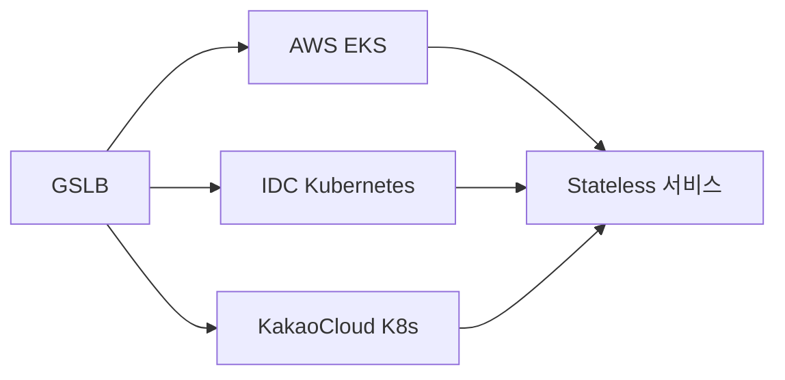

# 99.999%를 향한 집착: 멀티 & 하이브리드 클러스터로 살아남기

> [!abstract] 한 줄 정리
> 가용성을 높이기 위해 무조건 클러스터를 복제한 것이 아니라, stateless 서비스는 멀티 클러스터로 분산하고 stateful 서비스는 여러 플랫폼 노드를 하나의 논리 클러스터로 묶는 하이브리드 구조를 선택한 운영 사례다.

> 카카오페이 기술 블로그 · 2025-05-23

## 핵심 내용

2024년 SLO 99.993%도 증권 서비스에서는 10분 이상의 장애 가능성을 의미했고, 하나의 서비스가 단일 클러스터에만 배포돼 있으면 플랫폼 장애가 곧 서비스 전체 장애로 이어졌다. AWS EKS·IDC Kubernetes·KakaoCloud Kubernetes Engine에 서비스를 병렬 배포하고 GSLB 헬스체크로 장애 클러스터를 자동 제외한다. 예시에서는 40/30/30 트래픽 중 한 플랫폼 장애 시 살아 있는 두 곳으로 50:50 재분배한다.

Jenkins처럼 상태를 내부에 가진 서비스는 여러 클러스터에 각각 띄운다고 고가용성이 되지 않는다. GSLB는 트래픽만 넘길 뿐 빌드 이력·설정·작업 상태까지 이전하지 않기 때문이다. stateful 서비스에는 AWS·KakaoCloud·IDC의 노드를 하나의 논리 Kubernetes 클러스터로 묶어 상태는 단일 클러스터에서 유지하면서 물리 플랫폼 장애를 분산하는 하이브리드 방식을 적용했다.

AWS Global Accelerator 같은 더 단순한 대안도 검토했지만 실제 장애 운영 경험이 충분하지 않아 즉시 도입하지 않고 Config 기반 라우팅을 유지했다. 기능 존재보다 운영 경험과 복구 자신감을 도입 조건으로 둔 셈이다.

트래픽을 다른 클러스터에 보내는 것과 서비스의 **상태를 복구하는 것**은 별개다. Stateless 워크로드는 GSLB의 헬스체크와 재분배만으로 상당 부분 대응할 수 있지만, Jenkins 같은 Stateful 도구는 실행 이력과 설정이 다른 클러스터에 자동 이전되지 않는다.

*자체 재구성. 실제 물리 플랫폼은 다르지만 논리 서비스에 트래픽을 나누는 구성을 간략히 보여 준다.*

## 왜 읽을까

'멀티 클러스터 = 고가용성'이라는 단순 공식을 깨준다. stateless와 stateful의 장애 의미가 다르고, 트래픽 우회만으로는 상태 복구가 해결되지 않는다는 점을 실제 Jenkins 사례로 설명한다.

또한 새로운 관리형 기능이 더 간단해 보여도 운영 경험이 부족하면 도입을 미루는 판단이 나온다. 고가용성 설계에서 기술 기능뿐 아니라 팀의 복구 능력과 관측 경험까지 고려해야 한다는 좋은 사례다.

**프로젝트에 적용 — PawCycle**

- [ ] 현재 단일 인스턴스 구조에서 먼저 장애 지점을 `애플리케이션 / DB / 네트워크 / 외부 의존성`으로 분해하고 실제 Failure Mode를 재현한다.
- [ ] 멀티 인스턴스로 확장할 때 stateless 요청 처리와 상태를 가진 배치·세션·파일 작업을 구분해 각각의 failover 조건을 정의한다.
- [ ] 새로운 HA 기술은 기능표보다 장애 주입 후 복구 시간, 데이터 정합성, 운영 복잡도를 기준으로 KEEP·DEFER를 판단한다.

---

**원문:** [99.999%를 향한 집착: 멀티 & 하이브리드 클러스터로 살아남기](https://tech.kakaopay.com/post/multi-cluster/)
