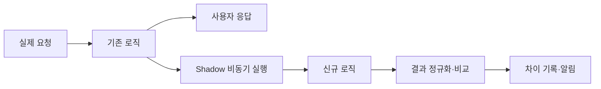

# 안전하게 레거시 코드 옮겨 보기

> [!abstract] 한 줄 정리
> 테스트만으로 모든 레거시 호출 케이스를 재현하기 어려울 때, 기존 응답은 그대로 유지한 채 신규 로직을 운영 트래픽으로 병행 실행하고 결과를 비교하면 점진적 이관의 불확실성을 줄일 수 있다. 다만 Shadow 실행 자체의 자원 비용을 반드시 측정하고 실행률을 제어해야 한다.

> 카카오페이 기술 블로그 · 2026-09-03

## 핵심 내용

Spring Boot 버전업을 막는 레거시 모듈 의존성을 제거해야 했지만, 호출 지점이 많고 뒷단에 숨어 있어 통합·회귀 테스트만으로 전체 케이스를 파악하기 어려웠다. Strangler 패턴을 차용해 AOP `@AfterReturning` 이후 신규 로직을 비동기로 실행했다. 실제 응답은 기존 로직 결과를 유지하고, 신규 결과는 비교 목적으로만 사용했다.

기존·신규 응답을 JSON Tree로 비교하고 불일치만 DB 저장·알림으로 연결했다. BigDecimal 스케일, Collection 순서, 필드 순서 같은 가짜 불일치를 줄이기 위해 비교 전에 정규화했다. SANDBOX에서 CPU·Heap·GC·HikariCP pending·P95 등을 측정한 결과 Shadow 100% 적용 시 최대 처리 용량은 기존 대비 약 20% 감소했지만 전 구간 5xx/Timeout은 0건이었다.

한 요청에서 두 로직을 실행하므로 처리량과 자원 비용이 증가한다. 실행 비율을 DB에서 런타임 조절하고 리플렉션 결과도 캐시해 부담을 제한했다.

이 방식의 목적은 '두 구현을 동시에 운영한다'보다 **응답 영향 없이 실제 요청에서 차이를 측정한다**는 데 있다. 기존 결과를 사용자에게 반환한 뒤 신규 로직을 Shadow로 수행하므로 기능 변경 리스크를 줄일 수 있지만 요청마다 부가 CPU·메모리·DB 부하를 발생시킨다. 따라서 비교 불일치율과 함께 Shadow 비율, P95, DB 풀 대기, 5xx까지 관찰해야 한다.

*자체 재구성. 사용자의 응답 경로와 검증 경로를 구분했다.*

## 왜 읽을까

레거시 교체를 ‘테스트가 충분해지면 한 번에 전환’하는 문제가 아니라, 실제 운영 트래픽을 이용해 신구 결과의 동등성을 점진적으로 증명하는 문제로 바꾸는 사례다. 특히 Shadow 전략도 공짜가 아니며 성능 기준과 중단 장치를 함께 설계해야 한다는 점이 좋다.

**프로젝트에 적용 — PawCycle**

- [ ] 위험도가 높은 조회·계산 로직을 교체할 때 기존 경로를 바로 삭제하지 않고 신구 결과를 병행 비교할 수 있는지 검토한다.
- [ ] Shadow 경로는 외부 결제·재고 변경처럼 부작용이 발생하는 쓰기 작업과 분리한다.
- [ ] 비교 성공률뿐 아니라 CPU, DB Pool, p95와 실행률별 비용을 함께 측정하고 제거 기준을 정한다.

---

**원문:** [안전하게 레거시 코드 옮겨 보기](https://tech.kakaopay.com/post/kakaopayins-legacy-improvement-with-aop/)
