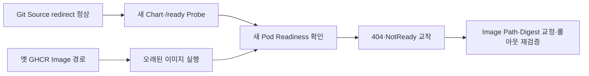

# 새 readiness probe와 옛 이미지가 만난 GitOps 교착

> [!abstract] 한 줄 정리
> Git 소스와 컨테이너 이미지가 서로 다른 정본을 가리키면서 새 readiness probe와 옛 이미지가 결합해 배포가 교착된 사례로, GitOps의 완료 기준은 ‘Sync 성공’이 아니라 실제 실행 artifact까지 이어지는 chain 검증이어야 함을 보여준다.

> 홍성주의 개발 노트 · 2026-07-18

## 핵심 내용

GitHub 저장소 Owner를 변경했을 때 Git 원본 URL은 redirect를 통해 정상 fetch될 수 있지만 컨테이너 이미지의 GHCR 경로는 자동으로 같은 방식으로 바뀌지 않는다. 한 GitOps 서비스는 소스 Chart는 최신인데 Image Updater가 예전 Registry Owner를 가리켜 과거 이미지를 계속 선택한 상태에서 새 `/ready` Probe를 적용해 RollingUpdate가 교착됐다.

*원문 내용을 바탕으로 자체 재구성한 가로형 기술 흐름도다.*

신규 Pod는 옛 바이너리에서 없는 `/ready`에 404로 응답해 NotReady이고 기존 Ready Pod는 RollingUpdate 정책 때문에 보존됐다. 해결은 Application 전체 삭제가 아니라 Git에 추적된 Manifest의 Repository URL과 Image List 경로를 고치고 새 SHA가 Registry와 Helm Values에 존재하는지 대조한 다음 실패한 이전 Argo Operation만 최소 범위에서 중단한 것이다.

| 경계 | 실제 현상 | 확인 방법 |
| --- | --- | --- |
| Git Source | Redirect로 최신 Chart | source SHA |
| GHCR | 예전 Owner 이미지 선택 | image-list·digest |
| 신규 Probe | 구 이미지에서 404 | HTTP `/ready` 200 |
| RollingUpdate | 기존 Pod 계속 Ready | Deployment 상태 |
| 최종 승인 | Argo Synced/Healthy | 실제 Pod SHA·Restart·인증 테스트 |

수정 뒤 source revision→선택된 이미지 SHA→실제 Pod Image Digest→`/health`·`/ready` 응답을 일치 확인하고 Pod 1/1 Ready·restart 0·Argo Synced/Healthy까지 검사했다. 사용자 서비스 중단 없이 복구했지만 컨트롤러가 Healthy라고 표시한다는 것만으로 **실행 중인 artifact가 원하는 소스**라는 사실을 증명할 수는 없다.

## 왜 읽을까

GitOps 장애를 ‘Argo가 이상하다’고 뭉뚱그리지 않고 각 시스템이 무엇을 정본으로 보고 있는지 분해해 원인을 좁히는 과정이 좋다. 특히 복구 전에 새 artifact의 존재와 정합성을 먼저 증명하고, 최소한의 상태만 변경하는 운영 태도를 참고할 만하다.

**프로젝트에 적용 — PawCycle**

- [ ] 배포 Evidence에 Git SHA뿐 아니라 실제 실행 중인 container image digest/SHA를 함께 남긴다.
- [ ] readiness 변경 시 현재 배포 image에도 해당 endpoint가 실제 존재하는지 rollout 전에 검증한다.
- [ ] GitOps 장애 복구는 전체 리소스 삭제보다 source revision → registry artifact → live Pod 순으로 정본을 대조한 뒤 최소 변경으로 수행한다.

---

**원문:** [새 readiness probe와 옛 이미지가 만난 GitOps 교착](https://seongju.vercel.app/writing/gitops-stale-image-readiness/)
