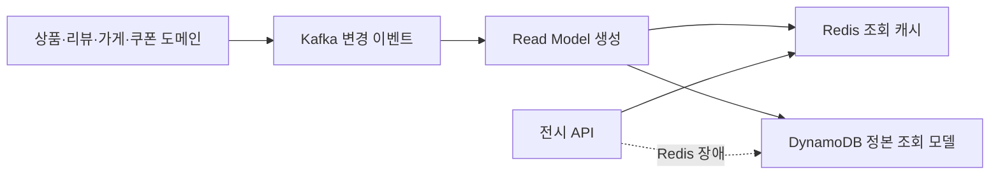

# \[배민스토어\] 배민스토어에 이벤트 기반 아키텍처를 곁들인…

> [!abstract] 한 줄 정리
> 이벤트 기반 아키텍처는 느슨한 결합만 얻는 선택이 아니다. 읽기 모델 최적화와 복원력을 얻는 대신 이벤트 순서, 결과적 일관성, 디버깅과 보정 로직이라는 비용을 함께 떠안는다.

> 우아한형제들 기술블로그 · 2023-08-17

## 핵심 내용

배민스토어 전시 화면은 상품·리뷰·가게·쿠폰 정보를 여러 MSA에서 받아야 한다. 모든 사용자 요청에 여러 도메인 API를 동기 호출하면 외부 서비스의 장애와 지연이 그대로 전시 응답으로 전파되므로 읽기 모델을 비동기로 구축해 서비스 간 결합을 줄였다.

*원문 내용을 바탕으로 자체 재구성한 가로형 기술 흐름도다.*

각 도메인의 변경 이벤트를 Kafka로 받아 화면에 필요한 형태의 Read Model을 DynamoDB·Redis에 저장했다. Redis가 문제가 생기면 DynamoDB로 폴백할 수 있지만, 이벤트가 순서대로 도착한다는 보장이 약하면 이전 상태가 최신 데이터를 덮어쓰는 일이 생길 수 있다. 특히 가격과 재고처럼 실제 정합성이 중요한 값은 Payload 전체를 이벤트에 복제하기보다 대상 ID만 넣은 Zero Payload 이벤트를 발행한 뒤 최신 도메인 API를 다시 조회하도록 했다.

| 정보 종류 | 동기화 전략 | 중요한 위험 |
| --- | --- | --- |
| 일반 전시 데이터 | Kafka 이벤트 Payload | 지연·순서·재발행 |
| 가격·재고 | ID만 알리고 최신값 재조회 | 중간 상태 누락·조회 부담 |
| 조회 저장소 | Redis + DynamoDB | 장애 폴백 시 부하 |
| 운영 복구 | DLQ·수동 보정 | 멱등성·재처리 범위 |

EDA 전환은 비동기 장애 격리를 개선하지만 재처리·DLQ·이벤트 유실·버전 정합성 같은 운영 책임이 생긴다. 원문은 오픈 직전 성능 시험에서 기대에 못 미친 시행착오도 공개했으며 이벤트 구조와 DynamoDB/Redis·WebFlux 조합의 종합 성능 개선을 특정 요소 하나의 효과로 환원할 수 없다.

## 왜 읽을까

Kafka를 넣으면 자동으로 좋은 아키텍처가 되는 게 아니라, **어떤 데이터는 비동기로 받아도 되고 어떤 데이터는 최신 상태를 다시 확인해야 하는지**를 구분하는 설계 기준을 볼 수 있다. 결과적 일관성을 선택했을 때 반드시 따라오는 운영·보정 비용도 함께 생각하게 해준다.

**프로젝트에 적용 — FutMatch**

- [ ] 매칭·참가·경기 상태를 이벤트로 분리할 일이 생기면 각 이벤트가 순서 역전에 안전한지 먼저 분류한다.
- [ ] 최신 값이 절대적으로 중요한 상태는 이벤트 payload만 신뢰할지, 식별자 기반 재조회가 필요한지 결정한다.
- [ ] Kafka 도입 전 동기 호출 병목과 결합도가 실제 문제인지 측정하고, 도입 후에는 재처리·DLQ·보정 절차까지 운영 설계에 포함한다.

---

**원문:** [\\[배민스토어\\] 배민스토어에 이벤트 기반 아키텍처를 곁들인…](https://techblog.woowahan.com/13101/)
