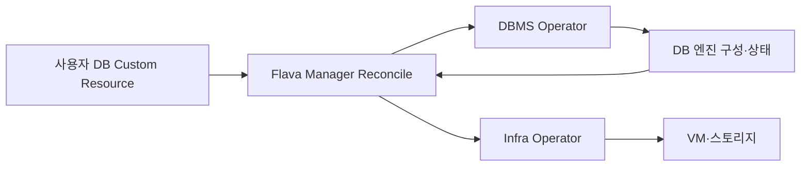

# Flava DBaaS 딥다이브: 아키텍처부터 마이그레이션, 그리고 미래까지

> [!abstract] 한 줄 정리
> DB 운영 지식을 선언적 컨트롤러와 공통 플랫폼에 녹이면 DBMS별 절차를 표준화할 수 있지만, 그만큼 구현 복잡도와 마이그레이션 설계까지 플랫폼이 책임져야 한다.

> LY Corporation Tech Blog

## 핵심 내용

DBaaS는 사용자가 DB 인스턴스를 요청했을 때 VM을 하나 만드는 셀프서비스 포털만을 의미하지 않는다. LY Flava DBaaS는 DB의 원하는 상태를 Kubernetes Custom Resource로 선언하고 Controller가 현재 상태와의 차이를 계속 조정(Reconcile)하는 운영 방식을 택했다.

*원문을 바탕으로 자체 재구성한 가로형 시스템 흐름도다.*

Manager는 사용자가 원하는 DB 사양·버전·복제 설정을 읽고 DBMS별 로직을 수행한다. IaaS의 VM·스토리지 제어 코드를 DB 비즈니스 로직에 직접 넣지 않도록 Infra Operator에서 클라우드 인프라를 Kubernetes 리소스처럼 추상화했다. DB가 실제로 준비되지 않거나 Reconcile이 반복 실패할 때 현재 상태·원하는 상태·Operator 로그를 비교하면 어떤 단계에서 막혔는지 진단할 수 있다.

| DB 이전 방식 | 다운타임 | 추가 복잡성 |
| --- | --- | --- |
| Dump & Restore | 상대적으로 길 수 있음 | 큰 데이터 복사·검증 |
| DBMS Replication | 줄일 수 있음 | 엔진 호환·복제 지연 |
| CDC | 짧은 전환 가능 | 이벤트 순서·중복·이중 시스템 |
| DBaaS 사양 | 최대 5TiB 정책 | 용량·단편화 관리 |

블록 스토리지 기반 인스턴스의 최대 크기는 기술적 상한이 아니라 과거 사용 사례 대부분을 수용하면서 서버 자원 단편화를 줄이려는 목표로 5TiB로 설정했다. 기존 DB를 실제로 이전할 때는 Dump/Restore, DBMS Replication, CDC의 다운타임과 데이터 일치·추가 인프라 비용을 비교해야 한다. 새 DBMS 인스턴스 제공뿐 아니라 고객이 그곳으로 무중단 또는 제한적 중단으로 이동할 절차를 제공하는 것도 플랫폼 책임이다.

## 왜 읽을까

Kubernetes Operator가 단순 자동화 기술이 아니라 ‘운영자의 도메인 지식을 코드와 상태 조정 루프로 옮기는 구조’라는 점을 이해하기 좋다. 동시에 추상화가 편의만 주는 것이 아니라 구현·마이그레이션 책임을 플랫폼으로 이동시킨다는 점도 명확하다.

**프로젝트에 적용 — PawCycle**

- [ ] 배포·DB 운영 자동화를 만들 때 절차 스크립트보다 원하는 상태와 실제 상태를 어떻게 검증할지 먼저 정의한다.
- [ ] 인프라 제어 코드와 애플리케이션 도메인 로직의 책임 경계를 문서화한다.
- [ ] DB 이전이 필요해지면 다운타임, 정합성, 롤백, 추가 운영 인프라를 기준으로 dump/replication/CDC를 비교한다.

---

**원문:** [Flava DBaaS 딥다이브: 아키텍처부터 마이그레이션, 그리고 미래까지](https://techblog.lycorp.co.jp/ko/techverse2026-231)
