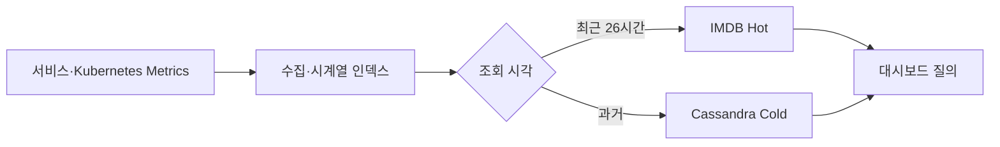

# Scaling to Infinity: 한계를 넘어서는 LY Corporation의 관측 가능성 플랫폼 진화기

> [!abstract] 한 줄 정리
> 관측 데이터가 커질수록 범용 저장소의 단순 확장보다 실제 조회 패턴과 데이터 수명에 맞춘 저장 계층 설계가 중요해진다. MySQL→OpenTSDB→자체 TSDB로 진화한 이유와 그 과정의 운영 한계를 함께 볼 수 있다.

> LY Corporation Tech Blog

## 핵심 내용

LY의 관측 플랫폼은 SOA에서 MSA로 이동하면서 수집해야 할 지표와 레이블 조합이 급증해 기존 MySQL 기반 시계열 저장의 쓰기·조회·태그 스키마 관리가 한계에 이르렀다. 2016년 OpenTSDB를 도입해 용량을 확대했지만 태그 제약과 긴 조회 전 준비 비용이 다시 문제가 되었다.

*원문을 바탕으로 자체 재구성한 가로형 시스템 흐름도다.*

2018년에 자체 TSDB 개발을 시작해 2019년 전환했으며, 운영 쿼리의 약 85%가 최근 26시간에 집중된다는 패턴을 이용해 최근 데이터는 메모리 기반 IMDB, 오래된 데이터는 Cassandra에 저장하도록 나누었다. 따라서 쓰기량과 보관 기간만 따지는 대신 실제 조회의 시간 범위에 맞춰 다른 비용 모델의 저장소를 결합했다.

| 시기 | 저장 방식 | 해결한 문제·새 위험 |
| --- | --- | --- |
| 초기 | MySQL TSDB | 태그·쓰기·조회 확장 한계 |
| 2016년 | OpenTSDB | 태그 제약·사전 warmup 비용 |
| 2019년~ | 자체 IMDB+Cassandra | 최근/과거 조회 비용 최적화 |
| Kubernetes 확대 | Cardinality 증가 | Hot 메모리·Cassandra 리밸런싱 |

일간 수조 건의 지표를 처리하는 규모에서도 Kubernetes 전환 뒤 레이블 Cardinality가 급격히 증가하면서 동일 사양 IMDB 노드를 유지하기 어려워지고 Cassandra 리밸런싱이 수십 시간 걸리는 병목이 새로 나타났다. 자체 TSDB를 만든 것이 끝이 아니라 저장소의 재배치·조회·노드 용량을 지속적으로 조정해야 하는 운영 문제라는 결론이다.

## 왜 읽을까

Observability를 Grafana 화면 구성 정도가 아니라 대규모 시계열 데이터를 어떤 비용 구조로 저장하고 조회할 것인가의 문제로 볼 수 있다. 특히 기존 API 호환성을 유지하면서 내부 저장 아키텍처를 교체한 점도 점진적 마이그레이션 관점에서 좋다.

**프로젝트에 적용 — PawCycle**

- [ ] 성능 실험에서 모든 지표를 무기한 수집하지 말고 어떤 지표가 장애·병목 판단에 실제 필요한지 먼저 정한다.
- [ ] Grafana/Prometheus를 붙일 때 수집 주기와 label cardinality가 만드는 저장 비용을 같이 관찰한다.
- [ ] 규모가 작을 때부터 자체 TSDB 같은 해법을 선도입하지 않고, 실제 보관량·조회 패턴이 병목이 된 뒤 저장 전략을 비교한다.

---

**원문:** [Scaling to Infinity: 한계를 넘어서는 LY Corporation의 관측 가능성 플랫폼 진화기](https://techblog.lycorp.co.jp/ko/the-evolution-of-the-ly-observability-platform)
