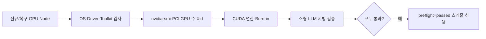

# 토스증권이 GPU-aware를 넘어 GPU-native 클러스터를 구축한 방법

> [!abstract] 한 줄 정리
> GPU를 쿠버네티스에 할당할 수 있다는 것과 실제 서비스에 안전하게 투입할 수 있다는 것은 다르다. 운영 가능한 플랫폼은 장치 내부 상태, 검증 기준, 장애 신호까지 별도의 계약으로 만들어야 한다.

> Toss Tech · 2026-09-15

## 핵심 내용

GPU가 설치된 Kubernetes 노드에서 `Node Ready=True`와 `Pod Running`만 확인하면 실제 CUDA 작업 가능 여부를 놓칠 수 있다. 토스증권은 H100 노드에서 GPU 한 장이 `nvidia-smi` 출력상 `ERR!`였지만 프로그램 종료 코드는 0으로 돌아와 기본 검증기가 정상으로 판단하는 사례를 겪었다.

*원문을 바탕으로 자체 재구성한 가로형 시스템 흐름도다.*

신규·수리 노드는 OS·커널·드라이버·CUDA 버전과 NVIDIA Container Toolkit, Device Plugin, 실제 PCI GPU 장치 수와 Kubernetes에 광고된 GPU 수를 각각 확인한다. GPU 상태에는 치명적인 Xid 코드와 VRAM 상태를 포함하고, 실제 CUDA 연산 및 GPU burn-in, 작은 LLM 서빙까지 통과한 노드만 `preflight=passed`로 라벨링하여 스케줄 대상에 포함한다.

| 점검 | 기존 맹점 | 추가 검증 |
| --- | --- | --- |
| Node Ready | kubelet 정상만 확인 | GPU 자체의 건강도 |
| nvidia-smi exit code | 오류 장치 있어도 0 반환 | ERR!/Xid·VRAM 파싱 |
| Device Plugin | 광고 GPU 수와 물리 수 차이 | PCI 수 대조 |
| CUDA Readiness | 프로세스 시작 성공 | 실제 계산·burn-in |
| 업무 검증 | 시스템 수준만 통과 | 작은 모델 서빙까지 수행 |

중요한 기준은 '도구 실행 성공'과 '실제 사용 가능'을 분리하는 것이다. 노드를 격리해야 할 오류를 감지했는데도 Ready만 믿고 GPU Job을 예약하면 워크로드가 반복 실패한다. 다양한 노드 타입·드라이버 버전에서 동일한 preflight 계약을 유지하려면 실제 장치 수와 연산 성공을 함께 검증하고 실패 시 재검사·복귀 절차를 둬야 한다.

## 왜 읽을까

인프라에서 중요한 건 자원을 '보이게 만드는 것'보다 서비스가 의존할 수 있는 상태를 정의하는 일이라는 점을 잘 보여준다. readiness를 단순 헬스체크가 아니라 운영 계약으로 설계하는 관점을 얻기 좋다.

**프로젝트에 적용 — PawCycle**

- [ ] 배포 시 `프로세스 실행 중`과 `실제 요청 처리 가능`을 구분해 readiness 기준을 정의한다.
- [ ] DB·Redis·외부 의존성이 붙는다면 단순 포트 오픈이 아니라 실제 서비스 경로가 준비됐는지 검증한다.
- [ ] 장애 대응 지표는 수집 가능한 메트릭 수보다 운영자가 답해야 하는 질문을 기준으로 선정한다.

---

**원문:** [토스증권이 GPU-aware를 넘어 GPU-native 클러스터를 구축한 방법](https://toss.tech/article/53143)
