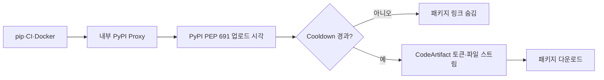

# How We Protect Karrot’s Internal PyPI Proxy from Supply Chain Attacks

> [!abstract] 한 줄 정리
> 패키지 공급망 공격을 개발자 개인 설정으로 막기보다 사내 PyPI 프록시라는 단일 진입점에서 cooldown 정책을 강제해, 보안 정책의 누락 가능성을 구조적으로 줄인 사례다.

> 당근 기술 블로그 · 2026-05-06

## 핵심 내용

내부 PyPI 프록시가 새로 업로드된 패키지를 즉시 허용하면 공급망 공격자가 올린 악성 버전이 탐지·차단되기 전 짧은 시간에 개발 PC와 CI에 설치될 수 있다. 당근은 패키지 새 버전을 일정 시간 보류하는 Cooldown을 CodeArtifact 앞 프록시에서 일관되게 집행하도록 만들었다.

*원문 근거를 가로 방향으로 자체 재구성한 학습용 도식이다.*

개발 PC·CI·Docker는 동일한 패키지 Index URL을 사용하고, 프록시는 PyPI의 PEP 691 JSON 메타데이터에서 파일 `upload-time`을 읽어 Cooldown 대상 버전의 링크를 PEP 503 HTML 결과에서 제외한다. 큰 wheel 바이너리는 8KB 단위로 스트리밍하며 CodeArtifact 토큰도 프록시가 관리한다. 토큰은 15분 유효기간으로 발급해 만료 5분 전에 ±60초 Jitter와 함께 갱신한다.

| 방어 단계 | 선택한 조건 | 위험·한계 |
| --- | --- | --- |
| Upload-time 검사 | 새 버전 일정 기간 보류 | 긴급 패치도 지연 |
| PEP 691→503 | 메타데이터 기반 링크 필터링 | Index 규격 호환성 |
| Token 갱신 | 15분 TTL, 5분 전·±60초 | 갱신 실패시 접근 중단 |
| `/health` | 실제 Token 유효 여부 | 503로 장애 감지 |
| 추가 방어 | 예외 승인·의존성 감사 | 기존 악성 버전 탐지 필요 |

`/health`는 HTTP 서버의 프로세스가 떠 있는지만 보지 않고 현재 CodeArtifact 토큰이 유효한지도 확인하고, 연속 갱신 실패 시 503으로 전환한다. 글에서 제시한 공격 10건 분석은 14일 Cooldown이면 9건을 피할 수 있었다는 과거 표본 기반의 결과이며 미래 공격을 모두 차단하는 보장은 아니다. Cooldown은 긴급 보안 패치도 늦출 수 있으므로 예외 승인과 Dependabot·취약점 감사 등 다른 방어층이 필요하다.

## 왜 읽을까

공급망 보안을 “개발자가 설정을 잘 지켜야 한다”는 규칙으로 두지 않고, 모든 패키지 요청이 지나는 경계에서 정책을 강제하는 설계가 좋다. 보안뿐 아니라 인증·관측·정책 집행에서 단일 진입점을 만드는 이유를 구체적으로 볼 수 있다.

**프로젝트에 적용 — DevPedia**

- [ ] GitHub Actions와 Docker 빌드에서 외부 의존성을 가져오는 경로와 자격증명 노출 지점을 정리한다.
- [ ] Dependabot 같은 업데이트 자동화와 dependency audit를 CI 검증에 포함할지 점검한다.
- [ ] 민감한 정책을 개발자 로컬 설정에 맡기기보다 CI나 공통 빌드 경계에서 강제할 수 있는 항목을 찾는다.

---

**원문:** [How We Protect Karrot’s Internal PyPI Proxy from Supply Chain Attacks](https://medium.com/daangn/how-we-protect-karrots-internal-pypi-proxy-from-supply-chain-attacks-0cf197205915)
