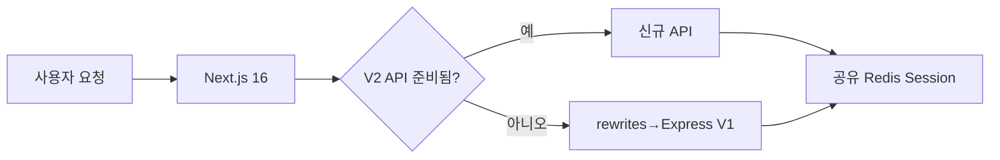

# Express SPA에서 Next.js 16으로: E2E 테스트 기반 TDD 마이그레이션

> [!abstract] 한 줄 정리
> 레거시를 점진적으로 교체할 때 새 구현부터 시작하지 않고 기존 사용자 시나리오를 E2E 테스트로 먼저 고정하면, 무엇이 그대로 동작해야 하는가를 실행 가능한 명세로 만들 수 있다.

> 스터닝 개발팀 · Medium · 2025-12-05

## 핵심 내용

Express+React SPA로 만든 계정 시스템은 API 라우팅·세션·메타태그가 한 서버에 얽혀 있었지만 여러 외부 서비스의 로그인 진입점이기도 해 한꺼번에 Next.js 16으로 교체할 위험이 컸다. 해당 팀은 새 구현을 작성하기 전에 기존 사용자가 수행하는 로그인·회원가입·비밀번호 찾기·소셜 로그인 시나리오를 E2E 테스트로 먼저 고정했다.

*원문 근거를 가로 방향으로 자체 재구성한 학습용 도식이다.*

V1 주요 기능의 E2E 커버리지를 100% 확보한 뒤 V1 Express와 V2 Next.js가 같은 Redis 세션 데이터를 읽도록 세션 호환성을 유지했다. 신규 Next.js에서 준비되지 않은 API는 rewrites로 레거시 Express에 위임하며 구현 완료된 API부터 단계적으로 교체했다. 이중 경로를 운영하면 새 구현이 실패했을 때 이전 경로로 복귀할 수 있지만, 쿠키·Session ID·만료·CSRF 정책의 호환 여부를 검증해야 한다.

| 순서 | 통과 조건 | 장애 시 복구 |
| --- | --- | --- |
| V1 E2E 선행 | 핵심 시나리오 100% 커버 | 동작 기준선 유지 |
| 세션 병행 | 동일 사용자 Redis Session 인식 | 구·신 버전 왕복 가능 |
| API 점진 이관 | V2 준비된 요청만 전환 | rewrite 경로 복귀 |
| 최종 전환 | 기능·권한·쿠키 검증 | V1 제거 전 호환 기간 확보 |

E2E는 기존 동작을 재현하는 실행 가능한 명세이므로 새 프레임워크를 도입해도 사용자 입장에서 기능이 바뀌지 않았다는 근거를 제공한다. 점진 전환 기간에 두 시스템을 함께 운영하는 비용은 증가하지만 Big Bang 변경보다 장애 범위를 제한할 수 있다. 원문은 회귀 없이 전환한 사례를 설명하되 모든 페이지에서 동일한 체감 성능 개선률을 제시하지 않는다.

## 왜 읽을까

리팩터링 전에 테스트를 보강하라는 원칙을 실제 인증 시스템 마이그레이션에 적용한 사례다. 구현 세부보다 기존 동작을 먼저 고정하고 작은 단위로 교체하는 순서가 특히 참고할 만하다.

**프로젝트에 적용 — DevPedia**

- [ ] 인증·회원 기능의 현재 API 계약을 통합 테스트로 먼저 고정한다.
- [ ] Security 설정이나 세션 전략을 바꾸기 전에 로그인·로그아웃·/me·권한 실패 시나리오를 회귀 세트로 만든다.
- [ ] 큰 인증 리팩터링은 기존 계약을 유지한 채 내부 구현만 단계적으로 바꾼다.

---

**원문:** [Express SPA에서 Next.js 16으로: E2E 테스트 기반 TDD 마이그레이션](https://medium.com/@team_stunning/express-spa%EC%97%90%EC%84%9C-next-js-16%EC%9C%BC%EB%A1%9C-e2e-%ED%85%8C%EC%8A%A4%ED%8A%B8-%EA%B8%B0%EB%B0%98-tdd-%EB%A7%88%EC%9D%B4%EA%B7%B8%EB%A0%88%EC%9D%B4%EC%85%98-0a6a10d8f01a)
