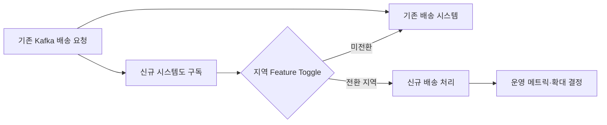

# 컬리의 새로운 배송 시스템 구축 과정과 우리가 배운점

> [!abstract] 한 줄 정리
> 대규모 시스템 교체의 핵심은 새 시스템을 한 번에 완성하는 것이 아니라, 기존 시스템과 병행하면서 작은 범위부터 검증하고 언제든 롤백할 수 있는 구조를 먼저 만드는 데 있다.

> 컬리 기술 블로그 · 2024-10-25

## 핵심 내용

기존 SaaS 배송 시스템을 자체 시스템으로 대체할 때 모든 upstream 서비스에 새 API를 동시에 적용하면 조직 전반의 협업·롤백 위험이 커진다. 컬리는 기존 Kafka 배송 요청을 새 시스템에서도 구독하게 하고 신규 시스템이 실제로 처리해야 할 요청만 선별하는 접근으로 전환 경계를 좁혔다.

*원문 근거를 가로 방향으로 자체 재구성한 학습용 도식이다.*

원래 배송 권역과 신규 배송 권역을 동일하게 유지하면서 모든 배송 데이터를 신규 저장소에도 모아 검증했다. 실제 주문은 지역 단위 Feature Toggle을 사용해 소규모 지역→센터 한 곳→센터 세 곳→50%→100%로 범위를 확대했다. 새 서비스가 정상이어도 외부 배송 연계와 라우팅 정책이 다르면 사용자 주문을 잃을 수 있으므로 기존 시스템이 맡을 지역과 신규 시스템이 맡을 지역을 명확하게 구분했다.

| 확대 단계 | 진행 범위 | 검증해야 할 사항 |
| --- | --- | --- |
| 1 | 작은 지역 | 물류 담당자의 실제 운영 |
| 2~3 | 센터 1개→3개 | 배송 권역·라우팅 일치 |
| 4 | 약 50% | 대규모 동시 운영·롤백 |
| 5 | 100% | 신규 시스템 단독 운영 |

*원문은 전환 중 배송 장애 0건을 보고하지만 이후 장기 운영의 모든 오류 부재를 의미하지 않는다.*

전환은 약 3주 만에 계획보다 3일 빨리 끝났고 기간 중 배송 불가와 장애가 0건이었다고 보고했다. 하지만 이 결과는 사전에 모든 불확실성을 제거했다는 증거가 아니다. 운영 전까지 테스트로 발견하기 어려운 조건이 많았기 때문에 다음 유사한 작업에서는 MVP를 더 일찍 운영에 투입해 실제 불확실성을 조기에 드러내겠다고 회고했다.

## 왜 읽을까

점진 전환을 기술 패턴으로만 설명하지 않고 데이터 일관성, 운영 현장, 온콜, 롤백 권한까지 함께 보여준다. 큰 리팩터링에서 새 구조가 좋은가보다 안전하게 옮길 수 있는가를 먼저 보게 해준다.

**프로젝트에 적용 — PawCycle**

- [ ] 큰 구조 변경은 기존 경로와 신규 경로를 일정 기간 병행할 수 있는지 먼저 검토한다.
- [ ] 전환 전에 롤백 조건과 외부 팀 의존 지점을 적는다.
- [ ] 단계별 트래픽 확대와 각 단계의 통과 기준을 정한다.

---

**원문:** [컬리의 새로운 배송 시스템 구축 과정과 우리가 배운점](https://helloworld.kurly.com/blog/2023-delivery-system/)
