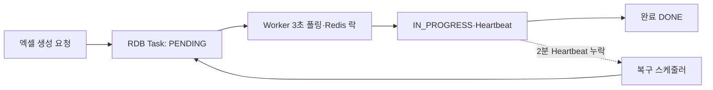

# 장시간 비동기 작업, Kafka 대신 RDB 기반 Task Queue로 해결하기

> [!abstract] 한 줄 정리
> 30분 이상 걸리는 비동기 작업에 Kafka를 계속 맞추기보다, 작업의 상태·재시도·복구가 핵심이라는 요구를 다시 정의해 RDB Task Queue + Heartbeat 구조로 단순화한 사례다.

> 우아한형제들 기술블로그 · 2025-11-25

## 핵심 내용

외부 API 호출이 포함된 엑셀 생성 시간이 10분 이내에서 30분 이상으로 늘어나자 Kafka Consumer의 `max.poll.interval.ms` 5분을 넘겼고, 리밸런스가 발생하면서 같은 작업을 다른 Consumer가 다시 받아 중복 메일을 보내는 문제가 나타났다. 단순히 비동기 실행 후 즉시 ACK하는 핫픽스는 이 중복을 줄였지만 실행 중 서버가 죽으면 완료되지 않은 작업이 유실될 수 있었다.

*원문에서 확인한 처리 경계를 가로형으로 자체 재구성한 학습용 도식이다.*

우아한형제들은 워크로드가 건수가 적지만 긴 작업이라는 점을 고려해 Kafka 대신 RDB에 Task의 `PENDING/IN_PROGRESS/DONE/FAILED`, Heartbeat, Retry Count를 영속화했다. 워커는 3초마다 실행할 작업을 폴링하고 Redis 락으로 선점한다. 실행 중에는 1분마다 Heartbeat를 갱신하며, 2분 이상 중단된 작업은 복구 스케줄러가 PENDING으로 되돌린다. 복구 스케줄러 자체는 ShedLock으로 중복 실행을 막는다.

| 요소 | 설정/상태 | 의도 |
| --- | --- | --- |
| Kafka Consumer | max.poll.interval 5분 | 장시간 작업 중 리밸런싱 문제 |
| RDB Task | 4가지 상태 | 작업 수명 영속화 |
| Worker | 3초 폴링 | 시작 지연 최대 약 3초 허용 |
| Heartbeat | 1분마다, 2분 이상 누락 시 회수 | 서버 중단 복구 |
| Retry | 최대 3회 | 실패 작업 격리 |
| ShedLock | 복구 스케줄러 단일 실행 | 중복 상태 전환 방지 |

실패 작업은 최대 3회 재시도한다. RDB 폴링으로 분당 20~30회 쿼리와 시작 지연 최대 3초가 추가되지만 작업 시간 30분에 비하면 이 비용을 수용할 수 있다고 판단했다. Heartbeat 타임아웃은 오래 걸리지만 정상 실행 중인 작업을 잘못 회수하지 않도록 배치의 실제 중단 조건과 함께 검증해야 하며 외부 메일 발송에는 멱등성 식별자가 필요하다.

## 왜 읽을까

“Kafka를 쓰고 있으니 Kafka 안에서 해결한다”가 아니라 작업 특성을 다시 정의하고 기술을 제거하는 의사결정이 좋다. 짧고 높은 처리량의 이벤트와, 수십 분 동안 상태 추적·재시도·복구가 필요한 작업은 같은 메시징 문제처럼 보여도 요구가 다르다는 점을 배울 수 있다.

**프로젝트에 적용 — PawCycle**

- [ ] 장시간 배치나 외부 API 연계 작업이 생기면 처리 시간, 상태 추적, 재시도, 배포 중 복구 요구를 먼저 표로 정의한다.
- [ ] Kafka/메시지 브로커를 도입하기 전에 RDB 작업 테이블만으로 요구를 충족할 수 있는지 비교한다.
- [ ] 중복 방지뿐 아니라 Worker가 처리 도중 죽었을 때 작업을 누가, 어떤 기준으로 다시 가져가는지 장애 시나리오로 검증한다.

---

**원문:** [장시간 비동기 작업, Kafka 대신 RDB 기반 Task Queue로 해결하기](https://techblog.woowahan.com/23625/)
