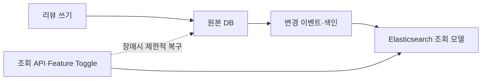

# 늘어가는 조회트래픽 Elasticsearch로 분산시키기

> [!abstract] 한 줄 정리
> 조회 트래픽과 필터·정렬 요구가 계속 늘어날 때 메인 DB에 인덱스를 더하는 방식만 고집하지 않고, Elasticsearch/OpenSearch를 조회 모델로 분리해 읽기 부하를 격리하는 설계 사례다.

> NAVER D2 · 2025-06-25

## 핵심 내용

리뷰 검색 트래픽과 조회 조건이 늘어날수록 메인 관계형 DB에 인덱스를 계속 추가하는 접근은 쓰기 비용과 운영 복잡도를 증가시킨다. NAVER 플레이스 리뷰 사례는 업무 데이터를 기록하는 정본과 검색 요구에 최적화된 조회 저장소의 책임을 분리하는 CQRS 관점에서 문제를 검토했다.

*원문에서 확인한 처리 경계를 가로형으로 자체 재구성한 학습용 도식이다.*

원본 DB에서 발생한 리뷰 생성·변경 이벤트를 조회용 Elasticsearch/OpenSearch 인덱스에 반영해 검색과 다중 필터·정렬의 부하를 별도 저장소가 처리하도록 했다. 한 번에 새 읽기 경로를 강제하지 않고 Feature Toggle로 일부 요청을 검색 저장소로 전환하면서 결과의 정합성·지연·누락을 확인한다. 조회 저장소가 장애를 일으켰을 때 원본 DB로 fallback한다면 그 순간 원본 DB에 트래픽이 급증할 수 있으므로 회복 경로에도 별도 Rate Limit이나 서킷 브레이커 정책이 필요하다.

| 경로 | 역할 | 위험 |
| --- | --- | --- |
| 원본 DB | 리뷰의 정본 쓰기·일관성 | 집중 조회 시 부하 |
| 검색 인덱스 | 다중 필터·검색 | 색인 지연·검색 스키마 관리 |
| Feature Toggle | 단계적 조회 전환 | 결과 비교·안전한 복귀 |
| Fallback | 검색 장애시 대응 | 원본 DB 과부하 위험 |

외부 검색 인덱스는 원본 DB와 동시에 트랜잭션으로 커밋되지 않으므로 최종 일관성을 허용하는 데이터와 강한 일관성을 요구하는 데이터를 구분해야 한다. 원문은 분산 조회 설계와 전환 방식을 제시하지만 모든 요청의 동일 결과 보장이나 정량적인 조회 지연 감소 수치를 확정해 제공하지 않는다.

## 왜 읽을까

DB 인덱스 최적화만으로 모든 조회 문제를 해결하려 하기보다, 읽기 요구가 커졌을 때 저장소의 책임 자체를 분리하는 판단 기준을 볼 수 있다. 특히 신규 조회 경로를 도입할 때 Feature Toggle과 fallback을 같이 설계한다는 점이 운영 관점에서 유용하다.

**프로젝트에 적용 — DevPedia**

- [ ] Recruitment 목록의 검색·필터·정렬 요구가 커질 때 우선 RDB 인덱스와 실행 계획으로 한계를 측정한다.
- [ ] 별도 검색 저장소가 실제로 필요해진다면 원본 DB와 조회 모델의 정합성 기준을 먼저 정의한다.
- [ ] 신규 조회 경로는 한 번에 전환하지 않고 Feature Toggle과 fallback을 포함해 검증한다.

---

**원문:** [늘어가는 조회트래픽 Elasticsearch로 분산시키기](https://d2.naver.com/helloworld/3675627)
