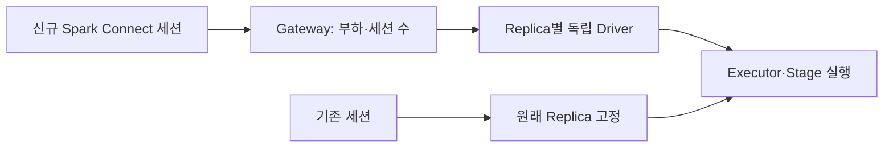

# Spark Connect on Kubernetes #1: 견고한 Spark Connect 만들기

> [!abstract] 한 줄 정리
> 여러 사용자가 하나의 long-running 서버를 공유하면 기존 기본값의 전제가 깨질 수 있다. 안정성은 장애를 없애는 것보다 한 사용자의 실패가 다른 사용자에게 번지지 않도록 실패 범위를 줄이는 데서 시작한다.

> Toss Tech · 2026-06-19

## 핵심 내용

Spark Connect는 여러 사용자의 세션이 하나의 Driver와 SparkContext를 공유하기 때문에 특정 쿼리의 Executor 오류가 전역 실패 횟수에 영향을 주면 다른 정상 세션까지 종료될 수 있다. 토스증권은 사용자 요청마다 Driver를 만드는 방식과 공유 서버를 쓰는 방식의 비용을 비교해 실패를 쿼리 단위로 최대한 격리하도록 조정했다.

*원문에서 확인한 처리 경계를 가로형으로 자체 재구성한 학습용 도식이다.*

전역 Executor 실패 한도를 완화하고 Task·Stage 단위 실패 조건으로 실패 쿼리만 중단하도록 했으며, `spark.driver.maxResultSize`로 거대한 결과가 Driver 메모리에 들어오는 문제를 사전에 거절했다. 서버 Replica마다 독립 Driver·SparkContext·Executor를 유지하면 한 Replica의 장애가 모든 사용자에게 번지는 범위도 줄어든다.

| 구분 | 기존 단일 Driver 위험 | 선택한 격리 방식 |
| --- | --- | --- |
| Executor 실패 | 여러 사용자 전역 종료 | Task/Stage별 제한 |
| 큰 조회 결과 | Driver OOM | maxResultSize 제한 |
| 단일 서버 장애 | 전체 세션 영향 | 독립 Replica 분리 |
| 기존 세션 | 재라우팅 시 상태 소실 | Session Affinity |
| Controller 장애 | Gateway 운영 연쇄 실패 | Redis를 통한 상태 전달 |

세션이 이미 시작됐으면 그 Driver에 상태가 있으므로 후속 요청은 같은 Replica로 라우팅해야 하지만 새 세션은 상대적으로 한가한 Replica로 보내야 한다. 단순 Consistent Hash 대신 실제 Task 사용률과 세션 수를 바탕으로 선택하는 Gateway를 만들었다. Kubernetes 리소스 수명은 Controller가 관리하고 Gateway는 Redis에 게시된 상태만 조회하여 Control Plane 장애가 Data Plane으로 직접 전파되는 위험을 제한한다.

## 왜 읽을까

고가용성을 단순히 Replica 수를 늘리는 문제로 보지 않는다. 기본 설정이 어떤 전제를 갖고 만들어졌는지 확인하고, 실패 격리·상태 있는 라우팅·Control/Data Plane 분리까지 이어가는 설계 과정을 볼 수 있다.

**프로젝트에 적용 — PawCycle**

- [ ] 부하 테스트에서 한 요청의 OOM·지연·외부 의존성 실패가 다른 요청까지 얼마나 전파되는지 확인한다.
- [ ] readiness와 timeout을 정상/비정상 판정뿐 아니라 장애 영향 범위를 제한하는 관점에서 검토한다.
- [ ] 운영 구조가 커지면 트래픽 처리 경로와 배포·제어 경로가 같은 장애 원인에 묶여 있지 않은지 점검한다.

---

**원문:** [Spark Connect on Kubernetes #1: 견고한 Spark Connect 만들기](https://toss.tech/article/spark-connect-on-kubernetes-1)
