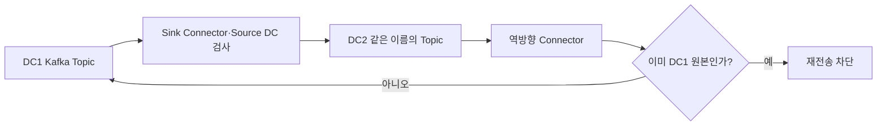

# 토스증권 Apache Kafka 데이터센터 이중화 구성 #2: 데이터 미러링

> [!abstract] 한 줄 정리
> Active-Active Kafka에서 같은 토픽 이름을 유지한 양방향 복제를 직접 구현하면서, 무한 복제 루프·메시지 유실·수천 개 잡의 운영 가시성을 함께 해결한 사례다.

> Toss Tech · 2025-01-14

## 핵심 내용

두 데이터센터에서 Kafka를 Active-Active로 운영하려면 메시지를 서로 복제하면서도 양쪽 애플리케이션이 동일한 토픽 이름을 사용할 수 있어야 한다. MirrorMaker2는 기본적으로 원본 클러스터 별칭을 토픽 이름에 붙이기 때문에 토스증권이 요구한 토픽 계약과 맞지 않았다.

*원문에서 확인한 처리 경계를 가로형으로 자체 재구성한 학습용 도식이다.*

팀은 Kafka Connect Sink Connector를 이용해 양방향으로 토픽을 미러링하고 메시지 헤더에 Source DC를 넣었다. 반대편에서 복제되어 들어온 메시지는 다시 원본으로 되돌리지 않도록 헤더를 검사해 무한 미러링 루프를 막는다. 전송 실패는 Kafka Connect DLQ에 원본 토픽·파티션·오프셋·예외와 함께 보존하고 별도 재처리 경로에서 목적지로 다시 전달하도록 했다.

| 문제 | 선택한 장치 | 남는 확인 |
| --- | --- | --- |
| 양쪽 동일 토픽명 | Sink Connector 기반 복제 | 권한·스키마 동기화 |
| 무한 루프 | Source DC 헤더 | 헤더 누락·변조 |
| 복제 실패 | DLQ·원본 오프셋 저장 | 재전송 멱등성 |
| 1,000+ 토픽 | Connect 클러스터 분할 | 배치 운영·관측 |
| 장기 지연 | ClickHouse 메트릭 | 데이터 유실·복구 구간 |

토픽당 Connector를 하나씩 두면 수백 잡의 메모리·스케줄링 부담이 커지므로 커다란 Connect 클러스터를 N개의 작은 클러스터로 분리해 장애 범위를 제한했다. 원문은 1,000개 이상의 토픽 미러링 잡을 운영하고 ClickHouse에 장기 지연 지표를 적재한다고 보고한다. Source DC 헤더는 재귀적인 재복제 방지 수단이지 글로벌 메시지 순서나 데이터센터 전환 시 Consumer Offset의 정확한 일치를 보장하지 않는다.

## 왜 읽을까

분산 시스템에서 ‘복제한다’는 기능 하나에도 중복, 루프, 유실, 재처리, 모니터링, 장애 범위가 따라온다는 걸 구체적으로 보여준다. 오픈소스를 그대로 쓰지 않은 이유도 기능 부족이 아니라 사용자에게 노출할 인터페이스와 운영 요구에서 출발한다는 점이 좋다.

**프로젝트에 적용 — PawCycle**

- [ ] 이벤트 기반 처리를 넣기 전에 중복 수신과 재처리가 안전한지 멱등성 기준을 먼저 정의한다.
- [ ] 메시지 실패 시 재시도만 하지 말고 DLQ에 어떤 식별자와 원인 정보를 남길지 정한다.
- [ ] 메시징 컴포넌트가 커질 경우 한 장애가 전체 이벤트 처리를 멈추지 않도록 격리 단위를 측정한다.

---

**원문:** [토스증권 Apache Kafka 데이터센터 이중화 구성 #2: 데이터 미러링](https://toss.tech/article/32973)
