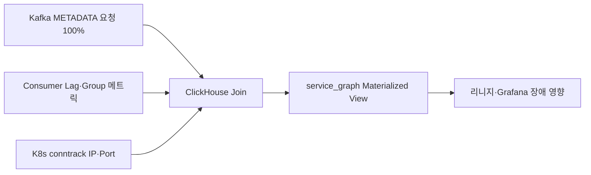

# 토스증권의 수 천개 실시간 데이터 파이프라인 운영방법 #2: MSA 환경 Observability 높이기

> [!abstract] 한 줄 정리
> 1만 개 서비스 Pod와 1천 개 Kafka Topic의 실제 연결 관계를 소스 수정 없이 관찰하기 위해, 모든 로그를 모으는 대신 구조적으로 적은 핵심 신호를 골라 다른 운영 데이터와 결합한 사례다.

> Toss Tech · 2025-09-19

## 핵심 내용

수천 개 실시간 데이터 파이프라인을 운영할 때 클라이언트가 어떤 Kafka Broker·Topic·Consumer Group에 실제 연결됐는지 알 수 없으면 장애의 영향 범위와 데이터 흐름을 찾기 어렵다. 소스에서 의존성을 추론하면 코드에 남아 있지만 실행되지 않는 관계까지 포함되고, Broker의 모든 요청을 로깅하면 초당 100만 건 이상인 운영 트래픽에 별도의 CPU·디스크 장애를 만들 수 있다.

*원문에서 확인한 처리 경계를 가로형으로 자체 재구성한 학습용 도식이다.*

토스증권은 약 30개 Kafka Broker API를 조사해 클라이언트가 기본적으로 대략 5분 간격으로 호출하는 METADATA 요청만 전수 기록했다. 최근 10분의 METADATA 로그에서 실제 Broker·Topic 연결을 추출하고 Consumer Group은 Lag 메트릭과, 실제 실행 Pod는 Kubernetes conntrack의 IP·Port 관계와 합쳐 복원했다. ClickHouse에서 세 원천을 조인하고 Materialized View로 `service_graph`를 만들었다.

| 데이터 소스 | 알려주는 사실 | 한계 |
| --- | --- | --- |
| Broker METADATA | Client↔Broker↔Topic | Producer/Consumer 세부 구분 부족 |
| Kafka Lag metric | Consumer Group·파티션 | 실제 Pod 이름 부재 |
| K8s conntrack | IP·Port↔Pod | 애플리케이션 의미 부재 |
| ClickHouse MV | 조인된 서비스 그래프 | 데이터 갱신 시점 불일치 주의 |

전체 요청의 0.1%만 로깅하면 Broker 안전성은 확보하기 쉬워도 접속 관계를 100% 발견한다는 요구를 보장할 수 없다. 반대로 METADATA API만 전수 수집하면 모든 클라이언트가 실제로 반복 호출한다는 프로토콜 동작에 의존해 비용과 커버리지를 함께 맞출 수 있다. 세 원천 데이터가 서로 다른 시간에 갱신되므로 조회 시점·만료 기준을 명시해야 잘못된 연결을 오래 남기지 않는다.

## 왜 읽을까

Observability를 ‘로그를 많이 남기는 것’으로 보지 않고, 필요한 질문에 답할 수 있는 최소 신호를 고르는 문제로 접근한다. 계측 자체가 운영 시스템을 망가뜨릴 수 있다는 점과 여러 불완전한 데이터 소스를 조합해 의미 있는 운영 모델을 만드는 과정도 좋다.

**프로젝트에 적용 — PawCycle**

- [ ] 운영 지표를 추가할 때 먼저 ‘장애 때 어떤 질문에 답하려는가’를 적고 필요한 최소 로그·메트릭만 정의한다.
- [ ] 관측을 위해 추가한 로그가 애플리케이션 CPU·디스크·응답시간에 주는 비용도 부하 테스트에 포함한다.
- [ ] 서비스·DB·Redis·외부 API 관계를 추적할 공통 식별자와 대시보드 구조를 미리 정리한다.

---

**원문:** [토스증권의 수 천개 실시간 데이터 파이프라인 운영방법 #2: MSA 환경 Observability 높이기](https://toss.tech/article/40783)
