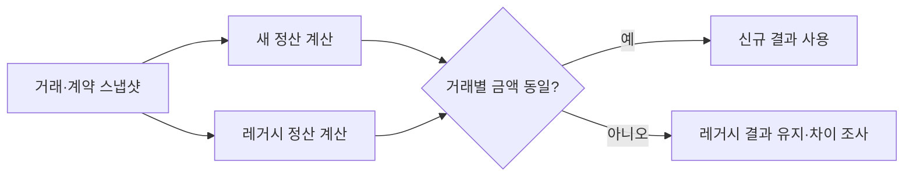

# 레거시 정산 개편기: 신규 시스템 투입 여정부터 대규모 배치 운영 노하우까지

> [!abstract] 한 줄 정리
> 20년 넘은 정산 시스템을 한 번에 다시 쓰지 않고, 거대한 SQL을 도메인 단위로 분해하고 거래 단위 데이터·재처리 상태·카나리 검증을 도입해 점진적으로 교체한 사례다. 레거시 전환에서는 새 구조뿐 아니라 과거와 같은 결과를 낸다는 증거와 되돌릴 수 있는 투입 단위가 중요하다.

> Toss Tech · 2025-12-11

## 핵심 내용

레거시 정산 로직이 복잡한 SQL의 CASE·DECODE·JOIN으로 얽혀 있으면 새로운 정산 유형을 추가할 때 어디까지 결과가 바뀌는지 검증하기 어렵다. 집계된 최종 금액만 저장하는 시스템은 장애가 났을 때 어떤 거래가 잘못 계산됐는지 추적하기도 힘들다.

*원문을 바탕으로 자체 재구성한 가로형 처리 경계 도식이다.*

토스는 정산 조건을 도메인과 세부 기능으로 분리하고 거래별 계산 결과와 계약·수수료 설정의 스냅샷을 함께 저장했다. 배치 계산 이전에 필요한 설정을 캐시로 채우고 건별 SQL을 청크 단위 Bulk 조회 및 JDBC Batch Insert로 바꿨다. Multi-threaded Step은 특정 거래가 중복 계산되는 위험이 있어 모듈러 연산 등으로 처리 범위를 미리 분할해 작업자 간 경합을 줄였다.

| 검증 항목 | 이전 문제 | 변경 후 계약 |
| --- | --- | --- |
| 계산 책임 | 거대 SQL에 혼합 | 도메인·기능별 규칙 모듈 |
| 장애 추적 | 집계 금액만 저장 | 거래별 결과·설정 스냅샷 |
| 배치 I/O | 개별 반복 쿼리 | 설정 캐싱·Bulk·Batch Insert |
| 병렬 처리 | 중복/누락 우려 | 거래 분할 규칙 적용 |
| 운영 전환 | 일괄 전환 위험 | 병행 계산·불일치 시 이전 결과 유지 |

수천 계산 유형과 수십 설정 조합에서 만들어진 수만 개 케이스를 테스트 API로 실행하면서 실제 배치와 같은 코어 계산 모듈을 사용해 다른 로직을 검증하는 오류를 피했다. 운영 전환에서도 레거시와 신규 결과를 동시에 계산해 일치할 때만 새 결과를 사용하고 불일치하면 레거시를 유지하는 카나리 구조를 택했다. 신규 결과의 빠른 처리보다 정산금 정확성과 역추적 가능한 거래 이력이 우선이라는 선택이다.

## 왜 읽을까

리팩터링을 코드 정리로 끝내지 않고 데이터 모델, 배치 성능, 테스트, 실제 투입 전략까지 하나의 전환 문제로 보는 글이다. 특히 정산처럼 결과 오류 비용이 큰 시스템에서 무엇을 근거로 신규 시스템을 신뢰할 수 있는지 볼 수 있다.

**프로젝트에 적용 — PawCycle**

- [ ] 주문·정산성 로직을 바꿀 때 기존/신규 계산 결과를 같은 입력으로 비교하는 회귀 검증을 만든다.
- [ ] 대량 처리 경로에서 건별 Repository/API I/O가 있는지 측정하고 Bulk 조회 가능성을 확인한다.
- [ ] 큰 구조 변경은 사용자·주문 유형 등 되돌릴 수 있는 작은 투입 단위를 먼저 정의한다.

---

**원문:** [레거시 정산 개편기: 신규 시스템 투입 여정부터 대규모 배치 운영 노하우까지](https://toss.tech/article/42671)
