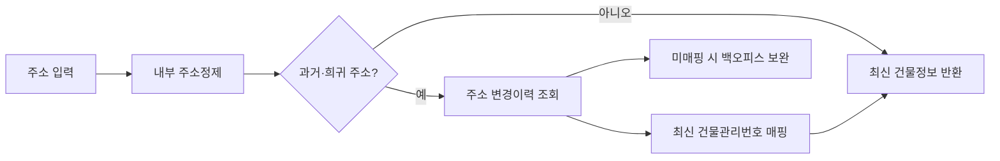

# 주소정제 서비스 내재화 - 마지막 화 ( 엔드 게임 )

> [!abstract] 한 줄 정리
> 외부 주소정제 API 의존을 약 1년에 걸쳐 단계적으로 걷어내면서 희귀 예외를 무리하게 일반화하지 않고, 데이터·변경이력·운영 도구를 보강해 최종 계약 종료까지 간 사례다. 100% 자동화보다 문제 비중과 비용을 보고 포기할 케이스를 명시하는 판단도 중요하다.

> 컬리 기술 블로그 · 2025-01-20

## 핵심 내용

주소정제 서비스를 외부 업체에서 내부 로직으로 이관할 때 단독·복합 건물 주소 대부분을 내재화했어도 소수의 과거 지번·LOW 수준 주소는 남았다. 컬리는 남은 호출이 일 평균 20건도 되지 않는다는 사실을 근거로 별도 지번 DB를 새로 만들지 않고 정부 도로명주소 API를 제한적으로 사용하는 방안을 선택했다.

*원문을 바탕으로 자체 재구성한 가로형 처리 경계 도식이다.*

건물·행정구역이 변경되면 과거 주소와 최신 건물 관리번호 사이에 연결이 끊어질 수 있으므로 OMS의 건물 정보를 갱신할 때 변경 전 값을 이력 DB에 함께 남겼다. 과거 주소 조회가 들어오면 이력을 따라 현재 건물 관리번호를 찾고, 자동으로 연결되지 않는 사례는 백오피스에서 사람이 보완했다. 흔하지 않은 예외를 위한 거대한 자동화 계층보다 이력의 추적 가능성을 확보하는 것이 합리적이었다.

| 남은 문제 | 대응 | 운영 근거 |
| --- | --- | --- |
| 외부 호출량 1% 미만 | 내재화 계속 | 전체 계약 종료 가능성 |
| 일 20건 미만 지번 | 정부 API 제한 사용 | 새 전용 DB의 운영비 불필요 |
| 과거 주소 | 건물 변경 이력 DB | 과거→최신 ID 복원 |
| 희귀 자동 정제 실패 | 백오피스 수동 보완 | 3개월간 하루 1~2건 수준 |
| 계약 종료 | 최종 배포 후 2개월 관측 | 외부 호출 0 상태 확인 |

약 3개월 동안 하루 1~2건 수준의 수작업 예외를 처리한 뒤 발생량이 거의 사라졌다. 최종 변경은 외부 계약 종료 약 두 달 전에 배포해 8월에 남은 호출을 점검하고 9월에 실제 외부 인터페이스를 제거한 상태로 안정성을 확인했다. 기술적 구현 완료와 외부 계약 종료는 다른 게이트이므로 호출량·예외 건수·롤백 경로를 확인하고 순서대로 해지해야 한다.

## 왜 읽을까

내재화 프로젝트를 단순 비용 절감으로 보지 않고 데이터 품질, 예외 정책, 운영 도구, 점진적 제거까지 다룬다. 회고에서 초기에 건물 DB와 지도 기반 도구를 더 빨리 만들었어야 했고, 규칙 없는 희귀 케이스를 모두 잡으려다 로직이 복잡해졌다는 실패도 공개해 설계 판단에 도움이 된다.

**프로젝트에 적용 — DevPedia**

- [ ] 외부 서비스나 복잡한 보조 로직을 대체할 때 성공률뿐 아니라 남은 실패 케이스의 빈도와 처리 비용을 따로 측정한다.
- [ ] 드문 예외를 핵심 도메인 로직에 계속 추가하기보다 운영 도구나 수동 처리로 분리할 수 있는지 판단한다.
- [ ] 교체 전 일정 기간 기존 경로를 보험으로 유지하면서 신규 경로의 결과와 실패 유형을 관찰한다.

---

**원문:** [주소정제 서비스 내재화 - 마지막 화 ( 엔드 게임 )](https://helloworld.kurly.com/blog/refine-address-internalization-6/)
