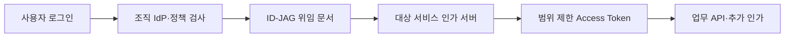

# AI 시대에 인증 과제를 해결할 차세대 표준 후보, ID-JAG

> [!abstract] 한 줄 정리
> AI 에이전트가 여러 서비스의 API를 대신 호출할수록 장기 API 키와 개별 OAuth 연결은 관리하기 어려워진다. ID-JAG는 기존 SSO의 신뢰를 API 위임으로 확장해 ‘누가 누구를 대신해 어느 범위까지 접근하는가’를 중앙 정책과 검증 가능한 토큰으로 다루려는 접근이다.

> LY Corporation Tech Blog · 2026-04-30

## 핵심 내용

에이전트가 사내 서비스의 API를 대신 호출하기 시작하면 기존 사용자 로그인만으로는 누가 어떤 데이터에 접근했는지 설명하기 어렵다. 서비스마다 API Key·리프레시 토큰·서비스 계정을 별도로 발급하면 위임 범위를 중앙에서 감사하거나 즉시 축소하기도 어려워진다. LY는 IETF 초안인 ID-JAG를 이러한 위임의 명시적 계약 후보로 검토했다.

*원문을 바탕으로 자체 재구성한 가로형 처리 경계 도식이다.*

사용자가 IdP에 로그인하면 정책 검사 뒤 원 사용자(`sub`), 대리 클라이언트(`client_id`), 수신 대상(`aud`), 요청 범위(`scp`) 등을 담은 ID-JAG를 발급한다. 대상 서비스의 인가 서버는 이를 자기 서비스가 수용할 수 있는 최종 Access Token으로 교환하고 API는 그 토큰을 검증한다. '인증된 사용자'라는 사실과 '이 에이전트에게 특정 데이터 조회를 위임했다'는 사실을 분리한 구조다.

| 필드/책임 | 담는 정보 | 보안상 판단 |
| --- | --- | --- |
| `sub` | 원 사용자 | 누가 위임했는가 |
| `client_id` | 대리 에이전트 | 누가 대신 행동하는가 |
| `aud` | 대상 수신자 | 다른 서비스로 토큰 전용 방지 |
| `scp` | 권한 범위 | 최소 권한·역할 제한 |
| 인가 서버 교환 | 최종 Access Token | 도메인별 정책 재검증 |

ID-JAG는 아직 인터넷 표준 초안으로 최종 사양이 변경될 수 있다. 특히 JWT 형태의 위임 문서는 발급 즉시 중앙에서 폐기하기 어렵기 때문에 짧은 만료, 범위 제한, 감사 로그와 교환 지점의 재검증을 함께 설계해야 한다. 기업 IdP가 최종 대상 API의 권한까지 직접 결정하지 않는다는 책임 경계도 중요하다.

## 왜 읽을까

Spring Security에서 로그인·세션·JWT 사용법을 넘어 인증과 인가, 위임된 권한, 토큰 수명과 감사라는 경계를 생각하기 좋은 글이다. 특히 AI 에이전트에게 ‘사용자의 모든 권한’을 그대로 주는 것이 왜 위험한지 구조적으로 이해할 수 있다.

**프로젝트에 적용 — DevPedia**

- [ ] 현재 세션 인증에서도 ‘누구인가’와 ‘무엇을 할 수 있는가’를 분리해 권한 검증 지점을 명확히 한다.
- [ ] 향후 AI 에이전트나 외부 연동이 생기면 장기 API 키보다 짧은 수명의 최소 권한 위임 방식을 우선 검토한다.
- [ ] 인증·인가 이벤트에 사용자, 호출 주체, 대상 리소스, 권한 범위를 추적 가능한 형태로 남기는 기준을 설계한다.

---

**원문:** [AI 시대에 인증 과제를 해결할 차세대 표준 후보, ID-JAG](https://techblog.lycorp.co.jp/ko/id-jag-next-generation-authentication-ai-era)
