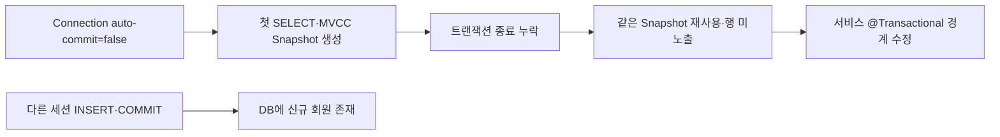

# 데이터가 있었는데요, 아니 없어요

> [!abstract] 한 줄 정리
> `autocommit=false`, REPEATABLE READ, OSIV가 겹치면 읽기 트랜잭션 경계가 예상과 달라져 오래된 MVCC 스냅샷을 계속 볼 수 있다. Spring 설정 하나를 바꿀 때 JDBC·Connection Pool·DB 격리 수준까지 함께 봐야 하는 사례다.

> 컬리 기술 블로그 · 2024-06-13

## 핵심 내용

회원 데이터가 Master에서 INSERT되어 Replica에서도 보이는데 Master의 다른 세션에서는 일시적으로 조회되지 않는 현상은 단순한 복제 지연으로 설명되지 않는다. 컬리는 Aurora MySQL 5.7의 REPEATABLE READ, HikariCP `auto-commit=false`, JPA OSIV=true 조합에서 트랜잭션 시작·종료 경계가 의도와 달라진 것을 추적했다.



*원문을 근거로 자체 재구성한 가로형 학습 도식이다.*

Repository 조회가 사용자 정의 메서드에 의해 실행되고 바깥 서비스에는 `@Transactional`이 없으면 같은 요청의 Connection에서 오래된 일관된 읽기 뷰를 유지할 수 있다. REPEATABLE READ에서 첫 consistent read의 MVCC 스냅샷이 끝나지 않은 트랜잭션 안에 남으면 나중에 INSERT된 데이터가 다른 세션에는 보여도 해당 요청에서는 보이지 않는다. `auto-commit=false`는 커넥션을 반환한다고 자동으로 의미 있는 트랜잭션 종료가 처리된다는 보장을 주지 않는다.

```java
// 조회 시 트랜잭션 경계를 명확히 하는 예시
@Transactional(readOnly = true)
public Membership findMember(long memberNo) {
    return memberRepository.findByMemberNo(memberNo)
        .orElseThrow();
}
```

`readOnly=true`만으로 모든 DB의 격리 동작이 같아지는 것은 아니므로 사용하는 트랜잭션 관리자·OSIV·드라이버 설정도 검증해야 한다.

READ COMMITTED나 Locking Read로 우회하는 방법은 기존 트랜잭션의 일관성과 락 경합에 영향을 주므로 채택하지 않았다. 바깥 서비스 메서드에 `@Transactional(readOnly=true)`를 선언해 트랜잭션 종료 경계를 명시하도록 바꾸었다. 기존에 `auto-commit=false`로 불필요한 set autocommit 호출을 줄여 API 응답이 1.5ms, 약 40% 빨라졌다는 개선과 이번 스냅샷 문제는 함께 기록하되 **성능 최적화가 정합성 의미를 바꿀 수 있다는 위험**을 구분해야 한다.

## 왜 읽을까

Spring의 `@Transactional`을 단순 애너테이션으로 외우지 않고, MVCC Snapshot과 JDBC Connection 생명주기까지 연결해 볼 수 있다. 성능 최적화 설정이 정합성 문제로 되돌아올 수 있다는 점도 좋은 운영 사례다.

**프로젝트에 적용 — DevPedia**

- [ ] 세션 인증·회원 조회 경로에서 서비스 계층의 트랜잭션 경계를 명시적으로 확인한다.
- [ ] Hikari `autoCommit`, OSIV, DB 격리 수준을 함께 기록하고 기본값을 바꿀 때 회귀 테스트를 둔다.
- [ ] 동시 세션에서 `INSERT → COMMIT → 다른 Connection SELECT`가 최신 데이터를 보는지 통합 테스트로 검증한다.

---

**원문:** [데이터가 있었는데요, 아니 없어요](https://helloworld.kurly.com/blog/commit-mvcc-set-autocommit/)
