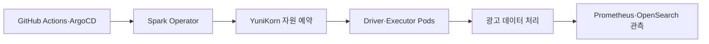

# LINE 서비스의 대규모 광고 데이터를 처리하기 위한 Spark on Kubernetes 적용기

> [!abstract] 한 줄 정리
> 스토리지와 컴퓨팅이 결합된 YARN의 자원 경합을 분리하기 위해 Spark 실행 환경을 Kubernetes로 옮겼고, 자원 격리와 독립적인 실행 환경을 확보하면서 처리량과 비용을 함께 개선했다.

> LY Corporation Tech Blog

## 핵심 내용

LINE 광고 데이터는 하루 수십억 건 이상이고 초당 수십만 건의 이벤트가 들어온다. 주요 테이블 규모가 2022년 대비 2025년 약 2.91배 커지는 동안 기존 YARN 환경에서는 HDFS 저장과 Spark 실행이 동일한 노드 자원을 경쟁하는 문제가 발생했다.

*원문을 근거로 자체 재구성한 가로형 학습 도식이다.*

Spark Driver와 Executor를 Kubernetes Pod로 실행하고 Spark Operator로 배포 수명주기를 관리했다. YuniKorn의 gang scheduling은 실행에 필요한 자원이 모두 준비되기 전까지 잡을 기다리게 하여 일부 Executor만 기동된 상태의 교착과 낭비를 줄인다. GitHub Actions와 ArgoCD는 버전/배포를, Prometheus·OpenSearch는 실행 상태와 로그를 관찰하는 역할로 분리했다.

| 평가 조건 | YARN | Kubernetes |
| --- | ---: | ---: |
| 스트리밍 코어 | 200 | 100 |
| 이벤트 처리량 | 약 200K events/s | 약 653K events/s |
| 메모리 오버헤드 기본 설정 | 0.1에서 시작 | 0.2 이상으로 보정 |
| 연간 컴퓨팅 비용 | 기준 | 40% 이상 절감 |

*자원 분리·Spark 설정·스케줄러를 함께 변경한 결과이며 K8s라는 플랫폼 이름만의 효과로 환원할 수 없다.*

전환 초기에 Pod가 OOM으로 종료된 원인을 Heap만으로 설명하기 어려웠다. Parquet·Netty 등의 off-heap 사용량과 Kubernetes 오버헤드를 고려해 `spark.executor.memoryOverhead`의 비율을 0.1에서 0.2 이상으로 조정했다. 스트리밍 비교에서 YARN은 200코어로 200K events/s, K8s는 100코어로 653K events/s를 처리했고 컴퓨팅 비용을 연간 40% 이상 줄였지만 같은 작업·설정 범위에서 측정한 수치만 비교해야 한다.

## 왜 읽을까

Kubernetes 전환을 유행이나 추상적 확장성으로 설명하지 않고 기존 자원 경합을 측정 가능한 문제로 정의하고, 전환 후 새로 생긴 OOM·스토리지 실패까지 다룬다. 아키텍처 변경의 이득과 새 책임을 같이 볼 수 있다.

**프로젝트에 적용 — PawCycle**

- [ ] 부하 테스트에서 애플리케이션 CPU뿐 아니라 DB·스토리지·다른 워크로드와의 자원 경합을 같은 시간축으로 관찰한다.
- [ ] 컨테이너 메모리를 JVM heap과 동일시하지 않고 off-heap·런타임 오버헤드까지 포함해 한도를 검증한다.
- [ ] 최적화 전후에는 처리량과 비용뿐 아니라 장애 시 복구 동작도 함께 기록한다.

---

**원문:** [LINE 서비스의 대규모 광고 데이터를 처리하기 위한 Spark on Kubernetes 적용기](https://techblog.lycorp.co.jp/ko/processing-large-scale-data-with-spark-on-kubernetes)
